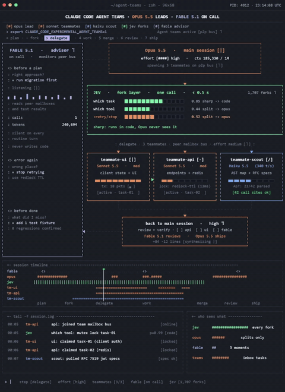
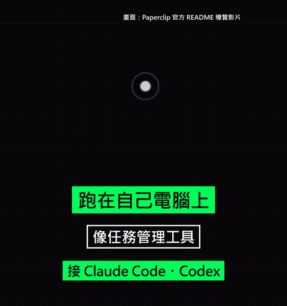

# Agent 系統與編排

中文 | [English](../en/docs/agent-orchestration.md)

[回首頁](../README.md)

多 agent 指揮、swarm、中斷續跑、商用 agent OS 與 agent 平台全景

### [Orca](https://github.com/stablyai/orca)

在同一個工作台集中指揮多個 coding agent

| 可信度 | 星數 | 出處 |
| --- | --- | --- |
| — | 110,828 | [影片 1](https://www.facebook.com/reel/2050168028979180) |

集中指揮多個 coding agent（Claude Code、Codex 等）的工作台

### [Ruflo](https://github.com/ruvnet/ruflo)

部署與協調多 agent swarm 的編排框架

| 可信度 | 星數 | 出處 |
| --- | --- | --- |
| — | 80,250 | [影片 1](https://www.facebook.com/reel/2050168028979180) |

部署多 agent swarm、協調自動化流程的框架

### [Reason Network](https://github.com/reason-machines/reason-network)

用加密 P2P 讓團隊看見彼此 agent 的進度

| 可信度 | 星數 | 出處 |
| --- | --- | --- |
| — | 1,336 | [影片 1](https://www.facebook.com/reel/2050168028979180) |

用加密 P2P 串起團隊的 agent，看得到各自在哪個 repo、分支做什麼

### [durable-harness](https://github.com/vercel-labs/durable-harness)

讓 agent 中斷後能從原處接著跑

| 可信度 | 星數 | 出處 |
| --- | --- | --- |
| — | 274 | [影片 1](https://www.facebook.com/reel/2050168028979180) |

讓 agent 中斷後能從原處接著跑（Vercel）

### [ZOEY OS](https://zoeyos.com/)

由總指揮 agent 分派 worker 的商用 agent 系統

| 可信度 | 星數 | 出處 |
| --- | --- | --- |
| 商用・無 repo | — | 截圖（ZOEY OS） |

商用多 agent 作業系統：跟總指揮 Zoey 一直對話，她自己建立專職 worker 分工；宣稱 5 層記憶、知識庫、1,000+ 整合、能操作你已登入的瀏覽器；沒有公開 repo

### Agentic AI 實作速查心智圖

一張圖看完 Agentic AI 平台的各個元件

| 可信度 | 星數 | 出處 |
| --- | --- | --- |
| AI 生成圖 | — | 截圖（Joyatres Technology） |

Joyatres Technology 整理的 agent 平台全景：記憶（長期／情節／語意／程序）、Human-in-the-loop（核准閘門、中斷與恢復）、工具與協定（MCP、A2A、function calling、電腦／瀏覽器操作）、Agentic RAG（查詢路由、Corrective RAG）、建構堆疊、LLMOps 與安全（LangSmith、DeepEval、NeMo Guardrails、最小權限）、廠商 SDK（Google ADK、MS Agent Framework、AWS Strands）。圖本身明顯是 AI 生成（Longle-Source、Correvlic、Kubenates、Roundation Modies 等亂碼），當檢查清單用就好，細節別照抄。面試：可拿 Evaluation、Guardrails、Observability、Approval Gates 四塊當 agent 平台品質控管的骨架

### [chief-night-01：Viktor 一夜開發 25 家牙醫診所](https://viktor.com/) ⚠️

AI 員工一夜找出 25 家潛在客戶，寄信前等人核准

| 可信度 | 星數 | 出處 |
| --- | --- | --- |
| ⚠️ 推薦碼引流 | — | 截圖（DeepRepo.ai） |

出自 @Argona0x 的推文（ARGONA 浮水印）：在 Viktor（ZETA AI 的 Slack／Teams AI 員工，跑 Opus 5.5）下目標「每月找 5 萬美元新生意、只用公開資料、沒我同意不聯絡任何人」，一夜拆成 4 個排程工作，從 Google Maps 撈 Austin 240 家牙醫、去掉連鎖剩 25 家，每家附觀察與出處，寫好開場信但 0 封寄出，報價單價格留白由人填。屬推薦碼（ARGONA100）導流，但流程設計值得學。面試：證據連結的主張、claim.check 標記 invented 0、price_gate 缺值就 STOP＋ASK、your_call 由人核准才寄送

### [Claude Code Agent Teams：多 agent 組隊協作](https://www.facebook.com/reel/1864411088067060)

Claude Code 讓多個 agent 組隊、共用任務清單、互相傳訊協作

| 可信度 | 星數 | 出處 |
| --- | --- | --- |
| 概念介面 | — | [影片 24](https://www.facebook.com/reel/1864411088067060) |

Lập Trình Web AI（越南語文案）介紹 Claude Code 的實驗功能 Agent Teams，官方文件確認存在：https://code.claude.com/docs/en/agent-teams 。用 `CLAUDE_CODE_EXPERIMENTAL_AGENT_TEAMS=1` 開啟（環境變數或 settings.json）：一個 team lead 負責拆解、分派與彙整，每個 teammate 各有獨立上下文、可以直接互相傳訊，並從共用任務清單自己認領工作。跟 subagent 的差別：subagent 只把結果回報給主 agent，team 成員彼此協調。文案與官方文件都提醒：相依任務多或改同一檔案容易衝突，token 用量也明顯更高，這類工作用單一 session 或 subagent 較好；teams 需要互動式 session，`-p` 與 Agent SDK 不會產生 teammate。影片本身是概念儀表板動畫，不是真實錄屏：lead（Opus 5.5）把 epic 拆成 3 個任務，dev／api／scout 透過 mailbox bus 認領，api 測試因 lock race 失敗兩次、改用 Redlock TTL 修好，review agent（標為 Fable 5.1）抓到 4 個安全回歸並擋下出貨，lead 看過 git diff 後 commit、開 PR #184。配樂：未確認（未分析音軌）。面試：多 agent 的價值來自共用任務清單＋隔離上下文＋審查關卡＋人工核准，而不是 agent 數量；避免多個 agent 同時改同一檔案

等寬字 TUI 風格儀表板：多個 agent 面板進度條推進、狀態數字更新、底部時間軸與 log 滾動；可用 CSS grid + monospace + setInterval 更新進度條重現

### [Paperclip：把 AI agent 當一家公司來管](https://github.com/paperclipai/paperclip)

用組織圖、工單、預算與核准關卡，管理一整個 AI agent 團隊

| 可信度 | 星數 | 出處 |
| --- | --- | --- |
| 可信度高・模擬示範資料 | 109.2k | [影片 33](https://www.facebook.com/reel/1785583925890920) |

開源平台，把多個 AI agent 組成一家公司：組織圖 CEO→CMO／CTO→ClaudeCoder／CodexCoder；工作以工單（PAP-xxx）派發，agent 在留言回報；儀表板顯示進行中任務、當月花費、待核准項目。agent 靠 heartbeat（有任務或排程）喚醒，不是一直開著；可依公司、agent、專案設花費上限，接近時警告、到限自動暫停；新增 agent 要你核准，也能暫停、改派或停掉 agent；共用 skill 有版本紀錄可回滾；一個部署可跑多家互相隔離的公司，組織可匯出／匯入。支援 Claude Code、Codex、Cursor、Gemini CLI、OpenClaw，每個 agent 可用不同模型。安裝：`npx` 一行啟動、不用註冊，需 Node 24+。README 注意事項：聊天／Email 連接器仍是實驗功能；預設開啟匿名遙測，可用環境變數關掉。MIT，2026-03-02 建立，官網 https://paperclip.ing 。影片（小礦工挖挖礦，AI 配音）用的是 README 的官方導覽影片；更正：0:26 打開的工單寫明這個 live demo 沒有資料庫，agent 是「pretending to do work」，是「a mock replay of a busy organization」，所以畫面是真的產品介面，但跑的是模擬示範資料、不是真實工作量；repo 本身可信度仍高。配樂：電子 lo-fi（音量小），壓在 AI 配音底下。GIF 片段：0:14–0:25。面試（主任工程師 AI 團隊管理重點）：治理 AI 團隊靠預算護欄、核准關卡、彙報線、heartbeat 排程，以及 skill 的稽核與回滾，和管人的團隊一樣要有權責與成本控管

Paperclip 暗色 SaaS 介面導覽：代理儀表板（統計卡片＋Issues by Priority/Status 長條圖）→ Issue 清單（IN PROGRESS / BLOCKED 分組）→ CEO→CTO→工程師 組織圖節點卡片與連線，游標移動點選；可用 CSS grid 卡片 + 小型長條圖 + SVG 樹狀連線重現（已裁掉底部字幕，畫面中央綠色大字幕疊在 UI 上無法裁除）

### [Cindy：開源 AI Agent 外殼（整合 Claude Code、Codex、Pi，跨電腦與手機接力）](https://github.com/makecindy/cindy) ⚠️

不是新模型，而是把你已有的 Claude Code、Codex 或 Pi 包進同一個桌面／手機 App，讓工作在不同裝置間接力

| 可信度 | 星數 | 出處 |
| --- | --- | --- |
| ⚠️ 引流・可信度中 | 8.9k | [影片 42](https://www.facebook.com/watch/?v=2575196886290079) ⚠️ |

GitHunt 上傳的 28 秒影片，只有捲動 README 加英文 AI 語音，沒有實機示範；片尾要人留言「AGENT」拿連結。標題說是「免費的 Claude Code 替代品」，但 README 寫的是 harness：選 Claude Code、Codex 或 Pi（開源、可接多家模型）其一來跑，還是要用你自己的訂閱、API key 或本機模型。功能：筆電／桌機／手機串起來（手機可遠端桌面）、automations 排程例行工作、透過 Slack、Telegram 交辦，可裝外掛。程式在 apps/desktop（Electron）和 apps/mobile（Expo／React Native）。Apache-2.0，2026-07-22 建立，最後推送 2026-11-01。可信度：中，repo 是真的，但「替代 Claude Code」說法誤導；README 的 CI 徽章 2026-11-01 查看時顯示 failing（最近幾次 main 執行被取消）；官方發行版預設含 TapDB 使用分析並綁帳號 ID，可在設定關閉。配樂：無。無 GIF 片段（只是捲動 README）。面試：評估 agent 工具先分清「模型」和「外殼」，外殼的價值在工作流、權限與跨裝置交接，品質仍取決於底下的模型；導入前也要查遙測與資料流向
