# Agent 系統與編排

中文 | [English](../en/docs/agent-orchestration.md)

[回首頁](../README.md)

多 agent 指揮、swarm、中斷續跑、商用 agent OS 與 agent 平台全景

### [Orca](https://github.com/stablyai/orca)

在同一個工作台集中指揮多個 coding agent

| 可信度 | 星數 | 出處 |
| --- | --- | --- |
| — | 110,828 | [影片 1](https://www.facebook.com/reel/2050168028979180) |

集中指揮多個 coding agent（Claude Code、Codex 等）的工作台

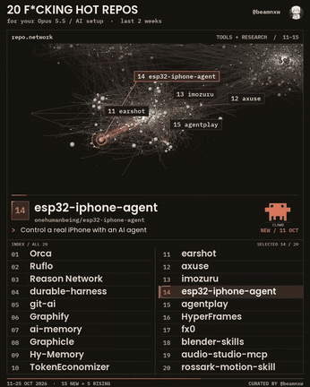

GIF：影片 1，星點雲狀節點圖介面。

### [Ruflo](https://github.com/ruvnet/ruflo)

部署與協調多 agent swarm 的編排框架

| 可信度 | 星數 | 出處 |
| --- | --- | --- |
| — | 80,250 | [影片 1](https://www.facebook.com/reel/2050168028979180) |

部署多 agent swarm、協調自動化流程的框架

### [Reason Network](https://github.com/reason-machines/reason-network)

用加密 P2P 讓團隊看見彼此 agent 的進度

| 可信度 | 星數 | 出處 |
| --- | --- | --- |
| — | 1,336 | [影片 1](https://www.facebook.com/reel/2050168028979180) |

用加密 P2P 串起團隊的 agent，看得到各自在哪個 repo、分支做什麼

### [durable-harness](https://github.com/vercel-labs/durable-harness)

讓 agent 中斷後能從原處接著跑

| 可信度 | 星數 | 出處 |
| --- | --- | --- |
| — | 274 | [影片 1](https://www.facebook.com/reel/2050168028979180) |

讓 agent 中斷後能從原處接著跑（Vercel）

### [ZOEY OS](https://zoeyos.com/)

由總指揮 agent 分派 worker 的商用 agent 系統

| 可信度 | 星數 | 出處 |
| --- | --- | --- |
| 商用・無 repo | — | 截圖（ZOEY OS） |

商用多 agent 作業系統：跟總指揮 Zoey 一直對話，她自己建立專職 worker 分工；宣稱 5 層記憶、知識庫、1,000+ 整合、能操作你已登入的瀏覽器；沒有公開 repo

### Agentic AI 實作速查心智圖

一張圖看完 Agentic AI 平台的各個元件

| 可信度 | 星數 | 出處 |
| --- | --- | --- |
| AI 生成圖 | — | 截圖（Joyatres Technology） |

Joyatres Technology 整理的 agent 平台全景：記憶（長期／情節／語意／程序）、Human-in-the-loop（核准閘門、中斷與恢復）、工具與協定（MCP、A2A、function calling、電腦／瀏覽器操作）、Agentic RAG（查詢路由、Corrective RAG）、建構堆疊、LLMOps 與安全（LangSmith、DeepEval、NeMo Guardrails、最小權限）、廠商 SDK（Google ADK、MS Agent Framework、AWS Strands）。圖本身明顯是 AI 生成（Longle-Source、Correvlic、Kubenates、Roundation Modies 等亂碼），當檢查清單用就好，細節別照抄。

### [chief-night-01：Viktor 一夜開發 25 家牙醫診所](https://viktor.com/) ⚠️

AI 員工一夜找出 25 家潛在客戶，寄信前等人核准

| 可信度 | 星數 | 出處 |
| --- | --- | --- |
| ⚠️ 推薦碼引流 | — | 截圖（DeepRepo.ai） |

出自 @Argona0x 的推文（ARGONA 浮水印）：在 Viktor（ZETA AI 的 Slack／Teams AI 員工，跑 Opus 5.5）下目標「每月找 5 萬美元新生意、只用公開資料、沒我同意不聯絡任何人」，一夜拆成 4 個排程工作，從 Google Maps 撈 Austin 240 家牙醫、去掉連鎖剩 25 家，每家附觀察與出處，寫好開場信但 0 封寄出，報價單價格留白由人填。屬推薦碼（ARGONA100）導流，但流程設計值得學。

### [Claude Code Agent Teams：多 agent 組隊協作](https://www.facebook.com/reel/1864411088067060)

Claude Code 讓多個 agent 組隊、共用任務清單、互相傳訊協作

| 可信度 | 星數 | 出處 |
| --- | --- | --- |
| 概念介面 | — | [影片 24](https://www.facebook.com/reel/1864411088067060) |

Lập Trình Web AI（越南語文案）介紹 Claude Code 的實驗功能 Agent Teams，官方文件確認存在：https://code.claude.com/docs/en/agent-teams 。用 `CLAUDE_CODE_EXPERIMENTAL_AGENT_TEAMS=1` 開啟（環境變數或 settings.json）：一個 team lead 負責拆解、分派與彙整，每個 teammate 各有獨立上下文、可以直接互相傳訊，並從共用任務清單自己認領工作。跟 subagent 的差別：subagent 只把結果回報給主 agent，team 成員彼此協調。文案與官方文件都提醒：相依任務多或改同一檔案容易衝突，token 用量也明顯更高，這類工作用單一 session 或 subagent 較好；teams 需要互動式 session，`-p` 與 Agent SDK 不會產生 teammate。影片本身是概念儀表板動畫，不是真實錄屏：lead（Opus 5.5）把 epic 拆成 3 個任務，dev／api／scout 透過 mailbox bus 認領，api 測試因 lock race 失敗兩次、改用 Redlock TTL 修好，review agent（標為 Fable 5.1）抓到 4 個安全回歸並擋下出貨，lead 看過 git diff 後 commit、開 PR #184。配樂：未確認（未分析音軌）。

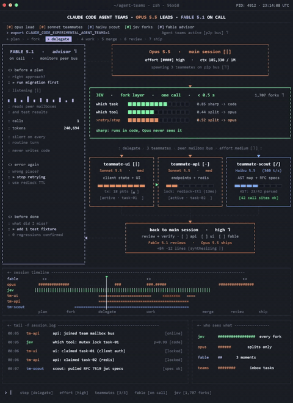

等寬字 TUI 風格儀表板：多個 agent 面板進度條推進、狀態數字更新、底部時間軸與 log 滾動；可用 CSS grid + monospace + setInterval 更新進度條重現

### [Paperclip：把 AI agent 當一家公司來管](https://github.com/paperclipai/paperclip)

用組織圖、工單、預算與核准關卡，管理一整個 AI agent 團隊

| 可信度 | 星數 | 出處 |
| --- | --- | --- |
| 可信度高・模擬示範資料 | 109.2k | [影片 33](https://www.facebook.com/reel/1785583925890920) |

開源平台，把多個 AI agent 組成一家公司：組織圖 CEO→CMO／CTO→ClaudeCoder／CodexCoder；工作以工單（PAP-xxx）派發，agent 在留言回報；儀表板顯示進行中任務、當月花費、待核准項目。agent 靠 heartbeat（有任務或排程）喚醒，不是一直開著；可依公司、agent、專案設花費上限，接近時警告、到限自動暫停；新增 agent 要你核准，也能暫停、改派或停掉 agent；共用 skill 有版本紀錄可回滾；一個部署可跑多家互相隔離的公司，組織可匯出／匯入。支援 Claude Code、Codex、Cursor、Gemini CLI、OpenClaw，每個 agent 可用不同模型。安裝：`npx` 一行啟動、不用註冊，需 Node 24+。README 注意事項：聊天／Email 連接器仍是實驗功能；預設開啟匿名遙測，可用環境變數關掉。MIT，2026-03-02 建立，官網 https://paperclip.ing 。影片（小礦工挖挖礦，AI 配音）用的是 README 的官方導覽影片；更正：0:26 打開的工單寫明這個 live demo 沒有資料庫，agent 是「pretending to do work」，是「a mock replay of a busy organization」，所以畫面是真的產品介面，但跑的是模擬示範資料、不是真實工作量；repo 本身可信度仍高。配樂：電子 lo-fi（音量小），壓在 AI 配音底下。GIF 片段：0:14–0:25。

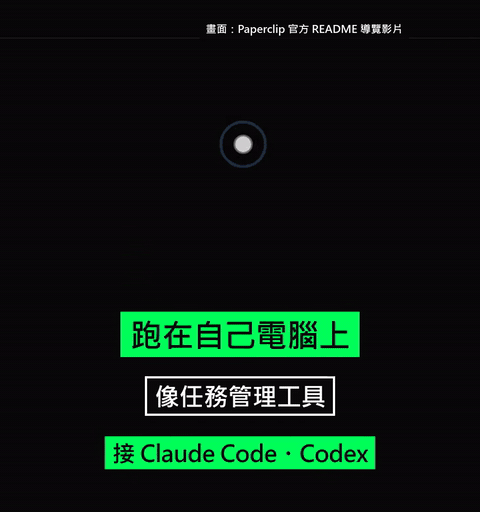

Paperclip 暗色 SaaS 介面導覽：代理儀表板（統計卡片＋Issues by Priority/Status 長條圖）→ Issue 清單（IN PROGRESS / BLOCKED 分組）→ CEO→CTO→工程師 組織圖節點卡片與連線，游標移動點選；可用 CSS grid 卡片 + 小型長條圖 + SVG 樹狀連線重現（已裁掉底部字幕，畫面中央綠色大字幕疊在 UI 上無法裁除）

### [Cindy：開源 AI Agent 外殼（整合 Claude Code、Codex、Pi，跨電腦與手機接力）](https://github.com/makecindy/cindy) ⚠️

不是新模型，而是把你已有的 Claude Code、Codex 或 Pi 包進同一個桌面／手機 App，讓工作在不同裝置間接力

| 可信度 | 星數 | 出處 |
| --- | --- | --- |
| ⚠️ 引流・可信度中 | 8.9k | [影片 42](https://www.facebook.com/watch/?v=2575196886290079) ⚠️ |

GitHunt 上傳的 28 秒影片，只有捲動 README 加英文 AI 語音，沒有實機示範；片尾要人留言「AGENT」拿連結。標題說是「免費的 Claude Code 替代品」，但 README 寫的是 harness：選 Claude Code、Codex 或 Pi（開源、可接多家模型）其一來跑，還是要用你自己的訂閱、API key 或本機模型。功能：筆電／桌機／手機串起來（手機可遠端桌面）、automations 排程例行工作、透過 Slack、Telegram 交辦，可裝外掛。程式在 apps/desktop（Electron）和 apps/mobile（Expo／React Native）。Apache-2.0，2026-07-22 建立，最後推送 2026-11-01。可信度：中，repo 是真的，但「替代 Claude Code」說法誤導；README 的 CI 徽章 2026-11-01 查看時顯示 failing（最近幾次 main 執行被取消）；官方發行版預設含 TapDB 使用分析並綁帳號 ID，可在設定關閉。配樂：無。無 GIF 片段（只是捲動 README）。

### [Altair AI：Claude Code 一場 session 三模型分工（Sonnet／Haiku／Opus）](https://code.claude.com/docs/en/sub-agents)

同一場 Claude Code：Sonnet 寫碼、Haiku 做便宜唯讀搜尋與測試、Opus 只在三個關卡做是／否審查

| 可信度 | 星數 | 出處 |
| --- | --- | --- |
| 概念動畫・可信度中 | — | [影片 52](https://www.facebook.com/reel/2504853660346325) |

Altair AI 上傳的 22 秒 Facebook Reel，純動態設計（非真實錄屏／未展示實際設定步驟）。構想：一場 Claude Code session 分三角色——Sonnet 當主 session 寫與改碼（`claude --model sonnet`）；Haiku 當便宜唯讀助手，負責搜 repo、grep 呼叫點、跑測試（構想是在 CLAUDE.md 規定：每次 repo 搜尋與測試都交給 haiku）；Opus 當審查者、從不寫碼，只回 yes／no，且只在三個時機醒來：計畫鎖定前、同一錯誤重複超過兩次（打斷迴圈）、宣告「完成」前（agent 最常在此誤報成功）。可對照 SEQ 0069（Agent Teams 多 agent 協作）、0054（多 agent 看板＋verify／gate）、0095（第二大腦記憶分工）。畫面數字（432 runs、0.91→0.74、diff +12 -3）為示意，標未驗證；「Sonnet／Haiku／Opus 5.5」型號標籤屬宣稱待驗證。實際設定（對照官方文件 https://code.claude.com/docs/en/sub-agents ）：主 session 用 `claude --model sonnet`（或 opus／haiku）；subagent 在 frontmatter 設 `model: sonnet|haiku|opus|inherit`（與 `--model` 接受的別名相同），也可在 Agent 呼叫時指定 model 參數，或以 `CLAUDE_CODE_SUBAGENT_MODEL` 統一覆寫。配樂：未標。GIF：0:05–0:08（https://wiki.singularityengine.dev/assets/gifs/v52-altair-multi-model-claude-code.gif）

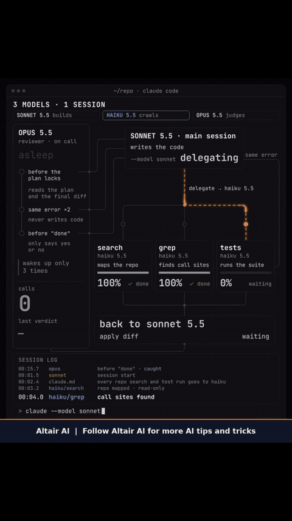

GIF：0:05–0:08。

### [15 個給 AI agent team 的 GitHub repo（含交易相關庫）](https://github.com/serenakeyitan/agent-org-chart)

說明文列出 15 個 repo：10 個 agent 組隊／角色範本，5 個行情與回測庫；畫面是模擬 Grok Bot Teams 儀表板，不是真實操作

| 可信度 | 星數 | 出處 |
| --- | --- | --- |
| 概念動畫・可信度中 | — | [影片 64](https://www.facebook.com/reel/1827893618429238) |

Lê Quốc Nghĩa 上傳的約 22 秒 Facebook Reel（2026-11-11），無留言換連結。畫面是模擬「Grok Bot Teams」儀表板概念動畫。說明文 15 個 repo 查證（GitHub API 2026-11-11 台北時間）全部存在。agent 組隊類多為小型專案（星數約 46–174，hypergrok-trading-desk 490）：[serenakeyitan/agent-org-chart](https://github.com/serenakeyitan/agent-org-chart)（174，MIT）、[jaredtrichard/grok-factory](https://github.com/jaredtrichard/grok-factory)（73，無 license 欄）、[simo255/multiBot](https://github.com/simo255/multiBot)（67，MIT）、[mKay00/grok-bot-second-brain](https://github.com/mKay00/grok-bot-second-brain)（69，無 license 欄）、[Archive228/foreman](https://github.com/Archive228/foreman)（60，MIT）、[YannisKiefer/grokbot-x](https://github.com/YannisKiefer/grokbot-x)（76，MIT）、[function1st/PhoneZero](https://github.com/function1st/PhoneZero)（47，MIT）、[mandarwagh9/botroster](https://github.com/mandarwagh9/botroster)（46，Apache-2.0）、[HAEGONG/grok-bot-profiles](https://github.com/HAEGONG/grok-bot-profiles)（61，CC-BY-4.0）、[galleonlabs/hypergrok-trading-desk](https://github.com/galleonlabs/hypergrok-trading-desk)（490，MIT；README 稱研究優先、執行需確認）。行情／回測庫較大：[bmoscon/cryptofeed](https://github.com/bmoscon/cryptofeed)（3,020，license 欄 NOASSERTION）、[ccxt/ccxt](https://github.com/ccxt/ccxt)（44,857，MIT）、[freqtrade/freqtrade](https://github.com/freqtrade/freqtrade)（56,763，GPL-3.0）、[polakowo/vectorbt](https://github.com/polakowo/vectorbt)（9,813，NOASSERTION）、[ranaroussi/quantstats](https://github.com/ranaroussi/quantstats)（7,851，Apache-2.0）。涉及真金或下單的工具（尤其交易桌與 freqtrade／ccxt）應加人人核准閘門，不要直接讓 agent 動用資金。可對照 SEQ 0069（Agent Teams）與站內「Agent 分工模式」頁。SkillSpector 掃描待補（本批不 clone）。配樂：未標。GIF：0:05–0:15。

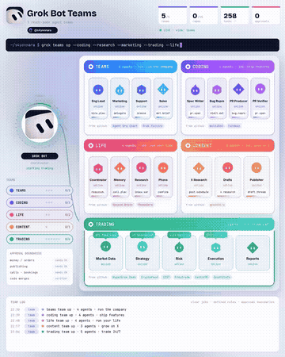

### [Fable 5.2 當 CEO：過夜帳單稽核（多模型分工）](https://www.facebook.com/reel/1071773105932698)

說明文稱 Fable 指揮、Haiku 讀帳、Opus 核實、Sonnet 寫信，一夜找出每月 11,640 美元漏洞；畫面是模擬儀表板，數字未驗證

| 可信度 | 星數 | 出處 |
| --- | --- | --- |
| 概念動畫・宣稱待驗證・可信度低 | — | [影片 65](https://www.facebook.com/reel/1071773105932698) |

Prakhar Saxena 上傳的約 41 秒 Facebook Reel（2026-11-10）。畫面是「CLAUDE CODE／FABLE 5.2」動態設計儀表板（非真實錄屏）。說明文編排：Fable 5.2 當 CEO 下指令；約 40 個 Haiku 5.5 讀完 41,806 筆交易；Opus 核對每項發現（需交易代號）；Sonnet 5.5 寫催收信；寄出前要人核准。宣稱一夜找出客戶隱漏三年、每月 11,640 美元（顧問超收 7,420、失敗扣款未重試 2,980、離職員工座位 1,240，另有 214 小時未請款 20,330），並稱客戶按首年追回的 20% 付了 27,936 美元——以上金額、筆數、「3 年」與「40 個 Haiku」皆未驗證。Sonnet 5.5 在畫面未出現。Fable 5.2 本身是 Anthropic 於 2026-11-09 發布的 Claude 模型（見 SEQ 0106）。可對照 SEQ 0098（Sonnet 寫／Haiku 搜／Opus 審的分工）。說明文附提示詞；無留言換連結。配樂：未標。GIF：0:15–0:25。

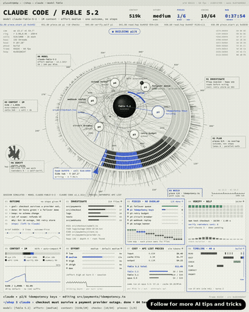

### ⚠️ [每間公司該建的 10 種 AI Employees（角色清單，無實作）](https://www.facebook.com/reel/2226812394848085) ⚠️

素材片上疊十張模擬角色卡，沒有真實軟體、網址或價格；片尾要留言 Community 換教學

| 可信度 | 星數 | 出處 |
| --- | --- | --- |
| ⚠️ 引流・概念動畫・可信度低 | — | ⚠️ [影片 68](https://www.facebook.com/reel/2226812394848085) ⚠️ |

Taki Wong - AI For Business 上傳的約 21 秒 Facebook Reel（2026-10-25）。說明文要留言 Community 才寄 10 種 AI Employees 的逐步指南，屬引流。畫面是素材片加上模擬卡片，沒有真實軟體、網址或價格，「10x」業績宣稱未驗證。角色清單（僅供核對、未示範）：① 幕僚長（調度其他 agent、每日簡報）；② 行銷（發文、剪片、看數據）；③ 銷售（回線索、資格篩選、約通話）；④ 客服（全通路 24/7）；⑤ 總機（接聽、預約）；⑥ 收件匣（分信、草擬回覆、約會議）；⑦ 財務（費用歸類、催帳、現金流）；⑧ 研究（對手、趨勢、客戶）；⑨ 評價（邀請與回覆評論）；⑩ 招聘（刊登職缺、篩選應徵、安排應徵者約見）。點名工具：Stripe、CRM、Instagram、TikTok、LinkedIn、YouTube、help desk、WhatsApp、SMS、Gmail、Outlook、Slack、QuickBooks、Xero、Google、Yelp、Facebook、Indeed。可對照 SEQ 0069（Agent Teams）、0078（Paperclip 公司化 agent）、0109（組隊 repo）。配樂：未標。GIF：0:00–0:10。

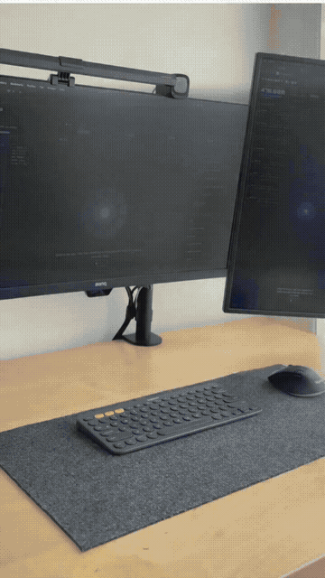

### [騰訊混元 Hy4：首次加入視覺與 computer use（說明文有把 preview 規格算進正式版）](https://www.tencent.com/tencent-launches-hy4-joining-the-ranks-of-the-worlds-leading-open-source-ai-models/)

官方 2026-11-04 發布 Hy4，確認首次支援視覺理解與 CLI／GUI computer use；說明文的 770B／49B 與 100 萬 token，官方只寫在較早的 Hy4 preview。畫面是通用科幻 CGI，沒有型號或操作介面

| 可信度 | 星數 | 出處 |
| --- | --- | --- |
| 宣稱待驗證・可信度中 | — | [影片 71](https://www.facebook.com/reel/2350688215687462) |

Marc.AI 上傳的 10 秒 Facebook Reel（2026-11-05）。畫面只有通用科幻 CGI（發光大腦、機械手、全息儀表），無文字、標誌或產品介面，所有資訊在說明文；片尾只問「會不會讓 AI 直接操作你的電腦」，不是留言換連結，故不標引流。因畫面是庫存式 CGI、沒有可核對的產品畫面，本則未截 GIF。

查證（2026-11-11 台北時間）對照[騰訊官方英文稿](https://www.tencent.com/tencent-launches-hy4-joining-the-ranks-of-the-worlds-leading-open-source-ai-models/)、[中文稿](https://www.tencent.com/zh-cn/tencent-launches-hy4-joining-the-ranks-of-the-worlds-leading-open-source-ai-models/)與研究頁 [hy.tencent.ai/research/hy4](https://hy.tencent.ai/research/hy4)：

1. 發布日 2026-11-04 已核到。
2. 首次加入視覺理解，以及 CLI 與 GUI 的 computer use（官方寫 command-line interfaces 與 graphical user interfaces，與說明文「螢幕和命令列」相符）已核到。
3. 說明文把「7700 億總參數、每次只啟動 490 億、100 萬 token 上下文、已經開放」都寫成 11 月 4 日這次發布的規格。770B／49B MoE 與 1M 上下文，官方寫在 2026-08-28 的 Hy4 preview（[preview 公告](https://www.tencent.com/tencent-releases-and-open-sources-tencent-hy4-preview/)、[GitHub](https://github.com/Tencent-Hunyuan/Hy4-preview)、[Hugging Face](https://huggingface.co/tencent/Hy4-preview)）；README 標 Apache License 2.0（查證當日 438 星，GitHub license 欄為 NOASSERTION）。11 月 4 日正式版官方稿只說相對 preview 加大預訓練與後訓練、長上下文理解有提升，並未重述 770B／49B 或 1M，這三項套在正式版上標未驗證。
4. 「開放」：官方寫「將於近期開源權重並發布 system card／plans to release model weights and system cards in the coming days」。查證當日 GitHub 無 Tencent-Hunyuan/Hy4（404），Hugging Face 公開清單只有 tencent/Hy4-preview 與 tencent/Hy4-preview-FP8，正式版權重是否已釋出標未驗證。

可對照 SEQ 0009（同一騰訊混元體系的 Hy-Memory，不是同一個產品）。配樂：未標。無 GIF。

### ⚠️ [SkillTree：宣稱 47 個 agent 跑一家公司（共享 Company Brain＋Council）](https://skilltree.altari.ai/) ⚠️

Ahmed Alassafi／Altari 的 SkillTree 操作畫面：公司記憶、分部門 agent、排程與多模型 Council。說明文要留言 47 才寄拆解與系統權限；「47 個 agent」未在畫面上點數，儀表板標明是虛構公司樣本資料

| 可信度 | 星數 | 出處 |
| --- | --- | --- |
| ⚠️ 引流・宣稱待驗證・可信度中 | — | ⚠️ [影片 72](https://www.facebook.com/reel/1329619602540541) ⚠️ |

Alassafi AI（Ahmed Alassafi）上傳的約 41 秒 Facebook Reel（2026-11-09）。說明文開頭要留言 47 才寄完整拆解，結尾要留言 47 才給系統權限，屬引流。畫面是看起來像真實產品的自製介面，品牌為 SkillTree，導覽有 Map、Chats、Dashboards、Files。Company Brain 來源列 Uploads 5,887、Gmail 1,840、Fireflies 412（數字未驗證）。地圖部門節點：Intelligence、Operations、Customer、Marketing、Back office、Deals、Sales、Finance。儀表板總覽寫明「Sample data for a fictional agency, Brightline」，可見來源包括 HubSpot（Open Pipeline 277,500 美元）、Xero（應收 55,700 美元，不是 MRR）、Instagram＋TikTok、Instantly＋HeyReach 等，以上金額皆為示範數字、標未驗證。另示範 LinkedIn 輪播、外聯研究提示詞（德州 20 家 10–50 人會計事務所）、把通話做成提案 PDF、紐約時間排程（Daily Brief 平日 7:30、Overnight lead research、Repurpose the best reels、Competitor watch），以及手機 Slack 機器人 Atlas。

模型挑選器（經 OpenRouter，標價為每百萬 token 輸入／輸出）列出 Claude Fable 5.1（10／50 美元）、Opus 5.5（4／20）、Sonnet 5.5（2／10）、GPT-6 Astra（10／50）、Grok 4.7（2／6）、Gemini 4 Argon（2／10）。名稱查證：GPT-6 Astra 已見 SEQ 0039；Opus 5.5、Sonnet 5.5、Fable 5.1 為 Anthropic 正式型號，但現行旗艦是 Fable 5.2（見 SEQ 0106，2026-11-09 發布，本片同日上傳，挑選器仍列 5.1）；Grok 4.7、Gemini 4 Argon 亦為當時已發布的型號。Ask the Council：Opus 作答、GPT 盲評、Grok 裁決（畫面按鈕為 Answer alone／Critique blind／Chair decides）。本則抽到的 Council 畫面寫的是 GPT-6 Astra，未在抽幀中看到「GPT-4 Astra」。說明文稱 47 個 agent，畫面從未點數，標未驗證。

公開網站 ⚠️ [skilltree.altari.ai](https://skilltree.altari.ai/) ⚠️ 存在（Altari／Ahmed Alassafi 的產品頁，宣傳 137 個 agent、7 個部門、可加入 waitlist；亦提供客製建置），與片中「47」數字不一致。可帶走的編排：共享公司記憶、分部門 agent、排程、聊天入口、重大決策用多模型 Council。可對照 SEQ 0069（Agent Teams）、0078（Paperclip 公司化 agent）、0109（組隊 repo）、0110（多模型對帳）、0113（十種 AI 角色清單）。配樂：未標。GIF：0:27–0:37。

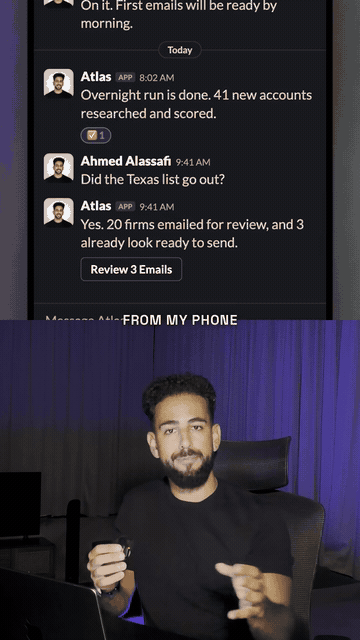

### [Claude Code（Fable 5.2）＋Herdr：四個本機 Pi agent 並行分窗](https://herdr.dev)

主窗 Claude Code 當監看編排，用 Herdr skill 在同一 tab 開四個本機 Pi pane（前端／後端／資料庫／review），工人跑本機 Nemotron 3.5 Super VL。真實錄屏，無引流

| 可信度 | 星數 | 出處 |
| --- | --- | --- |
| 可信度中 | 50,210 | [影片 74](https://www.facebook.com/reel/1609258920348255) |

胡嘉璽上傳的約 20 秒 Facebook Reel（2026-11-10；Brian 於 2026-11-12 00:01 Asia/Taipei 從 LINE 轉來裸連結 [這則分享連結](https://www.facebook.com/share/v/1CTf2CKEmi/)）。無留言換連結。畫面是真實操作錄屏：Herdr 桌面裡的 Claude Code 主窗（本機 repo 名稱 4panes），狀態列可見 Fable 5.2；提示詞請用 Herdr skill 在同一 tab 開四個 pi pane，工人模型為 nemotron-3.5-super-vl，經本機區網的 OpenAI 相容端點（畫面出現內網位址，本則不公開）。約 0:07 介面分成 1＋4：左側主窗監看，右側四個 Pi pane 分別擔任 frontend、backend、database、review，對同一個 4panes repo 工作（畫面可見 SPEC.md、README.md、docker-compose.yml；工人 pane 標 nemotron-super）。說明文寫需要 Herdr App、Herdr Skill、Herdr CLI、Claude Code CLI。

查證（2026-11-12 台北時間）：Herdr 是公開產品，官網 [herdr.dev](https://herdr.dev)，定位為給 coding agent 用的終端／工作區（spaces、tabs、panes，關窗後終端仍可跑）。GitHub：[herdrdev/herdr](https://github.com/herdrdev/herdr)（「the runtime your coding agents live on」，Apache-2.0，50,210 星，最近推送 2026-11-07 20:32 台北時間）；[herdrdev/herdr-app](https://github.com/herdrdev/herdr-app) 桌面應用（Apache-2.0，2,713 星，最近推送 2026-11-11 23:59）；另有 herdr-core（Apache-2.0）。官方文件有 agent skill，可讓 Claude Code 等在 Herdr pane 內檢查並開鄰近 pane。Pi 即 Pi coding agent（[badlogic/pi-mono](https://github.com/badlogic/pi-mono)，與 earendil-works/pi-mono 為同一庫，MIT，121,421 星，最近推送 2026-11-12 00:00；Herdr 官方文件有 Pi integration）。NVIDIA Nemotron 3.5 Super VL 是正式型號：2026-10-15 發布的開源多模態模型，120B 總參數／12B 啟動的 MoE，權重授權 OpenMDW-1.1（[官方部落格](https://developer.nvidia.com/blog/nvidia-nemotron-3-5-super-vl-powers-specialized-agents-with-multimodal-reasoning/)，Hugging Face [nvidia/NVIDIA-Nemotron-3.5-Super-VL-120B-A12B-BF16](https://huggingface.co/nvidia/NVIDIA-Nemotron-3.5-Super-VL-120B-A12B-BF16)）。Fable 5.2 為正式型號（見 SEQ 0106）。本則示範用的 4panes repo 不是公開專案。SkillSpector 掃描待補（本批不 clone）。可帶走的編排：主窗用較強模型當監看／編排，旁邊用本機較便宜模型分角色並行，而且工人 pane 看得到、可介入。可對照 SEQ 0089（Cindy 可接 Claude Code、Codex、Pi）、0069（Agent Teams）、0098（一場 session 三模型分工）、0110（Fable 當 CEO 過夜對帳）。配樂：未標。GIF：約 0:07–0:17（略避開稍早畫面中的內網端點）。

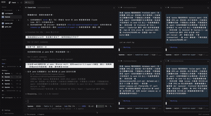

### [Altair AI：Fable 5.2 讀完筆電，告訴我為什麼專案都開了不完（概念動畫）](https://www.facebook.com/reel/1980204536698183)

風格化 3D 科幻 HUD，不是 Claude／Claude Code 真實錄屏。說明文與畫面列出筆記、session 與未完成專案的自述數字，皆為上傳者宣稱、未驗證；不是產品示範

| 可信度 | 星數 | 出處 |
| --- | --- | --- |
| 概念動畫・宣稱待驗證・可信度中 | — | [影片 76](https://www.facebook.com/reel/1980204536698183) |

Altair AI 上傳的約 24 秒直式 Facebook Reel（2026-11-11；Brian 於 2026-11-12 20:36 Asia/Taipei 在 LINE 寫 To wiki，轉來裸連結 [這則分享連結](https://www.facebook.com/share/v/1UH72zNprk/)）。同一上傳者已見 SEQ 0094、0095、0097、0098。畫面是風格化 3D 科幻 HUD 動態設計（標題 FABLE 5.2 READ MY ENTIRE LAPTOP／IT TOLD ME WHY NOTHING I START SHIPS），不是 Claude 或 Claude Code 的真實操作錄屏，也未出現提示詞或產品設定步驟。片尾橫幅「Altair AI | Follow Altair AI for more AI tips and tricks」是普通追蹤呼籲，與 SEQ 0094、0097 的 Follow 橫幅相同，不是留言換連結，故不標引流。

畫面數字與說明文大致相符，皆為上傳者的個人自述、標未驗證：notes 2,400（說明文寫 2,400 notes）、claude code 11 months、31 個專案開始／2 個交貨、把「make it better」計為 147 次。說明文寫沒說 better 是什麼；畫面上「better defined」的計數並不一致（抽幀見過 0 與 8）。ideas_final_v3 在說明文是資料夾（稱三月後沒開過），畫面也作 ideas_final_v3／資料夾（可見 ideas_final.md 等檔名），不是已核到的真實檔案。最有效率時段寫 6–9 am；landing.html 寫重寫約 40 次、花在這段時間（畫面有 landing.html · v40、rewritten 40 times、40 layers；重寫面板的版本號在跳動，抽幀見過 v1、v11、v21、v31、v40）。VERDICT：「You treat starting as the achievement. You drop every project at the exact moment it needs a decision only you can make.」Fable 5.2 是 Anthropic 正式型號（見 SEQ 0106）。

可帶走的作法：把長上下文模型對準筆記庫與 Claude Code session 紀錄，直問已開始對已交貨、統計含糊提示詞（例如 make it better）、找出自己的高產出時段；寫提示詞時先定義 better 是什麼。數字與「昨晚讀完整台筆電」的情節未驗證，不當產品示範。可對照 SEQ 0110（同樣是 Fable 5.2 的模擬稽核儀表板）、0104、0106、0111、0119（其他 Fable 5.2 條目）。配樂：未標。GIF：0:03–0:08。

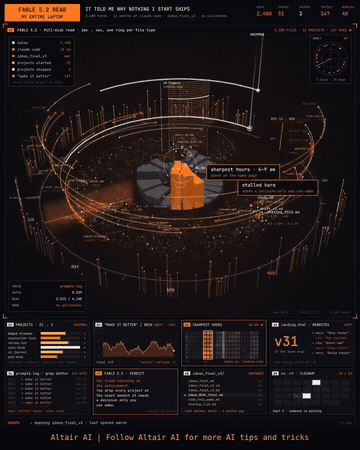

### [Altair AI：Fable 5.2 用五個 agent 管社群（概念動畫，非產品錄屏）](https://www.facebook.com/reel/40885633571023865)

風格化 SOCIAL HQ 儀表板，標題 FABLE 5.2／5 AI AGENTS RUN MY SOCIAL MEDIA。說明文沒有點名產品或 repo，畫面也沒有網址；數字與「一天、五平台、零手動發文」皆為動畫宣稱、未驗證

| 可信度 | 星數 | 出處 |
| --- | --- | --- |
| 概念動畫・宣稱待驗證・可信度中 | — | [影片 81](https://www.facebook.com/reel/40885633571023865) |

Altair AI 上傳的約 24 秒直式 Facebook Reel（2026-11-12；Brian 於 2026-11-13 12:59 Asia/Taipei 從 LINE 轉來裸連結 https://www.facebook.com/share/v/1Dtd5T4uCo/，對應 [這則 Reel](https://www.facebook.com/reel/40885633571023865)）。同一上傳者已見 SEQ 0094、0095、0097、0098、0121、0122。說明文是泛用的多 agent 社群管理提案（內容產製、規劃、agent 自動化、成效追蹤），沒有點名產品、repo 或網址；片尾只有「Follow Altair AI for more AI tips and tricks」，是普通追蹤呼籲，與 SEQ 0094、0097、0121 的 Follow 橫幅相同，不是留言換連結，故不標引流。

畫面是風格化暗色科幻 HUD（與 SEQ 0121 同一系列），不是真實產品錄屏，也未出現私人 IP 或本機路徑。標題列寫 FABLE 5.2 AGENT MODE、5 AI AGENTS RUN MY SOCIAL MEDIA、one day, 5 platforms, zero manual posting。主面板標 01 SOCIAL HQ · agents on duty · 5 platforms，並列出研究、內容、排程、互動、分析等職能（另有 platforms · live）：research／trends、content／drafts、scheduler／queued、engage／replies、analytics／lift。中央軌道圖把 FABLE 5.2 放在中間，周圍是 LinkedIn、YouTube、Instagram、X／Twitter、TikTok；agent mode 會從 listening、writing、planning、replying、learning 走到 reporting，時鐘像在走完「一天」。底部有研究趨勢、草稿、週曆排程、平台連結數、留言互動、核准佇列、hashtag 排行、觸及分析、週報、成長分數，以及一則寫在畫面右下的提示詞：「Run my social media like a team of agents. Research trends, draft posts in my voice, schedule at the best times, reply to comments, then report weekly. Ask me before anything sensitive.」（effort: high · tools: browser, scheduler）。核准列寫 nothing sensitive goes out alone。

片尾大標「2 hrs saved / day」「I only approve anything sensitive」，並出現「Fable 5.2 sends me one weekly report. My job is to approve and post less.」週報卡抽幀可見 This week: 14 posts, 38 replies, reach up 212%. Best post: prompt templates。頂列計數會跳到 TRENDS 12、POSTS 14、REPLIES 38、REACH 184K、SAVED 2.0h。這些數字與「零手動發文／每天省兩小時／觸及 +212%」都是動畫裡的宣稱，未驗證。畫面上的 SOCIAL HQ、FABLE 5.2 是這張概念儀表板的標題；Fable 5.2 是 Anthropic 正式型號（見 SEQ 0106、0121），但沒有找到叫 SOCIAL HQ 的官方產品或 repo，也不把這則當成已上線工具的示範。可對照 SEQ 0078（Paperclip：用組織與核准關卡管 agent 團隊）、0113（10 種 AI Employees 角色清單，無實作）、0091（FounderOS／Content Lab 創作者情報系統）、0121（同一上傳者的 Fable 5.2 概念 HUD）。配樂：未標。GIF：0:16–0:21。

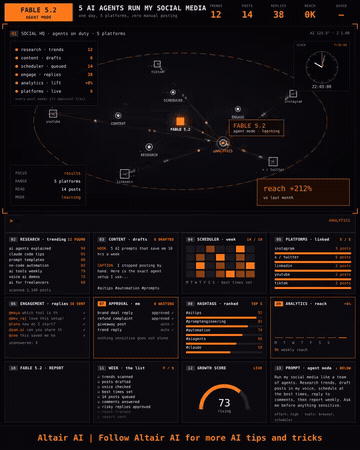

### [Machine Learning & AI：所謂 Google 9 頁 Agent Harness Engineering 文件（並非官方 Google PDF）](https://www.facebook.com/reel/1669067301263733)

說明文稱 Google 公布 9 頁 Agent Harness Engineering PDF（Agent = Model + Harness，六步）；畫面是獨立技術筆記第 1 頁，頁尾寫 made by @Mr_Buzzoni。本則未找到官方 Google 的同名 9 頁 PDF。

| 可信度 | 星數 | 出處 |
| --- | --- | --- |
| 宣稱待驗證・可信度中 | — | [影片 88](https://www.facebook.com/reel/1669067301263733) |

Machine Learning & AI 上傳的約 22.5 秒直式 Facebook Reel（2026-11-12；1440×1920；Brian 於 2026-11-13 在對話傳來 [這則 Reel](https://www.facebook.com/reel/1669067301263733)）。越南文說明文稱 Google 剛公布一份 9 頁 PDF，談 Agent Harness Engineering，公式是 Agent = Model + Harness，並列出 6 個步驟：從舊失敗寫出規則；加上 linter、測試等檢查；建立 plan-execute-verify-fix 迴圈；跨 session 保存記憶與狀態；權限與核准控制；以及監看工具、成本、重試與異常。重點是每次失敗要變成以後不再犯的規則。無留言換連結，故不標引流。

畫面全程是同一頁技術筆記的動畫，並未翻到後頁。頁首寫 Production Agent Engineering Practice 2026，標題為 Harness Engineering，副標 Agent = Model + Harness: The 6-Layer Production Playbook，頁尾寫 made by @Mr_Buzzoni、頁碼 1。圖上六層是 GUIDES、SENSORS、AGENTIC LOOP（Plan／Execute／Verify／Fix）、MEMORY、PERMISSIONS、OBSERVABILITY，與說明文的 6 步大致對應。標題旁有 Google 風格的 G 標誌，但出處行寫的是根據 Mitchell Hashimoto 的方法、OpenAI Codex field report、Martin Fowler 的 guides-and-sensors、以及 Anthropic、LangChain、Cursor 等材料整理。

查證（2026-11-13 台北時間）：

- 本則沒有找到由 Google 正式發布、標題為 Agent Harness Engineering 的 9 頁 PDF，因此不把「Google 公布這份 9 頁文件」當成事實
- 畫面這份筆記也不是官方 Google 文件。公開搜尋未能取得可自行點算頁數的檔案；多則獨立評介把它寫成 2026 年 8 月的非官方技術筆記、約 9 頁，且不是會議論文、也不是任何公司的官方文件，故「9 頁」並非本則自行點算
- 頁上 95% 企業 agent 未能上線、同模型 +44、Terminal Bench +25 名、100 萬行零手寫等數字，本則未核對
- Google 另有公開談 harness 的材料，但標題與性質都不同，不可與畫面這份六層手冊當成同一份文件：例如 2026-09-09 Google Developers Blog 的 [The Anatomy of Harness Engineering: How to Evaluate, Iterate, and Guard AI Coding Agents](https://developers.googleblog.com/en/the-anatomy-of-harness-engineering-how-to-evaluate-iterate-and-guard-ai-coding-agents/)，以及 Google Research 的 [Industrial Agentic Engineering](https://research.google/pubs/industrial-agentic-engineering/)
- 公式 Agent = Model + Harness 在其他公開文章也常見，本則不把它當成 Google 獨有發表

可對照 SEQ 0004、0069、0078。配樂：未標。

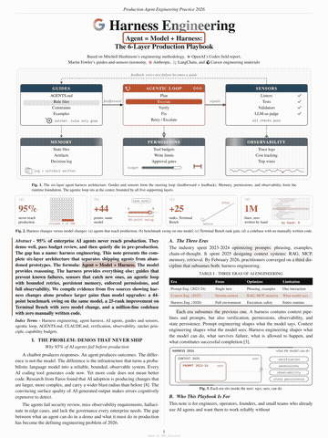

### [Altair AI：Claude Code 空資料夾建六部門公司（概念動畫；說明文來自 @birmeya）](https://www.facebook.com/reel/1152801101050169)

風格化 Claude Code 公司資料夾 HUD，按七步從空資料夾走到六個部門與 8:00 Telegram 核准。說明文與 @birmeya 的貼文幾乎逐字相同且未標出處；37 分鐘、20 筆名單與每日簡報皆為動畫宣稱、未驗證。

| 可信度 | 星數 | 出處 |
| --- | --- | --- |
| 概念動畫・宣稱待驗證・可信度中 | — | [影片 90](https://www.facebook.com/reel/1152801101050169) |

Altair AI 上傳的約 24 秒直式 Facebook Reel（2026-11-13；1080×1350；Brian 於 2026-11-13 在對話傳來 [這則 Reel](https://www.facebook.com/reel/1152801101050169)）。同一上傳者已見 SEQ 0094、0095、0097、0098、0121、0122、0125。說明文寫晚餐後把空資料夾丟進 Claude Code，37 分鐘後六個部門在早上 8 點用一則 Telegram 叫醒，並列出 7 步：安裝並指向空資料夾、用 5 題寫成最多 150 行的公司手冊（硬規則放最上面）、一次建立 sales／marketing／support／finance／ops／research 六個部門且各有列出輸入與輸出的 README、建立 lead-finder 寫下 20 筆附原因的名單且從不主動聯絡、同時啟動 lead-finder／post-writer／inbox 三個 agent（各鎖在自己的資料夾）並收回一則短摘要、經 MCP 接上 Make 列出可跑的 scenario 再草擬 follow-up、用 Gmail 寄出並記入試算表、最後設定每天 8:00，由 inbox 草擬回覆、analyst 讀昨日、planner 排當日，再用一則 Telegram 列出所有要你點頭的事項。文末「Subscribe to the exclusive content today」連到 Facebook 訂閱頁，再加上片尾 Follow Altair AI for more AI tips and tricks，都是普通訂閱／追蹤呼籲，不是留言換連結，故不標引流。

這段說明文與 [@birmeya 的貼文](https://x.com/birmeya/status/2120904800871096798)幾乎逐字相同，本則沒有標出原作者；Altair AI 只在文末多了訂閱呼籲。畫面是風格化暗色 Claude Code company folder 概念 HUD，不是真實產品錄屏，也沒有 repo 或操作逐字稿（僅配樂、無旁白）。頂列一開始就亮著 QUESTIONS 5、LINES MAX 150、DEPTS 6、LEADS 20，並以 1／7 走到 7／7。中央轉盤依步驟顯示 claude · empty folder、5 questions · CLAUDE.md、6 departments · READMEs、lead-finder · 20 leads、3 agents · 1 summary、Make · Gmail · sheet、inbox · analyst · planner。左上 HANDBOOK 寫 CLAUDE.md，硬規則可見 no email without approval、finance only when asked。六個部門塊在第 3 步長出 README，之後 lead-finder、post-writer、inbox 分別掛上 sales、marketing、support；第 7 步再出現 analyst、planner，SUPPORT 標 DRAFTS、FINANCE 標 YESTERDAY、OPS 標 DAY PLAN。

右上 STAGES 各步標了 Install 5 min、CLAUDE.md 10 min、Departments 2 min、lead-finder 5 min、Parallel run x3（沒有分鐘）、Make MCP 15 min、Autopilot daily（沒有分鐘）。有標分鐘的五段相加是 37，但七步並非都有分鐘數，不能把「全程 37 分鐘」當成已核對的計時。右下 MIN. SETUP 累計為 5→15→17→22（第 5 步仍為 22）→37→37，與這五段分鐘相符，同屬動畫宣稱。

查證（2026-11-13 台北時間）：

- 沒有找到對應的公開 repo
- [Make MCP](https://help.make.com/get-started-with-make-mcp-server) 是真實產品，可把 Make scenario 接到包含 Claude 在內的 MCP 客戶端；本則未核對片中「列出可跑 scenario、用 Gmail 寄出並記入試算表」是否為一次真實執行
- 20 筆名單、37 分鐘建置，以及每天 8:00 用一則 Telegram 做簡報，皆為說明文與動畫裡的宣稱，未驗證

可對照 SEQ 0121、0125（同一上傳者的概念 HUD）、0098（同一上傳者談 Claude Code 分工）、0078（用組織與核准關卡管 agent 團隊）、0117（分部門 agent 與排程的公司系統宣稱）。

互動重現：[空資料夾六部門公司 demo](https://wiki.singularityengine.dev/demos/company-folder-autopilot/)（7 步可逐步操作；名單與信件為虛構資料，不會連網或寄信）。配樂：僅配樂、無旁白。

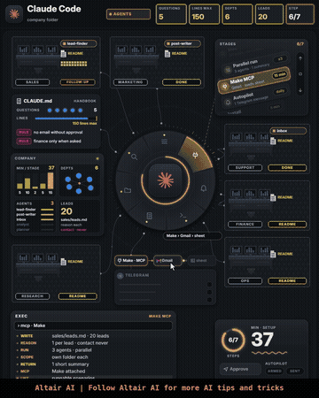

### [Altair AI：Fable 5.2 四模型一腦任務分流（概念動畫；說明文與畫面不符）](https://www.facebook.com/reel/3438861689623518)

風格化四模型分流板（Fable／Opus／Sonnet／Haiku）與 Prompt Doctor、Night Shift、Bill Autopsy。說明文是未署名轉貼的鏡像提示文案，與畫面不符；帳單與每 1 美元拆分未驗證。

| 可信度 | 星數 | 出處 |
| --- | --- | --- |
| 概念動畫・宣稱待驗證・可信度中（說明文與畫面不符） | — | [影片 91](https://www.facebook.com/reel/3438861689623518) |

Altair AI 上傳的約 26 秒直式 Facebook Reel（2026-11-14；1080×1468；Brian 於 2026-11-14 18:38 Asia/Taipei 從 LINE 傳來 [這則分享連結](https://www.facebook.com/share/r/1Fig8c7sAH/)，對應 [這則 Reel](https://www.facebook.com/reel/3438861689623518)）。同一上傳者已見 SEQ 0094、0095、0097、0098、0121、0122、0125、0132。本則依畫面書寫，不依說明文敘事。畫面是風格化暗色 FABLE 5.2 // CLAUDE CODE 概念 HUD，標題 THE BRAIN · TASKS ROUTING · FOUR MODELS · ONE BRAIN，不是真實產品錄屏，也沒有 repo 或操作逐字稿（僅配樂、無旁白）。片尾 Follow Altair AI for more AI tips and tricks，加上說明文末「Subscribe to the exclusive content today」連到 Facebook 訂閱頁，都是普通追蹤／訂閱呼籲，不是留言換連結，故不標引流。

右上 MODEL LANES 把任務分到四條模型車道，標了用途與列表價：Fable 負責 plans · architecture · root causes，標 $8／$40；Opus 負責 complex reasoning · real builds，標 $4／$20；Sonnet 負責 daily coding · reviews · checks，標 $2／$10；Haiku 負責 rename · tag · extract，標 $0.10／$0.50。這些數字與官方 Fable 5.2、Opus 5.5、Sonnet 5.5，以及 Haiku 5.5（prompt 在 10 萬 token 以內那一檔）的列表價相符，見 [官方定價頁](https://platform.claude.com/docs/en/about-claude/pricing)。另有 Advisor、Cache、Subagents 三列：Cache 寫 read at 1/40 of input price · keep the session。查證（2026-11-14 台北時間）：Fable 5.2 的 cache hit 確為輸入價的 0.025 倍（1／40，即 $0.20／MTok）；但 Opus 5.5 與 Sonnet 5.5 的 cache hit 是 0.05 倍（1／20），畫面把 1／40 寫在共用 Cache 列，不能套到所有車道。Advisor 列寫 consulted at decision points，並有 ADVISOR · SONNET ASKS FABLE 與 /advisor fable 字樣；本則未找到叫 Advisor 的獨立產品。官方發表稿把 Advisor 寫成 Fable 5.2 可扮演的角色（Haiku、Sonnet 或 Opus 遇到較難問題時向它諮詢），見 [Claude Fable 5.2 and Mythos 5.2](https://www.anthropic.com/news/claude-fable-and-mythos-5-2)，並不把畫面上的 /advisor 當成已核對的指令。中央球體把任務從 TASK STACK 路由出去，並寫 THINKING IS FABLE'S JOB, TYPING IS NOT。

PROMPT DOCTOR 標 11 CHECKS · OLD LINES THAT COST YOU，掃描 ~/.claude、CLAUDE.md、skills、agents、memory，可標 DELETE／REWRITE／KEEP，並寫 nothing changes without your yes 與 BACKUP FIRST。NIGHT SHIFT 標 NIGHT-SHIFT.md · AUTO MODE，時間軸從 23:45 先把問題問完，再寫目標與檢查清單，其後是示範用的分支與分段工作。BILL AUTOPSY 標 CCUSAGE · LOCAL LOGS，並有 $/SESSION 長條與佔比、80x less 等句子。[ccusage](https://github.com/ccusage/ccusage) 是真實的本地用量工具，但片中的長條、佔比與 80x less 都是動畫宣稱，未驗證。左下 EVERY $1 ON FABLE 把 1 美元拆成 THINKING 71¢、TYPING 27¢、RENAMES 2¢，同樣未驗證。跑馬燈與底部字條寫 PER TOKEN FABLE = 80x HAIKU，本則把 80× 當口號，不把它當成已量到的省錢倍數。

CORE BENCHMARKS 把 REMOTE LABOR INDEX 動畫到 41.3%，並并列 89.3%、83.5%、49.1%，以及 OPUS 21.3、GPT-6 20.8。查證官方發表稿：Remote Labor Index（High effort）Fable 5.2 為 41.3%、Opus 5.5 為 21.3%、GPT-6 Astra 為 20.8%；OSWorld 2.1（offline set, partial）Fable 5.2 為 89.3%；FrontierCode 2.0（Xhigh effort）Fable 5.2 為 49.1%。跑馬燈的 BENCHCAB 83.5 vs 65.3，與官方 BenchCAD 2.1（Max effort）Fable 5.2 的 83.5、Opus 5.5 的 65.3 相符，只是畫面把名稱寫成 BENCHCAB。

說明文與畫面不符：說明文談的是用一則 Fable 鏡像提示去讀本機 session 歷史、畫出行為肖像與 30 天計畫，並要調高 cleanupPeriodDays；畫面卻是四模型分流板、Prompt Doctor 與帳單解剖。這段說明文與 [@Kuzoxbt 的貼文](https://x.com/Kuzoxbt/status/2121392596970819722)幾乎逐字相同（Altair AI 在開頭多了 f*cking，文末多了訂閱呼籲），本則沒有標出原作者。該則貼文引用 @0xCodila，對應 [這則狀態](https://x.com/0xCodila/status/2120187587209896001)（本則讀到 Kuzoxbt 原文與引用卡，0xCodila 原帖頁面本則未能打開）。說明文裡「預設 30 天會刪掉完整 session、要改 cleanupPeriodDays 紀錄才不會每個月消失」只說對一半：官方 [Manage sessions](https://code.claude.com/docs/en/sessions) 與 [Explore the .claude directory](https://code.claude.com/docs/en/claude-directory) 寫明，cleanupPeriodDays 預設 30 天，session 逐字稿會過期刪除；但 ~/.claude/history.jsonl 在一般情況下會保留到你自行刪除，只有套用 HIPAA 設定時，清理才會一併刪掉超過此天數的 history.jsonl 條目。

可對照 SEQ 0098、0121、0106、0132。

互動重現：[四模型一腦 demo](https://wiki.singularityengine.dev/demos/four-models-one-brain/)（可把任務點選或拖到四條車道；時程與花費為虛構資料，不會連網）。配樂：僅配樂、無旁白。

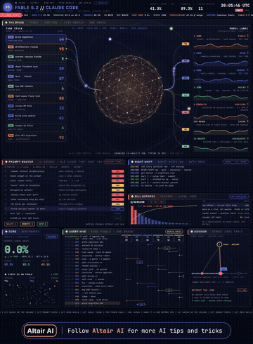

### [DeepResource.ai：JEV agent-router 四路研究寫作分流（概念圖；說明文來自 @Flandermaxx）](https://www.facebook.com/reel/1513020620686286)

風格化 jev-agent-router 節點圖，用 TypeSafe Jev 的 Choice／Score／Noul 把研究寫作分成四路。jev-1.13.0 與列表價屬實；單次 4 ms、把 $0.000042 當固定費、1 萬次 $0.02，以及把 GATE 0.85 當官方預設，皆未驗證。

| 可信度 | 星數 | 出處 |
| --- | --- | --- |
| 概念動畫・宣稱待驗證・可信度中 | — | [影片 92](https://www.facebook.com/reel/1513020620686286) |

DeepResource.ai 上傳的約 24 秒直式 Facebook Reel（2026-11-13；1440×1800；Brian 於 2026-11-14 19:05 Asia/Taipei 從 LINE 傳來[這則分享連結](https://www.facebook.com/share/v/1EM1MrttCh/)，對應[這則 Reel](https://www.facebook.com/reel/1513020620686286)）。泰文說明文與畫面相符，並註明來自 [@Flandermaxx](https://x.com/Flandermaxx/status/2121315745275543653)（2026-11-13 18:54 UTC，即 2026-11-14 02:54 Asia/Taipei）；說明文是該則貼文的忠實摘要，本則有標出原作者。文末「Link อยู่ในคอมเมนต์」（連結在留言）只是指向，不是留言關鍵字換檔，故不標引流。畫面是風格化暗色節點圖，標題列 jev-agent-router-12（nodes 20、edges 371、bus readers 14），不是真實產品錄屏，也沒有這個 agent-router 的公開產品 repo（僅配樂、無旁白）。左側狀態節點是 goal、notes、evidence、gaps、last_error。中央圖把問題送到 jev-1.13.0 · system_one（標 typed、parallel、no_chat），再寫出三個類型化答案：Choice next_worker（research／write／revise／review）、Score urgency（low 到 critical）、Noul safe_to_run（yes／no），然後進 result.*、queues／或 human review。疊字可見 02 JEV DECIDES、03 CHOICE → WRITE、04 GATE HOLDS、06 CODE ACTS。

查證（2026-11-14 台北時間）：jev-1.13.0 是 TypeSafe 真實的 System One 模型，Choice、Score、Noul 也是官方輸出型別；目前最新是 jev-1.14.0（2026-10-14，另加 Box），見[官方模型頁](https://docs.typesafe.ai/models)。官方列表價為每百萬輸入 token $0.042、輸出免費；畫面 GRAPH COST 面板的 input／M tokens $0.042、output free 與此相符。節點上的 cost_usd 0.000042 等於官方價乘上 1,000 個輸入 token，不是一筆固定手續費。X 貼文寫「1 萬次分流只要 $0.02」與 $0.000042 × 10,000 = $0.42 對不上，也與畫面 GRAPH COST 累計金額對不上（稍後畫面可見約 $0.39）。動畫裡單跳延遲約 4 ms（latency_ms 常見 2、4、5），說明文與 X 寫端到端平均 251 ms，畫面 GRAPH COST 則標 median 246 ms。官方文件寫多數呼叫大約 100 ms（發表文給 70–500 ms、從美西典型接近 100 ms），見 [How to build with System One](https://docs.typesafe.ai/concepts/how-to-build-with-system-one) 與 [System One 發表文](https://typesafe.ai/blog/introducing-system-one-models-and-jev)，因此 4 ms 與 251／246 ms 都是動畫或上傳者宣稱，不是官方典型值。GATE ≥ 0.85 寫在畫面 chief.py 的 `if answer.confidence >= 0.85`，以及 hold 0.71 → rev 這類紀錄，是使用者政策，不是 TypeSafe 預設。同一段 chief.py 寫 `from typesafe import Client, Choice, Score, Noul`，以及 `Client(model=jev-1.13.0)`；現行官方 Python SDK 是 `from typesafe_sdk import Choice, Noul, Score, TypeSafeClient`（套件 typesafe-sdk，客戶端類別是 TypeSafeClient 不是 Client），見 [Python usage](https://docs.typesafe.ai/sdk/python/usage/basic)，畫面 import 與現行 SDK 不符。說明文還寫 DISPATCH 以緊急程度把 8 個 worker 分到四條佇列，以及 HUMAN REVIEW 先留待簽名、每個狀態存成 JSON、稿件超過審查窗就提醒；這些是作者的流程設計，不是已發表的 TypeSafe 功能。

可對照 SEQ 0120（JEV Engineering 的科幻 FUI 儀表板，是另一個「JEV」名稱，不是 TypeSafe 的 Jev 模型，兩則不要併在一起）。

互動重現：[jev-agent-router 示範](https://wiki.singularityengine.dev/demos/jev-agent-router/)（可調信心門檻、送出示範狀態，看 Choice／Score／Noul 與閘門 hold 或派遣；花費與延遲標成示範數字，不會連網）。配樂：僅配樂、無旁白。

