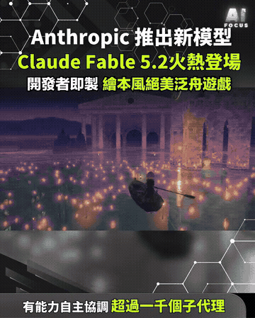
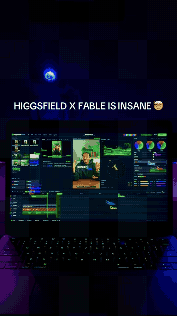

# AI 影像與影片

中文 | [English](../en/docs/ai-media.md)

[回首頁](../README.md)

AI 生成影片與圖片、prompt、AI 渲染、程式化影片

### [HyperFrames](https://github.com/heygen-com/hyperframes)

用 HTML 寫畫面、直接渲染成影片

| 可信度 | 星數 | 出處 |
| --- | --- | --- |
| — | 75,865 | [影片 1](https://www.facebook.com/reel/2050168028979180) |

HeyGen 出的，寫 HTML 就能渲染成影片

### [AI 生成的健身女孩短片](https://www.facebook.com/reel/1449881237350910)

AI 生成的虛擬網紅健身短片，可練習辨識破綻

| 可信度 | 星數 | 出處 |
| --- | --- | --- |
| AI 生成 | — | [影片 14](https://www.facebook.com/reel/1449881237350910) |

「少女晴天」帳號、文案「刮個筋膜刀就力竭了」，整支是 AI 生成的虛擬人物健身片。辨識破綻：衣服與牆上文字亂碼、健身器材結構不合理、瓶子與筋膜刀和身體融在一起、皮膚過度光滑。可當「AI 虛擬網紅」與辨識 AI 影片的案例。配樂：無人聲歌詞的 synth-pop／chill house

### [OPZEN AI：建築／室內 AI 渲染](https://opzenai.com) ⚠️

把草圖或 SketchUp 視圖轉成寫實建築渲染

| 可信度 | 星數 | 出處 |
| --- | --- | --- |
| ⚠️ 引流 | — | 截圖（OPZEN AI） |

上傳 SketchUp／CAD 視圖或手繪草圖就產出寫實渲染，Sync View 可在保留材質與比例下生成一致的其他角度，註冊送 60 點、輸出 1K／2K／4K；「留言 AI Render 送連結」是導流手法。替代方案：SketchUp 內建 AI Render（扣 Trimble 點數）。配樂：Sayfalse – DARE

### 照片轉日系手繪插畫 prompt

把照片轉成日系手繪插畫的 ChatGPT prompt

| 可信度 | 星數 | 出處 |
| --- | --- | --- |
| — | — | 截圖（徐國隆） |

徐國隆示範把情侶照丟進 ChatGPT 生成插畫，prompt：「根據上方照片生成一張的插畫，日系插畫風格、角色特徵鮮明、情緒自然表情、半身構圖、動態姿態、服裝細節精緻、手繪塗鴉風、潑墨筆觸、隨行線條、粉彩與墨色混合、漫畫草稿質感、白色簡約背景、周圍符號元素點綴、氛圍感強、高細節、高品質。」

### [What the water keeps：Kevin Ngo 的繪本風泛舟網頁（稱以 Claude Fable 5.2 製作）](https://what-the-water-keeps.vercel.app)

網頁作品確實可開啟；本則影片只循環播放變形划船動畫，沒有遊戲操作或提示詞。後補核對官方公告：輸入價從 5.1 的每百萬 $10 降至 $8、輸出從 $50 降至 $40；輸出最多快 30%。說明文所稱企業零留存並非預設。

| 可信度 | 星數 | 出處 |
| --- | --- | --- |
| 宣稱待驗證・可信度中 | — | [影片 59](https://www.facebook.com/reel/1465699568821932)／[影片 85](https://www.facebook.com/reel/1682717900077017) |

Aifocus 上傳的約 57 秒 Facebook Reel（2026-11-10）。查證（2026-11-10 台北時間）：Anthropic 確實於 2026-11-09 發布 Claude Fable 5.2 與 Mythos 5.2（[官方公告](https://www.anthropic.com/claude-fable-and-mythos-5-2)）；兩者為同一底模，Fable 公開、Mythos 需經驗證計畫。官網所寫「八天、1,000+ 子代理做出原型作業系統」「30 小時 formalize 費馬大定理」「兩道黑洞物理開放問題」皆為 Anthropic 官方宣稱，本則**未獨立驗證**。[what-the-water-keeps.vercel.app](https://what-the-water-keeps.vercel.app) 可開啟；Kevin Ngo（@kevin_t_ngo）在 X 稱此 demo 由 Fable 5.2 做成（非官方頁具名）。影片未展示可玩過程。可對照 SEQ 0104：兩則都寫 Fable 5.2，但 Fable 5.2 本身是 Anthropic 的 Claude 模型。

【影片 85】Marc.AI 上傳的約 10 秒直式 Facebook Reel（2026-11-10；Brian 於 2026-11-13 在對話傳來 [這則 Reel](https://www.facebook.com/reel/1682717900077017)）。說明文稱 11 月 9 日推出 Fable 5.2 與 Mythos 5.2，編碼、推理與視覺更強；Fable 5.2 回答快 30%，輸入價從每百萬 token $10 降至 $8，並支援企業零資料留存；Mythos 5.2 仍限經驗證的資安與生命科學使用者。畫面是通用科幻儀表板動畫，沒有產品介面、價格數字或官方標示，故不另做 GIF。無留言換連結，故不標引流。

查證（2026-11-13 台北時間，對照[官方公告](https://www.anthropic.com/claude-fable-and-mythos-5-2)、[產品頁](https://www.anthropic.com/claude/fable)、平台模型頁與發布說明、以及[資料留存說明](https://platform.claude.com/docs/en/manage-claude/api-and-data-retention)）：

- 11 月 9 日發布：已核過，仍相符
- 編碼、推理與視覺更強：官方寫在 coding、reasoning、vision 等面向有改進，屬官方宣稱
- 「快 30%」：官方原文是 Fable 5.2 與 Mythos 5.2 產生輸出最多快 30%（up to 30% faster）於 5.1，不是只寫 Fable、也不是固定 30%。另有可選 fast mode，產生速度最多約 2.5 倍，價為輸入 $16／輸出 $80 每百萬 token
- 價格：官方確認輸入從 5.1 的每百萬 $10 降至 $8；說明文沒寫輸出價，官方是從 $50 降至 $40。快取讀取為 $0.20（5.1 為 $0.25）
- 「企業零資料留存」過寬：官方預設為安全監控所需的 30 天資料留存（Covered Models）；除非 Anthropic 另行授權，否則不適用零資料留存（ZDR）。企業 Frontier Safeguards（EFS）目前為私人測試，合格客戶可在導入 EFS 前繼續以 ZDR 使用；其他客戶為 30 天留存
- Mythos 限制：官方是需通過已擴大的 Life Sciences 與 Cyber Verification Programs 的機構申請，不是籠統的「已驗證使用者」

無私人 IP 或本機路徑。配樂：未標。

### ⚠️ [Higgsfield X Fable 剪輯廣告（付費合作）](https://higgsfield.ai) ⚠️

擺拍筆電上的剪輯畫面，標 #higgsfieldpartner；片尾要留言 SHORTS 換連結，沒示範步驟

| 可信度 | 星數 | 出處 |
| --- | --- | --- |
| ⚠️ 引流・後製包裝・可信度低 | — | ⚠️ [影片 66](https://www.facebook.com/reel/1461806646088320) ⚠️ |

Ecomlee 上傳的約 14 秒 Facebook Reel（2026-11-11），說明文標 #higgsfieldpartner，屬付費／合作宣傳。畫面是筆電上的剪輯軟體擺拍，沒有操作步驟。畫面上寫「HIGGSFIELD X FABLE IS INSANE」，片尾「Comment SHORTS for the link」（說明文本身沒寫這句），屬引流。查證：不是另一套名叫 X Fable 的獨立 App；Higgsfield 官網與更新寫的是 Claude Fable 5.2 × Higgsfield MCP，以及 Supercomputer agent powered by Fable 5.2——亦即用 Anthropic 的 Fable 模型去調 Higgsfield 的影像／影片工具（見 SEQ 0104）。本則未示範實際剪輯流程，成效未驗證。配樂：未標。GIF：0:02–0:12。

