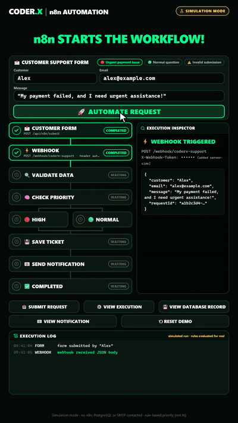
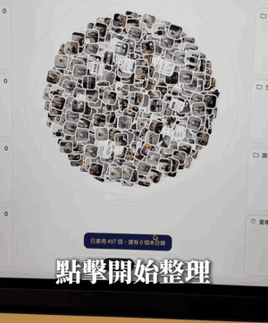

# 自動化工作流

中文 | [English](../en/docs/automation-workflows.md)

[回首頁](../README.md)

n8n 等流程自動化，規則優先與人工核准閘門

### [n8n 客服工單自動化流程](https://www.facebook.com/reel/3209079722631476)

表單到 SQL 工單的規則式客服自動化流程

| 可信度 | 星數 | 出處 |
| --- | --- | --- |
| 概念動畫 | — | [影片 7](https://www.facebook.com/reel/3209079722631476) |

表單送出→Webhook→驗證資料→用規則（非 AI）判斷 urgent／payment failed 為高優先→寫入 SQL 工單（INSERT … ON CONFLICT 防重試重複）→寄通知信→回 HTTP 200。影片是 AE 風格模擬動畫，不是真的 n8n 畫面（CODER.X）

霓虹綠終端風工作流 UI：節點依序亮起打勾、右側面板顯示 JSON、底部 log 逐行出現；可用 CSS keyframes + 依序 setTimeout 切換 active class 重現

### [n8n Email Agent：Gmail→AI Agent→HubSpot／Docs／Sheets](https://n8n.io/workflows/7680-automate-gmail-lead-follow-up-with-openai-gpt-4o-hubspot-slack-and-google-sheets/) ⚠️

Gmail 觸發、AI 查 CRM 後擬信的 n8n 範本

| 可信度 | 星數 | 出處 |
| --- | --- | --- |
| ⚠️ 引流 | — | 截圖（Maruf AI Automation Expert） |

MD Abdullah Al Maruf（孟加拉 n8n／Make 接案者）的「留言 Email Agent 拿模板」導流片：Gmail 觸發→AI Agent 查 HubSpot、Google Docs、Sheets→寄出或存草稿。n8n 官方免費範本就有同款（本連結 #7680）；#8967 則是先依 HubSpot 資料擬回覆、再到 Slack 讓人核准才寄出。面試：AI 只擬草稿、人核准後才寄送，就是對外動作的品質閘門

### [Claude 做的照片／影片自動分類網頁（單一 HTML）](https://www.instagram.com/reel/DfKEVgNSL3l/) ⚠️

用 Claude 生成一個 HTML 檔，在 Chrome 選資料夾後交給 Claude 分類，再按「開始整理」讓縮圖飛進各分類

| 可信度 | 星數 | 出處 |
| --- | --- | --- |
| ⚠️ 引流・可信度中 | — | [影片 41](https://www.instagram.com/reel/DfKEVgNSL3l/) ⚠️ |

亨利溫 Henry Wen 上傳的 19 秒 Instagram Reel，用手機翻拍筆電螢幕。流程：用 Chrome 開啟 Claude 做的單一 HTML 檔→選資料夾→複製資料貼給 Claude 分類→下載分類結果→按「開始整理」，縮圖從中間一團飛進網頁截圖、旅行與景點、生活日常、工作日常、迷因圖、純文字等分類，照片和影片分開兩區。說明文寫「回復任意留言」就私訊指令包，屬於留言導流。可信度：中，指令包要留言才拿得到，影片也沒秀分類準不準，只秀動畫。配樂：lofi。旁白像 AI 語音。面試：「AI 判斷＋本機程式執行」拆開做，AI 只產出分類清單、搬檔由確定性程式處理，結果可以先預覽再套用，出錯也好回溯

GIF：影片 0:10.5–0:14，縮圖飛進分類的動畫（手機翻拍螢幕）。

▶ 互動 Demo：[開啟](../demos/photo-sort-fly/) ⚠️（https://wiki.singularityengine.dev/demos/photo-sort-fly/ ⚠️）
