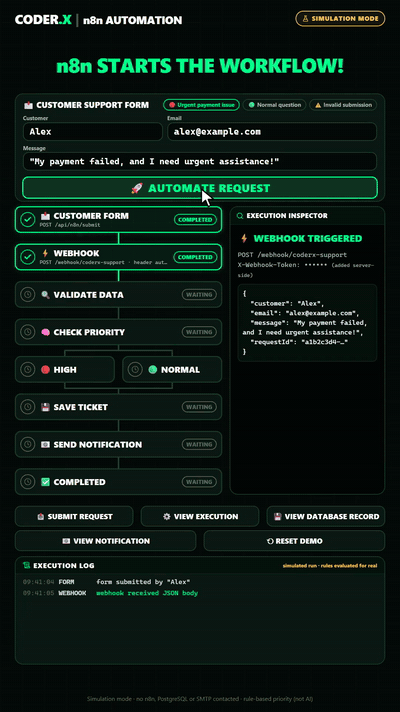
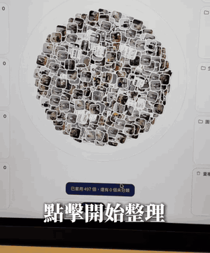
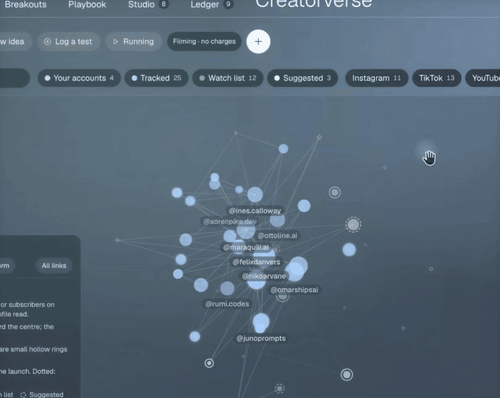

# 自動化工作流

中文 | [English](../en/docs/automation-workflows.md)

[回首頁](../README.md)

n8n 等流程自動化，規則優先與人工核准閘門

### [n8n 客服工單自動化流程](https://www.facebook.com/reel/3209079722631476)

表單到 SQL 工單的規則式客服自動化流程

| 可信度 | 星數 | 出處 |
| --- | --- | --- |
| 概念動畫 | — | [影片 7](https://www.facebook.com/reel/3209079722631476) |

表單送出→Webhook→驗證資料→用規則（非 AI）判斷 urgent／payment failed 為高優先→寫入 SQL 工單（INSERT … ON CONFLICT 防重試重複）→寄通知信→回 HTTP 200。影片是 AE 風格模擬動畫，不是真的 n8n 畫面（CODER.X）

霓虹綠終端風工作流 UI：節點依序亮起打勾、右側面板顯示 JSON、底部 log 逐行出現；可用 CSS keyframes + 依序 setTimeout 切換 active class 重現

### [n8n Email Agent：Gmail→AI Agent→HubSpot／Docs／Sheets](https://n8n.io/workflows/7680-automate-gmail-lead-follow-up-with-openai-gpt-4o-hubspot-slack-and-google-sheets/) ⚠️

Gmail 觸發、AI 查 CRM 後擬信的 n8n 範本

| 可信度 | 星數 | 出處 |
| --- | --- | --- |
| ⚠️ 引流 | — | 截圖（Maruf AI Automation Expert） |

MD Abdullah Al Maruf（孟加拉 n8n／Make 接案者）的「留言 Email Agent 拿模板」導流片：Gmail 觸發→AI Agent 查 HubSpot、Google Docs、Sheets→寄出或存草稿。n8n 官方免費範本就有同款（本連結 #7680）；#8967 則是先依 HubSpot 資料擬回覆、再到 Slack 讓人核准才寄出。

### [Claude 做的照片／影片自動分類網頁（單一 HTML）](https://www.instagram.com/reel/DfKEVgNSL3l/) ⚠️

用 Claude 生成一個 HTML 檔，在 Chrome 選資料夾後交給 Claude 分類，再按「開始整理」讓縮圖飛進各分類

| 可信度 | 星數 | 出處 |
| --- | --- | --- |
| ⚠️ 引流・可信度中 | — | [影片 41](https://www.instagram.com/reel/DfKEVgNSL3l/) ⚠️ |

亨利溫 Henry Wen 上傳的 19 秒 Instagram Reel，用手機翻拍筆電螢幕。流程：用 Chrome 開啟 Claude 做的單一 HTML 檔→選資料夾→複製資料貼給 Claude 分類→下載分類結果→按「開始整理」，縮圖從中間一團飛進網頁截圖、旅行與景點、生活日常、工作日常、迷因圖、純文字等分類，照片和影片分開兩區。說明文寫「回復任意留言」就私訊指令包，屬於留言導流。可信度：中，指令包要留言才拿得到，影片也沒秀分類準不準，只秀動畫。配樂：lofi。旁白像 AI 語音。

GIF：影片 0:10.5–0:14，縮圖飛進分類的動畫（手機翻拍螢幕）。

▶ 互動 Demo：[開啟](../demos/photo-sort-fly/) ⚠️（https://wiki.singularityengine.dev/demos/photo-sort-fly/ ⚠️）

### [FounderOS／Content Lab：創作者內容情報系統（Apify 爬取）](https://www.facebook.com/reel/1423421943269401) ⚠️

宣稱完全開源的創作者情報 App：用 Apify 抓同領域創作者貼文、算爆紅倍數、執行前先顯示爬取成本；但找不到 repo，要留言才給

| 可信度 | 星數 | 出處 |
| --- | --- | --- |
| ⚠️ 引流・宣稱待驗證・可信度低 | — | [影片 44](https://www.facebook.com/reel/1423421943269401) ⚠️ |

Brody 上傳的 1 分 53 秒 Facebook Reel，男聲英文旁白，配樂是安靜的氛圍合成器。畫面上下分割：上半部是 App 畫面，下半部是 Brody 在暗色攝影棚講解（前景有玻璃西洋棋，燒錄字幕）。App 標題列寫 glados / Lab，側欄有 Funnel、Brand Deals、Finances、Social、Creative Engine、Analytics、Content Lab、Editor、Agents、Tasks、Workflows、Skills、Brain、Settings。Content Lab 分頁：Today（你的貼文對自己常態的倍數 1.3x、同領域爆紅 17 則）、Breakouts（The Field 散佈圖，單篇細節顯示 8.6x）、Playbook（什麼讓貼文爆紅，附引用來源的腳本規則，例如 hook 要短）、Radar（Topic tide 上升話題）、Studio（寫腳本的 agent 對話）、Creatorverse（發光的創作者節點網路，上方篩選列 Your accounts 4／Tracked 25／Watch list 12／Suggested 3）、Ledger（預測校準）。按 Run now 會先跳估價視窗：4 accounts, 25 tracked creators, 15 posts each，約 $2.26（區間 $1.30 到 $3.12），寫明 Apify 每次執行到上限（最高 $3.00）就停、本月已用 $4.10／$46.00，並標示 Filming · no charges。之後切到真的瀏覽器錄影，畫面是 Apify Console 裡的 Instagram Scraper 頁面（[apify.com/apify/instagram-scraper](https://apify.com/apify/instagram-scraper) ⚠️，官方 Actor，按結果計費，頁面標價 $1.50／1,000 筆）。說明文宣稱「completely open source」，可以抓你領域的所有創作者、每次爬取都顯示成本、教 AI 什麼叫爆紅；但要留言「FOUNDER」才私訊平台和 Apify 設定教學，屬於留言導流。查證：GitHub API 搜尋 FounderOS、glados content lab、founderos apify 都是 0 筆（creatorverse 有 573 筆，但都是無關的學生作業），開源說法無法驗證。畫面判讀（逐格檢查）：App 段落有大量後製，傾斜鏡頭、景深模糊、光暈轉場、自動推近、平滑游標，看不到瀏覽器外框，帳號名稱看起來也像虛構的；但各分頁數字前後一致，估價視窗細節很具體，還有「Filming · no charges」這種拍攝模式標籤，也可能是用 Screen Studio 之類工具後製的真 App 錄影，不能斷定是純動態設計假畫面，所以標「宣稱待驗證」而不是「概念介面」。可信度：低，沒有可查的 repo，開源要留言才拿得到。配樂：氛圍合成器。

GIF：影片 1:14.5–1:17.5，Creatorverse 創作者節點網路（只裁上半部 App 畫面）。

▶ 互動 Demo：[開啟](../demos/creatorverse-network/) ⚠️（https://wiki.singularityengine.dev/demos/creatorverse-network/ ⚠️）

### 0142　Andrey Superior（@andreysuperior）：Fable 5.2 團隊 agent 在 Meta Ads Manager 建立並發布活動（宣稱；Facebook 轉發）

QuickTime 重播 Ads Manager 示範帳戶建立並發布活動；Fable／agent／沒人碰滑鼠的說法無法從畫面查證。標籤：宣稱待驗證・可信度中。來源：影片 98。

Andrey Superior（@andreysuperior）的約 19.5 秒直式畫面，經 Facebook 轉發（1440×2560，30fps；info.json 的 timestamp 為 1794642498，即 2026-11-14 07:48:18 UTC、2026-11-14 15:48:18 Asia/Taipei；upload_date 欄為 20261114，是 UTC 日期）。Brian 於 2026-11-15 從電腦傳來 https://www.facebook.com/reel/1111517925213954 。Facebook 上傳帳號是 Ampornchai Maneesangsakorn，說明文是泰文評論（大意是廣告代理商接下來要怎麼辦，如果它已經能做到這種程度），不是原作者的英文說明。原片是 Andrey 的 X 貼文 https://x.com/andreysuperior/status/2121353793577369670 。Facebook 與 X 都沒有要留言關鍵字換東西，故不標引流。畫面疊了 Fable 5.2 + Meta Ads。從頭到尾看得到 QuickTime Player 的選單列，也就是在播一段 Ads Manager 的螢幕錄影，不是即時的 agent 操作介面；片中也沒有出現 Claude、Fable 或任何 agent 控制台。因此「Fable 5.2 帶一組 agent、沒有人碰滑鼠、就在 Ads Manager 裡建好並發布活動」這類說法，無法從這支影片本身查證。X 說明文還寫 this shit already made and saved me over $10,000，金額只出現在說明文、沒有出現在畫面，同樣未驗證。螢幕標題列寫 Demo Ad Account，旁邊有一組帳號數字，位址列也帶著對應參數；本則與 GIF 都已遮去，不抄寫。網站欄是 example 風格的示範網址（可見 harbordental.example 與 new-patients 一類路徑），不是已驗證的真實網站。這些都顯示這是示範廣告帳戶，不能當成真實投放或真實花費。畫面上的活動名稱是 Harbor Dental | Leads | New patients，文案也用了這個名稱與 New to Portland 一類句子。本則只把它當成示範帳戶裡的畫面文字，不把這個名稱連到任何真實診所或公司，也不另加外部商業連結。可見流程大致是：新建活動（Leads／CTA）、每日預算後來可見約 45 美元、受眾寫 Portland +15 mi 與 25–65+，同時開了 Advantage audience，地區仍見 United States；右側 Audience definition 的估計人數約 331,000,000–372,000,000，這個量級和「波特蘭 15 英里」對不上，比較像把範圍放到接近全國。接著是文案與素材（牙齒圖示、Welcoming new patients）、預覽、Draft ready for review，再出現 Publishing your campaign（1 campaign、3 ad sets、6 ads），最後有 Campaign published、廣告進入審核的提示。發布前沒有另外跳出人工核准閘門，也沒有再確認一次每日上限（只看到每日預算欄位）。把建立活動的步驟自動化，也不等於買得有效益。另外，用自動化手段操作 Meta 產品、且未經事先許可，會碰到平台條款風險；官方允許的程式化廣告路徑是 Marketing API，不是去驅動 Ads Manager 介面。見 https://www.facebook.com/legal/terms 與 https://developers.facebook.com/docs/marketing-apis 。本則不是操作教學，也不示範怎麼自動點擊。可對照 SEQ 0106（Fable 5.2 是 Anthropic 於 2026-11-09 發布的正式模型）、SEQ 0111（另一則疊 Fable 5.2 字樣、但沒示範實際流程的宣傳短片）、SEQ 0133（同一型號的概念分流動畫，同樣不是產品錄屏）。互動重現：https://wiki.singularityengine.dev/demos/meta-ads-agent-pipeline/ （六步虛構管線，有人工核准閘門與預算上限開關；這不是 Meta 的介面，也不會連網或刊登廣告）。配樂：有現場環境音與介面操作聲，曲名未標。GIF：0:12–0:19（已裁到筆電螢幕，並遮去帳號數字、付款列尾碼，以及既有活動的花費欄；https://wiki.singularityengine.dev/assets/gifs/v92-meta-ads-agent-pipeline.gif）。

互動 Demo：[meta-ads-agent-pipeline](https://wiki.singularityengine.dev/demos/meta-ads-agent-pipeline/)

