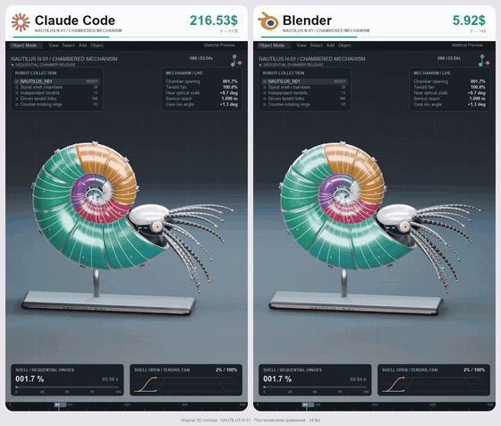
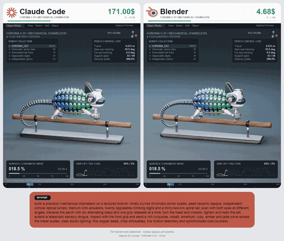

# 成本與取捨

中文 | [English](../en/docs/cost-tradeoffs.md)

[回首頁](../README.md)

token 成本、指令輸出壓縮、agent 與傳統工具的成本對比

### [TokenEconomizer](https://github.com/microsoft/TokenEconomizer)

用過往經驗降低 agent token 成本的研究工具

| 可信度 | 星數 | 出處 |
| --- | --- | --- |
| — | 1,349 | [影片 1](https://www.facebook.com/reel/2050168028979180) |

微軟研究院用過去經驗降低 agent 成本，SWE-Bench 成本降 18–31%（README 自述）

### [Claude Code vs Blender 成本梗](https://www.facebook.com/reel/1867596277567322)

用鸚鵡螺動畫諷刺 agent 生 3D 的 token 成本

| 可信度 | 星數 | 出處 |
| --- | --- | --- |
| 概念動畫 | — | [影片 2](https://www.facebook.com/reel/1867596277567322) |

同一段機械鸚鵡螺 3D 動畫，Claude Code 計數器跳到 512 美元，Blender 只要 14 美元，諷刺用 agent 生複雜動畫的 token 成本

左右分屏 3D 機械鸚鵡螺展開動畫＋上方金額計數器飛快跳動；可用 Three.js 模型動畫 + requestAnimationFrame 數字滾動計數器重現

### [Claude Code vs Blender：機械變色龍](https://www.facebook.com/reel/1413855857399181)

同系列成本對比動畫，主角換成機械變色龍

| 可信度 | 星數 | 出處 |
| --- | --- | --- |
| 概念動畫 | — | [影片 8](https://www.facebook.com/reel/1413855857399181) |

同影片 2 的對戰版型（左 Claude Code、右 Blender，金額計數器 512 美元 vs 14 美元），主角換成機械變色龍：雙眼各自轉動、沿樹枝走六步、伸出伸縮舌頭、鱗片波浪變色。底部附完整 prompt，作者 @marlenuii

左右分屏機械變色龍沿樹枝行走、鱗片波浪式變色、金額計數器跳動；變色可用 shader 依位置+時間偏移 hue 重現

### Claude Code vs Blender：ORBITAL X-02 火箭

同系列成本對比動畫，主角換成重型火箭

| 可信度 | 星數 | 出處 |
| --- | --- | --- |
| 概念動畫 | — | 截圖（DeepRepo.ai） |

同 @marlenuii 那系列對戰版型：重型火箭（陶瓷白燃料槽、雙助推器、14 個噴嘴、整流罩打開放出金箔衛星與太陽能板、分節再組回）左 Claude Code 184.70 美元、右 Blender 9.65 美元，約 19 倍。文案主張「AI 定義概念與結構、程式碼負責重複、Blender 負責執行」；畫面下方俄文註明金額是為影片設定的，不是實測成本

### [RTK（Rust Token Killer）](https://github.com/rtk-ai/rtk)

先壓縮指令輸出再交給 agent，省下大量 token 的 CLI 代理

| 可信度 | 星數 | 出處 |
| --- | --- | --- |
| — | 85.1k | Brian 推薦清單 2026-10-31 |

rtk-ai 的單一 Rust 執行檔：攔截 agent 執行的 shell 指令（ls、grep、git status／diff／log、cargo test、pytest、docker ps 等 100+ 種），把輸出壓縮後才進 LLM 上下文，例如測試只留失敗、git log 只留雜湊與標題，宣稱常見開發指令省 60–90% token、額外延遲 < 10 ms。README 自己說明省的是 bash 輸出，不等於帳單同比例下降，token 數是 bytes/4 估算。安裝：`brew install rtk`（或官方 install.sh），再 `rtk init -g` 接上 Claude Code（`--codex`、`--agent cursor` 等）；`rtk gain` 看節省統計。授權：GitHub 標 Apache-2.0，README 寫完整版是 Apache-2.0＋BUSL-1.1，純 Apache 版叫 rtk-oss；crates.io 上另有同名的不相干套件。

### [一人公司研究所：10 款專精小模型與三個挑選原則](https://www.facebook.com/reel/1761537521611500)

插畫解說別光追大模型，列出 10 款專精小模型與夠專精、授權能商用、電腦跑得動三原則。10 款名稱都找得到官方頁；GLiNER 舊版 209M 權重是非商業授權，SenseVoice 為自訂授權

| 可信度 | 星數 | 出處 |
| --- | --- | --- |
| 可信度中 | — | [影片 80](https://www.facebook.com/reel/1761537521611500) |

一人公司研究所（與 SEQ 0099 同一上傳帳號）約 151 秒直式 Facebook Reel（2026-11-12；Brian 於 2026-11-13 08:07 Asia/Taipei 從 LINE 轉來裸連結 https://www.facebook.com/share/v/1HtZM2hmmW/，對應 [這則 Reel](https://www.facebook.com/reel/1761537521611500)）。全片是插畫卡片，不是產品錄屏，無私人資訊。說明文主張大模型什麼都會但貴、許多工作交給只做一件事的小模型又快又便宜，並寫這份名單從一支 12 款影片逐款對過官方資料、改正 3 處版本錯位、補新款並淘汰授權有坑的之後留下 10 款；片中也出現「先查核，再推薦」、12→10 等字樣。這段「12 款來源影片／3 處錯位／淘汰授權坑」是作者自稱，本則只核了留下的 10 款是否存在與授權，沒有核對被淘汰的名單。片尾三個原則與說明文一致：夠專精、授權能商用、你的電腦跑得動。說明文最後寫完整查核筆記已整理成報告放在留言區，這是指向已貼出的報告，不是留言關鍵字才給連結，不標引流（有別於 SEQ 0095 影片 48 的留言編號換連結）。SkillSpector 不適用（模型權重，非 skill／MCP repo）。

查證（2026-11-13 台北時間，Hugging Face／GitHub 官方頁）：

| 說明文 | 官方連結 | 參數 | 授權 | 備註 |
| --- | --- | --- | --- | --- |
| SenseVoiceSmall（234M） | https://huggingface.co/FunAudioLLM/SenseVoiceSmall | 官方 README 寫規模與 Whisper-Small 相近，未逐字寫 234M（Whisper-Small 常見約 244M） | other／FunASR MODEL_LICENSE（自訂條款，非標準 SPDX 寬鬆授權；官方議題回覆曾說可商用但需標示來源，仍應自行閱讀條款） | 存在 |
| PaddleOCR-VL（0.9B） | https://huggingface.co/PaddlePaddle/PaddleOCR-VL | 官方 0.9B | Apache-2.0 | 另有較新的 PaddleOCR-VL-1.6；說明文指 0.9B |
| Qwen3-Embedding-0.6B | https://huggingface.co/Qwen/Qwen3-Embedding-0.6B | 官方 0.6B（畫面寫 596M） | Apache-2.0 | 存在 |
| Qwen3-Reranker-0.6B | https://huggingface.co/Qwen/Qwen3-Reranker-0.6B | 官方 0.6B | Apache-2.0 | 存在 |
| GLiNER（209M） | https://github.com/urchade/GLiNER | 209M 是 medium／base 規模 | 早期 v0／v1 的 209M（如 gliner_base、gliner_medium）為 **CC-BY-NC-4.0（不能商用）**；v2／v2.1 的 209M（如 urchade/gliner_medium-v2.1）為 Apache-2.0 | 說明文未標版本，選用時必須核對權重授權 |
| SetFit | https://github.com/huggingface/setfit | 說明文未寫參數規模（正確：這是 few-shot 方法／函式庫，不是單一固定參數權重檔） | Apache-2.0 | 存在 |
| Laya（421M） | https://huggingface.co/convaiinnovations/laya | 官方 421M | Apache-2.0 | 找得到。非自回歸判斷／分類模型（Convai Innovations，ModernBERT-large），與「只做判斷，毫秒級給答案（要用自己的資料微調）」相符，不是語音模型 |
| Kokoro-82M | https://huggingface.co/hexgrad/Kokoro-82M | 官方 82M TTS | Apache-2.0 | 說明文「授權乾淨可商用」與此相符 |
| Real-ESRGAN（16.7M） | https://github.com/xinntao/Real-ESRGAN | 16.7M 是 x4plus 生成器（RRDBNet）常見標示，Qualcomm AI Hub 等頁也寫 16.7M；本則未自行點算權重 | BSD-3-Clause（可商用） | 存在 |
| Chronos-2（120M） | https://huggingface.co/amazon/chronos-2 | 官方 README 寫 120M 參數 encoder-only 時間序列基礎模型 | Apache-2.0 | 存在 |

配樂：未標。GIF：2:18–2:23。

