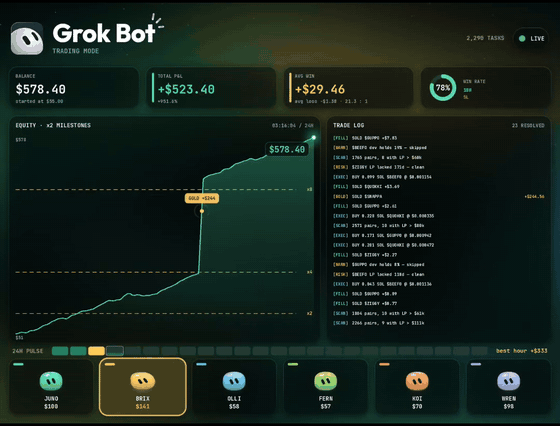

# 金融與交易

中文 | [English](../en/docs/finance-trading.md)

[回首頁](../README.md)

交易圖表、財務 Claude 技巧，以及交易機器人導流片

### [TradingView K 線回放動畫](https://www.facebook.com/reel/1632204671708366)

用 Bar Replay 錄成帶標註的 K 線回放動畫

| 可信度 | 星數 | 出處 |
| --- | --- | --- |
| — | — | [影片 3](https://www.facebook.com/reel/1632204671708366) |

用 TradingView 的 Bar Replay 高速重播行情並螢幕錄影，疊上 Premium／Discount 分區、成交量分布、Buy/Sell 與 TP 標籤和狀態面板；可改用 canvas 自己做成 HTML

這支的 canvas 重現在本倉庫：[K 線回放圖表演示](../demos/chart-replay/index.html)。

K 線逐根回放、Premium/Discount 半透明色帶、右側成交量分布直方圖與狀態面板即時更新；可用 Canvas 2D 逐幀畫蠟燭 + 疊加矩形區塊重現

### [財務人員的 25 個 Claude 技巧](https://www.facebook.com/reel/1411775787706586)

財務人員用 Claude 處理 Excel 與報表的 25 招

| 可信度 | 星數 | 出處 |
| --- | --- | --- |
| — | — | [影片 12](https://www.facebook.com/reel/1411775787706586) |

Nicolas Boucher 整理，分五類：Claude in Excel（儲存格引用、解釋公式、找 #REF、預算差異、對帳、三表模型、PDF 抽表）、Dashboard（Styles、一客戶一 Project、Artifact 互動儀表板、KPI 追溯）、Claude Cowork（只開專用資料夾的最小權限、先列計畫等核准再動檔案、批次改名、截圖轉 Excel）、最佳實務（Opus／Sonnet／Haiku 分工、XML 標籤、防幻覺驗證、直接產出 XLSX／PPT、用 Claude Code 自動化報表）。配樂：女聲 EDM／House，無法辨識曲名

### [⚠️ AI 交易機器人導流片（反面教材）](https://www.facebook.com/reel/1893910828071251) ⚠️

用假獲利畫面導流的 AI 交易影片，反面教材

| 可信度 | 星數 | 出處 |
| --- | --- | --- |
| ⚠️ 引流 | — | [影片 13](https://www.facebook.com/reel/1893910828071251) ⚠️ |

Tauhid 2.0 宣稱「給 Grok Bot 53 美元自動調槓桿」，畫面從 $54.76 漲到 $3,874.56、勝率 68%、平均 67.5 倍槓桿。但沒有任何真實交易所或 Grok 介面、權益曲線完全沒回撤、平倉還會噴彩帶，幾乎確定是 AE 動畫；「私訊 GROK BOT」是典型課程／單子群導流。配樂：駭客風 synthwave

暗綠玻璃擬態交易儀表板：權益曲線繪製、交易 log 捲動、底部角色卡輪流高亮，中途彩帶粒子爆發＋獲利彈窗；可用 Canvas 折線動畫 + canvas-confetti 重現（內容本身為假獲利，僅參考 UI）

### [ALGORY：「打造自動化避險基金第 289 天」](https://algory.app/) ⚠️

用基因演算法產生 MT5 交易機器人的付費軟體

| 可信度 | 星數 | 出處 |
| --- | --- | --- |
| ⚠️ 引流 | — | 截圖（Tommy Vaga） |

Tommy Vaga（應即 VagaFX 的 Tomas Edgar）賣的 Windows 軟體：用基因演算法讓策略分 Consistency／Growth 兩族繁殖約 20 代，以沒看過的 30% 歷史資料做樣本外測試、再跟 MT5 逐筆比對，存活者匯出成 MetaTrader 5 機器人，原型有 Multi Signal、Breakout Hunter、Reversion 等。官網自己寫「Algory 不會幫你交易」，作者也承認「避險基金」只是文字遊戲；影片只有紅色 HUD、沒有任何真實損益，回測不代表未來，請比照 Tauhid 2.0 存疑。配樂：ayaibrahimx 原聲

### [Grok Desk：6 個 AI agent 的 BTC 交易終端](https://x.com/marlenuii/status/2115396645131022816)

六個 AI agent 交易 BTC 的概念動畫介面

| 可信度 | 星數 | 出處 |
| --- | --- | --- |
| 概念動畫 | — | 截圖（DeepRepo.ai） |

作者留言標明出處是 @Marlenuii（本 wiki 港口動畫、Claude Code vs Blender 的作者）：TAKER、SPOTTER、EDGE、CLOSER、PRIOR、KELLY 六個 agent 圍著中央反應爐，搭配 18 個資料訊號與即時盤面。這是設計好的動畫概念，不是可用的產品；Grok Bot 目錄上確實有類似分工的 Poly 範本（paper-first、先模擬盤的 Polymarket BTC 5 分鐘漲跌盤），可參考但別當成這支影片的實作
