# 前端與 UI 設計

中文 | [English](../en/docs/frontend-ui.md)

[回首頁](../README.md)

設計系統、UI linter、設計 skill、介面模板與概念介面

### [fx0](https://github.com/vercel-labs/fx0)

用文字描述頁面，生成單一 HTML 檔

| 可信度 | 星數 | 出處 |
| --- | --- | --- |
| — | 418 | [影片 1](https://www.facebook.com/reel/2050168028979180) |

描述頁面，它寫成一個 HTML 檔（Vercel）

### [Awesome DESIGN.md](https://github.com/VoltAgent/awesome-design-md)

73 個真實網站的設計系統，讓 AI 照著做 UI

| 可信度 | 星數 | 出處 |
| --- | --- | --- |
| — | 124.7k | [影片 9](https://www.facebook.com/reel/1780228483203385) |

VoltAgent 整理 73 個真實網站（Stripe、Linear…）的 DESIGN.md，丟進專案讓 Claude 照真實設計系統做，避免 AI 臉

### [Impeccable](https://github.com/pbakaus/impeccable)

抓出 AI 味設計問題的指令與規則集

| 可信度 | 星數 | 出處 |
| --- | --- | --- |
| — | 97.2k | [影片 9](https://www.facebook.com/reel/1780228483203385) |

24 個設計指令（/impeccable audit、polish、bolder、quieter…）+ 59 條規則，專抓漸層標題、emoji 圖示、全用 Inter 等 AI 味；Apache-2.0

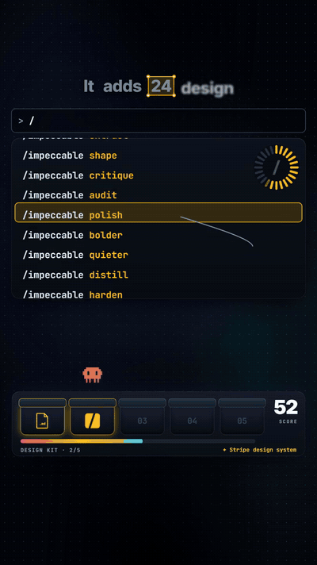

UI 介面拆成多層玻璃平面做 3D 透視傾斜爆炸圖、紅色警示標籤逐一彈出；可用 CSS perspective + rotateX/rotateZ + translateZ 分層重現

### [Taste Skill](https://github.com/Leonxlnx/taste-skill)

用三個參數設定設計品味的 Claude skill

| 可信度 | 星數 | 出處 |
| --- | --- | --- |
| — | 106.4k | [影片 9](https://www.facebook.com/reel/1780228483203385) |

用 bold／motion／density 三個參數設定設計風格，讓 Claude 照你的品味產出；MIT

### [Web Design Guidelines（Vercel skill）](https://github.com/vercel-labs/agent-skills/tree/main/skills/web-design-guidelines)

像 UI linter 一樣檢查網頁可用性的 skill

| 可信度 | 星數 | 出處 |
| --- | --- | --- |
| — | 33.3k（agent-skills） | [影片 9](https://www.facebook.com/reel/1780228483203385) |

vercel-labs/agent-skills 內的 skill，像 UI linter：抓禁止縮放、點擊區 < 24px、送出無 loading 狀態

### [Apex：JARVIS 風 AI 幕僚長介面](https://github.com/RubenM1990/APEX-UI)

JARVIS 風格 AI 幕僚長的 3D 介面原始碼

| 可信度 | 星數 | 出處 |
| --- | --- | --- |
| 概念介面 | 158 | 截圖（Reznikov Engineering） |

Reznikov Engineering（Ruben Mouradian）的獨立創業者 AI 幕僚長。公開的 APEX-UI：Next.js 15 + React 19 + react-three-fiber，金色光環球體配 18 個 agent 節點的推理網、STANDBY 狀態列（即藍色 org chart 那張截圖）。粒子人頭「Apex Humanoid」放在非公開 repo；MIT，品牌不在授權內

### [Vessa／Cadra 後台儀表板模板](https://codeandchill.store/templates/vessa)

付費後台儀表板模板，可當 AI 做 UI 的參考

| 可信度 | 星數 | 出處 |
| --- | --- | --- |
| 付費模板 | — | 截圖（Code and Chill） |

Code and Chill 販售的付費模板（非 AI 生成 demo）：Vessa 是保養品牌庫存系統，Cadra 是 29 頁工廠管理系統。TypeScript + GSAP、無框架無後端，各 $78；沒有公開 repo。可當作給 AI 做後台 UI 的設計參考

### [Open Design Agent Kit（Feima Code）](https://marketplace.visualstudio.com/items?itemName=feima.open-design-agent-kit)

把大量設計 skill 帶進 Copilot Chat 的 VS Code 擴充

| 可信度 | 星數 | 出處 |
| --- | --- | --- |
| — | 581 | 截圖（DeepRepo.ai） |

VS Code 擴充把 270+ 設計 skill、150+ 品牌設計系統、160+ 範例做成 GitHub Copilot Chat 的原生工具與 / 指令，用你在 Copilot 選的模型產出 HTML 檔進 repo，不需 daemon、MCP 或 API key；同 repo 也提供 Claude Code 外掛、Codex skill 與 MCP server，MIT。畫面上的 Ram Maheshwari（@rammcodes）是轉貼來源

### [Websites in 2026：Aethelburg 與 Montfort](https://www.facebook.com/reel/1834273334429297) ⚠️

兩個 WebGL 捲動動畫很重的 2026 風格網站展示

| 可信度 | 星數 | 出處 |
| --- | --- | --- |
| ⚠️ 引流 | — | [影片 29](https://www.facebook.com/reel/1834273334429297) ⚠️ |

wearebrand 的「Websites in 2026 🤩」，文案「Comment “WEBSITE” and let’s make your brand stand out」是留言關鍵字招攬接案的導流，片中的網站不一定是他們做的。真實拍攝在 Mac 上捲動兩個 WebGL 很重的網站：① Aethelburg（⚠️ https://aethelburg.network ⚠️），粒子群、扭曲字型、捲動時的 3D 平面，片中是某工作室的職缺頁；網域存在，但網頁標題是「AETHELNET // Sovereign Mesh Observer & Neural Manifold」，是否就是片中那頁未確認；② Montfort（⚠️ https://mont-fort.com ⚠️，不是 montfortgroup.com，那是一家磚石公司），能源與大宗商品貿易公司（據點在阿聯、新加坡、瑞士），捲動視差從雲中山峰到海上貨輪再到旋轉 3D 地球；mesh3d.gallery 記載是 Immersive Garden 用 Three.js、自訂 shader 與 Lenis 製作。片中沒有任何 AI 工具。配樂：聽起來是 Tyla《Water》（未確認）。

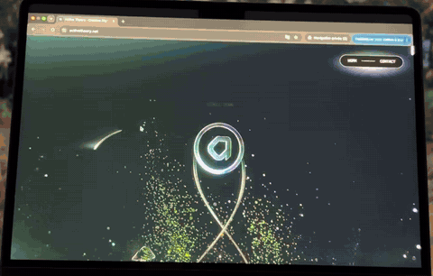

WebGL 作品集網站：捲動時 3D 卡片／面板在空間中飛過，彩色粒子與故障（glitch）RGB 分離文字 'DISCOVER YOUR PATRONUS'；可用 Three.js 捲動驅動相機 + 粒子 + RGB shift 後處理重現

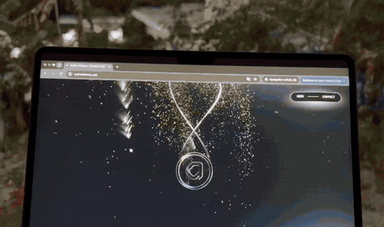

企業 WebGL 網站：捲動穿越雪山與體積雲、油輪在雲海中航行，最後拉遠成 3D 地球，細字標題淡入；可用 Three.js 體積雲／霧 shader + 捲動驅動相機路徑重現

### [Kishan 平面設計作品集單頁](https://www.facebook.com/reel/1670796030659910)

一頁式平面設計作品集的版面範例

| 可信度 | 星數 | 出處 |
| --- | --- | --- |
| 版面參考 | — | [影片 35](https://www.facebook.com/reel/1670796030659910) |

自動捲動的單頁作品集：深色抬頭「2026 PORTFOLIO / GRAPHIC DESIGN PORTFOLIO / CREATIVE - MODERN - IMPACTFUL」，接著白色區塊卡片 01–08：About、Logo（AUREN／NEXORA／VELORA／BOLDPRO，黑金配色）、YouTube 縮圖、社群貼文、產品 mockup、型錄、包裝（畫面拼成「PAKAGING」）、圍籬／看板，最後是附 QR code 的聯絡頁尾。標示工具為 Illustrator ＋ Photoshop；雖然有 #canva 標籤，片中沒有 Canva 也沒有 AI。可信度：不適用，純版面參考。配樂：lo-fi chillhop。GIF 片段：0:01–0:06。備註：版面分區清楚，可當參考；計畫做一個自動捲動的 HTML demo

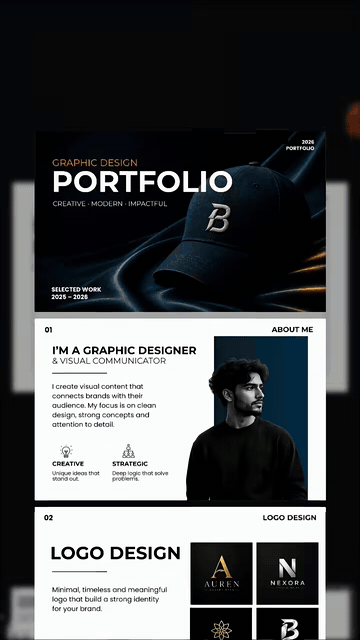

長版作品集頁面在模糊暗色背景上自動垂直捲動（PORTFOLIO 封面 → About me → Logo / Thumbnail / Social media 區塊），黑白粗體排版＋作品縮圖格；可用 CSS @keyframes translateY 自動捲動長圖 + backdrop blur 背景重現

▶ 互動 Demo：[開啟](../demos/portfolio-scroll/)（https://wiki.singularityengine.dev/demos/portfolio-scroll/）

### [6 種圖表與使用時機](https://www.facebook.com/reel/1742098810210214)

一張動畫看懂長條、圓餅、折線、散佈、直方、箱型圖各該什麼時候用

| 可信度 | 星數 | 出處 |
| --- | --- | --- |
| 可信度高・資料視覺化 | — | [影片 36](https://www.facebook.com/reel/1742098810210214) |

Statsmaniaofficial 的「Different visualizations — 6 charts · when to use them」，10 秒循環、用合成資料。深藍點陣背景＋2×3 卡片：長條圖（A18、B32、C24、D26，「height = value」）；圓餅圖（同樣 A–D 的比例與顏色）；折線圖（Jan–Dec，黃線加面積漸層）；散佈圖（綠點、正向趨勢，「Association ≠ causation」）；直方圖（90 筆配送時間、等寬分組 10–70、右偏）；箱型圖（同樣 90 筆，標出中位數、IQR = Q3−Q1、離群值）。一條垂直掃描線掃過各圖並高亮底下的資料。文案指南：比較類別用長條、看部分佔整體用圓餅、看時間變化用折線、兩個數值變數用散佈、看分佈形狀用直方、精簡摘要用箱型，並提醒相關不等於因果。可信度：高，抓幀檢查過統計數字前後一致。配樂：未確認。備註：計畫做一個 6 圖動態 SVG 的 HTML demo。

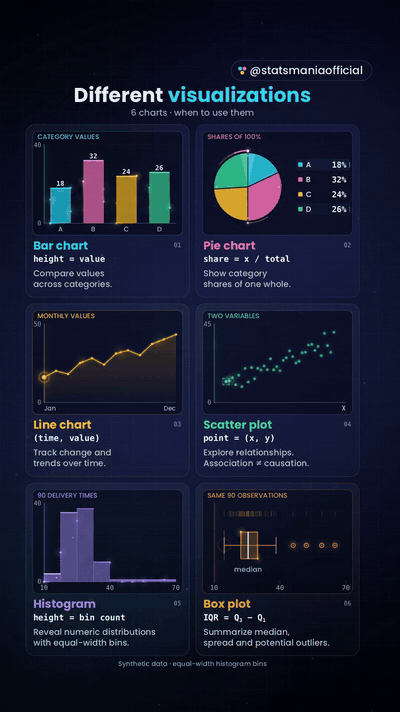

深色背景 2×3 圖表卡（長條、圓餅、折線、散佈、直方圖、箱形圖），一條發光掃描線橫向掃過各圖並逐一高亮資料點；可用 SVG/Canvas 畫圖表 + 移動的漸層遮罩線（mix-blend-mode）重現，整段 10 秒可無縫循環

▶ 互動 Demo：[開啟](../demos/charts/)（https://wiki.singularityengine.dev/demos/charts/）

### Kinlo 後台儀表板：View Transitions 圓形擦除轉場

點擊切換頁面或主題時，用 View Transitions API 從點擊位置展開圓形遮罩，產生擦除轉場。

| 可信度 | 星數 | 出處 |
| --- | --- | --- |
| 可信度高 | — | [影片 37](https://www.facebook.com/reel/1473800611304190) |

Code & Chill 的 Reel，示範電影院後台儀表板（側欄、Finance › Cards、Calendar）。做法是呼叫 `document.startViewTransition`，再對 `::view-transition-new(root)` 的 `clipPath` 做動畫：從 `circle(0px at x y)` 放到 `circle(d px at x y)`，其中 `d = Math.hypot(Math.max(x, innerWidth-x), Math.max(y, innerHeight-y))`，大約 400 ms。API 不支援，或使用者設定 `prefers-reduced-motion` 時，改成立即切換。配樂：未確認。

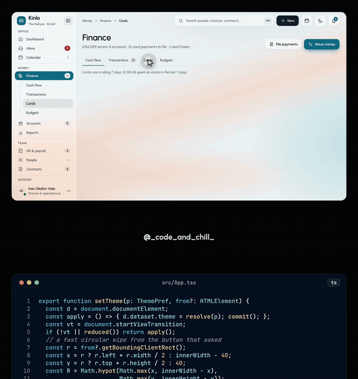

▶ 互動 Demo：[開啟](../demos/view-transition-dashboard/)（https://wiki.singularityengine.dev/demos/view-transition-dashboard/）

### [Details.so：真實網站設計細節庫＋MCP（Claude Code／Cursor）](https://www.details.so)

手選的真實上線網站設計細節庫，可用官方遠端 MCP 從 Claude Code、Cursor 等工具找靈感

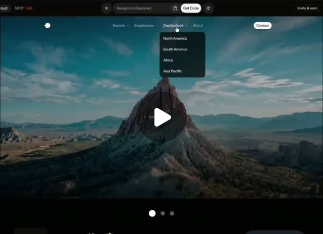

| 可信度 | 星數 | 出處 |
| --- | --- | --- |
| 宣稱待驗證・可信度中 | — | [Threads @ethansavemoneydairy](https://www.threads.com/@ethansavemoneydairy/post/DfgeXIwAIzH) |

Ethan（@ethansavemoneydairy）2026-11-10 Threads 圖文（無影片）。宣稱 Details.so 收集超過 3,400 個真實網站設計案例，並可經 MCP 讓 Claude Code、Cursor 找設計靈感。查證（官網 [pricing](https://www.details.so/pricing)、[mcp.md](https://www.details.so/mcp.md)，2026-11-10 台北時間）：確實有官方遠端 MCP（https://api.details.so/mcp，瀏覽器 OAuth），付費方案皆含 MCP；Pro 每月 9 美元（完整 Inspo 庫＋每月 300 MCP 點數）、Max 每月 19 美元（加 Vault、1,000 點）、Team 每席每月 22 美元（每席 2,000 點）、Lifetime 一次付清（頁面未標金額，每月 2,000 點）。免費 Starter 可瀏覽近期 Inspo、分類與 Vault 預覽及部分免費資源；官方 MCP 文件另寫免費帳號在 free access 開啟期間有一次性 20 點（可能關閉、不補發，也不解鎖付費網站或 Vault）。「3,400+」案例總數未在本次開啟的官網頁面核到，標**未驗證**。未找到公開 MCP GitHub repo，故無 SkillSpector 掃描。可對照 SEQ 0028、0029、0030、0031。無留言導流。

### ⚠️ [Hallmark：Together AI 的反 AI 味設計 skill（Claude Code／Codex／Cursor／OpenCode）](https://github.com/Nutlope/hallmark) ⚠️

避開常見 AI 網頁版型的設計 skill：50 種主題、先讀專案再要真實照片與數字，並可在真實瀏覽器以 8 種寬度檢查

| 可信度 | 星數 | 出處 |
| --- | --- | --- |
| ⚠️ 引流・概念動畫・可信度中 | 52.0k | ⚠️ [影片 55](https://www.facebook.com/reel/1745279943247041) ⚠️ |

小礦工挖挖礦上傳的 1:20 Facebook Reel（2026-11-07），旁白加簡報／概念畫面（無真實操作錄屏、未展示真實 GitHub 頁）。片尾要留言「網頁質感」才私訊連結，屬引流；正式 repo 可直接開啟。宣稱：Together AI 做的 Hallmark，給 Claude Code／Codex／Cursor／OpenCode；48.2k 星／2.6k fork、MIT；50 種主題各有參考頁；會讀專案字型、配色、框架；只問一次真實照片與數字、不編造內容；從 3 個合適主題中選、依頁面目的排版；有 custom 模式；755 張開放授權照片並標出處；redesign（保留內容改風格）與 audit（只出報告）；用真實瀏覽器檢查 8 種寬度（對比、焦點、手機）並由 fresh-eyes 審查者做最後判定；瀏覽器檢查需要 Chrome。刻意避開 AI 味手法（標題上方小標、全大寫標籤、頁尾電子報欄）。查證（GitHub API 2026-11-10 台北時間）：真實 repo 為 ⚠️ [Nutlope/hallmark](https://github.com/Nutlope/hallmark) ⚠️（擁有者 Nutlope／Hassan El Mghari，不是 togethercomputer org；README 寫 Made by Together AI），MIT，52,023 星／2,771 fork（影片 48.2k 星已過時，fork 與宣稱 2.6k 接近），未封存，建立 2026-04-27，最近推送 2026-11-05 21:16 Asia/Taipei；官網 ⚠️ [usehallmark.com](https://www.usehallmark.com/) ⚠️。README 與上述功能描述大致相符，並註明沒有 Chrome／puppeteer-core 時靜態檢查仍可跑；本影片無實測畫面，功能成效未在此驗證。可對照 SEQ 0028、0029、0030、0100。配樂：未標。GIF：0:22–0:32。SkillSpector 掃描待補（本批不 clone）

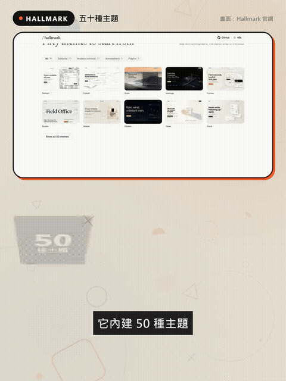

### ⚠️ [Claude＋ChatGPT Astra 6：互動建築簡報（Verdant Residences）](https://www.facebook.com/reel/1485883914602760) ⚠️

只展示完成的互動 3D 建案網頁（立面滑桿、平面、印度盧比房貸計算機），疊「客戶付 2,450 美元」；未出現任何 AI 介面或流程

| 可信度 | 星數 | 出處 |
| --- | --- | --- |
| ⚠️ 引流・宣稱待驗證・可信度低 | — | ⚠️ [影片 67](https://www.facebook.com/reel/1485883914602760) ⚠️ |

Presentation Palette 上傳的約 24 秒 Facebook Reel（2026-11-11）。說明文要留言 ASTRA 才分享完整 AI 工作流與提示詞，屬引流。畫面只有完成的互動網頁「Verdant Residences」：立面材質滑桿、平面圖、以印度盧比計的房貸計算機，並疊「Client paid $2450」——金額與是否真由 Claude＋Astra 做出，標未驗證；未出現 AI 操作介面。說明文寫「ChatGPT Astra 6」名稱不準：官方是 GPT-6 Astra（⚠️ [openai.com/index/gpt-6-astra](https://openai.com/index/gpt-6-astra/) ⚠️ ，API 識別名 gpt-6-astra），在 ChatGPT 裡作為 GPT-6 Pro 的底模；SEQ 0039 的 OpenAI 事故報告亦已用 GPT-6 Astra 這個名稱。可對照 SEQ 0045（OPZEN AI 建築渲染）。配樂：未標。GIF：0:09–0:19。

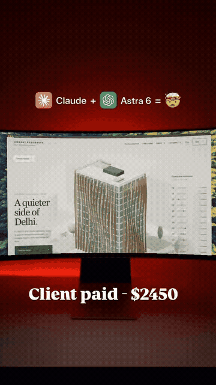

### ⚠️ [9 個打敗 AI slop 的 UI 細節（David Mráz／Atheros Learning）](https://www.facebook.com/reel/1690133082855724) ⚠️

約 9 秒前後對照動畫：切換 AI Slop→Premium，列出九項介面細節與部分 CSS 寫法；要留言 Learn 才進付費教材

| 可信度 | 星數 | 出處 |
| --- | --- | --- |
| ⚠️ 引流・概念動畫・可信度中 | — | ⚠️ [影片 69](https://www.facebook.com/reel/1690133082855724) ⚠️ |

David Mráz（@davidm_ai）上傳的約 9 秒 Facebook Reel（2026-11-09）。說明文要留言 Learn，才能在 Atheros Learning 取得這些概念（僅限付費 Pass 會員，⚠️ [learning.atheros.ai](https://learning.atheros.ai) ⚠️），屬引流。畫面是動畫清單，不是真實專案錄屏。九項：① 同心圓角（內圓角＝外圓角減 padding：R32、p16、r16）；② 視覺光學中心（播放鍵三角形略往右移）；③ 等寬數字；④ 文本平衡（避免最後一行單字孤兒）；⑤ 髮絲線（5% 邊框加兩道柔和陰影，而非一道生硬陰影）；⑥ 圖示筆畫（1.75 描邊而非填滿）；⑦ 空狀態要有標題、副標與行動按鈕，不要只寫 No data；⑧ 只留一個主按鈕（把 Cancel 降級）；⑨ 可見焦點環 2px。片中／可對照的 CSS：`font-variant-numeric: tabular-nums`；`text-wrap: balance`；`:focus-visible` outline。可對照 SEQ 0029（Impeccable）、0100（Details.so）、0102（Hallmark）。配樂：未標。GIF：0:00–0:09。

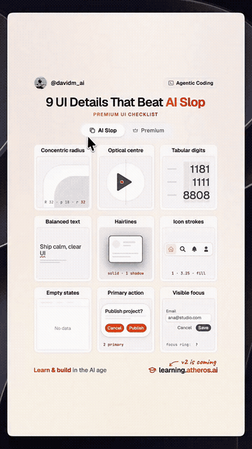

### [光與線：視覺構成短片（非 AI 工具介紹）](https://www.facebook.com/reel/1782325196375171)

極簡動態設計：一根線加上光變成故事封面；複製、位移長成柱廊。片中沒有 AI 工具、提示詞或網址，收作海報／主視覺構圖靈感

| 可信度 | 星數 | 出處 |
| --- | --- | --- |
| 設計靈感・概念動畫 | — | [影片 70](https://www.facebook.com/reel/1782325196375171) |

家變美統包工程上傳的約 19 秒 Facebook Reel（2026-11-08），無留言換連結。畫面是 2D 加風格化 3D 的動態設計，不是 AI 工具或操作示範，也未出現提示詞或產品網址。國語旁白大意：一根線加上光，變成故事封面（字排海報）；再複製、位移，變成六條錐位線，3D 柱廊與小人影有了劇情；線條側臉再加一點紅。收句：「簡單的設計、不同的組合，這就是視覺的構成。」可帶走的構圖手法：少元素、重複與位移、光與對比、單一強調色——寫海報或介面主視覺提示詞時可當參考。可對照 SEQ 0114（九個 UI 細節），兩則都談構成，但本則不是介面元件教學。配樂：未標。GIF：0:02–0:12。

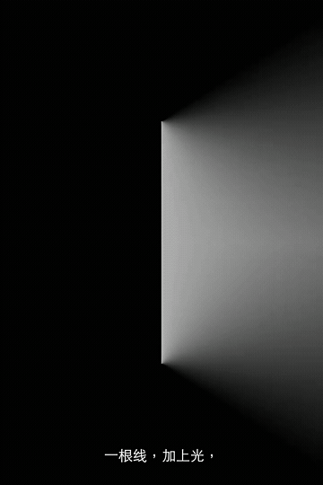

### ⚠️ [Gilt Foundry：互動漫畫網站（只展示完成品，留言 HOW）](https://giltfoundry.com) ⚠️

只拍到完成的卷軸漫畫網站（MacBook 按空白鍵翻頁），沒有工具、提示詞或製作流程；要留言 HOW 才寄 workflow。疊文「GPT-6.1 Terra can't do this」——型號是真的，做不到的宣稱未驗證

| 可信度 | 星數 | 出處 |
| --- | --- | --- |
| ⚠️ 引流・宣稱待驗證・可信度中 | — | ⚠️ [影片 73](https://www.facebook.com/reel/1436171255368046) ⚠️ |

Gilt Foundry 上傳的約 13 秒 Facebook Reel（2026-11-06；Brian 於 2026-11-11 23:54 Asia/Taipei 從 LINE 轉來 ⚠️ [這則分享連結](https://www.facebook.com/share/r/19nawPHdLe/) ⚠️）。說明文要留言 HOW 才寄「sites like this」的 workflow，屬引流。畫面只有完成網站：有人在 MacBook（Safari）按空白鍵；黑白墨線漫畫加局部色彩（棕褐外套、紅色），依步驟／捲動出現分鏡、視差、3D 線框球變成紅日、手伸進紅色、鋸齒紅幕拉開露出哥德式建築；導覽可見 CERVANTES；字幕敘述夜裡有人被跟上。未出現任何製作工具、提示詞或流程，如何做成標未驗證。

疊文「POV: GPT-6.1 Terra can't do this」：GPT-6.1 Terra 是 OpenAI 於 2026-10-26 發布的正式型號（⚠️ [官方介紹](https://openai.com/index/introducing-gpt-6-1-terra/) ⚠️，API 識別名 gpt-6.1-terra），與 SEQ 0039 的 GPT-6 Astra 不是同一款；「做不到這種網站」的能力宣稱未驗證。工作室官網找到 ⚠️ [giltfoundry.com](https://giltfoundry.com) ⚠️（「Premium digital craftsmanship」，作品頁 /work 主打 The Temple 卷軸體驗）；本則這座 CERVANTES 漫畫站的公開網址，快速查找未找到。可帶走的是卷軸敘事網頁手法（逐步觸發分鏡、視差層、canvas／WebGL 變形一類），不當操作教學。可對照 SEQ 0074（2026 網站捲動敘事）、0100（Details.so）、0102（Hallmark）、0114（UI 細節）。配樂：未標。GIF：0:00–0:10。

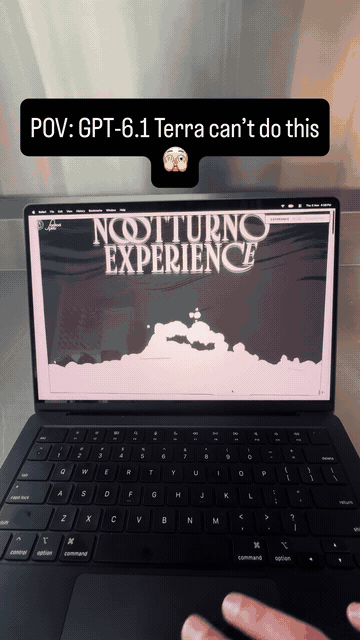

### [JEV Engineering：多 agent 管線監控的科幻 FUI 儀表板（概念動畫，非產品錄屏）](https://www.facebook.com/reel/1773060590589981)

暗色科幻監控儀表板，把規劃、工人、品質／政策／發布閘門和成本列排在同一畫面。這是風格化動態設計／模擬 UI，不是真實產品錄屏；製作工具未說明，數字是假的

| 可信度 | 星數 | 出處 |
| --- | --- | --- |
| 設計靈感・概念動畫 | — | [影片 75](https://www.facebook.com/reel/1773060590589981) |

Moh Moh 上傳的約 20 秒直式 Facebook Reel（2026-11-11；Brian 於 2026-11-12 20:07 Asia/Taipei 從 LINE 轉來裸連結 [這則分享連結](https://www.facebook.com/share/v/19SorEAJS6/)）。說明文只有一句「学了别人看不懂的东西，比Ai还要强」，沒有工具、產品或網址，也不是留言換連結。畫面是循環的暗色科幻 FUI 儀表板（標題 JEV ENGINEERING，副標 BUILD FABRIC／ENGINEERING SYSTEM），不是真實產品操作錄屏；未出現製作工具、提示詞或產品網址。頂列階段為 INGEST→PLAN→EXECUTE→VERIFY→GATE→COMMIT（ROUTE／BUILD／VERIFY／RELEASE）。可見區塊包括 AGENT PLANNER、CODE／WORKER、SIMULATION／WORKER、SOURCE／WORKER、QUALITY／EVIDENCE、POLICY／APPROVAL、PACKET MATRIX、RELEASE／GATE、TEST／EXECUTOR、CACHE／MEMORY、BUILD TRACE、RESOURCE／BUDGET 等（另有 REQUEST／INTAKE、INTEGRITY SCAN、AGENT SWARM 等）。立體機械水母在面板上移動（標 5 MEDUSA AGENTS），並有像素風格的交接標籤。BUILD TRACE 持續捲動品質／閘門一類日誌；RESOURCE／BUDGET 的成本數字持續跳動（抽幀見過約 18–22 美元），面板本身標 USD／DEMO、simulation demo cost，屬示範假數。畫面右上有浮水印「Xi @Klonzu」，未核到對應公開產品，不當作品牌。可帶走的是多 agent 管線監控儀表板的編排構想：規劃→工人→品質／政策／發布閘門，加上成本追蹤。可對照 SEQ 0115（同為設計靈感的概念動畫，不是工具介紹）。配樂：未標。GIF：0:08–0:13。

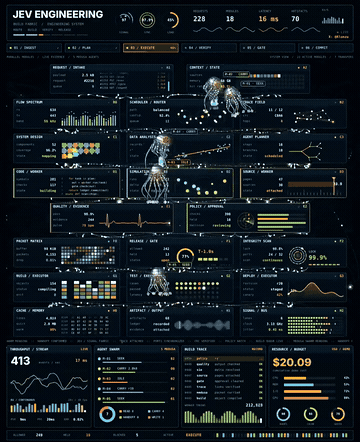

### [Code with Bhurtel：Space-Time Curve（JavaScript 軟化重力網格動畫，非 AI 工具）](https://www.facebook.com/reel/1140316585123225)

3D 發光線框網格被恆星與繞行行星彎曲，黑洞隨後吞沒兩者；底部是靜態 Carbon 風格的 gravityAt 軟化牛頓加速度片段。這是概念動畫／創意程式設計靈感，不是 AI 工具，也不像該片段的即時輸出

| 可信度 | 星數 | 出處 |
| --- | --- | --- |
| 設計靈感・概念動畫 | — | [影片 79](https://www.facebook.com/reel/1140316585123225) |

Code with Bhurtel 上傳的約 15 秒直式 Facebook Reel（2026-11-11；Brian 於 2026-11-13 08:06 Asia/Taipei 從 LINE 轉來裸連結 https://www.facebook.com/share/r/1MDedB26No/，對應 [這則 Reel](https://www.facebook.com/reel/1140316585123225)）。說明文只有「Space Time Curve Using JavaScript!」加上 hashtag，沒有函式庫、工具或產品網址，也不是留言換連結。畫面標題為 Space-Time Curve：上方是發光線框的 3D 空間網格，被一顆恆星與繞行行星拉彎；約 0:04 黑洞掃入，約 0:10 把兩者吞沒。底部是靜態 Carbon 風格（圓點視窗鈕）的 JavaScript 片段 gravityAt(bodies, x, z, skip)，以軟化牛頓加速度計算平面力：d2 = dx² + dz² + soften²，f = G * mass / (d2 * sqrt(d2))。這段程式碼全程沒有改動，動畫看起來是預先算好的渲染，不像該片段的即時輸出；片中也沒有點名任何繪圖函式庫。這不是 AI 工具介紹，收錄是作為視覺／創意程式設計靈感（可對照 SEQ 0115、0120）。可帶走的是軟化重力公式，以及用重力位勢位移網格的構想；若要自己做，three.js 是一種可能做法，但影片並沒有示範。畫面無私人資訊。配樂：未標。GIF：0:08–0:13。

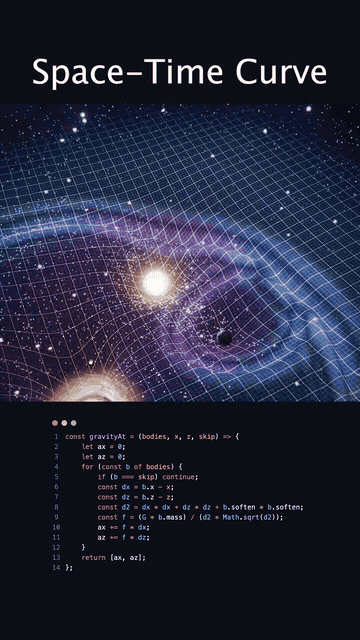

### [產品經理的背後靈 Philo：Pixel Plays（Amir Mushich 的五款零圖片像素網頁遊戲）](https://github.com/amirmushichge/pixel-plays)

開源專案 Pixel Plays：五款等角像素網頁遊戲，畫面由程式碼繪製。行數、零圖片、零依賴與程式碼 MIT 已核到；音樂不在 MIT 內。Claude Opus 5.5 是作者自述加上提交共同作者標記

| 可信度 | 星數 | 出處 |
| --- | --- | --- |
| 可信度高 | 463 | [影片 82](https://www.facebook.com/reel/1927405395307821) |

產品經理的背後靈 Philo（AI郵報）上傳的約 124 秒直式 Facebook Reel（2026-11-11；Brian 於 2026-11-13 在對話傳來 [這則 Reel](https://www.facebook.com/reel/1927405395307821)）。影片是查核解說，畫面是公開遊戲錄製或作者 X 影片的截取，疊上條目與字幕，不是作者操作錄屏，未出現私人 IP 或本機路徑。說明文介紹 Amir Mushich 的開源專案 Pixel Plays，並寫 X 上超過 18 萬次觀看、用 Claude Opus 5.5 協助製作；結尾要人留言「遊戲」讓他知道、並先收藏，沒有答應留言就寄連結或檔案，不是留言換東西，故不標引流。

查證（2026-11-13 台北時間，GitHub API 與原始檔）：

- 官方 repo：[amirmushichge/pixel-plays](https://github.com/amirmushichge/pixel-plays)
- 試玩：https://pixel-plays-ruby.vercel.app/
- 作者 X 貼文：https://x.com/AmirMushich/status/2116509069477621819 （2026-10-31 20:34 台北時間，標題「3D pixel games with Claude Opus 5.5 (OS)」）
- 五款遊戲：Balote、Stari Most、Rooftop Laundry、Tie-Break、Mini Ramp
- 行數：說明文寫 3,557 行。以換行計算，五個遊戲頁 3,067 行（524+655+674+635+579）加 engine.js 343、shell.js 147，合計 3,557，相符
- 零圖片、零依賴：倉庫樹沒有任何圖片檔；沒有 package.json，serve.mjs 只用 Node 內建模組。另有五個 .mp3（Suno 生成），不是圖片
- 授權：LICENSE 為 MIT，Copyright (c) 2026 Amir Mushich，與說明文「程式碼 MIT」相符。README 與 MUSIC.md 寫明音樂不在 MIT 內、不得在專案外重用，說明文沒有寫這點，須補上
- 星數：GitHub API 當日 463 星、46 個 fork
- 視覺規則與說明文一致：固定 30 度正交視角、暗部偏紫、亮部偏暖黃、影子朝畫面右、只有植物會動、360×280 畫布整數倍放大；README 還有更多（Bayer dither、深度緩衝等）
- Claude：兩筆提交（770640d、0c2a70f）末行都有 Co-Authored-By: Claude Opus 5.5，沒有簽章；倉庫文字檔裡沒有提示詞。說明文已寫參與來自作者說明及提交紀錄、尚無完整提示詞，與查證相符
- 說明文的 18 萬次觀看是對該 X 貼文的宣稱，本則未在 X 當頁重核觀看數
- README 署名：Concept by abhi. Game by AmirMushich. Visual reference: shawn.'s Small plays。「沒有複製素材或主題」是作者說法，本則未比對原作

SkillSpector 靜態掃描（2026-11-13 台北時間，skillspector 2.12.0，--no-llm，commit 0c2a70f）：此 repo 不是 skill／MCP 包；issues 0、findings 0；risk score 0、severity LOW、max_issue_severity NONE；覆蓋率 85.7%（12／14 個元件，狀態 partial）。可對照 SEQ 0106（同樣是 AI 協助、在瀏覽器裡即時畫出的網頁作品）。配樂：影片標無音樂（解說用畫面）。GIF：0:50–0:55。

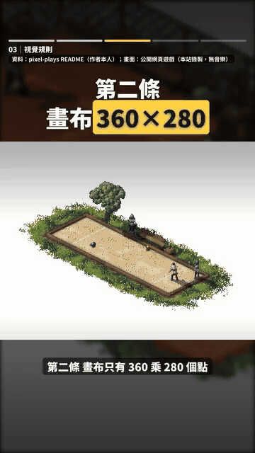

### [HA Bridge：可視化畫 3D 戶型並綁定 Home Assistant 實體（官方付費中控）](https://habridge.cn/)

顏民凱示範付費中控 HA Bridge：在編輯器裡畫 3D 戶型、套用官方「栖光」UI 方案，並把 Home Assistant 實體綁到儀表盤，過程不必寫 YAML。

| 可信度 | 星數 | 出處 |
| --- | --- | --- |
| 可信度高 | — | [影片 84](https://www.facebook.com/reel/1885203799120310) |

顏民凱上傳的約 104 秒橫式 Facebook Reel（2026-09-04；1624×720；Brian 於 2026-11-13 在對話傳來 [這則 Reel](https://www.facebook.com/reel/1885203799120310)）。說明文只有一句：「輕鬆完成戶型圖設計，導入HA實體，終於不用再寫Yaml了」。無留言換連結，故不標引流。

畫面是真實產品錄屏，不是概念動畫：先在儀表盤預覽等角 3D 戶型（燈光與空調等圖示可點），再切到燈光總覽、空調／窗簾／洗衣機等設備頁與控制彈窗，接著進入「戶型圖繪製」編輯器（平面圖、家具庫、即時 3D 預覽），最後是「導出 3D 戶型圖」對話框。頂欄有「編輯／儀表盤／打開 HA／保存」，與官方文件「編輯器與基本操作」所列工具列一致。左側可見「UI 方案 栖光」，旁邊有畫面標示「DWELL LIGHT · 1.0.0」。官方文件確認「栖光」是內建完整 UI 方案（含頁面、控件、彈窗、主題與素材，建立後再替換實體）；已查的官方文件沒有把 DWELL LIGHT 寫成栖光的英文名稱，故該英文標示僅作畫面紀錄。

查證（2026-11-13 台北時間）：

- 產品：[HA Bridge](https://habridge.cn/)，文件：https://wiki.habridge.cn/
- 官方定位是獨立部署的家庭中控儀表盤：Home Assistant 負責設備與實體，HA Bridge 負責中控介面。可用可視化編輯器 DIY 二維面板，也可繪製 3D 戶型並在即時 3D 交互裡綁定實體
- 官方寫明為付費專案，功能按授權開放，3D 交互需對應權益
- 支援 Home Assistant Add-on 與獨立 Docker，預設存取埠 18080（可用 APP_PORT 更改）
- 官方 Add-on 倉庫優先用 Gitee https://gitee.com/weidaye1122/ha-bridge-addon ，GitHub 備用 https://github.com/weidaye1122/ha-bridge-addon ；獨立 Docker 映像為 weidaye1122/ha_bridge
- 這與同名的 Philips Hue 模擬器 [bwssytems/ha-bridge](https://github.com/bwssytems/ha-bridge) 不是同一個專案
- 「不必再寫 YAML」是上傳者說明文的說法。官方文件描述的流程是在編輯器右側「關聯實體」搜尋並選擇 entity_id，並未要求手寫 Lovelace YAML；本則未實測每一種控件是否完全不必碰 YAML

畫面頂欄出現內網中控位址，本則不公開；也未抄寫本機路徑或住家地址。戶型銘牌上的標題是上傳者專案畫面，不是產品名稱。

SkillSpector 靜態掃描（2026-11-13 台北時間，skillspector 2.12.0，--no-llm，commit 09b9be5）：掃描的是公開 Add-on 安裝包 weidaye1122/ha-bridge-addon，不是付費產品本身的封閉映像。此 repo 不是 skill／MCP 包；issues 27（HIGH 6、MEDIUM 21），全部位於 release/ 與 tests/（例如 candidate.py、verify_addon_upgrade.sh、test_release_recovery.py 的環境變數傳遞、subprocess、升級驗證腳本中的刪除目錄等）；risk score 100、severity CRITICAL、recommendation DO_NOT_INSTALL、max_issue_severity HIGH；覆蓋率 100%（22／22 個元件，狀態 complete）。產品主程式不在此倉庫，本則未掃描其 Docker 映像。GitHub API 當日該 Add-on 倉庫 4 星，最近推送 2026-11-10 10:01 台北時間，提交說明為 Add-on 0.8.6-1。配樂：未標。

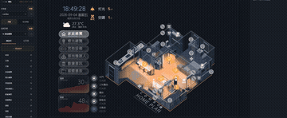
