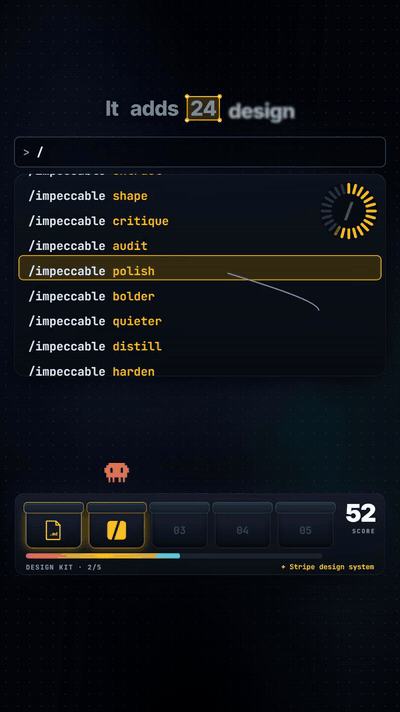
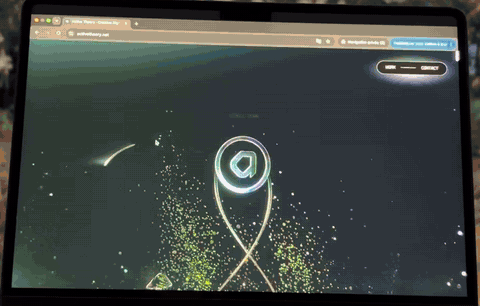
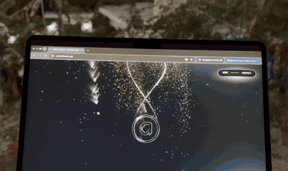
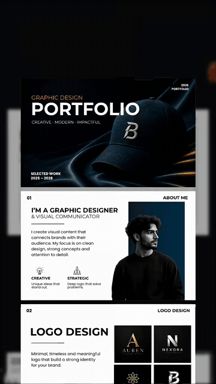
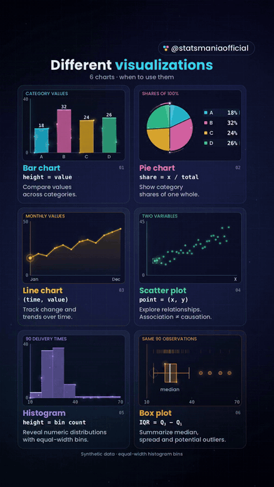
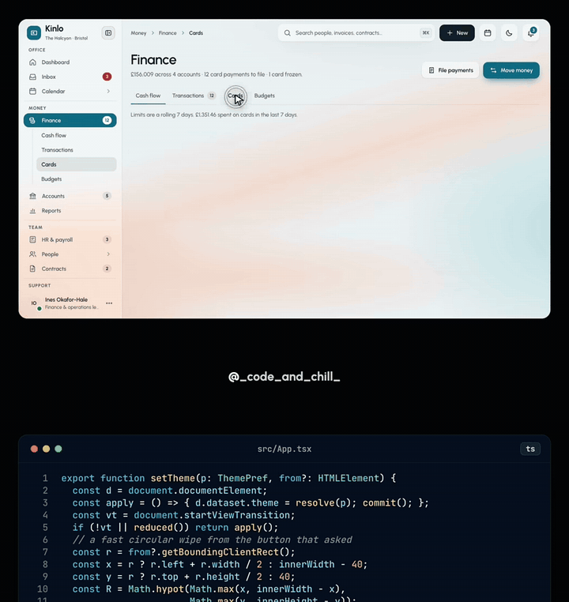

# 前端與 UI 設計

中文 | [English](../en/docs/frontend-ui.md)

[回首頁](../README.md)

設計系統、UI linter、設計 skill、介面模板與概念介面

### [fx0](https://github.com/vercel-labs/fx0)

用文字描述頁面，生成單一 HTML 檔

| 可信度 | 星數 | 出處 |
| --- | --- | --- |
| — | 418 | [影片 1](https://www.facebook.com/reel/2050168028979180) |

描述頁面，它寫成一個 HTML 檔（Vercel）

### [Awesome DESIGN.md](https://github.com/VoltAgent/awesome-design-md)

73 個真實網站的設計系統，讓 AI 照著做 UI

| 可信度 | 星數 | 出處 |
| --- | --- | --- |
| — | 124.7k | [影片 9](https://www.facebook.com/reel/1780228483203385) |

VoltAgent 整理 73 個真實網站（Stripe、Linear…）的 DESIGN.md，丟進專案讓 Claude 照真實設計系統做，避免 AI 臉

### [Impeccable](https://github.com/pbakaus/impeccable)

抓出 AI 味設計問題的指令與規則集

| 可信度 | 星數 | 出處 |
| --- | --- | --- |
| — | 97.2k | [影片 9](https://www.facebook.com/reel/1780228483203385) |

24 個設計指令（/impeccable audit、polish、bolder、quieter…）+ 59 條規則，專抓漸層標題、emoji 圖示、全用 Inter 等 AI 味；Apache-2.0

UI 介面拆成多層玻璃平面做 3D 透視傾斜爆炸圖、紅色警示標籤逐一彈出；可用 CSS perspective + rotateX/rotateZ + translateZ 分層重現

### [Taste Skill](https://github.com/Leonxlnx/taste-skill)

用三個參數設定設計品味的 Claude skill

| 可信度 | 星數 | 出處 |
| --- | --- | --- |
| — | 106.4k | [影片 9](https://www.facebook.com/reel/1780228483203385) |

用 bold／motion／density 三個參數設定設計風格，讓 Claude 照你的品味產出；MIT

### [Web Design Guidelines（Vercel skill）](https://github.com/vercel-labs/agent-skills/tree/main/skills/web-design-guidelines)

像 UI linter 一樣檢查網頁可用性的 skill

| 可信度 | 星數 | 出處 |
| --- | --- | --- |
| — | 33.3k（agent-skills） | [影片 9](https://www.facebook.com/reel/1780228483203385) |

vercel-labs/agent-skills 內的 skill，像 UI linter：抓禁止縮放、點擊區 < 24px、送出無 loading 狀態

### [Apex：JARVIS 風 AI 幕僚長介面](https://github.com/RubenM1990/APEX-UI)

JARVIS 風格 AI 幕僚長的 3D 介面原始碼

| 可信度 | 星數 | 出處 |
| --- | --- | --- |
| 概念介面 | 158 | 截圖（Reznikov Engineering） |

Reznikov Engineering（Ruben Mouradian）的獨立創業者 AI 幕僚長。公開的 APEX-UI：Next.js 15 + React 19 + react-three-fiber，金色光環球體配 18 個 agent 節點的推理網、STANDBY 狀態列（即藍色 org chart 那張截圖）。粒子人頭「Apex Humanoid」放在非公開 repo；MIT，品牌不在授權內

### [Vessa／Cadra 後台儀表板模板](https://codeandchill.store/templates/vessa)

付費後台儀表板模板，可當 AI 做 UI 的參考

| 可信度 | 星數 | 出處 |
| --- | --- | --- |
| 付費模板 | — | 截圖（Code and Chill） |

Code and Chill 販售的付費模板（非 AI 生成 demo）：Vessa 是保養品牌庫存系統，Cadra 是 29 頁工廠管理系統。TypeScript + GSAP、無框架無後端，各 $78；沒有公開 repo。可當作給 AI 做後台 UI 的設計參考

### [Open Design Agent Kit（Feima Code）](https://marketplace.visualstudio.com/items?itemName=feima.open-design-agent-kit)

把大量設計 skill 帶進 Copilot Chat 的 VS Code 擴充

| 可信度 | 星數 | 出處 |
| --- | --- | --- |
| — | 581 | 截圖（DeepRepo.ai） |

VS Code 擴充把 270+ 設計 skill、150+ 品牌設計系統、160+ 範例做成 GitHub Copilot Chat 的原生工具與 / 指令，用你在 Copilot 選的模型產出 HTML 檔進 repo，不需 daemon、MCP 或 API key；同 repo 也提供 Claude Code 外掛、Codex skill 與 MCP server，MIT。畫面上的 Ram Maheshwari（@rammcodes）是轉貼來源

### [Websites in 2026：Aethelburg 與 Montfort](https://www.facebook.com/reel/1834273334429297) ⚠️

兩個 WebGL 捲動動畫很重的 2026 風格網站展示

| 可信度 | 星數 | 出處 |
| --- | --- | --- |
| ⚠️ 引流 | — | [影片 29](https://www.facebook.com/reel/1834273334429297) ⚠️ |

wearebrand 的「Websites in 2026 🤩」，文案「Comment “WEBSITE” and let’s make your brand stand out」是留言關鍵字招攬接案的導流，片中的網站不一定是他們做的。真實拍攝在 Mac 上捲動兩個 WebGL 很重的網站：① Aethelburg（⚠️ https://aethelburg.network ⚠️），粒子群、扭曲字型、捲動時的 3D 平面，片中是某工作室的職缺頁；網域存在，但網頁標題是「AETHELNET // Sovereign Mesh Observer & Neural Manifold」，是否就是片中那頁未確認；② Montfort（⚠️ https://mont-fort.com ⚠️，不是 montfortgroup.com，那是一家磚石公司），能源與大宗商品貿易公司（據點在阿聯、新加坡、瑞士），捲動視差從雲中山峰到海上貨輪再到旋轉 3D 地球；mesh3d.gallery 記載是 Immersive Garden 用 Three.js、自訂 shader 與 Lenis 製作。片中沒有任何 AI 工具。配樂：聽起來是 Tyla《Water》（未確認）。面試：重度 WebGL 會拖累效能與無障礙，上線前要量 Core Web Vitals，並支援 prefers-reduced-motion

WebGL 作品集網站：捲動時 3D 卡片／面板在空間中飛過，彩色粒子與故障（glitch）RGB 分離文字 'DISCOVER YOUR PATRONUS'；可用 Three.js 捲動驅動相機 + 粒子 + RGB shift 後處理重現

企業 WebGL 網站：捲動穿越雪山與體積雲、油輪在雲海中航行，最後拉遠成 3D 地球，細字標題淡入；可用 Three.js 體積雲／霧 shader + 捲動驅動相機路徑重現

### [Kishan 平面設計作品集單頁](https://www.facebook.com/reel/1670796030659910)

一頁式平面設計作品集的版面範例

| 可信度 | 星數 | 出處 |
| --- | --- | --- |
| 版面參考 | — | [影片 35](https://www.facebook.com/reel/1670796030659910) |

自動捲動的單頁作品集：深色抬頭「2026 PORTFOLIO / GRAPHIC DESIGN PORTFOLIO / CREATIVE - MODERN - IMPACTFUL」，接著白色區塊卡片 01–08：About、Logo（AUREN／NEXORA／VELORA／BOLDPRO，黑金配色）、YouTube 縮圖、社群貼文、產品 mockup、型錄、包裝（畫面拼成「PAKAGING」）、圍籬／看板，最後是附 QR code 的聯絡頁尾。標示工具為 Illustrator ＋ Photoshop；雖然有 #canva 標籤，片中沒有 Canva 也沒有 AI。可信度：不適用，純版面參考。配樂：lo-fi chillhop。GIF 片段：0:01–0:06。備註：版面分區清楚，可當參考；計畫做一個自動捲動的 HTML demo

長版作品集頁面在模糊暗色背景上自動垂直捲動（PORTFOLIO 封面 → About me → Logo / Thumbnail / Social media 區塊），黑白粗體排版＋作品縮圖格；可用 CSS @keyframes translateY 自動捲動長圖 + backdrop blur 背景重現

▶ 互動 Demo：[開啟](../demos/portfolio-scroll/)（https://wiki.singularityengine.dev/demos/portfolio-scroll/）

### [6 種圖表與使用時機](https://www.facebook.com/reel/1742098810210214)

一張動畫看懂長條、圓餅、折線、散佈、直方、箱型圖各該什麼時候用

| 可信度 | 星數 | 出處 |
| --- | --- | --- |
| 可信度高・資料視覺化 | — | [影片 36](https://www.facebook.com/reel/1742098810210214) |

Statsmaniaofficial 的「Different visualizations — 6 charts · when to use them」，10 秒循環、用合成資料。深藍點陣背景＋2×3 卡片：長條圖（A18、B32、C24、D26，「height = value」）；圓餅圖（同樣 A–D 的比例與顏色）；折線圖（Jan–Dec，黃線加面積漸層）；散佈圖（綠點、正向趨勢，「Association ≠ causation」）；直方圖（90 筆配送時間、等寬分組 10–70、右偏）；箱型圖（同樣 90 筆，標出中位數、IQR = Q3−Q1、離群值）。一條垂直掃描線掃過各圖並高亮底下的資料。文案指南：比較類別用長條、看部分佔整體用圓餅、看時間變化用折線、兩個數值變數用散佈、看分佈形狀用直方、精簡摘要用箱型，並提醒相關不等於因果。可信度：高，抓幀檢查過統計數字前後一致。配樂：未確認。備註：計畫做一個 6 圖動態 SVG 的 HTML demo。面試：依問題選圖；工程指標（如延遲分佈）用直方圖、箱型圖或 p50／p95／p99，不要只看平均值

深色背景 2×3 圖表卡（長條、圓餅、折線、散佈、直方圖、箱形圖），一條發光掃描線橫向掃過各圖並逐一高亮資料點；可用 SVG/Canvas 畫圖表 + 移動的漸層遮罩線（mix-blend-mode）重現，整段 10 秒可無縫循環

▶ 互動 Demo：[開啟](../demos/charts/)（https://wiki.singularityengine.dev/demos/charts/）

### Kinlo 後台儀表板：View Transitions 圓形擦除轉場

點擊切換頁面或主題時，用 View Transitions API 從點擊位置展開圓形遮罩，產生擦除轉場。

| 可信度 | 星數 | 出處 |
| --- | --- | --- |
| 可信度高 | — | [影片 37](https://www.facebook.com/reel/1473800611304190) |

Code & Chill 的 Reel，示範電影院後台儀表板（側欄、Finance › Cards、Calendar）。做法是呼叫 `document.startViewTransition`，再對 `::view-transition-new(root)` 的 `clipPath` 做動畫：從 `circle(0px at x y)` 放到 `circle(d px at x y)`，其中 `d = Math.hypot(Math.max(x, innerWidth-x), Math.max(y, innerHeight-y))`，大約 400 ms。API 不支援，或使用者設定 `prefers-reduced-motion` 時，改成立即切換。配樂：未確認。面試：小細節的動效能提升產品質感，且要做 progressive enhancement。

▶ 互動 Demo：[開啟](../demos/view-transition-dashboard/)（https://wiki.singularityengine.dev/demos/view-transition-dashboard/）
