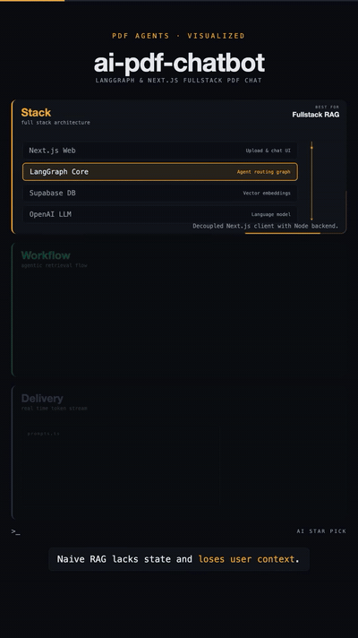

# 記憶與上下文

[回首頁](../README.md)

知識圖譜、程式碼圖譜、長期記憶、跨 agent 交接

### [Graphify](https://github.com/Graphify-Labs/graphify)

把程式碼與文件轉成可查詢的知識圖譜

| 可信度 | 星數 | 出處 |
| --- | --- | --- |
| — | 139,236 | [影片 1](https://www.facebook.com/reel/2050168028979180) |

把程式碼、文件、schema 轉成可查詢的知識圖譜

### [ai-memory](https://github.com/akitaonrails/ai-memory)

給 agent CLI 的長期記憶，方便跨 agent 交接

| 可信度 | 星數 | 出處 |
| --- | --- | --- |
| — | 14,563 | [影片 1](https://www.facebook.com/reel/2050168028979180) |

agent CLI 的長期記憶，方便跨 agent 交接

### [Graphicle](https://github.com/Graphicle-AI/graphicle)

單一 Rust 程式同時提供程式碼圖譜與記憶

| 可信度 | 星數 | 出處 |
| --- | --- | --- |
| — | 477 | [影片 1](https://www.facebook.com/reel/2050168028979180) |

一支 Rust 程式同時提供程式碼圖譜和記憶

### [Hy-Memory](https://github.com/Tencent-Hunyuan/Hy-Memory)

騰訊混元的跨工具 agent 記憶引擎

| 可信度 | 星數 | 出處 |
| --- | --- | --- |
| — | 1,876 | [影片 1](https://www.facebook.com/reel/2050168028979180) |

騰訊混元的 agent 記憶引擎，跨工具共享記憶

### [CodeGraph](https://github.com/colbymchenry/codegraph)

預先索引程式碼成知識圖譜，透過 MCP 給 agent 精準上下文

| 可信度 | 星數 | 出處 |
| --- | --- | --- |
| — | 76.1k | Brian 推薦清單 2026-10-31 |

colbymchenry 的本地端程式碼知識圖譜（Rust 核心）：預先索引函式、類別、呼叫鏈與跨檔關係，程式碼變動時自動同步，透過 MCP server 讓 Claude Code、Cursor、Codex、Gemini、Copilot、Grok Build 等直接查詢，不必每次 grep 整個 repo；100% 本地。安裝：`curl -fsSL https://raw.githubusercontent.com/colbymchenry/codegraph/main/install.sh | sh`（或 `npm i -g @colbymchenry/codegraph`），再 `codegraph install` 接上 agent，每個專案 `codegraph init` 建索引；MIT。同名專案很多（CodeGraphContext 4.4k 星等），這個星數最高。面試：上下文工程的做法之一，先給 agent 正確的結構圖，比讓它亂搜更省 token 也更少改錯地方

### [RAG Design Patterns：7 種 RAG 架構圖解](https://www.facebook.com/reel/4570321283241437)

一張圖看懂 7 種 RAG 架構：從基本檢索到多 agent 協作

| 可信度 | 星數 | 出處 |
| --- | --- | --- |
| — | — | [影片 21](https://www.facebook.com/reel/4570321283241437) |

Ankur Mishra 轉貼、@MindBoost-Tutorix（YouTube）／@MindBoostTutorix（X）製作的靜態圖表「RAG Design patterns (You must know in 2026)」。① Naive RAG（圖上誤寫成 Native RAG）：文件切塊→嵌入→向量庫，查詢嵌入後取回上下文送 LLM，適合起步與單純問答；② Retrieve-and-Rerank：取回後加 reranker 重排，適合召回夠但前幾名不準時；③ Multimodal RAG：圖片、影音一起切塊嵌入，交給多模態 LLM，適合資料不只文字時；④ Graph RAG：抽實體→LLM 建圖→圖資料庫→圖檢索，適合要跨文件推關係的問題；⑤ Hybrid RAG：向量＋關鍵字＋圖檢索合併成混合上下文，適合有專有名詞、代碼等精確匹配需求時；⑥ Agentic RAG（Router）：由 agent 決定要不要查、查哪裡，可反覆查向量庫，適合問題類型多變時；⑦ Multi-Agent RAG：總指揮 agent 分派給子 agent（程式工具、網路搜尋、向量引擎 A／B、Slack／Gmail），適合要跨多個來源與工具的任務。圖的小問題：「Native」是錯字、Hybrid 的關鍵字搜尋沒接到任何索引、Router 那格沒畫資料匯入。人工繪製，非 AI 生成。配樂：無旁白，通用的免版稅輕快 synth-pop。面試：依需求選 RAG 複雜度，從 Naive 開始，量測召回率／精準度不足才加 rerank 或 hybrid；agentic、多 agent 會增加延遲與成本，必須有評測支撐

### [ai-pdf-chatbot-langchain：LangGraph PDF 問答範本](https://github.com/mayooear/ai-pdf-chatbot-langchain)

用 LangGraph + Next.js 做 PDF 問答的全端範本

| 可信度 | 星數 | 出處 |
| --- | --- | --- |
| — | 16.6k | [影片 27](https://www.facebook.com/reel/1687227069493469) |

mayooear 的 monorepo 範本（也是 O'Reilly《Learning LangChain》的配套範例）：Next.js 前端＋Node／TypeScript 的 LangGraph agent，graph 節點分為匯入、檢索路由、回應；Supabase 向量庫、OpenAI LLM、token 串流、每個對話串各自保留歷史、LangSmith 追蹤。可對照影片 21 的 RAG 架構：大致是 Naive RAG 加上 Router 式的檢索判斷。維護狀態：MIT，GitHub 上已封存（archived），最後一次 commit 是 2026-03-28（台北時間），README 寫明不再維護、僅供參考。影片（AI Star Pick）是架構動畫，不是錄屏。配樂：無旁白無音樂，只有 UI 音效。面試：圖式 agent（狀態、迴圈、路由）與線性 chain 的取捨；LangSmith 這類 tracing 是品質控管工具；採用開源前先看維護狀態

Stack / Workflow / Delivery 三區塊依序點亮，邊框描邊動畫、節點流程圖逐步連線、底部字幕切換；可用 SVG stroke 描邊 + 分段 reveal 重現
