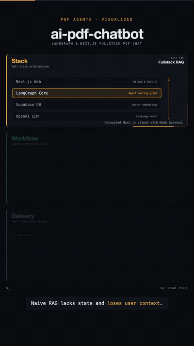
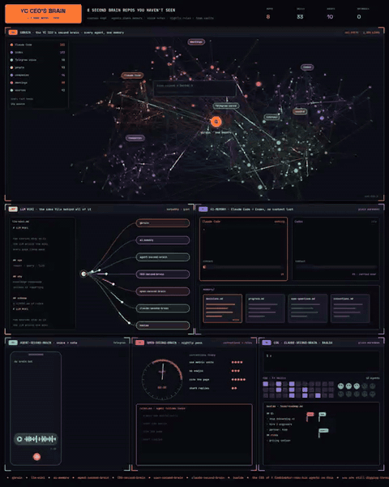
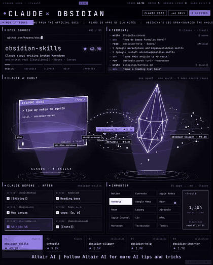

# 記憶與上下文

中文 | [English](../en/docs/memory-context.md)

[回首頁](../README.md)

知識圖譜、程式碼圖譜、長期記憶、跨 agent 交接

### [Graphify](https://github.com/Graphify-Labs/graphify)

把程式碼與文件轉成可查詢的知識圖譜

| 可信度 | 星數 | 出處 |
| --- | --- | --- |
| — | 139,236 | [影片 1](https://www.facebook.com/reel/2050168028979180) |

把程式碼、文件、schema 轉成可查詢的知識圖譜

### [ai-memory](https://github.com/akitaonrails/ai-memory)

給 agent CLI 的長期記憶，方便跨 agent 交接

| 可信度 | 星數 | 出處 |
| --- | --- | --- |
| — | 14,563 | [影片 1](https://www.facebook.com/reel/2050168028979180) |

agent CLI 的長期記憶，方便跨 agent 交接

### [Graphicle](https://github.com/Graphicle-AI/graphicle)

單一 Rust 程式同時提供程式碼圖譜與記憶

| 可信度 | 星數 | 出處 |
| --- | --- | --- |
| — | 477 | [影片 1](https://www.facebook.com/reel/2050168028979180) |

一支 Rust 程式同時提供程式碼圖譜和記憶

### [Hy-Memory](https://github.com/Tencent-Hunyuan/Hy-Memory)

騰訊混元的跨工具 agent 記憶引擎

| 可信度 | 星數 | 出處 |
| --- | --- | --- |
| — | 1,876 | [影片 1](https://www.facebook.com/reel/2050168028979180) |

騰訊混元的 agent 記憶引擎，跨工具共享記憶

### [CodeGraph](https://github.com/colbymchenry/codegraph)

預先索引程式碼成知識圖譜，透過 MCP 給 agent 精準上下文

| 可信度 | 星數 | 出處 |
| --- | --- | --- |
| — | 76.1k | Brian 推薦清單 2026-10-31 |

colbymchenry 的本地端程式碼知識圖譜（Rust 核心）：預先索引函式、類別、呼叫鏈與跨檔關係，程式碼變動時自動同步，透過 MCP server 讓 Claude Code、Cursor、Codex、Gemini、Copilot、Grok Build 等直接查詢，不必每次 grep 整個 repo；100% 本地。安裝：`curl -fsSL https://raw.githubusercontent.com/colbymchenry/codegraph/main/install.sh | sh`（或 `npm i -g @colbymchenry/codegraph`），再 `codegraph install` 接上 agent，每個專案 `codegraph init` 建索引；MIT。同名專案很多（CodeGraphContext 4.4k 星等），這個星數最高。

### [RAG Design Patterns：7 種 RAG 架構圖解](https://www.facebook.com/reel/4570321283241437)

一張圖看懂 7 種 RAG 架構：從基本檢索到多 agent 協作

| 可信度 | 星數 | 出處 |
| --- | --- | --- |
| — | — | [影片 21](https://www.facebook.com/reel/4570321283241437) |

Ankur Mishra 轉貼、@MindBoost-Tutorix（YouTube）／@MindBoostTutorix（X）製作的靜態圖表「RAG Design patterns (You must know in 2026)」。① Naive RAG（圖上誤寫成 Native RAG）：文件切塊→嵌入→向量庫，查詢嵌入後取回上下文送 LLM，適合起步與單純問答；② Retrieve-and-Rerank：取回後加 reranker 重排，適合召回夠但前幾名不準時；③ Multimodal RAG：圖片、影音一起切塊嵌入，交給多模態 LLM，適合資料不只文字時；④ Graph RAG：抽實體→LLM 建圖→圖資料庫→圖檢索，適合要跨文件推關係的問題；⑤ Hybrid RAG：向量＋關鍵字＋圖檢索合併成混合上下文，適合有專有名詞、代碼等精確匹配需求時；⑥ Agentic RAG（Router）：由 agent 決定要不要查、查哪裡，可反覆查向量庫，適合問題類型多變時；⑦ Multi-Agent RAG：總指揮 agent 分派給子 agent（程式工具、網路搜尋、向量引擎 A／B、Slack／Gmail），適合要跨多個來源與工具的任務。圖的小問題：「Native」是錯字、Hybrid 的關鍵字搜尋沒接到任何索引、Router 那格沒畫資料匯入。人工繪製，非 AI 生成。配樂：無旁白，通用的免版稅輕快 synth-pop。

### [ai-pdf-chatbot-langchain：LangGraph PDF 問答範本](https://github.com/mayooear/ai-pdf-chatbot-langchain)

用 LangGraph + Next.js 做 PDF 問答的全端範本

| 可信度 | 星數 | 出處 |
| --- | --- | --- |
| — | 16.6k | [影片 27](https://www.facebook.com/reel/1687227069493469) |

mayooear 的 monorepo 範本（也是 O'Reilly《Learning LangChain》的配套範例）：Next.js 前端＋Node／TypeScript 的 LangGraph agent，graph 節點分為匯入、檢索路由、回應；Supabase 向量庫、OpenAI LLM、token 串流、每個對話串各自保留歷史、LangSmith 追蹤。可對照影片 21 的 RAG 架構：大致是 Naive RAG 加上 Router 式的檢索判斷。維護狀態：MIT，GitHub 上已封存（archived），最後一次 commit 是 2026-03-28（台北時間），README 寫明不再維護、僅供參考。影片（AI Star Pick）是架構動畫，不是錄屏。配樂：無旁白無音樂，只有 UI 音效。

Stack / Workflow / Delivery 三區塊依序點亮，邊框描邊動畫、節點流程圖逐步連線、底部字幕切換；可用 SVG stroke 描邊 + 分段 reveal 重現

### [gbrain：YC CEO Garry Tan 開源的 agent 第二大腦](https://github.com/garrytan/gbrain)

Garry Tan 開源的 OpenClaw／Hermes agent 大腦，強調每筆事實保留來源

| 可信度 | 星數 | 出處 |
| --- | --- | --- |
| 概念動畫・可信度高 | 31.9k | [影片 46](https://x.com/imryven/status/2119433356584604119) |

Ryven（@imryven）上傳的 27 秒 X 影片，畫面是 GBRAIN／GARRY TAN 字樣與發光節點網路的動態設計（非真實錄屏），沒有在畫面上打出完整 URL；說明文寫「YC CEO 開源自己的 second brain」並點名 gbrain (by garrytan)。查證：https://github.com/garrytan/gbrain 存在，MIT，簡介「Garry's Opinionated OpenClaw/Hermes Agent Brain」，GitHub API 2026-11-09 為 31.9k 星／4.7k fork，未封存、最近推送 2026-11-09（台北時間）。配樂：未標。GIF 片段：0:00–0:02.5（https://wiki.singularityengine.dev/assets/gifs/v46-gbrain-network.gif）。SkillSpector 掃描待補（本批不 clone）。

GIF：影片 0:00–0:02.5，gbrain 節點網路動態設計。

### ⚠️ [Altair AI：Claude＋Obsidian Second Brain 十個 repo 清單](https://github.com/kepano/obsidian-skills) ⚠️

動態片整理用 Claude 與 Obsidian 組第二大腦的開源 repo；畫面多半看不清，依說明文核對可確認者

| 可信度 | 星數 | 出處 |
| --- | --- | --- |
| ⚠️ 引流・概念動畫・可信度中 | — | ⚠️ [影片 48](https://www.facebook.com/reel/1666945238466731) ⚠️ |

Altair AI 上傳的 22 秒 Facebook Reel，動態設計「10 AI REPOS」看板（非真實錄屏），畫面字太小多半無法辨識；說明文點名並描述流程（sources→raw→ingest→link→check→wiki→ask）。依說明文核對 GitHub（只取名稱清楚對得上的）：⚠️ [kepano/obsidian-skills](https://github.com/kepano/obsidian-skills) ⚠️（51.2k，與影片 47 同一 repo）；⚠️ [AgriciDaniel/claude-obsidian](https://github.com/AgriciDaniel/claude-obsidian) ⚠️（16.3k，MIT，最近推送 2026-10-25）；⚠️ [Astro-Han/karpathy-llm-wiki](https://github.com/Astro-Han/karpathy-llm-wiki) ⚠️（2.7k，MIT，Karpathy 風格 LLM wiki，最近推送 2026-07-23）；⚠️ [undefined-ui/second-brain-os](https://github.com/undefined-ui/second-brain-os) ⚠️（1.5k，MIT，最近推送 2026-11-03）；⚠️ [vouchdev/vouch](https://github.com/vouchdev/vouch) ⚠️（66，MIT，「no source means error／你核准才寫入」與文案相符）。其餘名稱（obsidian-second-brain、second-brain、llm-wiki、ai-second-brain、LLM_Wiki_SecondBrain 等）有多個同名或對不上，標為未確認、不猜測 owner。片尾要留言編號，屬引流。配樂：未標。SkillSpector 掃描待補（本批不 clone）。

### [Lamis Mukta（Anthropic）：從 CLAUDE.md 到 Dreaming 的 agent 記憶演進](https://x.com/David_eficaz/status/2118745007628726684)

Anthropic 工程師談 agent 記憶：CLAUDE.md→tool memory→skills→memory/ 目錄，再到非同步 Dreaming 整併

| 可信度 | 星數 | 出處 |
| --- | --- | --- |
| 可信度高・宣稱待驗證（說明文框架） | — | [影片 49](https://x.com/David_eficaz/status/2118745007628726684) |

David（@David_eficaz）轉貼的約 31 分鐘英文會議演講：Lamis Mukta（Member of Technical Staff, Anthropic）在 AI DevCon by Tessl 講 agent 記憶。重點時間碼：記憶演進 CLAUDE.md→tool memory→skills→由 agent 管理的 memory/ 目錄（03:16）；skills 的 progressive disclosure（05:30）；編輯記憶檔前後用 hashing 做 concurrency control（10:05）；記憶權限——組織知識唯讀 vs scratchpad 可讀寫（11:45）；in-band 記憶更新的限制（14:59）；Dreaming：非同步、out-of-band 批次從 transcript 整併記憶（17:49）；Dreaming 架構——orchestrator＋子 agent 找重複錯誤（21:27）。演講中的量化宣稱（例如「97% fewer first pass errors」）屬宣稱待驗證。X 說明文提到「Opus 5.5」「不要 prompt、要建自 prompt 系統」等框架，演講本身未出現 Opus 5.5——說明文框架標宣稱待驗證。配樂：會議現場。無 GIF。

### [Altair AI：Obsidian CEO 開源的 Claude＋Obsidian 工具清單](https://github.com/kepano/defuddle)

動態看板整理 kepano／Obsidian 官方開源的 Claude＋Obsidian 工具：skills、Defuddle、Clipper、Help、Importer

| 可信度 | 星數 | 出處 |
| --- | --- | --- |
| 概念動畫・可信度高 | —（各 repo 見內文） | [影片 50](https://www.facebook.com/reel/1895633831459873) |

Altair AI 上傳的 25 秒 Facebook Reel（2026-11-08），動態設計（非真實錄屏），橫幅 Follow Altair AI；說明文稱 Obsidian CEO（kepano）開源 Claude＋Obsidian 工具。OPEN SOURCE 面板列出五個項目（畫面星數／API 2026-11-09）：① [kepano/obsidian-skills](https://github.com/kepano/obsidian-skills)（畫面 58.0k、API 51.2k）→ 已見 SEQ 0094／0095，本則只交叉引用、不重複建檔；② [kepano/defuddle](https://github.com/kepano/defuddle)（畫面 9.0k、API 9.9k，MIT，把網頁主內容轉成 Markdown，最近推送 2026-10-25）；③ [obsidianmd/obsidian-clipper](https://github.com/obsidianmd/obsidian-clipper)（畫面 5.5k、API 5.5k，MIT，官方 Web Clipper 擴充功能，最近推送 2026-09-22）；④ [obsidianmd/obsidian-help](https://github.com/obsidianmd/obsidian-help)（畫面 1.9k、API 2.0k，官方說明文件 repo，最近推送 2026-11-07）；⑤ [obsidianmd/obsidian-importer](https://github.com/obsidianmd/obsidian-importer)（畫面 1.7k、API 1.7k，MIT，把 Apple Notes／OneNote 等轉成 Markdown，最近推送 2026-10-21）。五個帳號與 repo 皆可直接開啟。配樂：未標。SkillSpector 掃描待補（本批不 clone）。

GIF：影片 0:01–0:03.5，OPEN SOURCE 工具清單看板（動態設計，非錄屏）。
