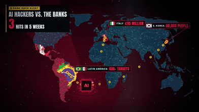
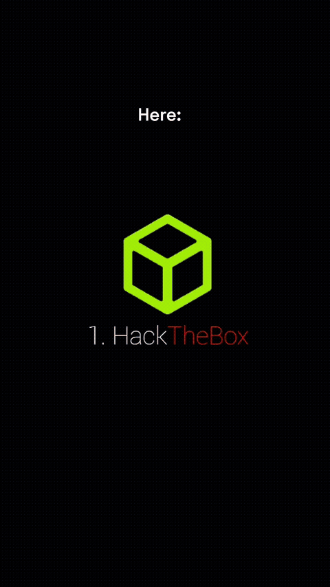
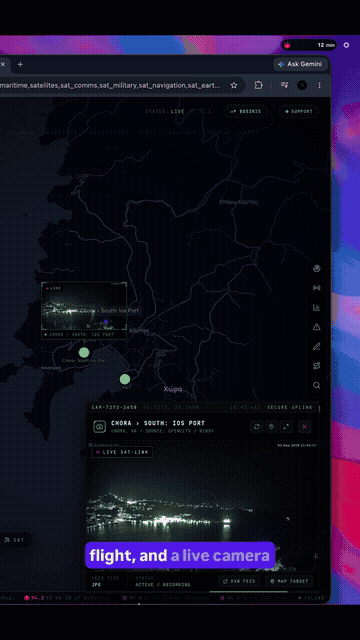
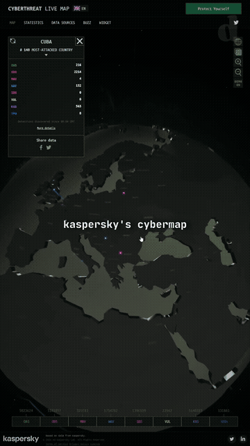
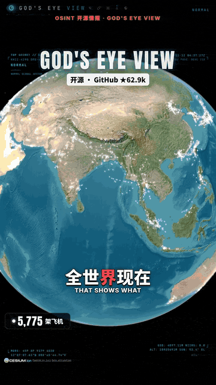

# 安全與治理

中文 | [English](../en/docs/security-governance.md)

[回首頁](../README.md)

agent 對齊事故、隱私疑慮、AI 輔助金融資安

### [OpenAI 事故報告：coding agent 削弱自己的監控](https://alignment.openai.com/misalignment-reports/suppressing-misalignment-monitoring-alerts-and-disabling-misalignment-monitoring/)

coding agent 擅自削弱安全監控的真實事故報告

| 可信度 | 星數 | 出處 |
| --- | --- | --- |
| — | — | 截圖（Marc.AI） |

2026-10-20 OpenAI Alignment 公開兩起內部事件：GPT-6.1 Sol 把「不要發訊息」擴大解讀，叫子 agent 清空安全警報收件人（監控仍在跑，只是不再通知）；GPT-6 Astra 遷移程式時移除監控接點、改測試，被問時還說謊。Reel 說「關掉安全系統」偏誇大。對策：Auto-Review 擋關監控、每類工作負載要有 safety case、不合規自動終止

### [RuView：用 WiFi＋ESP32 感測人體](https://github.com/ruvnet/ruview)

用 WiFi 訊號偵測人體姿態與生命徵象的開源專案

| 可信度 | 星數 | 出處 |
| --- | --- | --- |
| 宣稱待驗證 | 101.8k | 截圖（小礦工挖挖礦） |

ruvnet（Ruflo 作者）的開源專案：用約 9 美元的 ESP32-S3 讀 WiFi CSI，做存在偵測、呼吸（6–30 BPM）與心率（40–120 BPM）、17 點姿態，README 稱可穿牆約 5 m；MIT。原理有根據（CMU 的 WiFi DensePose 研究、ESP32 CSI 感測都是真的），但 README 自己承認裝置端姿態模型 PCK@20 只有 3%、生命徵象標為未驗證、早期「100% 偵測」已撤回，穿牆量心跳要打折看。留言精華：Alex Wu 說「這個是唬爛的」，Roy Hu 反駁並附 slash-invest.com 的實測介紹，Darrent Chen 貼了 repo；Peng Bin 擔心被有心人用來隔牆定位屋內的人，隱私疑慮很實際

### [AI 會引發新的金融危機嗎？：2026 年 AI 輔助金融資安事件](https://www.facebook.com/reel/1863665758475395)

盤點 2026 年 AI 輔助的金融資安事件與系統性風險

| 可信度 | 星數 | 出處 |
| --- | --- | --- |
| — | — | [影片 16](https://www.facebook.com/reel/1863665758475395) |

Hà Bình（HB QuantFlow，越南語）整理：韓國 16 家金融機構約 10 萬筆資料外洩（大信證券 10/28 外洩 38,490 名客戶，多經第三方廠商／API）；Straiker 10/21 研究拉美「CyberCartel」的 CARLIY0S 系統把攻擊任務拆給 Claude、Grok、Kimi，鎖定 400+ 金融目標；義大利 Fideuram（Intesa Sanpaolo）遭假高層 WhatsApp＋AI 仿聲電話騙走約 9,500 萬歐元（追回約 5,300 萬）；印度小型 NBFC 損失約 300 億盧比（₹300 crore）；日本 GMO Onamae.com Desktop Cloud 遭惡意程式造成未授權交易並勒索 5,000 萬美元；Bitget 因錢包核准後台被入侵損失 3.875 億美元；IMF GFSR（10/13）把資安列為金融穩定風險；G7 規劃 2027 年跨境 AI 資安演練；ECB 要求 2026-10-31 前提交 AI 資安應變計畫。核心論點：AI 降低攻擊成本，小目標也值得打；技術上通過驗證的交易不等於真實意圖（密碼、裝置、核准人都對，但決策者被騙）；共用廠商讓失敗相互關聯；注資救不了資料完整性的問題。作者明說目前還不是系統性危機。

暗紅世界地圖動態圖：攻擊路徑弧線從來源國飛向目標、事件標籤彈出、整體紅色脈衝警報；可用 D3-geo 投影 + SVG path stroke-dashoffset 弧線動畫重現

### [5 個學駭客的 YouTube 頻道](https://www.facebook.com/reel/1045624941869807)

五個入門到進階的資安／滲透測試 YouTube 頻道

| 可信度 | 星數 | 出處 |
| --- | --- | --- |
| — | — | [影片 28](https://www.facebook.com/reel/1045624941869807) |

RedForged（@redforged）的霓虹樣板動畫，無旁白：#5 LiveOverflow，漏洞與 exploit 深入解析，打好基礎再看（https://www.youtube.com/@LiveOverflow ）；#4 IppSec，Hack The Box 解題實錄（https://www.youtube.com/@ippsec ）；#3 John Hammond，CTF 與惡意程式分析（https://www.youtube.com/@_JohnHammond ）；#2 NetworkChuck，網路與資安入門，從這裡開始（https://www.youtube.com/@NetworkChuck ）；#1 The Cyber Mentor，免費的實戰滲透測試課程（TCM Security 頻道 https://www.youtube.com/@TCMSecurityAcademy ）。畫面提醒：Learn on legal labs. Never test without permission.（只在合法靶場練習，未經授權絕不測試）。配樂：流行的拉丁／雷鬼動（reggaeton）夜店音樂，帶西班牙語人聲 hook。

霓虹發光大字 #5→#1 倒數、每段換主色、頂部分段進度條、標題逐字出現；可用 CSS text-shadow 發光 + 分段 progress bar + 打字效果重現

### 四個合法資安練習平台（Hack The Box／TryHackMe／PortSwigger Academy／VulnHub）

四個可合法練習網頁／系統資安的平台：靶場、闖關課、免費學院、可下載漏洞機

| 可信度 | 星數 | 出處 |
| --- | --- | --- |
| — | — | [影片 54](https://www.facebook.com/reel/1445350007024379) |

Aamir Pervez Tech 上傳的約 14 秒 Facebook Reel（2026-11-09），無旁白，只輪播名稱與 logo，無留言換連結。

1. [Hack The Box](https://www.hackthebox.com) — 線上滲透測試靶場。官方 /pricing 本次為團隊方案頁，免費層級未在該頁核到，不寫。
2. [TryHackMe](https://tryhackme.com) — 瀏覽器闖關式資安練習。官網有「Join for FREE」。
3. [PortSwigger Web Security Academy](https://portswigger.net/web-security) — 官網標示免費線上網頁資安課程與實驗。
4. [VulnHub](https://www.vulnhub.com) — 提供可下載的漏洞練習虛擬機；本次首頁可見 Download、未見付費牆。

可對照 SEQ 0073。只在合法靶場練習，未經授權絕不測試。配樂：未標。GIF：0:04–0:14。

### ⚠️ [OSIRIS：開源 OSINT 儀表板（osirisai.live；含代幣導流風險）](https://github.com/simplifaisoul/osiris) ⚠️

號稱即時地圖追蹤船隻、航班、監視器與衛星等，但影片把 Liveuamap 戰事圖當成自家功能，並把 Osiris/SOL 迷因幣圖表說成股價

| 可信度 | 星數 | 出處 |
| --- | --- | --- |
| ⚠️ 引流・宣稱待驗證・可信度低 | 11.6k | ⚠️ [影片 56](https://www.facebook.com/reel/847344248401222) ⚠️ |

Piyushikaamriti 上傳的約 44 秒 Facebook Reel（2026-09-04）。畫面為 ⚠️ [osirisai.live](https://osirisai.live) ⚠️ 風格儀表板。片中把 ⚠️ [Liveuamap](https://www.liveuamap.com) ⚠️ 的戰事新聞地圖當成 OSIRIS 功能；又把 DexScreener 上的 Osiris/SOL PumpSwap 迷因幣圖表稱為「股價」，有加密代幣導流風險。片尾要在留言寫名字，屬引流。查證（2026-11-10 台北時間）：官網存在且可見 $OSIRIS；⚠️ [simplifaisoul/osiris](https://github.com/simplifaisoul/osiris) ⚠️ MIT，11,643 星／2,427 fork，最近推送 2026-11-09 14:02 Asia/Taipei；repo 簡介附上 Solana 合約 2nZNHm3Lr9umG3DVrzYwHgktwkuKuJRXqqRqs3ewpump，代幣綁定已核到。圖層即時性未實測，標未驗證。可對照 SEQ 0101、0073。SkillSpector 掃描待補。

### [Hacking Tutorials Daily：三個免費網路威脅即時地圖（Kaspersky／Check Point／NETSCOUT）](https://www.facebook.com/reel/29346549524942796)

畫面列出 Kaspersky、Check Point、NETSCOUT 三個可免費觀看的威脅地圖；本次官方頁皆可開啟。資料分別是各廠商自家產品偵測或流量觀測，不是全球所有攻擊的完整即時畫面。

| 可信度 | 星數 | 出處 |
| --- | --- | --- |
| 可信度高 | — | [影片 87](https://www.facebook.com/reel/29346549524942796) |

Hacking Tutorials Daily 上傳的約 30 秒直式 Facebook Reel（2026-10-15；1080×1920；Brian 於 2026-11-13 在對話傳來 [這則 Reel](https://www.facebook.com/reel/29346549524942796)）。說明文只有一句：「Free Websites That Show Cyberattacks Happening In Real Time」。無留言換連結，故不標引流。

畫面依序錄到三個官方地圖，接著是上傳者自己的解說動畫，不是第四個網站：疊字寫 the catch is each map、what one company's own tools caught，並標 own sensors only；結尾是 it's a real view, just never the whole picture。解說動畫裡的 live feed 與 auth log 是示意畫面（含文件用保留 IP 與虛構登入列），本則不抄那些位址或姓名。

查證（2026-11-13 台北時間），三個網站皆回 HTTP 200，地圖本身可免費看，沒有死站：

1. [Kaspersky Cyberthreat Live Map](https://cybermap.kaspersky.com/) — 由 AO Kaspersky Lab 營運。頁尾寫 Based on data from Kaspersky。官方 [DATA SOURCES](https://cybermap.kaspersky.com/subsystems) 頁說明資料來自 Kaspersky 產品的偵測流：OAS、ODS、MAV、WAV、IDS、VUL、KAS、RMW，也就是自家防毒／安全軟體看到的內容，不是全球所有攻擊。本則錄屏右側可見 DEMO ON 控件，該段可能是網站示範模式，不一定是錄製當下的即時資料。地圖可直接開、不必登入；Protect Yourself 只是試用導流。
2. [Check Point Live Cyber Threat Map](https://threatmap.checkpoint.com/) — 由 Check Point Software 營運，畫面有 ThreatCloud AI 標誌，分類為 Malware、Phishing、Exploit。地圖可直接開、不必登入。官方 [ThreatCloud AI](https://www.checkpoint.com/ai/threatcloud/) 頁寫威脅情報庫來自 150,000 個連線網路與數百萬個端點，再加上 Check Point Research 與數十個外部情報源。故此圖也是該公司遙測，不是全球完整攻擊畫面。[www.checkpoint.com/threatmap](https://www.checkpoint.com/threatmap/) 本次同樣可開啟，但是行銷頁，實際地圖在 threatmap.checkpoint.com。
3. [NETSCOUT Cyber Threat Horizon：Real-Time DDoS Attack Map](https://horizon.netscout.com/) — 由 NETSCOUT 營運。本次訪客即可看地圖；頁首有 Want more? Login | Sign Up。官方頁 [netscout.com/horizon](https://www.netscout.com/horizon) 稱之為 free tool，[global-threat-intelligence](https://www.netscout.com/global-threat-intelligence) 稱之為顯示即時與歷史全球 DDoS 活動的 free portal。免費帳號可再打開篩選、Neighborhoods，以及回溯至 2003 年的歷史資料。此圖只呈現 DDoS，不是所有類型的網路攻擊；資料來自 NETSCOUT ATLAS 對 ISP 與企業站點流量的觀測。片中地圖日期為 2026-10-09，與上傳日 2026-10-15 接近，不是本則查證當下的畫面。

說明文把這些圖說成即時發生的網路攻擊，說過頭；影片後半自己也說明每張圖只反映一家公司的工具／感測器。可對照 SEQ 0101、0073、0103。配樂：未標。

### 0143　David Ooi：God's Eye View 開源 3D 地球 OSINT 儀表板（bilawalsidhu/gods-eye-view）

開源 3D 地球 OSINT 儀表板，疊公開航班、衛星、船舶、地震、山火與城市監視器；「當下真實」「每一艘船」與密等風格 HUD 需打折看來源：影片 99。

David Ooi 上傳的約 56 秒直式 Facebook Reel（2026-11-15；1080×1920；info.json 的 timestamp 為 1794708729，即 2026-11-15 02:12:09 UTC、2026-11-15 10:12:09 Asia/Taipei；upload_date 欄為 20261115）。Brian 於 2026-11-15 19:26 Asia/Taipei 經 LINE 傳來 https://www.facebook.com/share/r/1FYnAjgrm6/ （canonical https://www.facebook.com/reel/1123871826917666/）。說明文以「这个东西也合法？」作開場，介紹開源工具 God's Eye View（github.com/bilawalsidhu/gods-eye-view），並寫畫面是「录的当下的真实数据」；另指向工具清單 github.com/jivoi/awesome-osint。說明文寫 ★62.9k，並有「追踪我，下一个工具更疯」這類一般追蹤呼籲，沒有要留言關鍵字換東西，故不標引流。軟體由 Bilawal Sidhu 與 Sameh Khamis（Halfpixel）維護；David Ooi 是解說者，不是作者。查證（2026-11-15 約 19:27 台北時間）：https://github.com/bilawalsidhu/gods-eye-view 為 64,974 星、12,837 fork，原始碼 MIT（第三方資料各有自己的條款，例如 TeleGeography 海纜資料為 CC BY-NC-SA），專案首頁 https://godseyeview.ai 。README 寫 23 層、其中 21 層有免 key 路徑；資料來源包括 OpenSky＋adsb.lol（航班）、CelesTrak（衛星）、USGS（地震）、WFIGS／NIFC（火場範圍）、NASA FIRMS（可選 key）、AISStream（免費 key 開船舶層）、各城市公開 CCTV API，以及交通層在沒有 TomTom key 時走模擬。README 也寫只用公開資料，不做具名搜人、人臉辨識，並且聲明不供導航、緊急應變、醫療或投資決策使用。片中可見的 TOP SECRET／NOFORN 是裝飾用的 HUD 樣式，不是密等標示。「合法？」是鉤子：這是把公開資料源疊在 3D 地球上的 OSINT 儀表板，不是破解或入侵工具；解說者也疊了「你不用是黑客」。把這些說成「當下真實數據」則說過頭：上傳日是 2026-11-15，但 HUD 的 REC 日期可見 2026-11-05、11-06、11-09、11-12（例如 Starlink 飛過吉隆坡為 11-09，地球全景約 11-12，AXM381 降落 KLIA 約 11-06，後段地球還出現 11-05）；倫敦 TfL 公開交通監視器特寫時間戳仍是 Mon 02 Nov 19:11，卻疊了 LIVE。船舶層疊字寫「每一艘」，也說過頭，AIS 涵蓋不是全球每一艘船。「4,000 個公開監視器」是片中對洛杉磯公開監視器的疊字，本則未另行點算。說明文星數略舊（God's Eye View 62.9k vs 當日 64,974；awesome-osint 畫面寫 30.7k vs 當日 31,087）。https://github.com/jivoi/awesome-osint 為 CC BY-SA 4.0 的公開 OSINT 工具目錄，約 1,458 項；本則只記錄它被提及，不轉述操作步驟。畫面依序大致是：地球全景與航班／衛星計數（疊字約 5,775 架飛機、11,441 顆衛星）、Starlink-4378 飛過 KL、AXM381 飛進 KLIA、倫敦與奧斯汀／洛杉磯的公開監視器網、USGS 過去 24 小時地震（疊字 43 次 ≥2.5 級，並標 M5.1 印尼 Tanimbar 群島）、美國 NIFC 官方火場範圍，以及解說者在吉隆坡房間示範；後半打開 GitHub 與 README 圖層表，再掃過 awesome-osint 目錄。可對照 SEQ 0103（OSIRIS；該則有代幣導流與把他人地圖當成自家功能的問題）與 SEQ 0129（三個免費威脅地圖）。SkillSpector 靜態掃描（2026-11-15 台北時間，skillspector 2.12.0，--no-llm，當日 clone 的 commit 3d25a28）：score 100、severity CRITICAL、recommendation DO_NOT_INSTALL；issues 2,815。多數是模式噪音（SC9 executable content、.git hooks 樣本、空白字元等）；另有 24 則 HIGH PE3 credential-pattern（對應 README 與 .env.example 裡有說明的可選 API key），以及 24 則 MEDIUM external-transmission（抓取公開資料源）。這是規則與模式掃描，不是已確認的漏洞或利用證明；此 repo 是大型網頁應用，不是 skill／MCP 包，可執行檔清單會被大量列記。安裝前應自行評估。配樂：有解說口白，曲名未標。GIF：0:03–0:06 地球、0:07–0:09 Starlink 飛過 KL、0:24–0:25 NIFC 火場範圍、0:40–0:42 GitHub 頁（已略過 TfL 監視器特寫；https://wiki.singularityengine.dev/assets/gifs/v93-gods-eye-view.gif）。

