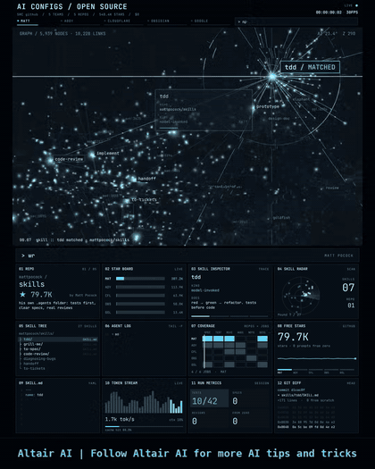
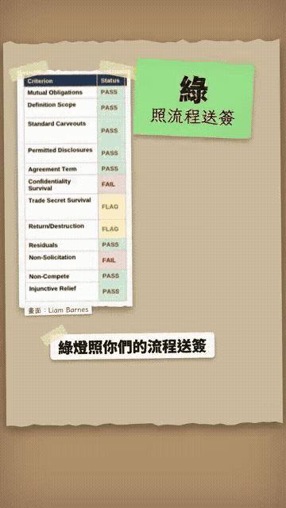

# Skills／MCP／工具

中文 | [English](../en/docs/skills-mcp-tools.md)

[回首頁](../README.md)

通用的 agent 能力元件：MCP、skill、開發方法論 skill、語音、抽取模型

### [earshot](https://github.com/Leonxlnx/earshot)

讓 agent 在本地端處理語音的工具

| 可信度 | 星數 | 出處 |
| --- | --- | --- |
| — | 3,290 | [影片 1](https://www.facebook.com/reel/2050168028979180) |

讓 agent 在本地處理語音

### [axuse](https://github.com/ctoldigital/axuse)

透過無障礙樹操作瀏覽器的 MCP 工具

| 可信度 | 星數 | 出處 |
| --- | --- | --- |
| — | 648 | [影片 1](https://www.facebook.com/reel/2050168028979180) |

透過無障礙樹操作瀏覽器，走 MCP

### [imozuru](https://github.com/MaryCache/imozuru)

沿引用追回原始文獻的 Claude Code skill

| 可信度 | 星數 | 出處 |
| --- | --- | --- |
| — | 1,385 | [影片 1](https://www.facebook.com/reel/2050168028979180) |

沿引用往回追到原始文獻的 Claude Code skill

### [audio-studio-mcp](https://github.com/kanaworksai-hue/audio-studio-mcp)

在本地生成音樂與音效的 MCP 工具

| 可信度 | 星數 | 出處 |
| --- | --- | --- |
| — | 541 | [影片 1](https://www.facebook.com/reel/2050168028979180) |

在本地生成音樂和音效

### [Cloudflare Clairic 抽取模型](https://blog.cloudflare.com/clairic-extraction-model/)

一次前向就抽出結構化欄位的 Cloudflare 模型

| 可信度 | 星數 | 出處 |
| --- | --- | --- |
| — | — | 截圖（Marc.AI） |

2026-10-19 Workers AI 預覽模型 @cf/cloudflare/clairic：給文字（最多 4 張圖）加欄位 schema，一次前向就回傳有型別的值，不生成 token，附信心分數、null 機率與字元位置。每百萬輸入 token $0.10、輸出不收費，預告開權重。多步數學與預測仍弱

### [Superpowers](https://github.com/obra/superpowers)

讓 coding agent 先釐清需求、寫計畫、TDD 再動手的 skill 方法論

| 可信度 | 星數 | 出處 |
| --- | --- | --- |
| — | 309.7k | Brian 推薦清單 2026-10-31 |

Jesse Vincent（obra）的 agentic skills 框架：agent 一開工先 brainstorming 問清楚需求、分段給你確認設計，再寫出連新手都能照做的實作計畫，強調紅綠 TDD、YAGNI、DRY，最後用 subagent-driven-development 逐項派工並審查成果；skill 會自動觸發。支援 Claude Code、Codex、Cursor、Gemini CLI、Copilot CLI、Grok Build 等。安裝：Claude Code 用 `/plugin install superpowers@claude-plugins-official`，Cursor 用 `/add-plugin superpowers`；MIT。預設會載入官網 logo 統計版本，可用 `SUPERPOWERS_DISABLE_TELEMETRY` 關閉。

### [Matt Pocock Skills（Skills For Real Engineers）](https://github.com/mattpocock/skills)

Matt Pocock 每天用的小型工程 skill，主打先對齊再寫碼

| 可信度 | 星數 | 出處 |
| --- | --- | --- |
| — | 319.2k | Brian 推薦清單 2026-10-31；[影片 47](https://www.facebook.com/reel/1815732602882824) |

TypeScript 講師 Matt Pocock 從自己 .agents 目錄公開的 skill 集，刻意做得小、可組合、不綁流程（相對 GSD、BMAD、Spec-Kit 那種接管整個流程的做法）。招牌是 /grill-me、/grill-with-docs：開工前讓 agent 反過來拷問你需求，順便建立專案共用詞彙表（ubiquitous language）並把難解釋的決策寫成 ADR，讓 agent 用詞精簡、命名一致。安裝：Claude Code 用 `claude plugin install mattpocock-skills@claude-plugins-official`，其他 agent 用 `npx skills@latest add mattpocock/skills`；MIT。

### [Ponytail](https://github.com/DietrichGebert/ponytail)

讓 agent 像資深工程師一樣少寫程式、先重用現有元件的 skill

| 可信度 | 星數 | 出處 |
| --- | --- | --- |
| — | 181.2k | Brian 推薦清單 2026-10-31 |

DietrichGebert 的「懶惰資深工程師」skill：只寫任務需要的程式，優先重用 repo 既有元件，但不准砍驗證、錯誤處理、安全與無障礙。附 /ponytail-review（連 diff 以外受影響的檔案一起審）、/ponytail-audit 等指令。README 自述 Ponytail 5 在 Claude Code 39 個任務的測試：程式碼 -53%、時間 -41%、成本 -26%、token -45%，高風險邏輯 98% 附測試（無 skill 為 68%），屬作者自測。安裝：Claude Code 先 `/plugin marketplace add DietrichGebert/ponytail` 再 `/plugin install ponytail@ponytail`，其他 agent 可直接放 AGENTS.md；MIT。作者提醒只從這個 repo 或 npm `@dietrichgebert/ponytail` 安裝，帶 .exe／.dll 的是假冒版。

### [CLI-Anything：讓所有軟體都有命令列](https://github.com/HKUDS/CLI-Anything)

自動幫專業軟體生出命令列，讓 AI agent 不用點畫面就能操作

| 可信度 | 星數 | 出處 |
| --- | --- | --- |
| — | 57.9k | [影片 26](https://www.facebook.com/reel/1857279712725267) |

香港大學 HKUDS 的開源專案（repo 簡介：Making ALL Software Agent-Native）：替專業軟體自動產生 CLI，讓 agent 用指令操作，而不是截圖加點擊。在 Claude Code 執行 `/cli-anything <軟體路徑或 GitHub 網址>`，走 7 個階段：分析程式碼→設計 CLI→實作→規劃測試→寫測試→寫測試文件→發佈到 PyPI。會呼叫真的軟體（LibreOffice 轉 PDF、Blender 算圖），輸出結構化 JSON，文案稱有 2,000+ 個測試；CLI-Hub（https://clianything.cc/ ）讓 agent 搜尋、安裝社群做好的 CLI（SKILL.md）。影片示範 FreeCAD 做好奇號風探測車、Blender 軌道中繼無人機、《殺戮尖塔 2》CLI；但畫面上的殺戮尖塔看起來是一代不是二代，示範畫面也是 README 裡美化過的展示。和本 wiki 的 blender-skills、Spider Walker 等 DCC 項目是同一方向：讓 agent 用可測試的介面操作 3D 軟體。Python、Apache-2.0，2026-03-08 建立、5.2k fork。影片是小礦工挖挖礦的繁中 AI 配音。配樂：無。

### [archify：把想法或程式碼變成互動架構圖](https://github.com/tt-a1i/archify)

讓 AI agent 把想法、計畫或程式碼轉成可互動的圖

| 可信度 | 星數 | 出處 |
| --- | --- | --- |
| — | 92.0k | Brian 推薦清單 2026-10-31 |

給 Claude Code、Codex 等 agent 用的 skill，把一個想法、計畫或整個 codebase 轉成互動式圖表。Apache-2.0，2026-04-15 建立，官網 https://archify.si 。出自 Brian 的文字推薦，無影片。配樂：不適用（無影片）。

### [diagram-design：編輯級品質的圖表 skill](https://github.com/cathrynlavery/diagram-design)

讓 AI agent 畫出雜誌等級的 HTML＋SVG 圖表

| 可信度 | 星數 | 出處 |
| --- | --- | --- |
| — | 63.4k | Brian 推薦清單 2026-10-31 |

給 Claude Code、Codex、Copilot、Cursor 等 agent 用的圖表 skill，產出獨立 HTML 加內嵌 SVG 的編輯級品質圖表。MIT，官網 https://diagramdesign.dev 。中文 fork patrick-xin/diagram-design-zh（https://github.com/patrick-xin/diagram-design-zh ，48 ⭐）內建中日韓文字排版。出自 Brian 的文字推薦，無影片。配樂：不適用（無影片）。

### [PPT Master：文件或主題 → 可編輯的原生 PPTX（AI 技能包）](https://github.com/hugohe3/ppt-master)

丟 PDF／Word／文字或只給主題，AI 做出文字框、形狀、圖表都能改的真 PowerPoint，不是圖片

| 可信度 | 星數 | 出處 |
| --- | --- | --- |
| 可信度高 | 71.6k | [影片 39](https://www.facebook.com/reel/1051071164608370) |

小礦工挖挖礦上傳的 1:28 影片，畫面是官方範例網站的錄影，沒有現場生成示範。給 Claude Code、Cursor、Codex CLI 用的技能包。功能：生成前先確認模板、比例、頁數等規格（要求快速模式才跳過）；圖表預設是可編輯的形狀，加參數可改成原生圖表；會加轉場與動畫，並把旁白稿寫進備忘稿；圖片來自 AI 生成或開放圖庫，並在投影片上標註來源；也能套用公司模板並保留原設計。官方範例站有 72 份簡報、1012 頁，涵蓋中、日、韓、德文；範例 repo：https://github.com/hugohe3/ppt-master-examples （22 ⭐）。需求：Python 3.10–3.14 加一個 AI 程式助理。作者提醒別期待第一次就完美，仍要自己再修。值得一看的 fork：academic-ppt-master（論文轉 PPTX）、ppt-master-plus。MIT，2025-12-10 建立，最近推送 2026-10-30。可信度：高，星數與 GitHub API 一致；片尾只問你最想先做哪份簡報，是輕微的留言引導，不算引流。配樂：輕快、俏皮的電子配樂（休閒遊戲風）。無 GIF 片段。

### [VibeVoice：微軟開源語音 AI（長音檔 ASR＋說話者分離＋即時 TTS）](https://github.com/microsoft/VibeVoice)

一次吃進最長約 1 小時錄音，直接輸出「誰講・幾秒・講什麼」的逐字稿，另有可在 Colab 跑的即時語音合成

| 可信度 | 星數 | 出處 |
| --- | --- | --- |
| 可信度高 | 55.1k | [影片 40](https://www.facebook.com/watch/?v=2181912112534967) |

AI懶人報上傳的 59 秒影片，AI 語音國語旁白。重點：VibeVoice-ASR 不用先把長錄音切段，單次處理最長約 1 小時，同時做說話者分離與時間戳（誰講、幾秒到幾秒、講什麼），支援 50 多種語言，可給熱詞（hotwords）提高專有名詞辨識率（旁白念成 WhyVoice，正確是 VibeVoice）；另有即時 TTS，附 Colab T4 快速上手筆記本。示範片段是官方 demo 的 Jimmy Fallon 訪談 Lady Gaga，字幕標出講者 0／講者 1。以前要 ASR 加 diarization 兩個工具接起來，現在一個模型搞定。MIT 授權，2025-08-25 建立，最後推送 2026-10-08；影片顯示 54.9k 星。可信度：高，微軟官方 repo，影片內容與 README 一致；片尾只叫人追蹤，沒有導流。配樂：烏克麗麗加輕打擊樂。

GIF：影片 0:22.5–0:26，說話者分離示範。

### ⚠️ [Android 手機 AI agent（ADB 無線偵錯＋Claude Code MCP）｜預覽圖是替代方案 mobile-mcp，不是影片的 repo](https://www.facebook.com/reel/1628595922149351)

宣稱「某 GitHub repo＋Opus 5.5」能讓任何 Android 手機變成免手動 agent，但影片裡的 repo 查無此帳號；底層手法只是 ADB 無線連線加截圖、點擊、打字

替代方案預覽（不是影片裡的 repo）：⚠️ [mobile-next/mobile-mcp](https://github.com/mobile-next/mobile-mcp)

| 可信度 | 星數 | 出處 |
| --- | --- | --- |
| ⚠️ 引流・宣稱待驗證・可信度低 | —（替代方案 mobile-mcp：10.2k） | ⚠️ [影片 43](https://www.facebook.com/reel/1628595922149351) |

Tauhid IQ 上傳的 17 秒影片，沒有旁白。上半部是標題「dkrv-dev / Reverse Engineer Phone」的 GitHub 頁面（頁面顯示 17k 星、2.1k fork），About 寫「Turn any Android phone into an agent that uses its own apps over Wi-Fi. Say one sentence. Claude taps the rest.」，README 列出 tools/phone.py --probe、tools/agent.sh、claude mcp add phone tools/venv/bin/python tools/mcp.py；下半部是 Windows cmd.exe 的執行紀錄，加上一支真手機放在桌上加速播放，自己開 Telegram、再開到 Play 商店的 ChatGPT 頁面。英文說明文步驟：手機與筆電連同一個 Wi-Fi→開發人員選項開啟無線偵錯→把 repo 和手機「關於手機」截圖連同提示詞貼給 Claude Code→Opus「找到漏洞」（其實就是走網路的 ADB）→探測型號、版本、已安裝 App 並存還原點→寫出只有 3 個工具（看畫面、點擊、打字）的 agent→加進 Claude Code 當 MCP→按一次 Allow，說「open Telegram and install ChatGPT」。還宣稱支援 40 個品牌、300 多款機型、免 root；結尾寫「Find GitHub repo + full prompt below」卻沒給 repo。查證：⚠️ https://github.com/dkrv-dev 回 404（帳號不存在），GitHub API 搜尋也找不到這個 repo；而且 GitHub repo 名稱不能有空格，頁面很可能是做出來的假畫面或已刪除。Opus 5.5 只是說明文點名的模型，這裡不做判斷。可信度：低，repo 查無、數字無從驗證，加上「repo＋完整提示詞在下面」的導流寫法和誇張口吻。手法本身是真的也很普通：adb connect 走 Wi-Fi，再用截圖、點擊、輸入文字三個動作操作手機，就是標準做法。可用的替代方案（不是影片裡的 repo）：mobile-next/mobile-mcp（⚠️ https://github.com/mobile-next/mobile-mcp），10,198 星，Apache-2.0，MCP server，支援模擬器與實機，可接 Claude Code、Codex、Cursor。配樂：phonk／電子。

GIF：影片 0:02–0:06，終端機紀錄與手機自動操作（加速播放）。

### ⚠️ [Scrapling：Python 網頁爬取框架（隱形瀏覽器＋MCP）](https://github.com/D4Vinci/Scrapling) ⚠️

整合隱形瀏覽器、代理輪替、CSS／XPath 與 Markdown 輸出的 Python 爬蟲框架，並附 MCP

| 可信度 | 星數 | 出處 |
| --- | --- | --- |
| ⚠️ 引流・可信度中 | 100.2k | ⚠️ [影片 45](https://www.facebook.com/reel/2088263658998884) ⚠️ |

小礦工挖挖礦上傳的 1:26 繁中影片，畫面是做成 GitHub UI 的投影片／動態設計（非真實錄屏），顯示約 97.1k 星、10.2k fork。介紹 Scrapling：Python 框架，整合快速請求、隱形瀏覽器、解析（CSS／XPath）、整站爬取（節流、暫停續爬、代理輪替）、輸出 JSON／CSV，並可把網頁轉成 Markdown 餵給 AI；也有 MCP server 讓 Claude、Cursor 這類代理直接用。影片宣稱可自動處理 Cloudflare 驗證頁（宣稱待驗證）。查證：真實 repo 為 ⚠️ [https://github.com/D4Vinci/Scrapling](https://github.com/D4Vinci/Scrapling) ⚠️ ，BSD-3-Clause，2024-10-13 建立，GitHub API 2026-11-09 為 100.2k 星／10.5k fork（與畫面接近）、未封存、最近推送 2026-11-09（台北時間）。官網 ⚠️ [https://scrapling.readthedocs.io/en/latest/](https://scrapling.readthedocs.io/en/latest/) ⚠️ 。片尾要留言「爬蟲」才私訊連結，屬引流；repo 本身可直接開啟。配樂：未標。SkillSpector 掃描待補（本批不 clone；URL 模式被 SSRF 擋下）。

### [Altair AI：五個公開 agent skill／設定清單](https://github.com/addyosmani/agent-skills)

動態看板整理五個公開 skill／設定 repo：Matt Pocock、Addy Osmani、Cloudflare、Obsidian CEO、Google

| 可信度 | 星數 | 出處 |
| --- | --- | --- |
| 概念動畫・可信度高 | — | [影片 47](https://www.facebook.com/reel/1815732602882824) |

Altair AI 上傳的 21 秒 Facebook Reel，動態設計 skill 看板（非真實錄屏），橫幅 Follow Altair AI。畫面列出五個 repo（畫面星數／說明文星數與 API 2026-11-09 對照）：① mattpocock/skills（畫面 295.8K、文案 318K、API 319.2k）→ 已有條目 SEQ 0058，本則只加來源、不重複建檔；② addyosmani/agent-skills（畫面 86.9K、文案 92K、API 114.3k，MIT，最近推送 2026-11-01）；③ cloudflare/security-audit-skill（畫面／文案 63.9K、API 67.5k，MIT，最近推送 2026-09-14）；④ kepano/obsidian-skills（畫面 58.0K、文案 51K、API 51.2k，MIT，最近推送 2026-09-15；與影片 48 交叉）；⑤ google/elephant-goldfish-model（畫面 13.4K、文案 14.8K、API 15.9k，Apache-2.0，最近推送 2026-11-09）。五個帳號與 repo 皆可直接開啟。配樂：未標。GIF 片段：0:00–0:02（https://wiki.singularityengine.dev/assets/gifs/v47-altair-skill-board.gif）。SkillSpector 掃描待補（本批不 clone）。

GIF：影片 0:00–0:02，Altair AI skill 看板（動態設計，非錄屏）。

### [倉頡 SKILL 2.0（cangjie-skill）：長影片／課程／播客蒸餾成 Agent Skills](https://github.com/kangarooking/cangjie-skill)

把長影片、課程、播客、書的文字內容蒸餾成可呼叫的 Agent Skills（步驟、框架、安全邊界）；搭配 video-downloader skill 先下載與轉寫

| 可信度 | 星數 | 出處 |
| --- | --- | --- |
| 宣稱待驗證・可信度中 | 12.5k | [影片 53](https://www.facebook.com/reel/1308612614774010) |

一人公司研究所上傳的 3:15 Facebook Reel（來源標 B 站 AI袋鼠帝／kangarooking）。工具：kangarooking/cangjie-skill（畫面稱倉頡 SKILL 2.0；README 版本徽章 2.5.0），並搭配同作者的 [video-downloader](https://github.com/kangarooking/kangarooking-skills/tree/main/video-downloader) skill。流程：影片連結→下載→抽音訊→語音轉文字→cangjie-skill 把文字蒸餾成可重用 Agent Skills（步驟、框架、安全邊界）。這是**文字蒸餾**，不是畫面／多模態視覺分析——Facebook 說明文寫「多模態、同時理解畫面和聲音」與實際流程不符，已更正。輸入可為長影片、課程、播客、書；作者示範搭配 Longcat-2.0 與 Claude Code。宣稱（畫面僅素材片、**未驗證**）：Andrew Ng 2026 課程 26 支／4 小時以上→約 1 小時產出 25 個 skills；4 支 YouTube（80+ 分鐘）→ 8 個 skills。無留言換連結、無安裝指令畫面。查證（GitHub API 2026-11-10 台北時間）：repo 存在，MIT，12,523 星／1,481 fork，未封存，建立 2026-04-16，最近推送 2026-10-02 11:17 Asia/Taipei；母 repo kangarooking-skills 715 星、無 license 欄、最近推送 2026-11-04。可對照 SEQ 0095、0057、0058、0094。配樂：未標。GIF：0:33–0:38（https://wiki.singularityengine.dev/assets/gifs/v53-cangjie-skill-distill.gif）。SkillSpector 掃描待補（本批不 clone）

### ⚠️ [Broch Builds：10 個新 Claude Code／Codex skill 清單](https://github.com/heydamir/unslop) ⚠️

短片列出多個設計／動畫 skill repo，片尾要留言 SKILLS 才寄 320 份清單

| 可信度 | 星數 | 出處 |
| --- | --- | --- |
| ⚠️ 引流・可信度中 | 14.2k | ⚠️ [影片 63](https://www.facebook.com/reel/1439815074924674) ⚠️ |

Broch Builds 上傳的約 12 秒 Facebook Reel（2026-11-11）。說明文要留言 SKILLS 才寄「依 GitHub 星數排序、附安裝指令的 320 份清單」，屬引流。畫面點名的 repo 查證（GitHub API 2026-11-11 台北時間）：存在——⚠️ [caru-ini/stack-diagram](https://github.com/caru-ini/stack-diagram) ⚠️（2,345 星，MIT，最近推送 2026-11-09 14:00 Asia/Taipei）；⚠️ [elvarofficial/teardown](https://github.com/elvarofficial/teardown) ⚠️（3,076，MIT，2026-10-31 22:01）；⚠️ [t3dotgg/tstack](https://github.com/t3dotgg/tstack) ⚠️（3,469，MIT，2026-11-11 19:33）；⚠️ [heydamir/unslop](https://github.com/heydamir/unslop) ⚠️（14,232，CC-BY-4.0，2026-11-09 05:18；畫面稱 #1、＋13,630，增幅未核對）。畫面路徑 mromdev/claude-animated-shorts 回 404；名稱只差一字母、確實存在的是 ⚠️ [mromidev/claude-animated-shorts](https://github.com/mromidev/claude-animated-shorts) ⚠️（2,867，MIT，2026-11-01 13:57）。benjitaylor/stageshow、haydenchetty/floorplan 皆 404，未猜測替代。#4 Earshot、#3 Rea-Video、#2 PixelFX 未給 repo（Earshot 已有條目 SEQ 0011，本則不另猜路徑）。已核到的 repo SkillSpector 掃描待補（本批不 clone）。配樂：未標。GIF：0:00–0:10。

### [AI懶人報：Anthropic 官方法務外掛（triage-nda／review-contract／legal-risk-assessment／claude-for-legal）](https://github.com/anthropics/knowledge-work-plugins)

介紹 Anthropic 官方法務外掛：knowledge-work-plugins 的 legal 資料夾，以及 claude-for-legal 的領域外掛。預設依美國法與美國實務，台灣相關事項仍應由律師審查。

| 可信度 | 星數 | 出處 |
| --- | --- | --- |
| 可信度高 | 35,612／9,992 | [影片 89](https://www.facebook.com/reel/2280311616036852) |

AI懶人報上傳的約 95 秒直式 Facebook Reel（2026-11-13；360×640；Brian 於 2026-11-13 在對話傳來 [這則 Reel](https://www.facebook.com/reel/2280311616036852)）。說明文介紹四塊：triage-nda 把 NDA 分成綠／黃／紅燈；review-contract 先問你站哪邊再逐條標色，紅黃條文附修改建議；legal-risk-assessment 用嚴重程度乘發生機率打分；claude-for-legal 有 12 個領域外掛，其中商務合約可列出 90 天內要通知解約的合約。並寫要付費版 Claude（桌面版 Cowork 或 Claude Code）。說明文也註明這些外掛預設照美國法與美國實務寫，台灣的法律問題與要簽的文件最後還是要律師看；風險備忘錄、續約清單兩段是示意。片尾追蹤 @ai.lanrenbao 是普通追蹤呼籲，不是留言換連結，故不標引流。

查證（2026-11-13 台北時間）：

- 兩個官方倉庫都存在，授權皆為 [Apache 2.0](https://github.com/anthropics/knowledge-work-plugins)：[anthropics/knowledge-work-plugins](https://github.com/anthropics/knowledge-work-plugins)、[anthropics/claude-for-legal](https://github.com/anthropics/claude-for-legal)
- knowledge-work-plugins 官方說明是給知識工作者、主要以 Claude Cowork 使用、也相容 Claude Code 的外掛集；legal 資料夾確實在內。GitHub API 當日 35,612 星（畫面寫 34.6k，數字已過時），最近推送 2026-11-13 10:09 台北時間，掃描用 commit 02717ef
- legal／skills 目錄可見 triage-nda、review-contract、legal-risk-assessment 等技能資料夾，這三個名稱屬實；同資料夾還有 brief、compliance-check、legal-response、meeting-briefing、signature-request、vendor-check。legal／README 的技能表仍寫 contract-review、nda-triage 等較舊名稱，與現有資料夾名不完全一致
- 該 README 的免責聲明寫明：此外掛協助法務流程，不提供法律意見，AI 分析須由合格律師審查後才能作為法律決定依據；預設 playbook 例子反映美國法律立場與 Delaware、New York、California 等管轄，若在其他法系（並舉 EU、UK 等為例）必須先改 playbook 再依賴分析
- claude-for-legal 官方說明是法務工作流程外掛套件。GitHub API 當日 9,992 星（畫面寫破 9,800／9.9k，接近當日數字），掃描用 commit 4a6c651（該淺層 clone 的 main 尖端；倉庫 updated_at 較新，可能含其他活動）
- marketplace.json 列出 13 個外掛：12 個官方領域外掛（commercial-legal、privacy-legal、product-legal、corporate-legal、employment-legal、regulatory-legal、ai-governance-legal、litigation-legal、law-student、legal-clinic、legal-builder-hub、ip-legal），再加上由 Thomson Reuters 維護的合作外掛 cocounsel-legal。說明文的「12 個領域外掛」與官方第一方數量相符
- 官方 README 寫可作為 Claude Cowork 或 Claude Code 外掛安裝，也可經 Claude Managed Agents API 部署
- commercial-legal 確有 renewal-tracker 技能，預設列出未來 90 天內的解約通知期限（紅 0–13 天、橙 14–44 天、黃 45–89 天），與畫面指令說明相符；該段畫面標了「示意」，本則把示意清單視為示範，不把片中列舉的日期當成真實案件
- 官方也強調產出都是供律師審查的草稿，不是法律意見或法律結論，不能取代律師
- 關於「要付費版 Claude」：官方 Cowork 產品頁寫 Claude Cowork is now just Claude，並寫正在推給 Pro、Max 與 Ultra，後續還會有更多方案。外掛文件指定的使用面是 Cowork 或 Claude Code（claude-for-legal 另支援 Managed Agents API）。本則未逐一核對每一種 Claude 方案能否安裝這些外掛

SkillSpector 靜態掃描（2026-11-13 台北時間，skillspector 2.12.0，--no-llm）：

- 對 knowledge-work-plugins 整個倉庫（marketplace 外掛數量很多）以 300 秒逾時未跑完，沒有完整 JSON。改掃其中的 legal 外掛包：issues 1（HIGH 1，位於 README.md，規則為 Anti-Refusal Statement），risk score 20、severity LOW、recommendation SAFE、max_issue_severity HIGH；覆蓋率 100%（14／14 個元件，狀態 complete）
- 對 claude-for-legal 整個倉庫：issues 233（HIGH 22、MEDIUM 207、LOW 4），risk score 100、severity CRITICAL、recommendation DO_NOT_INSTALL、max_issue_severity HIGH；覆蓋率 98.7%（311／315 個元件，狀態 partial）
- 這是規則與模式掃描，不是已確認的產品漏洞；許多命中出在技能說明的用語與 MCP 設定文件

配樂：未標。

