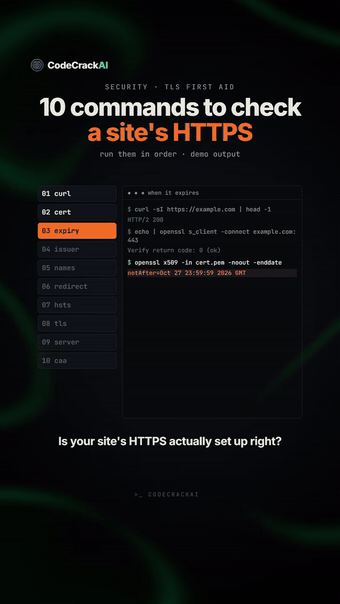
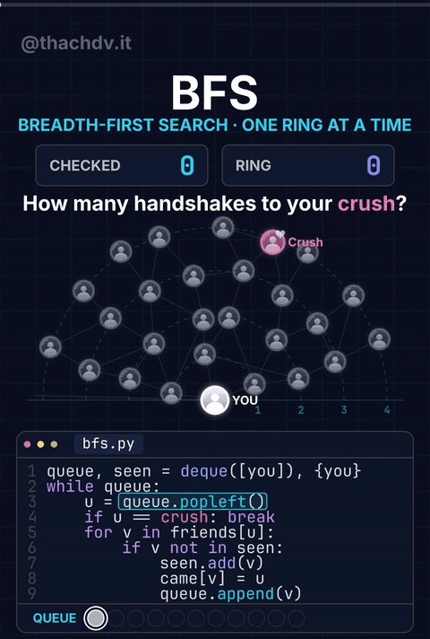
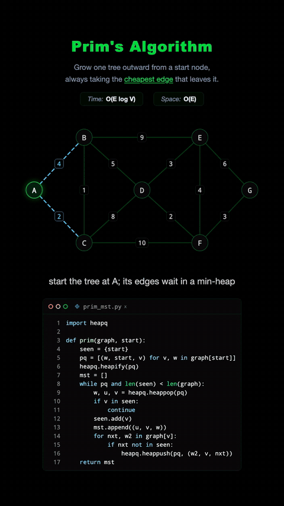

# 系統設計與工程基礎

中文 | [English](../en/docs/systems-design.md)

[回首頁](../README.md)

非 AI 的後端／分散式系統基礎與維運常識（如 TLS 健檢），主任工程師面試必備

### [12 個系統設計基本概念](https://www.facebook.com/reel/3285768298275601)

12 個系統設計基本概念一句話速查

| 可信度 | 星數 | 出處 |
| --- | --- | --- |
| — | — | [影片 22](https://www.facebook.com/reel/3285768298275601) |

Code Crack 的 13 秒動態圖卡（深色格線背景、12 張卡片依序亮起、無旁白，人工製作非 AI 生成）：Load Balancer 分散流量；Caching 快取重複查詢；CDN 把內容放到靠近使用者的地方；Sharding 資料分片；Replication 複本供讀取與容錯；Message Queue 非同步可靠處理；Rate Limiting 限流；Consistent Hashing 加節點時不必大量重分配；CAP 一致性／可用性／分區容錯；Idempotency 重試無害；Circuit Breaker 熔斷避免連鎖故障；Observability 用 logs／metrics／traces 看清系統。更正：圖上 CAP「三選二」的說法過度簡化，分區不是能選的，發生分區時只能在一致性與可用性之間擇一；沒有分區時則如 PACELC 所說，是在延遲與一致性之間取捨。配樂：UI 音效（上行的馬林巴鐘聲、結尾提示音）疊在微弱的通用輕快科技感節拍上。面試：AI agent 本身也是分散式系統，可重試的工具呼叫要冪等、LLM API 外層要有熔斷與限流、長時間 agent 任務走佇列、agent 執行過程要有 traces 可觀測

深色格線背景 3×4 卡片依序淡入，每張卡內有小型示意動畫（流量分流點、快取方塊、分片條）並輪流綠框高亮；可用 CSS grid + animation-delay stagger 重現

### [10 個指令檢查網站 HTTPS](https://www.facebook.com/reel/4523349764619784)

從憑證到期、HSTS 到舊版 TLS，10 個指令快速健檢 HTTPS

| 可信度 | 星數 | 出處 |
| --- | --- | --- |
| — | — | [影片 23](https://www.facebook.com/reel/4523349764619784) |

Code Crack（CodeCrackAI）的動態終端機圖卡「SECURITY • TLS FIRST AID」，示範輸出以紅字標出憑證到期日、仍開著 TLSv1.0、`server: nginx/1.18.0` 洩漏版本。人工製作，非 AI 生成。十項檢查：`curl -sI` 看是否回應；`openssl s_client` 取憑證；`openssl x509 -enddate` 看到期日；`-issuer` 看簽發者；`-ext subjectAltName` 看涵蓋哪些網域；HTTP 是否用 `location` 導向 HTTPS；是否有 `strict-transport-security`（HSTS）；`nmap --script ssl-enum-ciphers` 找舊協定；`server` 標頭是否洩漏版本；`dig CAA` 看誰可以簽發憑證。更正：第 2 步說「存成 cert.pem」，但指令本身沒有存檔，應為 `echo | openssl s_client -connect example.com:443 -servername example.com 2>/dev/null | openssl x509 > cert.pem`，且要加 `-servername` 才會帶 SNI。實測 wiki.singularityengine.dev（2026-10-31）：HTTP/2 200；Let's Encrypt（YR2）簽發、2027-01-29 到期；SAN 只有 wiki.singularityengine.dev；`server: GitHub.com`；但 http:// 回 Cloudflare 500、沒有導向，也沒有 HSTS 標頭；singularityengine.dev 沒有 CAA 紀錄。配樂：無人聲與音樂，只有 UI 嗶聲與結尾和弦。另見「安全與治理」分類。面試：這類檢查清單應該做成 CI 與監控（例如憑證到期告警）自動跑，而不是靠人工；AI agent 可以代跑，但結果要經過關卡確認

左側步驟清單橘色高亮逐項前進、右側終端機逐行打出指令與輸出、紅字標出風險；背景綠色流動線條；可用 typewriter 效果 + 步驟 active class 重現

### [Kafka 架構手寫風筆記](https://www.facebook.com/reel/3443590945824757)

一張手寫風筆記看懂 Kafka 架構（注意 ZooKeeper 已過時）

| 可信度 | 星數 | 出處 |
| --- | --- | --- |
| — | — | [影片 25](https://www.facebook.com/reel/3443590945824757) |

softwaredeveloper077 的 15 秒靜態圖，數位手寫風筆記「KAFKA ARCHITECTURE」分 11 塊：Producers；Cluster／Brokers；Consumers；Topics；Partitions（有序、不可變，提供平行度）；Replication（leader／followers）；ZooKeeper；資料流（offset、commit）；好處；使用情境；最佳實務（topic 名稱要有意義、partition 數量要合適、開複本、監控 consumer lag、依時間與大小設 retention、用 consumer group、調 batch size）。無浮水印，字跡乾淨，看起來是人工製作，但無法完全排除 AI。更正：ZooKeeper 已過時，KRaft 取代它（3.3 起可用於正式環境，4.0 移除 ZooKeeper）。配樂：通用的免版稅輕快電子／House。面試：Kafka 這類佇列可以當事件驅動 agent 管線的骨幹；談 Kafka 記得提 KRaft，顯示知識是新的

### [BFS 廣度優先搜尋：幾步找到 Crush](https://www.facebook.com/reel/1108544155324652)

用「朋友的朋友」一圈圈往外找，說明 BFS 為何能找到最短路徑

| 可信度 | 星數 | 出處 |
| --- | --- | --- |
| 可信度高・程式小 bug | — | [影片 30](https://www.facebook.com/reel/1108544155324652) |

thachdv.it（越南語）的 BFS 動畫，文案「Thuật toán tìm kiếm theo chiều rộng - BFS. Cách các nền tảng giúp b dò nhà crush 😁」（BFS 演算法：平台怎麼幫你找到 crush 的家）。圖以「YOU」為中心排成同心圓，目標「Crush」在第 4 圈；檢查到的節點會亮起，QUEUE 列顯示節點加入與取出（FIFO），另有 CHECKED 與 RING 計數。步驟：先查朋友、再一圈圈查朋友的朋友；佇列維持先進先出；第一次找到就停；最後標出最短路徑「4 handshakes: the fewest there are」。畫面程式：`queue, seen = deque([you]), {you}`，`while queue: u = queue.popleft(); if u == crush: break; for v in friends[u]: if v not in seen: seen.add(v); came[v] = u; queue.append(v)`。正確性：無權重圖上 BFS 確實給出最短路徑（幾度分隔）。小 bug：`came` 沒有初始化（要先 `came = {}`），照抄會出現 NameError。文案說「找 crush 的家」，但影片只講社交關係的握手數；真的地圖導航道路有權重，要用 Dijkstra／A*。配樂：8-bit chiptune，無旁白。GIF 片段：0:00–0:11。面試：無權重用 BFS、有權重用 Dijkstra、有啟發函數用 A*；應用如好友推薦、「你可能認識的人」、依賴圖的影響範圍分析

BFS 由 YOU 一圈一圈向外擴散（節點依層著色）、上方 CHECKED/RING 計數、下方程式碼逐行高亮與 QUEUE 圓點進出，找到後以金色標出最短路徑；可用 SVG 節點 + 逐步狀態機 + 程式碼行高亮重現

▶ 互動 Demo：[開啟](../demos/bfs/)（https://wiki.singularityengine.dev/demos/bfs/）

### [Prim 演算法：最小生成樹](https://www.facebook.com/reel/2132850694107274)

從一個點開始，每次挑最便宜的往外邊，長出連接所有點的最省樹

| 可信度 | 星數 | 出處 |
| --- | --- | --- |
| 可信度高 | — | [影片 31](https://www.facebook.com/reel/2132850694107274) |

Software with John 的動畫（文案「Prim's Algorithm #dsa」），無向圖 A–G，邊：A-B 4、A-C 2、B-C 1、B-D 5、B-E 9、C-D 8、C-F 10、D-E 3、D-F 2、E-F 4、E-G 3、F-G 3。從 A 開始依序選：A-C(2)、C-B(1)、跳過 A-B(4)（B 已在樹中，會形成環，閃紅）、B-D(5)、D-F(2)、D-E(3)、F-G(3)，總權重 16。畫面重點：「Grow one tree outward from a start node, always taking the cheapest edge that leaves it.」（從起點長出一棵樹，每次都挑離開這棵樹最便宜的邊）。程式：Python `heapq`，`v in seen` 就跳過，再把鄰邊推進 heap；複雜度標示時間 O(E log V)、空間 O(E)。正確性：已驗算，總和 16 就是最小生成樹（用 Kruskal 交叉驗算也是 16）。畫面：深色背景，heap 裡的邊是藍色虛線，選中的邊發青光，捨棄的邊閃紅。配樂：未確認（分析時沒有音軌）。GIF 片段：0:02–0:07（含閃紅跳過）。面試：Prim 是基於 cut property 的貪婪法，用 heap 從一點長樹；Kruskal 是先把所有邊排序再用 Union-Find；Dijkstra 長得很像，但比的是累積距離，Prim 比的是單一邊權；應用如最低成本的網路／佈線規劃、分群

Prim 演算法：從 A 起逐步把最小邊加入樹（青色實線）、候選邊在 heap 中以虛線表示、已在樹內的邊以紅色標示跳過，下方程式碼與說明同步；可用 SVG 邊線 class 切換 + 步驟資料陣列重現

▶ 互動 Demo：[開啟](../demos/prim/)（https://wiki.singularityengine.dev/demos/prim/）

### [每個工程師都該知道的 5 個 GitHub repo](https://www.facebook.com/reel/1849291249414632) ⚠️

五個經典 GitHub repo：自己重做工具、學習路線圖、系統設計、免費書、演算法

| 可信度 | 星數 | 出處 |
| --- | --- | --- |
| ⚠️ 引流・可信度高 | — | [影片 32](https://www.facebook.com/reel/1849291249414632) ⚠️ |

James Mcquay 的真人口述片（貼文文案「Comment “AI”」，片中又要觀眾留言「Github」由私訊送連結，是留言導流；不過沒藏私，每個 repo 名稱都有念出來也有上字幕）。畫面字幕「10/10 GitHub repositories to make you an elite developer」屬誇大行銷。① build-your-own-x（⚠️ https://github.com/codecrafters-io/build-your-own-x ⚠️）：從零重做 Git、Docker、資料庫等，557.8k ⭐（影片說 485k，已過時）；② roadmap.sh（⚠️ https://github.com/nilbuild/developer-roadmap ⚠️，原 kamranahmedse/developer-roadmap，已改名）：後端、前端、DevOps、AI 學習路線圖，370.9k ⭐；③ system-design-primer（⚠️ https://github.com/donnemartin/system-design-primer ⚠️）：快取、負載平衡、可擴展性，376.3k ⭐；④ free-programming-books（⚠️ https://github.com/EbookFoundation/free-programming-books ⚠️）：免費書與課程，400.6k ⭐；⑤ TheAlgorithms/Python（⚠️ https://github.com/TheAlgorithms/Python ⚠️）：各種演算法實作，225.7k ⭐。星數為 2026-10-31 查詢。可信度：高，repo 都是真的經典專案，只有「elite developer」說法誇大。配樂：輕柔 lo-fi 背景音樂。靜態口述，無 GIF 片段。面試：system-design-primer 可搭配本分類的系統設計項目一起準備；build-your-own-x 適合拿來訓練新人的基本功，AI 寫程式的時代，人更要懂底層才審得好 AI 的程式碼
