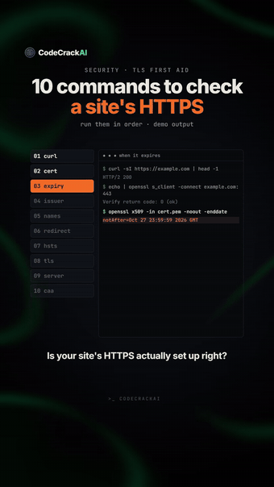
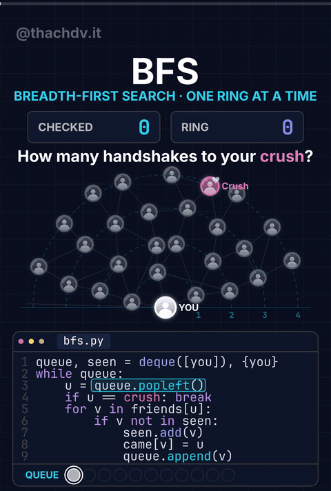
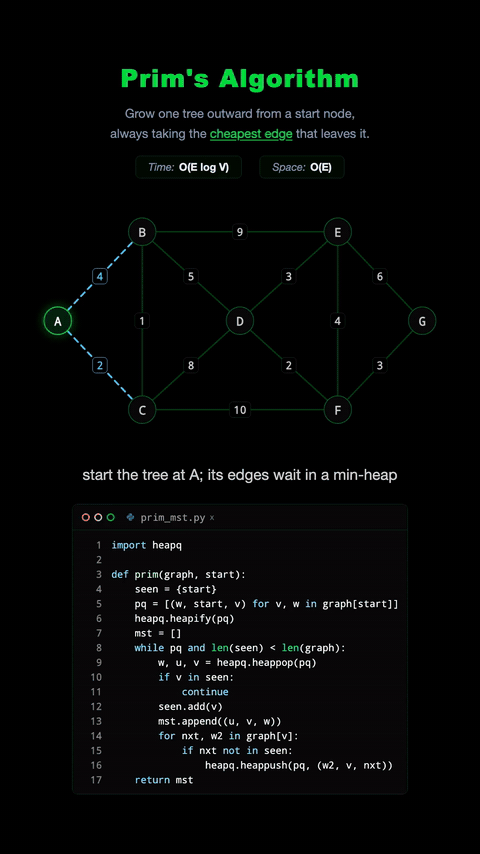
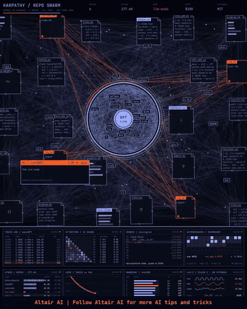

# 系統設計與工程基礎

中文 | [English](../en/docs/systems-design.md)

[回首頁](../README.md)

非 AI 的後端／分散式系統基礎與維運常識（如 TLS 健檢）

### [12 個系統設計基本概念](https://www.facebook.com/reel/3285768298275601)

12 個系統設計基本概念一句話速查

| 可信度 | 星數 | 出處 |
| --- | --- | --- |
| — | — | [影片 22](https://www.facebook.com/reel/3285768298275601) |

Code Crack 的 13 秒動態圖卡（深色格線背景、12 張卡片依序亮起、無旁白，人工製作非 AI 生成）：Load Balancer 分散流量；Caching 快取重複查詢；CDN 把內容放到靠近使用者的地方；Sharding 資料分片；Replication 複本供讀取與容錯；Message Queue 非同步可靠處理；Rate Limiting 限流；Consistent Hashing 加節點時不必大量重分配；CAP 一致性／可用性／分區容錯；Idempotency 重試無害；Circuit Breaker 熔斷避免連鎖故障；Observability 用 logs／metrics／traces 看清系統。更正：圖上 CAP「三選二」的說法過度簡化，分區不是能選的，發生分區時只能在一致性與可用性之間擇一；沒有分區時則如 PACELC 所說，是在延遲與一致性之間取捨。配樂：UI 音效（上行的馬林巴鐘聲、結尾提示音）疊在微弱的通用輕快科技感節拍上。

深色格線背景 3×4 卡片依序淡入，每張卡內有小型示意動畫（流量分流點、快取方塊、分片條）並輪流綠框高亮；可用 CSS grid + animation-delay stagger 重現

### [10 個指令檢查網站 HTTPS](https://www.facebook.com/reel/4523349764619784)

從憑證到期、HSTS 到舊版 TLS，10 個指令快速健檢 HTTPS

| 可信度 | 星數 | 出處 |
| --- | --- | --- |
| — | — | [影片 23](https://www.facebook.com/reel/4523349764619784) |

Code Crack（CodeCrackAI）的動態終端機圖卡「SECURITY • TLS FIRST AID」，示範輸出以紅字標出憑證到期日、仍開著 TLSv1.0、`server: nginx/1.18.0` 洩漏版本。人工製作，非 AI 生成。十項檢查：`curl -sI` 看是否回應；`openssl s_client` 取憑證；`openssl x509 -enddate` 看到期日；`-issuer` 看簽發者；`-ext subjectAltName` 看涵蓋哪些網域；HTTP 是否用 `location` 導向 HTTPS；是否有 `strict-transport-security`（HSTS）；`nmap --script ssl-enum-ciphers` 找舊協定；`server` 標頭是否洩漏版本；`dig CAA` 看誰可以簽發憑證。更正：第 2 步說「存成 cert.pem」，但指令本身沒有存檔，應為 `echo | openssl s_client -connect example.com:443 -servername example.com 2>/dev/null | openssl x509 > cert.pem`，且要加 `-servername` 才會帶 SNI。實測 wiki.singularityengine.dev（2026-10-31）：HTTP/2 200；Let's Encrypt（YR2）簽發、2027-01-29 到期；SAN 只有 wiki.singularityengine.dev；`server: GitHub.com`；但 http:// 回 Cloudflare 500、沒有導向，也沒有 HSTS 標頭；singularityengine.dev 沒有 CAA 紀錄。配樂：無人聲與音樂，只有 UI 嗶聲與結尾和弦。另見「安全與治理」分類。

左側步驟清單橘色高亮逐項前進、右側終端機逐行打出指令與輸出、紅字標出風險；背景綠色流動線條；可用 typewriter 效果 + 步驟 active class 重現

### [Kafka 架構手寫風筆記](https://www.facebook.com/reel/3443590945824757)

一張手寫風筆記看懂 Kafka 架構（注意 ZooKeeper 已過時）

| 可信度 | 星數 | 出處 |
| --- | --- | --- |
| — | — | [影片 25](https://www.facebook.com/reel/3443590945824757) |

softwaredeveloper077 的 15 秒靜態圖，數位手寫風筆記「KAFKA ARCHITECTURE」分 11 塊：Producers；Cluster／Brokers；Consumers；Topics；Partitions（有序、不可變，提供平行度）；Replication（leader／followers）；ZooKeeper；資料流（offset、commit）；好處；使用情境；最佳實務（topic 名稱要有意義、partition 數量要合適、開複本、監控 consumer lag、依時間與大小設 retention、用 consumer group、調 batch size）。無浮水印，字跡乾淨，看起來是人工製作，但無法完全排除 AI。更正：ZooKeeper 已過時，KRaft 取代它（3.3 起可用於正式環境，4.0 移除 ZooKeeper）。配樂：通用的免版稅輕快電子／House。

### [BFS 廣度優先搜尋：幾步找到 Crush](https://www.facebook.com/reel/1108544155324652)

用「朋友的朋友」一圈圈往外找，說明 BFS 為何能找到最短路徑

| 可信度 | 星數 | 出處 |
| --- | --- | --- |
| 可信度高・程式小 bug | — | [影片 30](https://www.facebook.com/reel/1108544155324652) |

thachdv.it（越南語）的 BFS 動畫，文案「Thuật toán tìm kiếm theo chiều rộng - BFS. Cách các nền tảng giúp b dò nhà crush 😁」（BFS 演算法：平台怎麼幫你找到 crush 的家）。圖以「YOU」為中心排成同心圓，目標「Crush」在第 4 圈；檢查到的節點會亮起，QUEUE 列顯示節點加入與取出（FIFO），另有 CHECKED 與 RING 計數。步驟：先查朋友、再一圈圈查朋友的朋友；佇列維持先進先出；第一次找到就停；最後標出最短路徑「4 handshakes: the fewest there are」。畫面程式：`queue, seen = deque([you]), {you}`，`while queue: u = queue.popleft(); if u == crush: break; for v in friends[u]: if v not in seen: seen.add(v); came[v] = u; queue.append(v)`。正確性：無權重圖上 BFS 確實給出最短路徑（幾度分隔）。小 bug：`came` 沒有初始化（要先 `came = {}`），照抄會出現 NameError。文案說「找 crush 的家」，但影片只講社交關係的握手數；真的地圖導航道路有權重，要用 Dijkstra／A*。配樂：8-bit chiptune，無旁白。GIF 片段：0:00–0:11。

BFS 由 YOU 一圈一圈向外擴散（節點依層著色）、上方 CHECKED/RING 計數、下方程式碼逐行高亮與 QUEUE 圓點進出，找到後以金色標出最短路徑；可用 SVG 節點 + 逐步狀態機 + 程式碼行高亮重現

▶ 互動 Demo：[開啟](../demos/bfs/)（https://wiki.singularityengine.dev/demos/bfs/）

### [Prim 演算法：最小生成樹](https://www.facebook.com/reel/2132850694107274)

從一個點開始，每次挑最便宜的往外邊，長出連接所有點的最省樹

| 可信度 | 星數 | 出處 |
| --- | --- | --- |
| 可信度高 | — | [影片 31](https://www.facebook.com/reel/2132850694107274) |

Software with John 的動畫（文案「Prim's Algorithm #dsa」），無向圖 A–G，邊：A-B 4、A-C 2、B-C 1、B-D 5、B-E 9、C-D 8、C-F 10、D-E 3、D-F 2、E-F 4、E-G 3、F-G 3。從 A 開始依序選：A-C(2)、C-B(1)、跳過 A-B(4)（B 已在樹中，會形成環，閃紅）、B-D(5)、D-F(2)、D-E(3)、F-G(3)，總權重 16。畫面重點：「Grow one tree outward from a start node, always taking the cheapest edge that leaves it.」（從起點長出一棵樹，每次都挑離開這棵樹最便宜的邊）。程式：Python `heapq`，`v in seen` 就跳過，再把鄰邊推進 heap；複雜度標示時間 O(E log V)、空間 O(E)。正確性：已驗算，總和 16 就是最小生成樹（用 Kruskal 交叉驗算也是 16）。畫面：深色背景，heap 裡的邊是藍色虛線，選中的邊發青光，捨棄的邊閃紅。配樂：未確認（分析時沒有音軌）。GIF 片段：0:02–0:07（含閃紅跳過）。

Prim 演算法：從 A 起逐步把最小邊加入樹（青色實線）、候選邊在 heap 中以虛線表示、已在樹內的邊以紅色標示跳過，下方程式碼與說明同步；可用 SVG 邊線 class 切換 + 步驟資料陣列重現

▶ 互動 Demo：[開啟](../demos/prim/)（https://wiki.singularityengine.dev/demos/prim/）

### [每個工程師都該知道的 5 個 GitHub repo](https://www.facebook.com/reel/1849291249414632) ⚠️

五個經典 GitHub repo：自己重做工具、學習路線圖、系統設計、免費書、演算法

| 可信度 | 星數 | 出處 |
| --- | --- | --- |
| ⚠️ 引流・可信度高 | — | [影片 32](https://www.facebook.com/reel/1849291249414632) ⚠️ |

James Mcquay 的真人口述片（貼文文案「Comment “AI”」，片中又要觀眾留言「Github」由私訊送連結，是留言導流；不過沒藏私，每個 repo 名稱都有念出來也有上字幕）。畫面字幕「10/10 GitHub repositories to make you an elite developer」屬誇大行銷。① build-your-own-x（⚠️ https://github.com/codecrafters-io/build-your-own-x ⚠️）：從零重做 Git、Docker、資料庫等，557.8k ⭐（影片說 485k，已過時）；② roadmap.sh（⚠️ https://github.com/nilbuild/developer-roadmap ⚠️，原 kamranahmedse/developer-roadmap，已改名）：後端、前端、DevOps、AI 學習路線圖，370.9k ⭐；③ system-design-primer（⚠️ https://github.com/donnemartin/system-design-primer ⚠️）：快取、負載平衡、可擴展性，376.3k ⭐；④ free-programming-books（⚠️ https://github.com/EbookFoundation/free-programming-books ⚠️）：免費書與課程，400.6k ⭐；⑤ TheAlgorithms/Python（⚠️ https://github.com/TheAlgorithms/Python ⚠️）：各種演算法實作，225.7k ⭐。星數為 2026-10-31 查詢。可信度：高，repo 都是真的經典專案，只有「elite developer」說法誇大。配樂：輕柔 lo-fi 背景音樂。靜態口述，無 GIF 片段。

### [Altair AI：Karpathy 的六個免費 GitHub 專案（含 LLM Wiki gist）](https://www.facebook.com/reel/1655634979372088)

動態儀表板介紹 Karpathy 六個公開專案。五個 GitHub repo 都在、星數與說明文大致相符；LLM Wiki 是 gist，完整網址已找到，說明文寫 50K 星與畫面／gist 頁面不符

| 可信度 | 星數 | 出處 |
| --- | --- | --- |
| 概念動畫・可信度高 | — | [影片 78](https://www.facebook.com/reel/1655634979372088) |

Altair AI 上傳的約 22 秒直式 Facebook Reel（2026-11-12；Brian 於 2026-11-12 22:00 Asia/Taipei 在對話傳來 [這則 Reel](https://www.facebook.com/reel/1655634979372088)）。畫面是風格化科幻 HUD（標題 KARPATHY／REPO SWARM），不是真實操作錄屏，無私人資訊。說明文列出六個項目（原連結寫 http，本則改用 https），並稱合計超過 30 萬星；片尾要人 Save these 六個 repo，只是普通收藏呼籲，不是留言換連結，不標引流。片尾另有 Follow Altair AI 橫幅，同屬普通追蹤呼籲。

查證（2026-11-12 台北時間，GitHub API，皆為 karpathy 帳號下的公開專案）：

1. [karpathy/autoresearch](https://github.com/karpathy/autoresearch)：說明文 92.7K，API 99,902，license 欄為空
2. [karpathy/nanoGPT](https://github.com/karpathy/nanoGPT)：說明文 64.4K，API 64,676，MIT
3. [karpathy/nanochat](https://github.com/karpathy/nanochat)：說明文 60.2K，API 60,508，MIT
4. LLM Wiki：說明文寫 50K，連結被截成 gist.github.com/karpathy/442a6。完整 gist 已找到 [gist.github.com/karpathy/442a6bf555914893e9891c11519de94f](https://gist.github.com/karpathy/442a6bf555914893e9891c11519de94f)（檔名 llm-wiki.md）。查證當日 gist 頁面星數只顯示 5,000+（GitHub 對 gist 的顯示上限），API 回 502 未取到精確數字；畫面卡片與底欄寫 5.8K gist，與說明文 50K 不符
5. [karpathy/llm.c](https://github.com/karpathy/llm.c)：說明文 31.4K，API 31,452，MIT
6. [karpathy/micrograd](https://github.com/karpathy/micrograd)：說明文 18.7K，API 18,881，MIT

前五個 repo 的 API 星數合計 275,419，再加上 gist 至少 5,000+，接近畫面標題列的 277.6K；說明文「超過 30 萬星」把 gist 算成 50K，偏高。畫面總覽把六個都標 MIT，但 autoresearch 與該 gist 在查證當日看不到 SPDX 授權，不以畫面為準。可對照 SEQ 0095（其中 Astro-Han/karpathy-llm-wiki 是這個 gist 構想的衍生實作）、0077（另一則工程師該看的 GitHub repo 清單）。SkillSpector 掃描待補（本批不 clone；routines 暫停中）。配樂：未標。GIF：0:10–0:15。

### [Know Your System：Saga pattern（跨服務補償交易：編排 vs 事件協同）](https://www.facebook.com/reel/2222208475400708)

六張圖卡說明跨四個服務結帳時，失敗要用補償（退款而不是回滾），並對比事件協同與編排。畫面的 Consistent 是最終一致，不是 ACID 隔離；影片沒提到編排中心可能成為單點故障。

| 可信度 | 星數 | 出處 |
| --- | --- | --- |
| 可信度高 | — | [影片 93](https://www.facebook.com/reel/2222208475400708) |

Know Your System 上傳的約 30 秒直式 Facebook Reel（2026-11-14 18:30 Asia/Taipei；360×640；Brian 於 2026-11-14 21:56 Asia/Taipei 從電腦傳來[這則 Reel](https://www.facebook.com/reel/2222208475400708)）。說明文只寫「Payment charged, but the item is out of stock」與 Saga pattern 標籤，沒有留言換連結，故不標引流。畫面是深色格線上的手做系統設計圖卡（標題 Saga Pattern · System Design），無旁白字幕，不是 AI 工具介紹。

六張卡依序為：

1/6 PARTIAL FAILURE：Order Pending、Payment Charged、Inventory No stock、Shipping 尚未動作。畫面用虛線框標 one ACID tx 並打叉，寫 Money taken, no item，接著 2PC 也打叉，並標 locks held、tight coupling。

2/6 LOCAL STEPS：四個服務各有本地正向與補償動作——Order Create／Cancel、Payment Charge／Refund、Inventory Reserve／Release、Shipping Ship（失敗路徑下補償為 —，因為還沒出貨）。並標 local tx、compensation、eventually consistent。

3/6 COMPENSATE：庫存失敗後 Payment 改為 Refunded、Order 改為 Canceled，大標 Consistent，並寫 Refund, not rollback。這裡的 Consistent 是卡 2 已寫出的最終一致（eventual consistency），不是單一資料庫 ACID 交易的隔離或自動回滾；補償是另做一筆反向本地交易（例如退款），見 [microservices.io 的 Saga pattern](https://microservices.io/patterns/data/saga.html)（該文並指出 saga 缺少 ACID 的 isolation，需另做隔離對策）與 [Azure Architecture Center 的 Saga](https://learn.microsoft.com/en-us/azure/architecture/patterns/saga)（寫明各服務已提交的變更不能靠回滾還原）。

4/6 CHOREOGRAPHY：服務之間走 Event bus，事件依序 OrderPlaced、PaymentDone、OutOfStock，標 No central brain、decoupled、hard to trace。

5/6 ORCHESTRATION：由中央 Orchestrator 依序下 Create、Charge、Reserve，失敗後再下 Refund、Cancel，標 Central brain、clear flow、extra service。影片沒有提到編排中心可能成為單點故障；Microsoft 的 Saga 說明則把「orchestrator 管理整段流程，因而引入一個故障點」列為編排的缺點。

6/6 HAPPY PATH：庫存足夠時狀態變成 Created、Charged、Reserved、Booked，標 Order complete、all local tx committed。

可對照 SEQ 0067（系統設計基本概念，含訊息佇列與一致性相關卡片）、0070（Kafka 事件架構）、0075（BFS）、0076（Prim）。

互動重現：[saga-pattern 示範](https://wiki.singularityengine.dev/demos/saga-pattern/)（四個服務的虛構結帳板，可切換事件協同／編排與庫存有貨或缺貨，再一步步走補償；一致性標成最終一致，不會連網）。配樂：僅配樂、無旁白。

### [Shiva.bytes：Machine Learning Algorithms Cheatsheet（八類演算法分流圖；源自 Azure ML designer 2021 表）](https://www.facebook.com/reel/1502253031965145)

把 Microsoft 2021 年 Azure ML designer 演算法表改成黑底分流圖，說明文用八類問題解釋機器學習

| 可信度 | 星數 | 出處 |
| --- | --- | --- |
| 改編自官方表 | — | [影片 96](https://www.facebook.com/reel/1502253031965145) |

Shiva.bytes 上傳的約 9 秒直式 Facebook Reel（2026-11-13 22:02 Asia/Taipei，1200×1500；Brian 於 2026-11-15 從電腦傳來[這則 Reel](https://www.facebook.com/reel/1502253031965145)）。畫面幾乎是一張靜態分流圖，大標 Machine Learning Algorithms Cheatsheet，中間問 What do you want to do?，再分到八類：Text Analytics、Two-Class Classification、Multiclass Classification、Regression、Anomaly Detection、Clustering、Image Classification、Recommenders。說明文用白話寫這八類各解什麼問題，並問 If you had this kind of AI toolbox, what problem would you solve first? 沒有要留言關鍵字換東西，故不標引流。海報署名 Sivasankar Natarajan，並寫 Driving Smarter Outcomes with AI, Cloud & Data.；上傳帳號是 Shiva.bytes，是否同一人未另查。

這張圖是把 Microsoft 2021 年 7 月為 Azure Machine Learning designer 發布的 Machine Learning Algorithm Cheat Sheet 重新排版上色（[官方說明頁](https://learn.microsoft.com/en-us/azure/machine-learning/algorithm-cheat-sheet?view=azureml-api-1)，[官方 PDF](https://download.microsoft.com/download/3/5/b/35bb997f-a8c7-485d-8c56-19444dafd757/azure-machine-learning-algorithm-cheat-sheet-july-2021.pdf)）。改編後拿掉了原圖的 © 2021 Microsoft Corporation. All rights reserved. 與 aka.ms/mlcheatsheet，也出現多處錯字，例如把 Derives 寫成 Drives、dictionary 寫成 directory、Vowpal Wabbit 寫成 Vowpel Wabbit、integer encoded 寫成 integer 10-encoded、cleaning operations on text 寫成 4O- on text、把官方的 Word2Vector 列誤標成第二個 Preprocess Text、linear model 寫成 linear modal、Averaged Perceptron 寫成 Perception、Neural 寫成 Neurol、fast training times 寫成 last trothing times、popular 寫成 populat、Discover structure 寫成 Discovery structure，以及 Train Wide & Deep Recommender module 被寫成 train Wide & Deep Recommenders module。

Microsoft 自己寫明這張表只是大約的經驗法則，用來幫人從 designer 的經典模組裡找起點，不是唯一答案。表上列的是 Azure ML SDK v1 經典預先建置元件；該 SDK 已於 2025-03-31 棄用，支援在 2026-06-30 結束。表裡沒有 XGBoost、LightGBM 這類後來常見的梯度提升實作；One-vs-All 與 One-vs-One 是把二分類器組成多類的策略，不是獨立演算法；Text Analytics 裡除了 LDA 以外，Extract N-Gram、Feature Hashing、Preprocess Text 多半是前處理，不是最終模型。

互動重現：[ml-algorithms-cheatsheet](https://wiki.singularityengine.dev/demos/ml-algorithms-cheatsheet/)（自製的「你現在想解決的是哪一種問題？」分流，版面與用詞都另外寫過，不是官方海報翻製；說明為通用解釋，並補充 XGBoost、LightGBM、DBSCAN 等較新做法；頁尾連回 2021 年官方表）。配樂：有配樂，曲名未標。本則因著作權考量，故意沒有做 GIF，公開站也不放海報截圖。

### 0147　Aman Views：API Design 八則最佳實務（動畫圖卡，非實作錄屏）

八則 API 設計圖卡（命名、冪等、分頁、篩選排序、資源路徑、限流、版本、安全性）；說明文是另一套 10 點清單，與畫面不一致。圖卡內容廣泛沿用 ByteByteGo／Sahn Lam 的整理。來源：影片 103。

Aman Views 上傳的約 12 秒直式 Facebook Reel（1440×2560；info.json 的 timestamp 為 1794795333，即 2026-11-16 02:15:33 UTC、2026-11-16 10:15 Asia/Taipei；upload_date 欄為 20261116，是 UTC 日期，與台北日期同一天）。Brian 於 2026-11-16 20:06 Asia/Taipei 經 LINE 傳來 https://www.facebook.com/share/r/1ebrFBUtWY/ （canonical https://www.facebook.com/reel/3974601762681447）。畫面是對一張靜態圖卡做短動畫，不是實作或產品錄屏。大標 Best Practices in API Design，副標 8 rules for APIs people love to use，依序示範八則。① Clear Naming：資源用名詞、動詞交給 HTTP；圖上 Update 列只寫 PUT（Create→POST /api/products，Read→GET /api/products/42，Update→PUT /api/products/42，Delete→DELETE /api/products/42），命名列沒有 PATCH。② Idempotency：同一請求打兩次應得到同一結果；圖上 GET／PUT／DELETE 為 yes，POST／PATCH 為 no*（unless you send a key），並示範帶 key 1234 的 POST，重試時寫 seen 1234 → same result。③ Pagination：大列表一次只回一頁；對照 Offset-based（?limit=3&offset=0／offset=3）與 Cursor-based（?limit=3、?limit=3&after=item3，並註 continues after the last item）。④ Filter & Sort：讓用戶端只要自己需要的資料；範例 GET /products?size=10&sort=date_added，篩 size = 10、newest first 後回 5 列中的 3 列。⑤ Resource Paths：把相關資源嵌進 URL；圖上稱 /api/v1/carts/123/items/321 為 clear hierarchy，稱 /api/v1/items?cart_id=123&item_id=321 為 less clear。⑥ Rate Limiting：保護 API 不被過度使用；圖例 rate limiter: 100 req/min，請求經過漏斗再到伺服器，旁註 quota used。⑦ Versioning：改 API 而不拆掉舊用戶端；舊應用 GET /api/v1/users/7 得到 `{ "name": "Ana Roy" }`，新應用 GET /api/v2/users/7 得到 `{ "first": "Ana", "last": "Roy" }`，並註 v1 keeps working while v2 ships（Ana Roy 是圖上的虛構人名）。⑧ Security：每個請求都走 HTTPS 並帶 token；有 token 時在標頭帶 bearer，經 gateway 進服務，沒有 token 則回 401 Unauthorized。說明文則是另一套 10 點清單（正確的 HTTP 方法、命名慣例、狀態碼、分頁與篩選、安全、一致的錯誤內容、版本、冪等、快取與效能、OpenAPI／測試等），與畫面上這八則並不完全對得起來，本則以畫面為準，不採用說明文的標題用語。沒有要留言關鍵字換東西，故不標引流。片中只有配樂、沒有旁白，逐字稿未提供，曲名未標。本則沒有做 GIF（這是廣泛流傳的圖卡）。上傳帳號是 Aman Views；這八則清單與版面廣泛沿用 ByteByteGo／Sahn Lam 的整理，可見 2025-08-16 的 [ByteByteGo EP176](https://blog.bytebytego.com/p/ep176-how-does-sso-work)。補充：圖上把 Update 都畫成 PUT，但 PUT 是完整取代，部分更新應是 PATCH（RFC 5789）。HTTP 的冪等定義見 RFC 9110；POST／PATCH 本身不是冪等，實務上常用 Idempotency-Key 這類應用層標頭讓重試安全，這不是 HTTP 標準方法語意的一部分。offset／limit 在列表中間插入或刪除時會漂移，cursor／keyset 較穩，但不能隨意跳頁。巢狀路徑對上 query 是風格選擇，不是硬性規則。URI 版本（/v1、/v2）只是版本做法之一，也有人放在標頭或媒體類型。HTTPS 加 bearer token 是基本盤，不是完整的縱深防禦。限流觸及時實務上通常回 429，並帶 RateLimit 或 Retry-After。可對照 SEQ 0067（12 個系統設計基本概念，其中也包括 Rate Limiting 與 Idempotency）。SkillSpector 不適用：這不是可掃描的 skill／MCP 包或程式庫。

互動重現：[api-design-best-practices](https://wiki.singularityengine.dev/demos/api-design-best-practices/)（八張可操作卡片，採補充說明後的說法與自製版面，不是原圖翻製；示例資料為虛構，權杖寫成 Bearer <token>，不會連網）。配樂：有配樂、無旁白，曲名未標。

互動 Demo：[api-design-best-practices](https://wiki.singularityengine.dev/demos/api-design-best-practices/)

### 0148　TechIn60Sec：端到端資料管線架構（動畫圖卡，非實作錄屏）

一張端到端資料管線圖卡，從來源、擷取、資料湖（Bronze／Silver／Gold）、處理、服務到使用者，並加上編排與監控；雲端產品名為示例。勳章式分層是常見做法，不是正式標準。來源：影片 104。

TechIn60Sec（畫面與說明文寫成 TECHIN60SEC）上傳的約 20 秒直式 Facebook Reel（1024×1820；info.json 的 timestamp 為 1791524506，即 2026-10-09 05:41:46 UTC、2026-10-09 13:41 Asia/Taipei；upload_date 欄為 20261009，是 UTC 日期，與台北日期同一天）。Brian 於 2026-11-16 從電腦傳來 https://www.facebook.com/reel/1117905587594958 。畫面是對一張靜態手繪風圖卡做短動畫，不是實作或產品錄屏。大標 END TO END DATA PIPELINE ARCHITECTURE，副標寫 Modern, Scalable & Secure Architecture，並列 AWS／GCP／Azure。圖分六段橫向流程，再加兩條貫穿全程的編排與監控。① Data Sources：Databases、Applications、Files/Logs、IoT/Devices、SaaS/APIs。② Ingestion Layer：Batch/Streaming，示例 AWS Kinesis、GCP Pub/Sub、Azure Event Hubs，另寫 or AWS Glue／ADF／Dataflow。③ Storage (Data Lake)：Raw Data (Landing Zone)，Bronze (Raw)、Silver (Cleaned)、Gold (Curated)，儲存示例 S3／GCS／ADLS Gen2。④ Processing Layer：ETL／ELT，示例 AWS Glue／EMR／Databricks、GCP Dataflow／Dataproc、Azure Databricks／Synapse／ADF。⑤ Serving Layer：Analytics & Consumption，資料倉儲示例 Redshift／BigQuery／Synapse，BI 示例 Power BI／Looker／Tableau，以及 APIs／Applications。⑥ Consumers：Business Users、Data Analysts、Data Scientists、ML/AI Models、External Systems。⑦ Orchestration & Workflow：AWS Step Functions、GCP Composer、Azure Data Factory／Logic Apps。⑧ Monitoring, Logging & Alerting：AWS CloudWatch、GCP Monitoring、Azure Monitor，以及 Alerts／Notifications。左下 PIPELINE FLOW 用八步重述同一路徑；右下 BEST PRACTICES 列 Medallion、Security & Governance（IAM、RBAC、DLP）、pipelines 與 IaC 的 CI/CD、各層資料品質與驗證、監控與失敗處理、用 partitioning 與 lifecycle policies 控制成本。右下貼紙寫 WORKS ON AWS／GCP／AZURE。說明文的八點與畫面結構大致相同，本則以畫面為準，不採用說明文與畫面底部的宣傳用語。沒有要留言關鍵字換東西，故不標引流。片中只有配樂、沒有旁白，逐字稿未提供，曲名未標。本則沒有做 GIF（這是帶品牌的宣傳圖卡）。補充：Bronze／Silver／Gold 的 Medallion 分層是 Databricks 推廣的常見湖倉做法，不是正式標準；有的團隊把 Landing Zone 與 Bronze 分開，有的把 Gold 直接放在倉儲，圖上把勳章分層畫在資料湖、把倉儲放在 Serving，只是其中一種切法。擷取列把 AWS Glue、Azure ADF 與 Dataflow 寫在同一行，Dataflow 在 GCP 是產品名，在 Azure 則常指 Data Factory 的 Mapping Data Flows，不宜當成三雲各一的對照。編排也不止這三個託管服務，實務上常見還有 Airflow、Prefect、Dagster 等。圖上所稱的 Secure 與 IAM／RBAC／DLP 只是基本盤，圖本身不是完整安全架構。所列雲端產品都是示例，不是完整清單，也不是使用建議。可對照 SEQ 0067（12 個系統設計基本概念）。SkillSpector 不適用：這不是可掃描的 skill／MCP 包或程式庫。

互動重現：[data-pipeline-architecture](https://wiki.singularityengine.dev/demos/data-pipeline-architecture/)（可點的八層示意與虛構訂單事件流，採補充說明後的說法與自製版面，不是原圖翻製，不會連網）。配樂：有配樂、無旁白，曲名未標。

互動 Demo：[data-pipeline-architecture](https://wiki.singularityengine.dev/demos/data-pipeline-architecture/)
