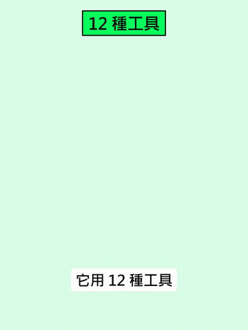
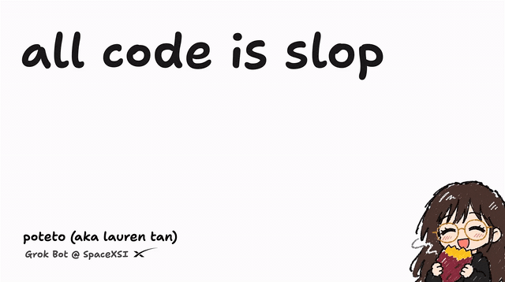

# 演講與 Talk

中文 | [English](../en/docs/talks.md)

[回首頁](../README.md)

演講、訪談、Podcast 片段：AI 領袖與從業者的第一手說法

### [Sam Altman：新模型連破研究難題後的失落感（Cheeky Pint）](https://www.facebook.com/reel/1167964102224005)

Sam Altman 談新模型連破研究難題，興奮之外也感到失落

| 可信度 | 星數 | 出處 |
| --- | --- | --- |
| — | — | [影片 17](https://www.facebook.com/reel/1167964102224005) |

大叔美股筆記 Uncle Investment Note 剪輯的 Podcast《Cheeky Pint》片段（浮水印 Source: Cheeky Pint，酒吧場景、兩人邊喝啤酒邊聊）。Altman 說某個週末拿到新模型，內部頻道取名「模型名 - hold my beer」，大家把學術生涯裡最難的研究問題丟給它，結果在許多領域一題接一題被解掉；他興奮到兩個晚上幾乎沒睡，但也比預期多了很多失落，像是「某件事正在結束」的感覺。他認為這對世界是對的，是沒人能也不該阻止的現實走向；主持人稱之為 wistfulness／懷舊，Altman 回「不只是懷舊」。片中沒有說是哪個模型；字幕前半段翻譯正確。真實訪談剪輯，非 AI 生成。配樂：無，只有對話。

### [Claude Science：蠍毒神經毒素蛋白結合劑（318,484 設計、實驗室測 211 個）](https://www.anthropic.com/research/claude-scorpion-toxin-binder-design)

Anthropic 公開 Claude 設計蠍毒結合劑的實驗：211 個送測、17 個過關（約 8%），官方寫明尚未驗證能否中和毒性

| 可信度 | 星數 | 出處 |
| --- | --- | --- |
| 可信度高 | — | [影片 62](https://www.facebook.com/reel/1119597340441398) |

小礦工挖挖礦上傳的約 1:22 Facebook Reel（2026-10-23）。對照[官方文章](https://www.anthropic.com/research/claude-scorpion-toxin-binder-design)與[技術報告 PDF](https://www-cdn.anthropic.com/31ac578806cffd8b3d92d8affe6edc4c04d502e1.pdf)（2026-10-20）：Claude 依初始提示詞與 4 次追問，針對 5 種鈉通道毒素產生 318,484 個設計，自選 180 個、團隊再加 31 個，共 211 個由 Adaptyv Bio 與 Twist Bioscience 實驗室檢測，17 個達結合標準（約 8%）；Cn2 有 7 個、Ts1 為 0。報告寫最緊的 Cn2-B1 為個位數 nM 或更好；旁白並提 B2，本則未逐圖核對 B2 親和力，標未驗證。自主設計約前 24 小時，到最終名單共 64 小時。提示詞與 Citrini Research 合作。官方明確寫尚未在功能試驗或體內測試能否中和毒性，只用重組毒素測結合，不是解藥宣稱。資料公開於 [Hugging Face](https://huggingface.co/datasets/Anthropic/scorpion-toxin-binder-design)。旁白只提 SPR；報告寫兩家的主篩是 SPR，部分 Adaptyv 重複測量改用 biolayer interferometry（BLI），兩家都做了 reverse BLI（Twist 測 Cn2、Ts1、AaH II、AaH I）。片尾只問「接下來最難的是設計還是實驗」，無留言換連結。配樂：未標。GIF：0:23–0:33。

### 0144　Lauren Tan（poteto）：All Code Is Slop (Except Mine)（AI Engineer CODE 2026）

當 agent 重複犯錯，把修正寫進程式碼庫、API 與可執行檢查，而不是再加 AGENTS.md。倒金字塔由上而下是 codebase、靜態分析、驗證、散文、人工審查；數字為講者／團隊自述、未查核。來源：影片 100。

Lauren Tan（poteto）在 AI Engineer CODE 2026 的約 17 分 31 秒演講（1920×1080；info.json 的 timestamp 為 1794681009，即 2026-11-14 18:30:09 UTC、2026-11-15 02:30:09 Asia/Taipei；upload_date 欄為 20261114，是 UTC 日期）。YouTube 由 AI Engineer 頻道上傳，標題為 All Code Is Slop (Except Mine) — Lauren Tan, SpaceXSI。Brian 於 2026-11-16 07:49 Asia/Taipei 經 LINE 傳來 https://youtu.be/O_zcc6Xl12g?si=8TX1iOUw2cJrOI51 （canonical https://www.youtube.com/watch?v=O_zcc6Xl12g）。官方頁 https://ai.engineer/code/2026/talks/lauren-tan 。沒有要留言關鍵字換東西，故不標引流。講者是 SpaceXSI 工程師、Grok Bot 團隊成員，也是 React compiler 核心成員（公開身分 @poteto）；開場自介為 poteto，在 SpaceXSI 做 Grok Bot。核心主張是：在大幅提高產出的同時維持甚至提高品質；信任來自投資 agent 的環境，不是盲目相信。當 agent 重複犯同一個錯，要把修正寫進程式碼庫、API 設計或可執行的檢查（lint、測試、驗證），而不是再加一段 AGENTS.md 或註解。她用一座倒金字塔（the poteto pyramid）說明時間該花在哪裡，左邊有朝下的 cost 箭頭，由上（寬、較便宜）到下（窄、較貴）依序是：codebase（好的 API 設計、架構、重構）、static analysis（lint、型別、編譯器、測試、CI）、verification（形式化、執行期）、prose（規則、skills、AGENTS.md）、human review。例子包括：內部框架 Dune（未公開；講者形容為給 Electron 應用用的 Next.js 類框架，內建大量可執行約束）；把註解改成會指出根本原因的 lint 規則，並限制絕大多數註解，因為註解會過期且無法強制執行；執行期用 feature map 加上可重用 CLI；形式化用 TLA+ 檢查跨裝置通知等主要流程、用 Lean 證明部分演算法（講者說仍在實驗，不是萬靈丹）；UI 屬性測試用開源庫 Bombadil（https://github.com/antithesishq/bombadil ，準備紀錄 2026-11-16 為 1,970 星、MIT）。她引用 Cindy Sridharan 的說法（演講中的引言，本則未另行查核）：約六個月前 Cindy 寫到，因細微錯誤被合併而難以信任 agent，缺的是驗證；六個月後 Cindy 說每天約 70% 的 token 花在驗證上。講者說這與她自己的觀察相符，並認為 agent 降低了測試與驗證的成本。這是講者對引言的轉述，不是本則獨立查證。數字皆為講者／團隊自述，本則未查核，也不要把不同口徑混在一起：她個人上一個月稱送出 3,000 個 PR；團隊投影片寫 Grok Bot 團隊 10 月合併 10,926 個 PR（口頭說約 11,000），6 月至 10 月合計 23,370；另提到 10 月約 227 人至少貢獻一個 PR，穩定版大約一天切一次。撤銷率投影片標的是被還原的 commit 百分比（10 月 0.47%；6 月至 10 月依序為 0.98%、0.61%、0.47%、0.48%、0.47%），口頭則說大約 0.5% 的 PR。講者也說 Grok Bot（仍是 Electron 應用）在啟動、打字、開新對話與切換對話等面向比推出時更快，這同樣是講者說法。片尾她把 Grok Bot 當作外圈（outer loop）的例子：有連接器與例行工作可啟動 Cursor、cloud agents 與 projects，用以編排數百甚至數千個 agent；並稱每次發佈會自動開一個 Cursor project 去做應用層的檢查、再開修復 PR 且自動合併。這是講者對自家流程的說法，本則不當操作教學，GIF 也略過相關討論串畫面。pstack 是她放在 cursor/plugins 底下的 plugin（https://github.com/cursor/plugins/tree/main/pstack ），MIT，Copyright (c) 2026 Lauren Tan，版本 v0.15.42。父倉庫 cursor/plugins 於準備當日為 16,437 星，這個數字屬於整個 plugins 倉庫，不要算成 pstack 自己的星數。SkillSpector 靜態掃描（2026-11-16 07:55 台北時間，報告時間戳 2026-11-15 23:55:20 UTC，skillspector 2.12.0，--no-llm，掃描路徑為 pstack，commit bf0c7cd）：score 100、severity CRITICAL、recommendation DO_NOT_INSTALL；issues 198（HIGH 20：TM1 5、MP3 4、P6 4、RA1 3、TM2 2、SC2 1、YR4 1；MEDIUM 176，其中 AS3 skill-enumeration 169 則；LOW 2）。多數是模式噪音。這是規則與模式掃描，不是已確認的漏洞或利用證明。安裝前應自行評估。互動重現：https://wiki.singularityengine.dev/demos/poteto-trust-pyramid/ （五層可點的倒金字塔與向下的 cost 箭頭，內容取自演講例子；這不是產品，也不會連網）。配樂：現場演講與掌聲，曲名未標。GIF：0:28–0:32 標題、0:02:06–0:02:11 金字塔、0:13:34–0:13:39 團隊 PR 圖（已裁到投影片區，不含講者姓名條；https://wiki.singularityengine.dev/assets/gifs/v94-poteto-trust-pyramid.gif）。

互動 Demo：[poteto-trust-pyramid](https://wiki.singularityengine.dev/demos/poteto-trust-pyramid/)

