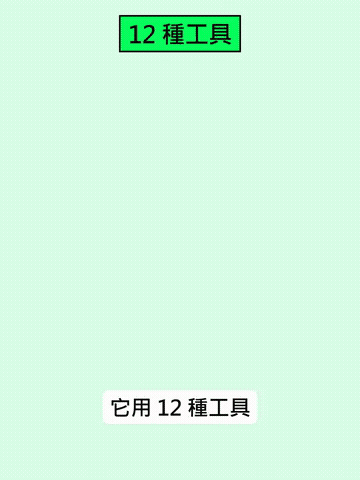

# 演講與 Talk

中文 | [English](../en/docs/talks.md)

[回首頁](../README.md)

演講、訪談、Podcast 片段：AI 領袖與從業者的第一手說法

### [Sam Altman：新模型連破研究難題後的失落感（Cheeky Pint）](https://www.facebook.com/reel/1167964102224005)

Sam Altman 談新模型連破研究難題，興奮之外也感到失落

| 可信度 | 星數 | 出處 |
| --- | --- | --- |
| — | — | [影片 17](https://www.facebook.com/reel/1167964102224005) |

大叔美股筆記 Uncle Investment Note 剪輯的 Podcast《Cheeky Pint》片段（浮水印 Source: Cheeky Pint，酒吧場景、兩人邊喝啤酒邊聊）。Altman 說某個週末拿到新模型，內部頻道取名「模型名 - hold my beer」，大家把學術生涯裡最難的研究問題丟給它，結果在許多領域一題接一題被解掉；他興奮到兩個晚上幾乎沒睡，但也比預期多了很多失落，像是「某件事正在結束」的感覺。他認為這對世界是對的，是沒人能也不該阻止的現實走向；主持人稱之為 wistfulness／懷舊，Altman 回「不只是懷舊」。片中沒有說是哪個模型；字幕前半段翻譯正確。真實訪談剪輯，非 AI 生成。配樂：無，只有對話。

### [Claude Science：蠍毒神經毒素蛋白結合劑（318,484 設計、實驗室測 211 個）](https://www.anthropic.com/research/claude-scorpion-toxin-binder-design)

Anthropic 公開 Claude 設計蠍毒結合劑的實驗：211 個送測、17 個過關（約 8%），官方寫明尚未驗證能否中和毒性

| 可信度 | 星數 | 出處 |
| --- | --- | --- |
| 可信度高 | — | [影片 62](https://www.facebook.com/reel/1119597340441398) |

小礦工挖挖礦上傳的約 1:22 Facebook Reel（2026-10-23）。對照[官方文章](https://www.anthropic.com/research/claude-scorpion-toxin-binder-design)與[技術報告 PDF](https://www-cdn.anthropic.com/31ac578806cffd8b3d92d8affe6edc4c04d502e1.pdf)（2026-10-20）：Claude 依初始提示詞與 4 次追問，針對 5 種鈉通道毒素產生 318,484 個設計，自選 180 個、團隊再加 31 個，共 211 個由 Adaptyv Bio 與 Twist Bioscience 實驗室檢測，17 個達結合標準（約 8%）；Cn2 有 7 個、Ts1 為 0。報告寫最緊的 Cn2-B1 為個位數 nM 或更好；旁白並提 B2，本則未逐圖核對 B2 親和力，標未驗證。自主設計約前 24 小時，到最終名單共 64 小時。提示詞與 Citrini Research 合作。官方明確寫尚未在功能試驗或體內測試能否中和毒性，只用重組毒素測結合，不是解藥宣稱。資料公開於 [Hugging Face](https://huggingface.co/datasets/Anthropic/scorpion-toxin-binder-design)。旁白只提 SPR；報告寫兩家的主篩是 SPR，部分 Adaptyv 重複測量改用 biolayer interferometry（BLI），兩家都做了 reverse BLI（Twist 測 Cn2、Ts1、AaH II、AaH I）。片尾只問「接下來最難的是設計還是實驗」，無留言換連結。配樂：未標。GIF：0:23–0:33。

