# Agent systems and orchestration

[中文](../../docs/agent-orchestration.md) | English

[Home](../index.md)

Multi-agent command, swarms, resume-after-interrupt, commercial agent OSes, and the agent-platform landscape

### [Orca](https://github.com/stablyai/orca)

Command several coding agents from one workbench

| Credibility | Stars | Source |
| --- | --- | --- |
| — | 110,828 | [Video 1](https://www.facebook.com/reel/2050168028979180) |

A workbench that centrally directs several coding agents (Claude Code, Codex, and others)

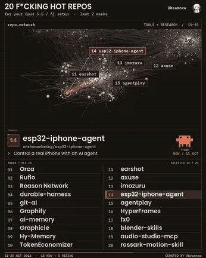

GIF: video 1, the node-graph interface.

### [Ruflo](https://github.com/ruvnet/ruflo)

A framework for deploying and coordinating a multi-agent swarm

| Credibility | Stars | Source |
| --- | --- | --- |
| — | 80,250 | [Video 1](https://www.facebook.com/reel/2050168028979180) |

A framework for deploying a multi-agent swarm and coordinating automated flows

### [Reason Network](https://github.com/reason-machines/reason-network)

Encrypted P2P so a team can see what each other's agents are doing

| Credibility | Stars | Source |
| --- | --- | --- |
| — | 1,336 | [Video 1](https://www.facebook.com/reel/2050168028979180) |

Connect a team's agents over encrypted P2P, and see which repo and branch each one is in

### [durable-harness](https://github.com/vercel-labs/durable-harness)

Let an agent resume from where it stopped

| Credibility | Stars | Source |
| --- | --- | --- |
| — | 274 | [Video 1](https://www.facebook.com/reel/2050168028979180) |

Let an agent resume from where it stopped after an interruption (Vercel)

### [ZOEY OS](https://zoeyos.com/)

A commercial agent system in which a lead agent assigns workers

| Credibility | Stars | Source |
| --- | --- | --- |
| Commercial · no repo | — | Screenshot (ZOEY OS) |

A commercial multi-agent operating system. You keep talking to the lead, Zoey, and she creates specialist workers and splits the work. It claims five layers of memory, a knowledge base, 1,000+ integrations, and the ability to operate a browser you are already logged into. There is no public repo.

### An Agentic AI implementation cheat-sheet mind map

One picture of the pieces of an agentic AI platform

| Credibility | Stars | Source |
| --- | --- | --- |
| AI-generated image | — | Screenshot (Joyatres Technology) |

Joyatres Technology's panorama of an agent platform: memory (long-term, episodic, semantic, procedural), human-in-the-loop (approval gates, interrupt and resume), tools and protocols (MCP, A2A, function calling, computer and browser control), agentic RAG (query routing, corrective RAG), the build stack, LLMOps and security (LangSmith, DeepEval, NeMo Guardrails, least privilege), and vendor SDKs (Google ADK, MS Agent Framework, AWS Strands). The picture is clearly AI-generated (garbled labels such as Longle-Source, Correvlic, Kubenates, and Roundation Modies). Use it as a checklist. Do not copy the details.

### [chief-night-01: Viktor develops 25 dental clinics overnight](https://viktor.com/) ⚠️

An AI employee finds 25 prospects overnight and waits for a person before sending mail

| Credibility | Stars | Source |
| --- | --- | --- |
| ⚠️ referral-code engagement bait | — | Screenshot (DeepRepo.ai) |

From a post by @Argona0x (ARGONA watermark). In Viktor (ZETA AI's Slack / Teams AI employee, running Opus 5.5) the goal is "find $50,000 of new business a month, use only public data, and contact nobody without my approval". Overnight it splits into 4 scheduled jobs, pulls 240 Austin dental clinics from Google Maps, drops chains, and keeps 25. Each has observations and a source. Opening emails are written and zero are sent. Quote prices are left blank for a person to fill. It is a referral-code (ARGONA100) funnel, but the flow is worth learning.

### [Claude Code Agent Teams: multi-agent collaboration](https://www.facebook.com/reel/1864411088067060)

Claude Code lets several agents team up, share a task list, and message each other

| Credibility | Stars | Source |
| --- | --- | --- |
| Concept interface | — | [Video 24](https://www.facebook.com/reel/1864411088067060) |

Lập Trình Web AI (Vietnamese copy) introduces Claude Code's experimental Agent Teams. Official docs confirm it: https://code.claude.com/docs/en/agent-teams . Turn it on with `CLAUDE_CODE_EXPERIMENTAL_AGENT_TEAMS=1` (environment variable or settings.json). A team lead splits, assigns, and summarizes. Each teammate has its own context, can message the others directly, and claims work from a shared task list. The difference from a subagent: a subagent only reports back to the main agent, while teammates coordinate with each other. Both the copy and the docs warn that many dependencies, or several agents editing the same file, cause conflicts, and token use is clearly higher. For that work a single session or a subagent is better. Teams need an interactive session. `-p` and the Agent SDK do not spawn teammates. The video itself is a concept-dashboard animation, not a real screen recording: the lead (Opus 5.5) splits an epic into 3 tasks, dev / api / scout claim them over a mailbox bus, api's test fails twice on a lock race and is fixed with a Redlock TTL, a review agent (labeled Fable 5.1) catches 4 security regressions and blocks the ship, and the lead looks at the git diff, commits, and opens PR #184. Music: unconfirmed (the audio was not analyzed).

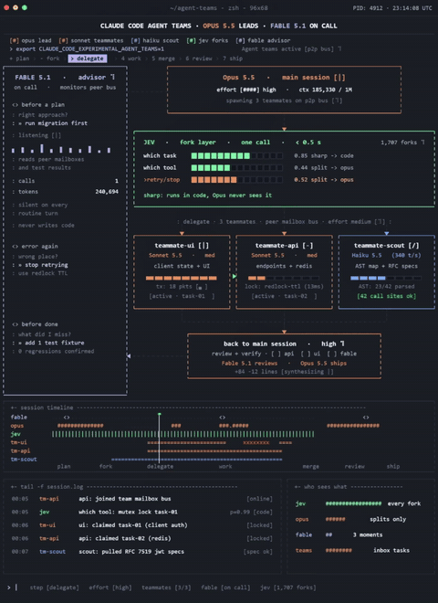

A monospace TUI dashboard: several agent panels advance their progress bars, status numbers update, and a timeline and log scroll at the bottom. Recreate it with CSS grid, a monospace font, and setInterval updating the bars.

### [Paperclip: run AI agents like a company](https://github.com/paperclipai/paperclip)

Manage a whole team of AI agents with an org chart, tickets, budgets, and approval gates

| Credibility | Stars | Source |
| --- | --- | --- |
| High credibility · simulated demo data | 109.2k | [Video 33](https://www.facebook.com/reel/1785583925890920) |

An open-source platform that organizes many AI agents as a company. The org chart runs CEO → CMO / CTO → ClaudeCoder / CodexCoder. Work is assigned as tickets (PAP-xxx) and agents report in comments. The dashboard shows tasks in progress, spend this month, and items waiting for approval. Agents wake on a heartbeat (a task or a schedule), rather than staying on. You can set spend caps per company, agent, and project. Near the cap it warns. At the cap it pauses. Adding an agent needs your approval. You can also pause, reassign, or stop an agent. Shared skills have version history and can roll back. One deployment can run several isolated companies. An organization can be exported and imported. It supports Claude Code, Codex, Cursor, Gemini CLI, and OpenClaw, and each agent can use a different model. Install with one `npx` line, no signup, Node 24+. README caveats: chat and email connectors are still experimental. Anonymous telemetry is on by default and can be turned off with an environment variable. MIT, created 2026-03-02. Site: https://paperclip.ing . The video (小礦工挖挖礦, AI voiceover) uses the official tour from the README. Correction: the ticket opened at 0:26 says this live demo has no database and the agents are "pretending to do work", "a mock replay of a busy organization". The UI is the real product, but the run is simulated demo data, not a real workload. The repo itself is still highly credible. Music: electronic lo-fi, quiet, under the AI voiceover. GIF segment: 0:14–0:25.

A Paperclip dark SaaS tour: an agent dashboard (stat cards and Issues by Priority/Status bars), an issue list grouped IN PROGRESS / BLOCKED, then an org chart of CEO → CTO → engineer cards and links, with the cursor clicking. Recreate it with CSS grid cards, small bar charts, and an SVG tree. Bottom subtitles were cropped. A large green caption in the center of the UI could not be cropped out.

### [Cindy: an open-source AI agent shell (wraps Claude Code, Codex, and Pi, and hands work between computer and phone)](https://github.com/makecindy/cindy) ⚠️

Not a new model. It wraps the Claude Code, Codex, or Pi you already have in one desktop and phone app, so work can continue across devices.

| Credibility | Stars | Source |
| --- | --- | --- |
| ⚠️ engagement bait · medium credibility | 8.9k | [Video 42](https://www.facebook.com/watch/?v=2575196886290079) ⚠️ |

A 28-second video uploaded by GitHunt. It only scrolls the README with an English AI voice, and there is no live demo. The end asks people to comment "AGENT" to get the link. The title calls it a "free Claude Code alternative", but the README describes a harness: you pick Claude Code, Codex, or Pi (open source, can attach several model providers) and you still use your own subscription, API key, or local model. Features: laptop, desktop, and phone linked together (the phone can remote-desktop), automations for routine work, assignments through Slack and Telegram, and plugins. Code is in apps/desktop (Electron) and apps/mobile (Expo / React Native). Apache-2.0, created 2026-07-22, last push 2026-11-01. Credibility: medium. The repo is real, but "replaces Claude Code" is misleading. The README's CI badge showed failing when checked on 2026-11-01 (recent main runs were cancelled). The official build includes TapDB usage analytics tied to an account id by default. It can be turned off in settings. Music: none. No GIF clip (it only scrolls the README).

### [Altair AI: three-model Claude Code session (Sonnet / Haiku / Opus)](https://code.claude.com/docs/en/sub-agents)

One Claude Code session, three roles: Sonnet writes code; Haiku does cheap read-only search and tests; Opus only says yes/no at three gates

| Credibility | Stars | Source |
| --- | --- | --- |
| concept animation · medium credibility | — | [Video 52](https://www.facebook.com/reel/2504853660346325) |

A 22s Altair AI motion-graphics reel (not a real setup). Idea: Sonnet as the main session (`claude --model sonnet`) writing code; Haiku as cheap read-only helpers for repo search, grepping call sites, and running tests (CLAUDE.md rule: every repo search and test run goes to haiku); Opus as a reviewer that never writes code, only yes/no, waking only three times — before the plan locks, when the same error repeats >2 times (stop the loop), and before declaring "done" (where agents most often falsely claim success). Cross-links: SEQ 0069 Agent Teams, 0054 multi-agent verify/gate board, 0095 second-brain memory split. On-screen numbers (432 runs, 0.91→0.74, diff +12 -3) illustrative (**unverified**). "Sonnet/Haiku/Opus 5.5" labels unverified. **How to actually set it up** (official docs https://code.claude.com/docs/en/sub-agents): main session `claude --model sonnet` (or opus/haiku); subagent frontmatter `model: sonnet|haiku|opus|inherit` (same aliases as `--model`); optional Agent-call model param or `CLAUDE_CODE_SUBAGENT_MODEL`.

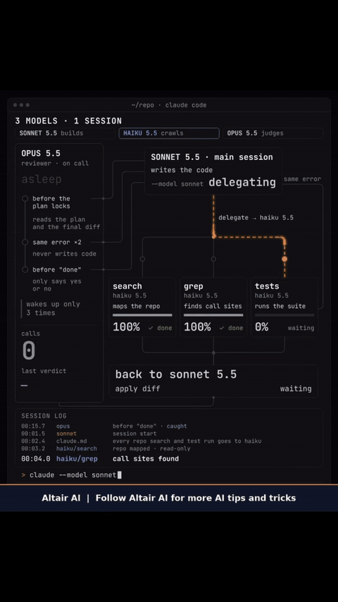

GIF: 0:05–0:08.

### [15 GitHub repos for AI agent teams (including trading libraries)](https://github.com/serenakeyitan/agent-org-chart)

The caption lists 15 repos: 10 agent-team / role templates and 5 market-data / backtest libraries; the video is a mock Grok Bot Teams dashboard, not a real session

| Credibility | Stars | Source |
| --- | --- | --- |
| concept animation · medium credibility | — | [Video 64](https://www.facebook.com/reel/1827893618429238) |

~22s Facebook Reel by Lê Quốc Nghĩa (2026-11-11); no comment-for-link. The picture is a mock “Grok Bot Teams” dashboard. All 15 caption repos exist (GitHub API 2026-11-11, Asia/Taipei). Team-template repos are mostly small (about 46–174★; hypergrok-trading-desk 490): [serenakeyitan/agent-org-chart](https://github.com/serenakeyitan/agent-org-chart) (174, MIT), [jaredtrichard/grok-factory](https://github.com/jaredtrichard/grok-factory) (73, no license field), [simo255/multiBot](https://github.com/simo255/multiBot) (67, MIT), [mKay00/grok-bot-second-brain](https://github.com/mKay00/grok-bot-second-brain) (69, no license field), [Archive228/foreman](https://github.com/Archive228/foreman) (60, MIT), [YannisKiefer/grokbot-x](https://github.com/YannisKiefer/grokbot-x) (76, MIT), [function1st/PhoneZero](https://github.com/function1st/PhoneZero) (47, MIT), [mandarwagh9/botroster](https://github.com/mandarwagh9/botroster) (46, Apache-2.0), [HAEGONG/grok-bot-profiles](https://github.com/HAEGONG/grok-bot-profiles) (61, CC-BY-4.0), [galleonlabs/hypergrok-trading-desk](https://github.com/galleonlabs/hypergrok-trading-desk) (490, MIT; README says research first, execution needs confirmation). Larger market / backtest libs: [bmoscon/cryptofeed](https://github.com/bmoscon/cryptofeed) (3,020, license field NOASSERTION), [ccxt/ccxt](https://github.com/ccxt/ccxt) (44,857, MIT), [freqtrade/freqtrade](https://github.com/freqtrade/freqtrade) (56,763, GPL-3.0), [polakowo/vectorbt](https://github.com/polakowo/vectorbt) (9,813, NOASSERTION), [ranaroussi/quantstats](https://github.com/ranaroussi/quantstats) (7,851, Apache-2.0). Tools that can move real money (especially the trading desk, freqtrade, and ccxt) need a human confirmation gate — do not let an agent place live orders on its own. Cross-links: SEQ 0069 (Agent Teams) and the site page “Agent 分工模式”. SkillSpector pending. GIF: 0:05–0:15.

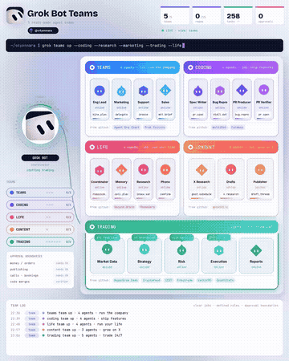

### [Fable 5.2 as CEO: overnight billing audit (multi-model split)](https://www.facebook.com/reel/1071773105932698)

The caption says Fable directs, Haiku reads the books, Opus verifies, and Sonnet drafts email, finding $11,640/month in one night; the video is a mock dashboard and the numbers are unverified

| Credibility | Stars | Source |
| --- | --- | --- |
| concept animation · claim unverified · low credibility | — | [Video 65](https://www.facebook.com/reel/1071773105932698) |

~41s Facebook Reel by Prakhar Saxena (2026-11-10). Motion-graphics “CLAUDE CODE / FABLE 5.2” dashboard (not a real screen recording). Caption orchestration: Fable 5.2 as CEO; about 40 Haiku 5.5 reading 41,806 transactions; Opus verifying each finding (needs a transaction id); Sonnet 5.5 drafting collection emails; human approval before send. Claims an overnight find of a three-year miss totaling $11,640/month (overbilled consulting $7,420, failed charges not retried $2,980, unused seats for departed staff $1,240, plus 214 unbilled hours $20,330) and that the client paid $27,936 as 20% of the first-year recovery — dollar amounts, counts, “3 years,” and “40 Haiku” are all **unverified**. Sonnet 5.5 never appears on screen. Fable 5.2 itself is the Claude model Anthropic announced on 2026-11-09 (see SEQ 0106). Cross-link SEQ 0098 (Sonnet writes / Haiku searches / Opus reviews). Caption includes a prompt; no comment-for-link. GIF: 0:15–0:25.

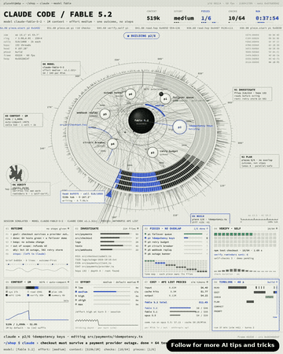

### ⚠️ [10 AI Employees every business should build (role list only, nothing demonstrated)](https://www.facebook.com/reel/2226812394848085) ⚠️

Ten mock role cards over stock footage; no real software, URLs, or prices; the end asks you to comment Community for the guides

| Credibility | Stars | Source |
| --- | --- | --- |
| ⚠️ engagement bait · concept animation · low credibility | — | ⚠️ [Video 68](https://www.facebook.com/reel/2226812394848085) ⚠️ |

~21s Facebook Reel by Taki Wong - AI For Business (2026-10-25). Caption: comment Community for step-by-step guides to 10 AI Employees — engagement bait. Mock cards over stock footage; no real software, URLs, or prices. The “10x” performance claim is **unverified**. Role checklist only (nothing demonstrated): (1) chief of staff (orchestrate other agents, daily brief); (2) marketing (posts, cuts, metrics); (3) sales (follow up leads, qualify, book calls); (4) support (omnichannel 24/7); (5) receptionist (answer, book); (6) inbox (sort mail, draft replies, schedule meetings); (7) finance (categorize expenses, chase invoices, cash flow); (8) research (competitors, trends, customers); (9) reviews (ask for and reply to reviews); (10) hiring (post roles, screen applicants, schedule candidate meetings). Named tools: Stripe, CRM, Instagram, TikTok, LinkedIn, YouTube, help desk, WhatsApp, SMS, Gmail, Outlook, Slack, QuickBooks, Xero, Google, Yelp, Facebook, Indeed. Cross-links: SEQ 0069 (Agent Teams), 0078 (Paperclip company-style agents), 0109 (team repos). GIF: 0:00–0:10.

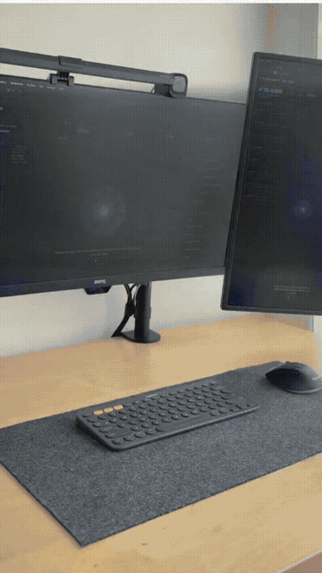

### [Tencent Hy4: vision and computer use for the first time (the caption applies preview specs to the GA release)](https://www.tencent.com/tencent-launches-hy4-joining-the-ranks-of-the-worlds-leading-open-source-ai-models/)

Official Hy4 launch on 2026-11-04 confirms vision understanding and CLI/GUI computer use for the first time; the caption’s 770B/49B and 1M-token figures are officially documented only for the earlier Hy4 preview. The video is generic sci-fi CGI, with no model name or product UI

| Credibility | Stars | Source |
| --- | --- | --- |
| claim unverified · medium credibility | — | [Video 71](https://www.facebook.com/reel/2350688215687462) |

10s Facebook Reel by Marc.AI (2026-11-05). Generic sci-fi CGI only (a glowing brain, robot hands, holographic dashboards); no on-screen text, logos, or product UI. All of the claims are in the caption. The closing line is a generic question (“Would you let an AI operate your computer…?”), not a comment-for-link CTA, so this is not tagged as engagement bait. No GIF: the clip is stock-style CGI with nothing to verify on screen.

Checked 2026-11-11 (Asia/Taipei) against Tencent’s [English announcement](https://www.tencent.com/tencent-launches-hy4-joining-the-ranks-of-the-worlds-leading-open-source-ai-models/), [Chinese announcement](https://www.tencent.com/zh-cn/tencent-launches-hy4-joining-the-ranks-of-the-worlds-leading-open-source-ai-models/), and the research page [hy.tencent.ai/research/hy4](https://hy.tencent.ai/research/hy4):

1. Release date 2026-11-04: verified.
2. Vision understanding, and computer use via CLI and GUI (official wording: command-line interfaces and graphical user interfaces, matching the caption’s “screen and command line”): verified as first-time Hy4 features versus Hy4 preview.
3. The caption assigns “770B total / 49B active, 1M-token context, already open” to this Nov 4 launch. The 770B/49B MoE and 1M context window are officially stated for Hy4 preview (2026-08-28): [preview post](https://www.tencent.com/tencent-releases-and-open-sources-tencent-hy4-preview/), [GitHub](https://github.com/Tencent-Hunyuan/Hy4-preview), [Hugging Face](https://huggingface.co/tencent/Hy4-preview). The README says Apache License 2.0 (438★ on the check date; GitHub license field is NOASSERTION). The Nov 4 GA post says pre-training and post-training were scaled up versus preview and that long-context understanding improved; it does **not** restate 770B/49B or 1M for the GA model, so those three figures are **unverified** for Hy4 itself.
4. “Open”: official text is “plans to release model weights and system cards in the coming days” / 「將於近期開源」. On the check date, GitHub had no Tencent-Hunyuan/Hy4 (404), and the public Hugging Face list only showed tencent/Hy4-preview and tencent/Hy4-preview-FP8. Whether GA weights have actually been published is **unverified**.

Cross-link SEQ 0009 (Hy-Memory, same Tencent Hunyuan family, not the same product). No GIF.

### ⚠️ [SkillTree: claims 47 AI agents run one company (shared Company Brain + Council)](https://skilltree.altari.ai/) ⚠️

Ahmed Alassafi / Altari’s SkillTree UI: company memory, per-department agents, schedules, and a multi-model Council. The caption asks you to comment 47 for a breakdown and for system access; “47 agents” is never counted on screen, and the dashboards are labeled sample data for a fictional agency

| Credibility | Stars | Source |
| --- | --- | --- |
| ⚠️ engagement bait · claim unverified · medium credibility | — | ⚠️ [Video 72](https://www.facebook.com/reel/1329619602540541) ⚠️ |

~41s Facebook Reel by Alassafi AI (Ahmed Alassafi) (2026-11-09). Caption: comment “47” at the start for a full breakdown and again at the end for access to the system — engagement bait. The recording shows a real-looking custom app branded SkillTree, with Map, Chats, Dashboards, and Files. Company Brain source chips: Uploads 5,887, Gmail 1,840, Fireflies 412 (figures **unverified**). Department nodes: Intelligence, Operations, Customer, Marketing, Back office, Deals, Sales, Finance. The dashboard overview is explicitly labeled “Sample data for a fictional agency, Brightline.” Visible sources include HubSpot (open pipeline $277,500), Xero (receivables $55,700 — not MRR), Instagram + TikTok, and Instantly + HeyReach. All of those dollar amounts are demo figures (**unverified**). Other walkthroughs: a LinkedIn carousel, an outbound research prompt (20 accounting firms in Texas, 10–50 staff), a call turned into a proposal PDF, America/New_York schedules (Daily Brief weekdays 7:30, Overnight lead research, Repurpose the best reels, Competitor watch), and a Slack bot named Atlas used from a phone.

The model picker (via OpenRouter; prices shown as input/output per million tokens) lists Claude Fable 5.1 ($10/$50), Opus 5.5 ($4/$20), Sonnet 5.5 ($2/$10), GPT-6 Astra ($10/$50), Grok 4.7 ($2/$6), and Gemini 4 Argon ($2/$10). Name check: GPT-6 Astra is already in SEQ 0039; Opus 5.5, Sonnet 5.5, and Fable 5.1 are official Anthropic models, but the current flagship is Fable 5.2 (see SEQ 0106, announced 2026-11-09 — the same day as this reel, and the picker still shows 5.1). Grok 4.7 and Gemini 4 Argon were also already released by then. Ask the Council: Opus answers, GPT critiques blind, Grok decides (on-screen controls: Answer alone / Critique blind / Chair decides). Council frames sampled here show GPT-6 Astra; a “GPT-4 Astra” typo was not found in those frames. The caption’s “47 agents” is never counted on screen (**unverified**).

A public site exists at ⚠️ [skilltree.altari.ai](https://skilltree.altari.ai/) ⚠️ (Altari / Ahmed Alassafi; it markets 137 agents across 7 departments, a waitlist, and custom builds). That 137 figure does not match the reel’s 47. Takeaway pattern: shared company memory, per-department agents, schedules, chat access, and a multi-model council for big decisions. Cross-links: SEQ 0069 (Agent Teams), 0078 (Paperclip company-style agents), 0109 (team repos), 0110 (multi-model audit), 0113 (ten AI role cards). GIF: 0:27–0:37.

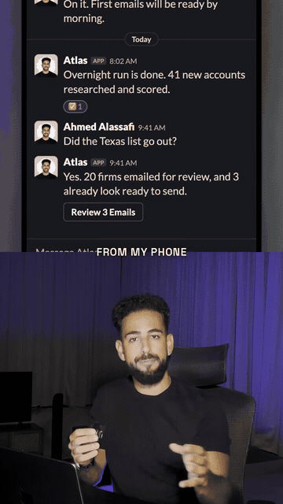

### [Claude Code (Fable 5.2) + Herdr: four local Pi agents in parallel panes](https://herdr.dev)

The main pane is Claude Code as supervisor. A Herdr skill opens four local Pi panes in the same tab (frontend / backend / database / review), each running local Nemotron 3.5 Super VL. Real screen recording, no engagement bait

| Credibility | Stars | Source |
| --- | --- | --- |
| medium credibility | 50,210 | [Video 74](https://www.facebook.com/reel/1609258920348255) |

~20s Facebook Reel by 胡嘉璽 (2026-11-10; Brian forwarded [this bare share link](https://www.facebook.com/share/v/1CTf2CKEmi/) via LINE at 00:01 Asia/Taipei on 2026-11-12). No comment-for-link bait. The clip is a real recording: Claude Code in a Herdr desktop window (local repo name 4panes), status bar showing Fable 5.2. The prompt asks the Herdr skill to open four pi panes in the same tab, with worker model nemotron-3.5-super-vl via a local LAN OpenAI-compatible endpoint (a private address is visible on screen; this entry does not publish it). Around 0:07 the UI splits 1+4: supervisor on the left, four Pi panes on the right as frontend, backend, database, and review, all on the same 4panes repo (SPEC.md, README.md, and docker-compose.yml are visible; worker panes are labeled nemotron-super). Caption lists Herdr App, Herdr Skill, Herdr CLI, and Claude Code CLI as requirements.

Verification (2026-11-12, Asia/Taipei): Herdr is a public product at [herdr.dev](https://herdr.dev), a terminal / workspace for coding agents (spaces, tabs, panes; terminals can keep running after the window closes). GitHub that day: [herdrdev/herdr](https://github.com/herdrdev/herdr) (“the runtime your coding agents live on”, Apache-2.0, 50,210 stars, last push 2026-11-07 20:32 Asia/Taipei); [herdrdev/herdr-app](https://github.com/herdrdev/herdr-app) desktop app (Apache-2.0, 2,713 stars, last push 2026-11-11 23:59); plus herdr-core (Apache-2.0). Official docs include an agent skill so Claude Code (and similar) can inspect and open neighboring panes from inside a Herdr pane. Pi is the Pi coding agent ([badlogic/pi-mono](https://github.com/badlogic/pi-mono), same repository as earendil-works/pi-mono, MIT, 121,421 stars, last push 2026-11-12 00:00; Herdr documents a Pi integration). NVIDIA Nemotron 3.5 Super VL is a real model: an open multimodal MoE announced 2026-10-15, 120B total / 12B active, weights under OpenMDW-1.1 ([NVIDIA blog](https://developer.nvidia.com/blog/nvidia-nemotron-3-5-super-vl-powers-specialized-agents-with-multimodal-reasoning/), Hugging Face [nvidia/NVIDIA-Nemotron-3.5-Super-VL-120B-A12B-BF16](https://huggingface.co/nvidia/NVIDIA-Nemotron-3.5-Super-VL-120B-A12B-BF16)). Fable 5.2 is a real model (see SEQ 0106). The demo 4panes repo is not a public project. SkillSpector scan pending (not cloned in this batch). Takeaway: a stronger model as visible supervisor in the main pane, cheaper local models as role-split workers you can watch and steer side by side. Cross-links: SEQ 0089 (Cindy can host Claude Code, Codex, and Pi), 0069 (Agent Teams), 0098 (three models in one session), 0110 (Fable as CEO overnight audit). GIF: about 0:07–0:17 (started slightly later so the on-screen LAN endpoint is not in the clip).

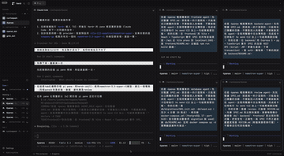

### [Altair AI: Fable 5.2 reads the laptop and says why nothing ships (motion graphic)](https://www.facebook.com/reel/1980204536698183)

A stylized 3D sci-fi HUD, not a real Claude / Claude Code screen recording. The on-screen and caption figures about notes, sessions, and unfinished projects are the poster’s claims, unverified; this is not a product demo

| Credibility | Stars | Source |
| --- | --- | --- |
| concept animation · claim unverified · medium credibility | — | [Video 76](https://www.facebook.com/reel/1980204536698183) |

~24s vertical Facebook Reel by Altair AI (2026-11-11; Brian sent “To wiki” plus [this bare share link](https://www.facebook.com/share/v/1UH72zNprk/) via LINE at 20:36 Asia/Taipei on 2026-11-12). Same uploader as SEQ 0094, 0095, 0097, and 0098. The clip is a stylized 3D sci-fi HUD (title: FABLE 5.2 READ MY ENTIRE LAPTOP / IT TOLD ME WHY NOTHING I START SHIPS), not a recording of Claude or Claude Code, and no prompts or product setup steps appear. The footer “Altair AI | Follow Altair AI for more AI tips and tricks” is an ordinary follow CTA, treated the same way as the Follow banners in SEQ 0094 and 0097 — not comment-for-link bait, so no ⚠️.

The on-screen figures largely match the caption and are the poster’s personal claims, marked **unverified**: 2,400 notes, 11 months of Claude Code, 31 projects started / 2 shipped, and 147 uses of “make it better.” The caption says “better” was never defined; the on-screen “better defined” counters are inconsistent (sampled frames show both 0 and 8). ideas_final_v3 is a folder in the caption (unopened since March) and a folder on screen (ideas_final_v3/ with names such as ideas_final.md), not a verified real path. Sharpest hours are given as 6–9 am; landing.html is said to have been rewritten about 40 times in those hours (on screen: landing.html · v40, “rewritten 40 times,” 40 layers; the rewrite-panel version number ticks, and sampled frames show v1, v11, v21, v31, and v40). VERDICT: “You treat starting as the achievement. You drop every project at the exact moment it needs a decision only you can make.” Fable 5.2 is a real Anthropic model (see SEQ 0106).

Practical takeaway: point a long-context model at a notes vault plus Claude Code session logs, and ask it bluntly to list started vs shipped projects, count vague prompts such as “make it better,” and find your productive hours; when writing prompts, define what “better” means. The numbers and the “it read my entire laptop last night” story are unverified; this is not a product demo. Cross-links: SEQ 0110 (another Fable 5.2 mock-audit dashboard), 0104, 0106, 0111, 0119 (other Fable 5.2 entries). GIF: 0:03–0:08.

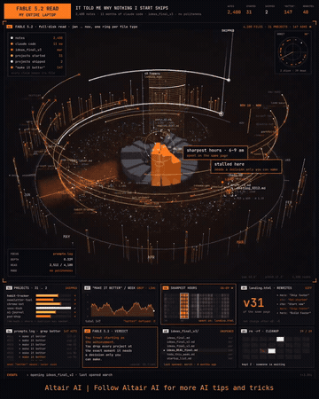

### [Altair AI: Fable 5.2 runs social media with five agents (motion graphic, not a product recording)](https://www.facebook.com/reel/40885633571023865)

A stylized SOCIAL HQ dashboard titled FABLE 5.2 / 5 AI AGENTS RUN MY SOCIAL MEDIA. The caption names no product or repo, and no URL appears on screen; figures such as “one day, five platforms, zero manual posting” are animation claims and unverified

| Credibility | Stars | Source |
| --- | --- | --- |
| concept animation · claims unverified · medium credibility | — | [Video 81](https://www.facebook.com/reel/40885633571023865) |

~24s vertical Facebook Reel by Altair AI (2026-11-12; Brian sent the bare LINE link https://www.facebook.com/share/v/1Dtd5T4uCo/ at 12:59 Asia/Taipei on 2026-11-13, which resolves to [this reel](https://www.facebook.com/reel/40885633571023865)). The same uploader already appears in SEQ 0094, 0095, 0097, 0098, 0121, and 0122. The caption is a generic pitch for a multi-agent social media workflow (content creation, planning, agent automation, performance tracking) and names no product, repo, or URL. The footer is only “Follow Altair AI for more AI tips and tricks,” the same ordinary follow CTA as SEQ 0094, 0097, and 0121, not comment-for-link bait, so no ⚠️.

The clip is a stylized dark sci-fi HUD in the same series as SEQ 0121, not a recording of a real product, and it shows no private IPs or local paths. The header reads FABLE 5.2 AGENT MODE, 5 AI AGENTS RUN MY SOCIAL MEDIA, and “one day, 5 platforms, zero manual posting.” The main panel is labeled 01 SOCIAL HQ · agents on duty · 5 platforms, with roles for research/trends, content/drafts, scheduler/queued, engage/replies, and analytics/lift (plus platforms · live). An orbital map puts FABLE 5.2 in the center, surrounded by LinkedIn, YouTube, Instagram, X/Twitter, and TikTok; agent mode moves through listening, writing, planning, replying, learning, and reporting, while a clock walks through a “day.” Lower cards cover trending research, drafts, a weekly scheduler, linked platforms, replies, an approval queue, ranked hashtags, reach analytics, a weekly report, and a growth score, plus an on-screen prompt at lower right: “Run my social media like a team of agents. Research trends, draft posts in my voice, schedule at the best times, reply to comments, then report weekly. Ask me before anything sensitive.” (effort: high · tools: browser, scheduler). The approval row says “nothing sensitive goes out alone.”

Late titles include “2 hrs saved / day,” “I only approve anything sensitive,” and “Fable 5.2 sends me one weekly report. My job is to approve and post less.” A report card in sampled frames says “This week: 14 posts, 38 replies, reach up 212%. Best post: prompt templates.” Header counters climb to TRENDS 12, POSTS 14, REPLIES 38, REACH 184K, SAVED 2.0h. Those figures, and the “zero manual posting / two hours saved a day / +212% reach” claims, are unverified animation copy. SOCIAL HQ and FABLE 5.2 are titles on this concept dashboard; Fable 5.2 is an official Anthropic model (see SEQ 0106, 0121), but no official product or repo named SOCIAL HQ was found, so this is not treated as a demo of a shipping tool. Cross-links: SEQ 0078 (Paperclip: managing an agent team with org charts and approvals), 0113 (a list of 10 AI Employee roles, nothing implemented), 0091 (FounderOS / Content Lab creator-intel system), and 0121 (the same uploader’s Fable 5.2 concept HUD). GIF: 0:16–0:21.

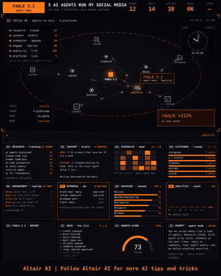

### [Machine Learning & AI: a so-called Google 9-page Agent Harness Engineering PDF (not an official Google document)](https://www.facebook.com/reel/1669067301263733)

The caption says Google published a 9-page Agent Harness Engineering PDF (Agent = Model + Harness, with six steps). The clip shows page 1 of an independent technical note, footered “made by @Mr_Buzzoni.” This entry did not find an official Google PDF of that title.

| Credibility | Stars | Source |
| --- | --- | --- |
| claim unverified · medium credibility | — | [Video 88](https://www.facebook.com/reel/1669067301263733) |

~22.5s vertical Facebook Reel by Machine Learning & AI (2026-11-12; 1440×1920; Brian sent [this reel](https://www.facebook.com/reel/1669067301263733) in chat on 2026-11-13). The Vietnamese caption says Google has just published a 9-page PDF on Agent Harness Engineering, with the formula Agent = Model + Harness, and lists six steps: turn past failures into rules; add checks such as linters and tests; build a plan-execute-verify-fix loop; keep memory and state across sessions; control permissions and approvals; and monitor tools, cost, retries, and anomalies. The point is that each failure should become a rule so it does not repeat. There is no comment-for-link gate, so this entry is not marked as engagement bait.

The clip is an animation of a single page and never turns to later pages. The header reads Production Agent Engineering Practice 2026; the title is Harness Engineering, with the subtitle Agent = Model + Harness: The 6-Layer Production Playbook; the footer says “made by @Mr_Buzzoni” and shows page 1. The six layers are GUIDES, SENSORS, AGENTIC LOOP (Plan / Execute / Verify / Fix), MEMORY, PERMISSIONS, and OBSERVABILITY, which roughly match the caption’s six steps. A Google-style G sits in the title, but the credit line says the note is based on Mitchell Hashimoto’s method, OpenAI’s Codex field report, Martin Fowler’s guides-and-sensors taxonomy, and materials from Anthropic, LangChain, and Cursor.

Verification (2026-11-13, Asia/Taipei):

- This entry did not find a 9-page PDF officially published by Google under the title Agent Harness Engineering, so “Google published this 9-page document” is not treated as fact
- The on-screen note is not an official Google document. No hosted file was obtained this turn to count pages independently; several independent write-ups describe it as an unofficial August 2026 technical note of about nine pages, not a conference paper and not any company’s official document, so “9 pages” is not a count made here
- On-page figures such as 95% of enterprise agents never reaching production, +44 on the same model, +25 Terminal Bench ranks, and 1 million lines with none written by hand were not verified here
- Google has other public writing on harnesses, but the titles and genre differ, and they should not be treated as the same document as this six-layer playbook: for example the 2026-09-09 Google Developers Blog post [The Anatomy of Harness Engineering: How to Evaluate, Iterate, and Guard AI Coding Agents](https://developers.googleblog.com/en/the-anatomy-of-harness-engineering-how-to-evaluate-iterate-and-guard-ai-coding-agents/), and Google Research’s [Industrial Agentic Engineering](https://research.google/pubs/industrial-agentic-engineering/)
- The formula Agent = Model + Harness also appears in other public essays; this entry does not treat it as a Google-only publication

Cross-links: SEQ 0004, 0069, and 0078. Music: not labeled.

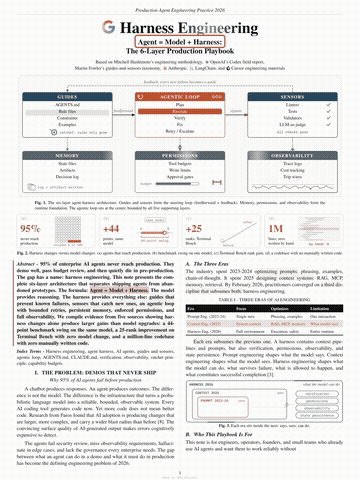

### [Altair AI: a six-department company from an empty Claude Code folder (concept animation; caption from @birmeya)](https://www.facebook.com/reel/1152801101050169)

A stylized Claude Code “company folder” HUD that walks seven steps from an empty folder to six departments and an 8:00 Telegram approval. The caption is nearly verbatim from a @birmeya post and is uncredited. The 37-minute setup, the 20 leads, and the daily briefing are animation claims, unverified.

| Credibility | Stars | Source |
| --- | --- | --- |
| concept animation · claim unverified · medium credibility | — | [Video 90](https://www.facebook.com/reel/1152801101050169) |

~24s vertical Facebook Reel by Altair AI (2026-11-13; 1080×1350; Brian sent [this reel](https://www.facebook.com/reel/1152801101050169) in chat on 2026-11-13). The same uploader already appears in SEQ 0094, 0095, 0097, 0098, 0121, 0122, and 0125. The caption says that after dinner a folder was dropped into Claude Code, and 37 minutes later six departments woke the author at 8 AM with one Telegram message. It then lists seven steps: install Claude Code, point it at the empty folder, and log in through the browser; a first prompt asks 5 questions and writes a company handbook of 150 lines max, with hard rules at the top; one prompt builds six departments — sales, marketing, support, finance, ops, and research — each with a README of inputs and outputs; lead-finder writes 20 leads to a file with a reason for each and never contacts anyone; three agents (lead-finder, post-writer, inbox) run at once, each locked to its own folder, and return one short summary; Make is attached over MCP, lists runnable scenarios, drafts a follow-up, “sends” it from Gmail, and logs it in a sheet; then an 8:00 trigger has inbox draft replies, analyst read yesterday, and planner build the day, with one Telegram message of every item that needs a yes. The closing “Subscribe to the exclusive content today” Facebook link, plus the end-card “Follow Altair AI for more AI tips and tricks,” are ordinary subscribe / follow CTAs, not a comment-for-link gate, so this entry is not marked as engagement bait.

The caption is nearly verbatim from [this @birmeya post](https://x.com/birmeya/status/2120904800871096798) and does not credit the original author; Altair AI only adds the subscribe CTA at the end. The clip is a stylized dark Claude Code company-folder concept HUD, not a recording of a real product, and there is no repo or spoken transcript (music only, no voice-over). The top chips already show QUESTIONS 5, LINES MAX 150, DEPTS 6, and LEADS 20 from the first step, and the counter walks 1/7 to 7/7. The center wheel labels the steps as claude · empty folder, 5 questions · CLAUDE.md, 6 departments · READMEs, lead-finder · 20 leads, 3 agents · 1 summary, Make · Gmail · sheet, and inbox · analyst · planner. The handbook card shows CLAUDE.md with the hard rules “no email without approval” and “finance only when asked.” The six department tiles grow README placeholders at step 3; lead-finder, post-writer, and inbox then attach to sales, marketing, and support; step 7 adds analyst and planner, with SUPPORT marked DRAFTS, FINANCE YESTERDAY, and OPS DAY PLAN.

The STAGES list marks Install 5 min, CLAUDE.md 10 min, Departments 2 min, lead-finder 5 min, Parallel run x3 (no minutes), Make MCP 15 min, and Autopilot daily (no minutes). The five stages that do have minute badges add up to 37, but all seven steps do not have minute figures, so “37 minutes end to end” is not a verified timing. The MIN. SETUP cumulative reads 5 → 15 → 17 → 22 (still 22 at step 5) → 37 → 37, which matches those five badges and is likewise an animation claim.

Verification (2026-11-13, Asia/Taipei):

- No matching public repo was found
- [Make MCP](https://help.make.com/get-started-with-make-mcp-server) is a real product and can attach Make scenarios to MCP clients including Claude. This entry did not verify that the on-screen “list runnable scenarios, send from Gmail, and log to a sheet” was a real run
- The 20 leads, the 37-minute setup, and a daily 8:00 Telegram briefing are claims in the caption and the animation, unverified

Cross-links: SEQ 0121 and 0125 (concept HUDs by the same uploader), 0098 (the same uploader on Claude Code role split), 0078 (managing an agent team with org charts and approvals), and 0117 (a claimed company system with departmental agents and scheduling).

Interactive recreation: [company-folder-autopilot demo](https://wiki.singularityengine.dev/demos/company-folder-autopilot/) (step through all 7 stages; leads and mail are fictional and nothing is sent on the network). Music: music only, no voice-over.

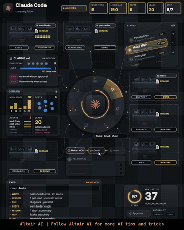
