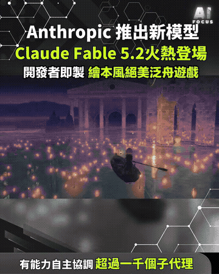
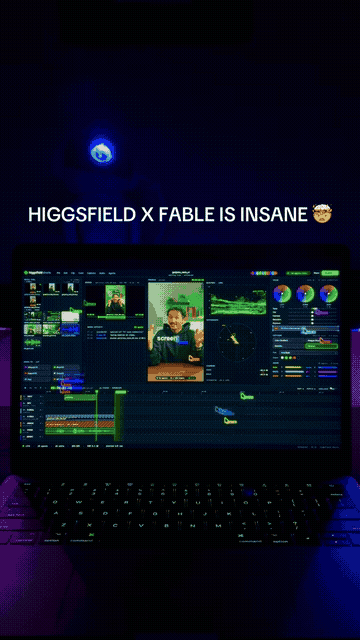

# AI image and video

[中文](../../docs/ai-media.md) | English

[Home](../index.md)

AI-generated video and images, prompts, AI rendering, programmatic video

### [HyperFrames](https://github.com/heygen-com/hyperframes)

Write the frame in HTML and render it straight to video

| Credibility | Stars | Source |
| --- | --- | --- |
| — | 75,865 | [Video 1](https://www.facebook.com/reel/2050168028979180) |

From HeyGen. Write HTML and it renders to video.

### [An AI-generated fitness-girl short](https://www.facebook.com/reel/1449881237350910)

An AI-generated virtual-influencer fitness clip, useful for practicing how to spot the tells

| Credibility | Stars | Source |
| --- | --- | --- |
| AI-generated | — | [Video 14](https://www.facebook.com/reel/1449881237350910) |

The account 少女晴天, with the copy "刮個筋膜刀就力竭了". The whole clip is an AI-generated virtual person working out. Tells: garbled text on clothes and the wall, gym equipment that does not make structural sense, the bottle and the fascia tool melting into the body, and skin that is too smooth. It works as a case of an AI virtual influencer and of how to recognize AI video. Music: synth-pop / chill house with no sung lyrics.

### [OPZEN AI: architectural and interior AI rendering](https://opzenai.com) ⚠️

Turn a sketch or a SketchUp view into a photoreal architectural render

| Credibility | Stars | Source |
| --- | --- | --- |
| ⚠️ engagement bait | — | Screenshot (OPZEN AI) |

Upload a SketchUp or CAD view, or a hand sketch, and it produces a photoreal render. Sync View can generate other angles while keeping materials and proportions. Signup gives 60 points. Output is 1K, 2K, or 4K. "Comment AI Render and I'll send the link" is an engagement-bait move. Alternative: SketchUp's built-in AI Render (it spends Trimble credits). Music: Sayfalse – DARE.

### A prompt that turns a photo into a Japanese-style hand-drawn illustration

Turn a photo into a Japanese-style hand-drawn illustration with a ChatGPT prompt

| Credibility | Stars | Source |
| --- | --- | --- |
| — | — | Screenshot (徐國隆) |

徐國隆 drops a couple's photo into ChatGPT and generates an illustration. The prompt: 「根據上方照片生成一張的插畫，日系插畫風格、角色特徵鮮明、情緒自然表情、半身構圖、動態姿態、服裝細節精緻、手繪塗鴉風、潑墨筆觸、隨行線條、粉彩與墨色混合、漫畫草稿質感、白色簡約背景、周圍符號元素點綴、氛圍感強、高細節、高品質。」

### [What the water keeps: Kevin Ngo’s storybook rafting web piece (said to be made with Claude Fable 5.2)](https://what-the-water-keeps.vercel.app)

The site loads; this reel only loops a morphing boat-rowing animation, with no gameplay or prompts. A later check of the official announcement confirms input pricing fell from $10 to $8 per million tokens versus 5.1, and output from $50 to $40; outputs are up to 30% faster. The caption’s claim of enterprise zero data retention is not the default.

| Credibility | Stars | Source |
| --- | --- | --- |
| claim unverified · medium credibility | — | [Video 59](https://www.facebook.com/reel/1465699568821932) / [Video 85](https://www.facebook.com/reel/1682717900077017) |

~57s Facebook Reel by Aifocus (2026-11-10). Verified 2026-11-10 (Asia/Taipei): Anthropic did announce Claude Fable 5.2 and Mythos 5.2 on 2026-11-09 ([official post](https://www.anthropic.com/claude-fable-and-mythos-5-2)); same underlying model, Fable public, Mythos via verification programs. Official claims — a prototype OS in eight days with 1,000+ subagents, Fermat formalization in 30 hours, two open black-hole physics problems — are Anthropic’s own and **not independently verified here**. [what-the-water-keeps.vercel.app](https://what-the-water-keeps.vercel.app) loads (“A slow boat ride by lantern light, drawn live in your browser”). Kevin Ngo (@kevin_t_ngo) posted on X that Fable 5.2 made the demo (not named on Anthropic’s page). The reel does not show playable gameplay. Cross-link SEQ 0104: both name Fable 5.2; Fable 5.2 is Anthropic’s Claude model, not a Higgsfield product.

Video 85: ~10s vertical Facebook Reel by Marc.AI (2026-11-10; Brian sent [this reel](https://www.facebook.com/reel/1682717900077017) in chat on 2026-11-13). The caption says the Nov 9 launch brought stronger coding, reasoning and vision; that Fable 5.2 answers 30% faster; that input pricing fell from $10 to $8 per million tokens; that it supports zero data retention for enterprise teams; and that Mythos 5.2 stays restricted to verified cyber and life-science users. The pictures are a generic sci-fi dashboard animation with no product UI, prices, or official marks, so no extra GIF was cut. There is no comment-for-link gate, so this source is not marked as engagement bait.

Verification (2026-11-13, Asia/Taipei, against the [official announcement](https://www.anthropic.com/claude-fable-and-mythos-5-2), the [product page](https://www.anthropic.com/claude/fable), platform model pages and release notes, and the [data-retention docs](https://platform.claude.com/docs/en/manage-claude/api-and-data-retention)):

- Nov 9 launch: already verified, still matches
- Stronger coding, reasoning and vision: official wording is improvements in coding, reasoning, and vision; this is an official claim
- “30% faster”: official text is that both models generate outputs up to 30% faster than Claude Fable 5.1 and Mythos 5.1, not a flat 30% and not Fable only. There is also an optional fast mode, up to about 2.5× generation speed, at $16 input / $80 output per million tokens
- Price: official confirmation that input fell from $10 to $8 per million tokens versus 5.1. The caption omitted output pricing, which official pages give as $50 down to $40. Cache reads are $0.20 (they were $0.25 on 5.1)
- “Zero data retention for enterprise” is too broad. Official default is 30-day retention for safety monitoring (Covered Models); zero data retention (ZDR) is not available unless Anthropic expressly authorizes it. Enterprise Frontier Safeguards (EFS) is in private beta; eligible customers can keep using ZDR until they implement EFS; other customers have 30-day retention
- Mythos access: official wording is that organizations apply through the expanded Life Sciences and Cyber Verification Programs, not a generic “verified users”

No private IPs or local paths. Music: not labeled.

### ⚠️ [Higgsfield X Fable editing ad (paid partnership)](https://higgsfield.ai) ⚠️

A staged laptop editing shot, tagged #higgsfieldpartner; the end asks you to comment SHORTS for the link, with no steps shown

| Credibility | Stars | Source |
| --- | --- | --- |
| ⚠️ engagement bait · post-produced · low credibility | — | ⚠️ [Video 66](https://www.facebook.com/reel/1461806646088320) ⚠️ |

~14s Facebook Reel by Ecomlee (2026-11-11). Caption has #higgsfieldpartner (paid/partner promo). Staged laptop, no editing steps. On-screen “HIGGSFIELD X FABLE IS INSANE” and end card “Comment SHORTS for the link” (that CTA is not in the Facebook caption) — engagement bait. This is not a separate app named X Fable. Higgsfield’s own wording is Claude Fable 5.2 × Higgsfield MCP, and a Supercomputer agent powered by Fable 5.2 — i.e. Anthropic’s Fable model driving Higgsfield image/video tools (see SEQ 0104). No real workflow is shown; results **unverified**. GIF: 0:02–0:12.

