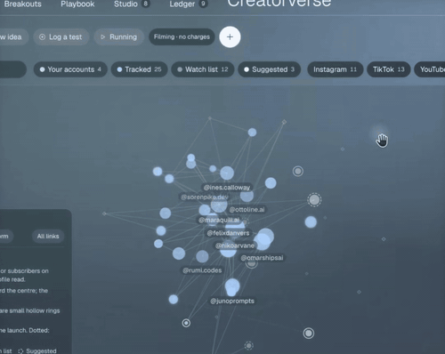

# Automation workflows

[中文](../../docs/automation-workflows.md) | English

[Home](../index.md)

n8n and similar automation: rules first, and a human approval gate

### [n8n customer-support ticket automation](https://www.facebook.com/reel/3209079722631476)

A rules-based support flow from a form to a SQL ticket

| Credibility | Stars | Source |
| --- | --- | --- |
| Concept animation | — | [Video 7](https://www.facebook.com/reel/3209079722631476) |

Form submit → webhook → validate the data → use rules (not AI) to treat urgent / payment failed as high priority → write a SQL ticket (INSERT … ON CONFLICT so a retry is not a duplicate) → send a notification email → return HTTP 200. The video is an After Effects-style simulated animation, not a real n8n screen (CODER.X).

A neon-green terminal-style workflow UI: nodes light up and check off in order, a side panel shows JSON, and a log appears line by line. Recreate it with CSS keyframes and setTimeout flipping an active class.

### [n8n Email Agent: Gmail → AI Agent → HubSpot / Docs / Sheets](https://n8n.io/workflows/7680-automate-gmail-lead-follow-up-with-openai-gpt-4o-hubspot-slack-and-google-sheets/) ⚠️

An n8n template: Gmail triggers, the AI looks up the CRM, then drafts a reply

| Credibility | Stars | Source |
| --- | --- | --- |
| ⚠️ engagement bait | — | Screenshot (Maruf AI Automation Expert) |

A "comment Email Agent and get the template" funnel video by MD Abdullah Al Maruf, a Bangladesh n8n / Make freelancer. Gmail triggers → an AI agent checks HubSpot, Google Docs, and Sheets → send or save a draft. n8n's free official templates already include the same pattern (this link is #7680). #8967 drafts a reply from HubSpot data, then waits for a person to approve it in Slack before sending. Interview takeaway: the AI only drafts. A person approves before anything is sent. That is the quality gate on an outward action.

### [A photo and video auto-sort page made with Claude (a single HTML file)](https://www.instagram.com/reel/DfKEVgNSL3l/) ⚠️

Claude generates one HTML file. In Chrome you pick a folder, hand it to Claude to classify, then press Start and the thumbnails fly into categories.

| Credibility | Stars | Source |
| --- | --- | --- |
| ⚠️ engagement bait · medium credibility | — | [Video 41](https://www.instagram.com/reel/DfKEVgNSL3l/) ⚠️ |

A 19-second Instagram Reel by 亨利溫 Henry Wen, a phone filming a laptop screen. Flow: open the single HTML file Claude made in Chrome → pick a folder → paste the data to Claude for classification → download the result → press Start. Thumbnails fly from a pile in the middle into categories such as webpage screenshots, travel and sights, daily life, work, memes, and plain text. Photos and videos are in two areas. The caption says reply to any comment and the instruction pack will be sent in a private message. That is comment-driven engagement bait. Credibility: medium. You only get the instructions by commenting, and the video never shows whether the classification is right. It only shows the animation. Music: lofi. The voiceover sounds synthetic. Interview takeaway: split "AI judgment" from "local execution". The AI only produces the classification list. A deterministic program moves the files. Preview the result before applying it, so a mistake is easy to undo.

GIF: 0:10.5–0:14 of the video, thumbnails flying into categories (a phone filming a screen).

▶ Interactive demo: [Open](../../demos/photo-sort-fly/) ⚠️（https://wiki.singularityengine.dev/demos/photo-sort-fly/ ⚠️）

### [FounderOS / Content Lab: a creator content-intelligence system (Apify scraping)](https://www.facebook.com/reel/1423421943269401) ⚠️

A creator-intelligence app it calls fully open source: it scrapes posts from creators in your niche with Apify, scores breakouts, and shows the scrape cost before running. No repo can be found, and you have to comment to get it.

| Credibility | Stars | Source |
| --- | --- | --- |
| ⚠️ engagement bait · claim unverified · low credibility | — | [Video 44](https://www.facebook.com/reel/1423421943269401) ⚠️ |

A 1:53 Facebook Reel by Brody, with English male narration and quiet ambient synth music. The frame is split: the top half is the app, the bottom half is Brody talking in a dark studio (glass chess pieces in the foreground, burned-in subtitles). The app header reads glados / Lab. The sidebar lists Funnel, Brand Deals, Finances, Social, Creative Engine, Analytics, Content Lab, Editor, Agents, Tasks, Workflows, Skills, Brain, and Settings. Content Lab tabs: Today (your posts at 1.3x your own baseline, 17 breakouts in your niche), Breakouts ("The Field" scatter plot; one post's detail shows 8.6x), Playbook (what lifts breakouts, with script rules that cite sources, such as keeping the hook short), Radar (topic tide, rising topics), Studio (an agent chat that writes scripts), Creatorverse (a glowing node network of creators, filtered by Your accounts 4 / Tracked 25 / Watch list 12 / Suggested 3), and Ledger (forecast calibration). Run now first opens a cost estimate: 4 accounts, 25 tracked creators, 15 posts each, about $2.26 (range $1.30 to $3.12). It says Apify stops each run at its ceiling (largest $3.00), shows $4.10 of $46.00 used this month, and is marked "Filming · no charges". The video then cuts to a real browser recording of the Instagram Scraper page in the Apify Console ([apify.com/apify/instagram-scraper](https://apify.com/apify/instagram-scraper) ⚠️, an official Actor billed per result; the page lists $1.50 per 1,000 results). The caption claims it is "completely open source", pulls every creator in your niche, shows the cost of every scrape, and teaches your AI what viral means. But you have to comment "FOUNDER" to get the platform and the Apify setup guide by private message. That is comment-driven engagement bait. Verification: GitHub API searches for FounderOS, glados content lab, and founderos apify all return 0 results (creatorverse returns 573, all unrelated student projects), so the open-source claim cannot be verified. Frame check: the app footage is heavily post-produced, with tilted camera moves, depth-of-field blur, light-flare transitions, auto zoom, a smoothed cursor, and no browser frame. The handles also look made up. But the numbers stay consistent across tabs, the cost dialog is very specific, and there is a "Filming · no charges" mode label, so it may be a real app recorded with a tool like Screen Studio. It cannot be called a pure motion-design mockup, so it is tagged "claim unverified" rather than "concept UI". Credibility: low. There is no repo to check, and the "open source" version is gated behind a comment. Music: ambient synth. Interview takeaway: a viral predictor needs calibration and backtesting (the Ledger tab gestures at this), or it is only explaining things after the fact. Showing the per-run cost and a spending cap before an agent or scraper runs is good practice. Scraping social platforms carries terms-of-service risk, so the data source and its use should go through legal first.

GIF: 1:14.5–1:17.5 of the video, the Creatorverse creator network (top half of the frame only, the app).

▶ Interactive demo: [Open](../../demos/creatorverse-network/) ⚠️（https://wiki.singularityengine.dev/demos/creatorverse-network/ ⚠️）
