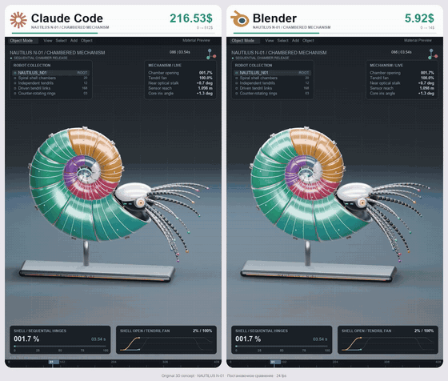
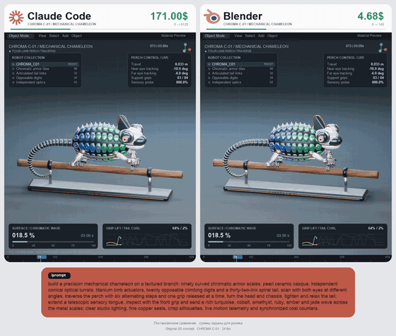

# Cost and tradeoffs

[中文](../../docs/cost-tradeoffs.md) | English

[Home](../index.md)

Token cost, compressing command output, and agents versus traditional tools

### [TokenEconomizer](https://github.com/microsoft/TokenEconomizer)

A research tool that uses past experience to lower an agent's token cost

| Credibility | Stars | Source |
| --- | --- | --- |
| — | 1,349 | [Video 1](https://www.facebook.com/reel/2050168028979180) |

Microsoft Research uses past experience to lower agent cost. The README says SWE-Bench cost drops 18–31%.

### [The Claude Code vs Blender cost gag](https://www.facebook.com/reel/1867596277567322)

A nautilus animation that mocks the token cost of generating 3D with an agent

| Credibility | Stars | Source |
| --- | --- | --- |
| Concept animation | — | [Video 2](https://www.facebook.com/reel/1867596277567322) |

The same mechanical-nautilus 3D animation. The Claude Code counter hits $512 and Blender costs $14. It mocks the token cost of using an agent to generate a complex animation.

Split screen: a 3D mechanical nautilus unfolds while the dollar counters above race. Recreate it with a Three.js model animation and a requestAnimationFrame rolling counter.

### [Claude Code vs Blender: mechanical chameleon](https://www.facebook.com/reel/1413855857399181)

The same cost-comparison series, with a mechanical chameleon as the subject

| Credibility | Stars | Source |
| --- | --- | --- |
| Concept animation | — | [Video 8](https://www.facebook.com/reel/1413855857399181) |

The same matchup as Video 2 (Claude Code on the left, Blender on the right, counters at $512 vs $14). The subject is a mechanical chameleon: the eyes rotate independently, it takes six steps along a branch, the tongue extends, and the scales change color in a wave. The full prompt is at the bottom. Author @marlenuii.

Split screen: a mechanical chameleon walks a branch, scales shift color in a wave, and the dollar counters tick. The color shift can be a shader that offsets hue by position and time.

### Claude Code vs Blender: ORBITAL X-02 rocket

The same cost-comparison series, with a heavy rocket as the subject

| Credibility | Stars | Source |
| --- | --- | --- |
| Concept animation | — | Screenshot (DeepRepo.ai) |

The same @marlenuii matchup: a heavy rocket (white ceramic tanks, twin boosters, 14 nozzles, a fairing that opens to release a gold-foil satellite and solar panels, then stages that reassemble). Claude Code is $184.70 on the left and Blender is $9.65 on the right, about 19 times. The copy says AI defines the concept and structure, code handles repetition, and Blender handles execution. A Russian note at the bottom says the amounts were set for the video and are not measured cost.

### [RTK (Rust Token Killer)](https://github.com/rtk-ai/rtk)

A CLI proxy that compresses command output before it reaches the agent, to save tokens

| Credibility | Stars | Source |
| --- | --- | --- |
| — | 85.1k | Brian's recommendation list 2026-10-31 |

A single Rust binary from rtk-ai. It intercepts shell commands the agent runs (ls, grep, git status/diff/log, cargo test, pytest, docker ps, and 100+ others) and compresses the output before it enters the LLM context. Tests keep only failures. git log keeps only the hash and the subject. It claims 60–90% fewer tokens on common dev commands, with under 10 ms of extra latency. The README says this saves bash output, which is not the same as the bill dropping by the same ratio. Token counts are a bytes/4 estimate. Install with `brew install rtk` (or the official install.sh), then `rtk init -g` to attach Claude Code (`--codex`, `--agent cursor`, and so on). `rtk gain` shows the savings. License: GitHub says Apache-2.0. The README says the full edition is Apache-2.0 plus BUSL-1.1, and the Apache-only edition is called rtk-oss. crates.io has an unrelated package with the same name.

### [一人公司研究所: 10 specialized small models and three selection principles](https://www.facebook.com/reel/1761537521611500)

An illustrated explainer arguing not to chase large models only: ten specialized small models plus three principles (specialized enough, commercially licensable, runnable on your computer). All ten names have official pages; older GLiNER 209M weights are non-commercial, and SenseVoice uses a custom license

| Credibility | Stars | Source |
| --- | --- | --- |
| medium credibility | — | [Video 80](https://www.facebook.com/reel/1761537521611500) |

~151s vertical Facebook Reel by 一人公司研究所 (same uploader as SEQ 0099; 2026-11-12; Brian sent the bare LINE link https://www.facebook.com/share/v/1HtZM2hmmW/ at 08:07 Asia/Taipei on 2026-11-13, which resolves to [this reel](https://www.facebook.com/reel/1761537521611500)). The clip is illustrated cards, not a product recording, and it contains no private information. The caption says large models can do everything but are expensive, and many jobs are faster and cheaper on a small specialist that runs locally. It also claims the list was checked against official sources from a 12-model video, with three version mismatches corrected and license-trap models dropped, leaving these ten; the video itself shows “verify first, then recommend” and 12→10. The 12-model source / three mismatches / dropped license traps are the poster’s claim: this entry only verified that the remaining ten exist and recorded their licenses; the dropped names were not checked. The closing three principles match the caption: specialized enough, commercially licensable, and runnable on your computer. The caption says the full fact-check notes were written up as a report and placed in the comments. That is a pointer to a report already posted, not a comment-a-keyword-for-the-link gate, so no ⚠️ (unlike SEQ 0095 / Video 48’s comment-the-number bait). SkillSpector is not applicable (model weights, not a skill / MCP repo).

Verification (2026-11-13, Asia/Taipei, official Hugging Face / GitHub pages):

| Caption | Official link | Parameters | License | Notes |
| --- | --- | --- | --- | --- |
| SenseVoiceSmall (234M) | https://huggingface.co/FunAudioLLM/SenseVoiceSmall | Official README says the size is similar to Whisper-Small and does not literally say 234M (Whisper-Small is commonly ~244M) | other / FunASR MODEL_LICENSE (custom terms, not a standard SPDX permissive license; an official issue reply has said commercial use is allowed with attribution, but the terms should still be read) | Exists |
| PaddleOCR-VL (0.9B) | https://huggingface.co/PaddlePaddle/PaddleOCR-VL | Official 0.9B | Apache-2.0 | A newer PaddleOCR-VL-1.6 also exists; the caption targets 0.9B |
| Qwen3-Embedding-0.6B | https://huggingface.co/Qwen/Qwen3-Embedding-0.6B | Official 0.6B (on-screen 596M) | Apache-2.0 | Exists |
| Qwen3-Reranker-0.6B | https://huggingface.co/Qwen/Qwen3-Reranker-0.6B | Official 0.6B | Apache-2.0 | Exists |
| GLiNER (209M) | https://github.com/urchade/GLiNER | 209M is the medium / base size | Early v0/v1 209M checkpoints (e.g. gliner_base, gliner_medium) are **CC-BY-NC-4.0 (non-commercial)**; v2/v2.1 209M (e.g. urchade/gliner_medium-v2.1) is Apache-2.0 | Caption does not name a version; check the weight’s license before use |
| SetFit | https://github.com/huggingface/setfit | Caption gives no param size (correct: this is a few-shot method / library, not a single fixed-size checkpoint) | Apache-2.0 | Exists |
| Laya (421M) | https://huggingface.co/convaiinnovations/laya | Official 421M | Apache-2.0 | Found. A non-autoregressive decision / classification model (Convai Innovations, ModernBERT-large), matching “millisecond judgments, needs your own fine-tune”; not a speech model |
| Kokoro-82M | https://huggingface.co/hexgrad/Kokoro-82M | Official 82M TTS | Apache-2.0 | Caption’s “clean commercial license” is consistent |
| Real-ESRGAN (16.7M) | https://github.com/xinntao/Real-ESRGAN | 16.7M is the commonly cited size of the x4plus generator (RRDBNet); Qualcomm AI Hub and similar pages also list 16.7M; this entry did not recount the weights | BSD-3-Clause (commercial-friendly) | Exists |
| Chronos-2 (120M) | https://huggingface.co/amazon/chronos-2 | Official README: 120M-parameter encoder-only time-series foundation model | Apache-2.0 | Exists |

GIF: 2:18–2:23.

