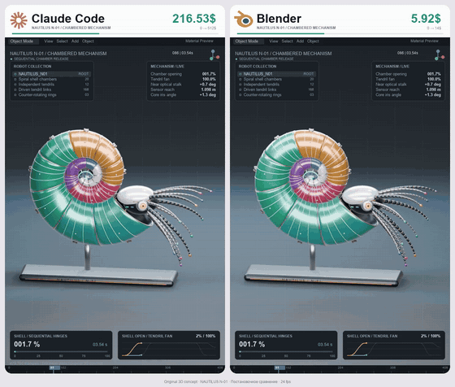
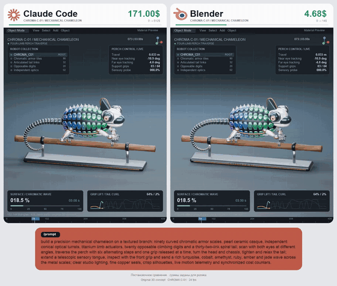

# Cost and tradeoffs

[中文](../../docs/cost-tradeoffs.md) | English

[Home](../index.md)

Token cost, compressing command output, and agents versus traditional tools

### [TokenEconomizer](https://github.com/microsoft/TokenEconomizer)

A research tool that uses past experience to lower an agent's token cost

| Credibility | Stars | Source |
| --- | --- | --- |
| — | 1,349 | [Video 1](https://www.facebook.com/reel/2050168028979180) |

Microsoft Research uses past experience to lower agent cost. The README says SWE-Bench cost drops 18–31%.

### [The Claude Code vs Blender cost gag](https://www.facebook.com/reel/1867596277567322)

A nautilus animation that mocks the token cost of generating 3D with an agent

| Credibility | Stars | Source |
| --- | --- | --- |
| Concept animation | — | [Video 2](https://www.facebook.com/reel/1867596277567322) |

The same mechanical-nautilus 3D animation. The Claude Code counter hits $512 and Blender costs $14. It mocks the token cost of using an agent to generate a complex animation.

Split screen: a 3D mechanical nautilus unfolds while the dollar counters above race. Recreate it with a Three.js model animation and a requestAnimationFrame rolling counter.

### [Claude Code vs Blender: mechanical chameleon](https://www.facebook.com/reel/1413855857399181)

The same cost-comparison series, with a mechanical chameleon as the subject

| Credibility | Stars | Source |
| --- | --- | --- |
| Concept animation | — | [Video 8](https://www.facebook.com/reel/1413855857399181) |

The same matchup as Video 2 (Claude Code on the left, Blender on the right, counters at $512 vs $14). The subject is a mechanical chameleon: the eyes rotate independently, it takes six steps along a branch, the tongue extends, and the scales change color in a wave. The full prompt is at the bottom. Author @marlenuii.

Split screen: a mechanical chameleon walks a branch, scales shift color in a wave, and the dollar counters tick. The color shift can be a shader that offsets hue by position and time.

### Claude Code vs Blender: ORBITAL X-02 rocket

The same cost-comparison series, with a heavy rocket as the subject

| Credibility | Stars | Source |
| --- | --- | --- |
| Concept animation | — | Screenshot (DeepRepo.ai) |

The same @marlenuii matchup: a heavy rocket (white ceramic tanks, twin boosters, 14 nozzles, a fairing that opens to release a gold-foil satellite and solar panels, then stages that reassemble). Claude Code is $184.70 on the left and Blender is $9.65 on the right, about 19 times. The copy says AI defines the concept and structure, code handles repetition, and Blender handles execution. A Russian note at the bottom says the amounts were set for the video and are not measured cost.

### [RTK (Rust Token Killer)](https://github.com/rtk-ai/rtk)

A CLI proxy that compresses command output before it reaches the agent, to save tokens

| Credibility | Stars | Source |
| --- | --- | --- |
| — | 85.1k | Brian's recommendation list 2026-10-31 |

A single Rust binary from rtk-ai. It intercepts shell commands the agent runs (ls, grep, git status/diff/log, cargo test, pytest, docker ps, and 100+ others) and compresses the output before it enters the LLM context. Tests keep only failures. git log keeps only the hash and the subject. It claims 60–90% fewer tokens on common dev commands, with under 10 ms of extra latency. The README says this saves bash output, which is not the same as the bill dropping by the same ratio. Token counts are a bytes/4 estimate. Install with `brew install rtk` (or the official install.sh), then `rtk init -g` to attach Claude Code (`--codex`, `--agent cursor`, and so on). `rtk gain` shows the savings. License: GitHub says Apache-2.0. The README says the full edition is Apache-2.0 plus BUSL-1.1, and the Apache-only edition is called rtk-oss. crates.io has an unrelated package with the same name. Interview takeaway: cost governance has to be measured. Find which context is noise, filter it with a tool, and keep failure information so quality does not drop.
