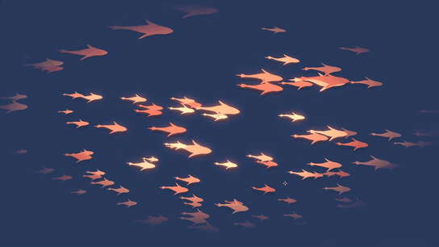
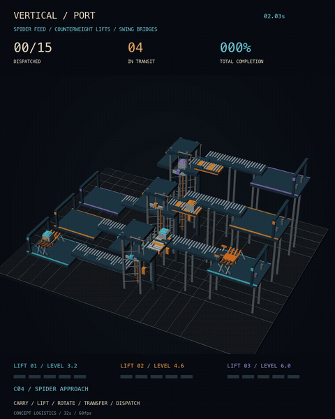
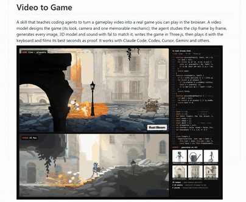
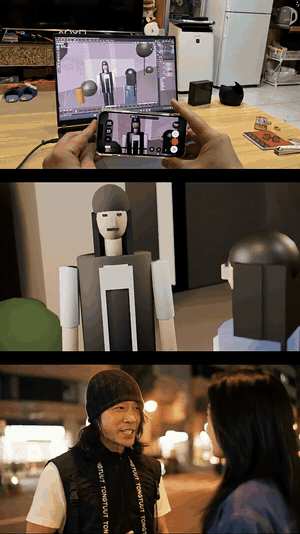
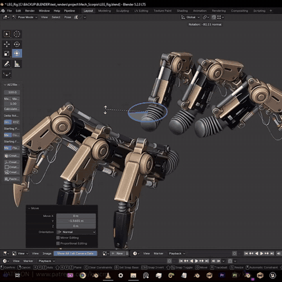

# 3D / animation and DCC

[中文](../../docs/dcc-animation.md) | English

[Home](../index.md)

Blender and other DCC add-ons, camera moves, procedural animation, game generation

### [blender-skills](https://github.com/EL4CTEO/blender-skills)

A skill that lets an agent run Blender workflows

| Credibility | Stars | Source |
| --- | --- | --- |
| — | 598 | [Video 1](https://www.facebook.com/reel/2050168028979180) |

A Blender workflow skill for agents

### [rossark-motion-skill](https://github.com/rossark0/rossark-motion-skill)

A skill that turns SVG into 60fps animation

| Credibility | Stars | Source |
| --- | --- | --- |
| — | 575 | [Video 1](https://www.facebook.com/reel/2050168028979180) |

Turns SVG into 60fps animation

### [Blender fish swimming along a curve](https://www.facebook.com/reel/1433262628273189)

A large school of fish swimming along a Bezier path

| Credibility | Stars | Source |
| --- | --- | --- |
| — | — | [Video 4](https://www.facebook.com/reel/1433262628273189) |

One BezierCurve is the path. Many glowing flat fish swim along it. It shows how a path plus instancing makes a complex crowd animation.

Many glowing flat fish swim a Bezier path, turn, and dive, with warm additive glow. Recreate it with Three.js InstancedMesh, samples along a CatmullRom curve, and additive blending.

### [Automated vertical port animation](https://www.facebook.com/reel/1665373244995510)

An isometric 3D port-logistics animation with a dashboard that stays in sync

| Credibility | Stars | Source |
| --- | --- | --- |
| — | — | [Video 5](https://www.facebook.com/reel/1665373244995510) |

Isometric 3D motion design: 15 containers move across three levels on conveyors, a counterweight lift, a rotating bridge, and a spider arm, while a live dashboard (shipped count, in transit, completion rate, lift height) ticks in sync. It looks like a Blender / C4D render plus post, not an AI generation. Author @marlenuii.

Isometric 3D multi-level port: containers move on conveyors and lifts while dashboard numbers (shipped, completion) increment in sync. Recreate it with a Three.js orthographic isometric camera and a GSAP timeline driving DOM numbers.

### [video-to-game](https://github.com/lovisdotio/video-to-game)

A skill that turns a video design board into a playable Three.js game

| Credibility | Stars | Source |
| --- | --- | --- |
| — | 278 | [Video 6](https://www.facebook.com/reel/1118797844231418) |

OdinLovis's agent skill. A video model first generates the game frames as a design board. The agent analyzes them frame by frame, then uses fal to generate images, 3D models, and sound, and writes a single-HTML Three.js game. It then plays the game and records highlight clips as the check. 31 games averaged about $6 each. MIT.

A generated Three.js game running (third-person flight / parkour) next to the code. Reference for a low-poly scene, a follow camera, and sky fog.

### [VirtuCamera: drive AI animation with a phone's handheld camera](https://virtucamera.com/)

Use a phone's handheld move to drive a 3D camera, then generate the AI video

| Credibility | Stars | Source |
| --- | --- | --- |
| — | — | [Video 10](https://www.facebook.com/reel/2599932377114150) |

A phone app connects over Wi-Fi to Blender (also Maya, Houdini, C4D, 3ds Max, and Nuke) and turns the phone's motion into a 3D camera move in real time. A slider pushes and pulls focal length live. Shoot the move first on a simple 3D character, then use that as the control layer for a photoreal AI video, instead of gambling on the camera in the generator. The app is a $19.99 one-time purchase. Pro is $9.99/month.

Three vertical panels in sync: a phone driving a Blender camera, a simple 3D character shot, and the generated photoreal AI video, all on the same move. A reference for a synchronized split-screen story.

### [Spider Walker: procedural walking for many-legged creatures](https://github.com/iltaen/spider_walker)

A Blender add-on that generates walking animation for many-legged creatures

| Credibility | Stars | Source |
| --- | --- | --- |
| — | 63 | [Video 11](https://www.facebook.com/reel/1442232340569116) |

A free Blender add-on (Blender 3.2). Set up the armature, the center bone, and each foot's IK controller. Move the body and the feet follow in gait order, predict the direction of travel, and ray-cast onto uneven ground. When it looks right, bake to keyframes in one click. The author notes that part of the code was written and refactored with AI. MIT. Music: instrumental synthwave / cyberpunk electronic music. The track name was not identified.

In Blender, a mechanical spider moves its body and each foot lifts and lands in gait order with IK, sticking to the terrain. Recreate it with Three.js CCDIKSolver, or 2D two-bone IK plus a gait phase.
