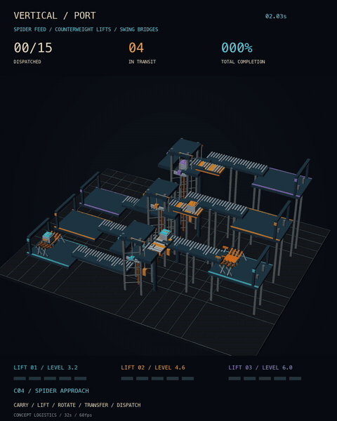
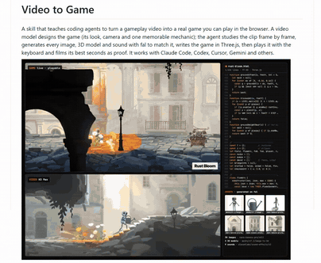
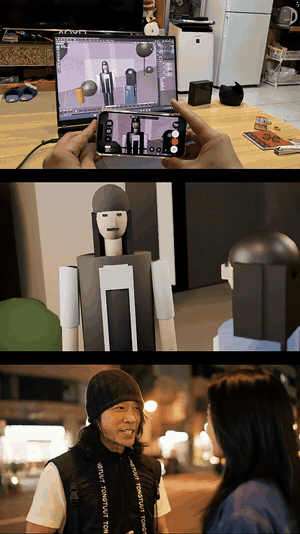
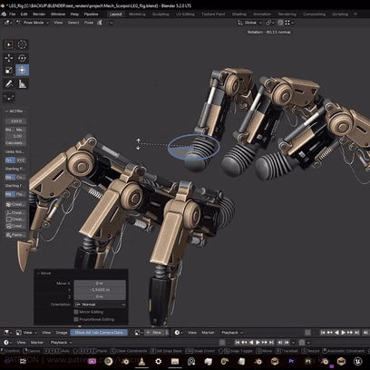
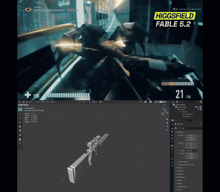
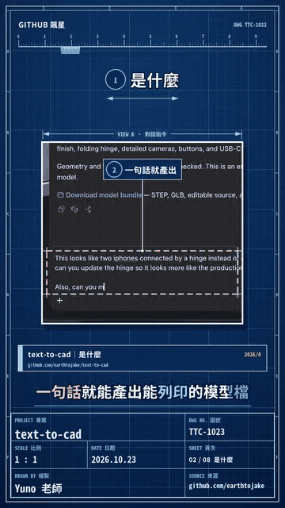
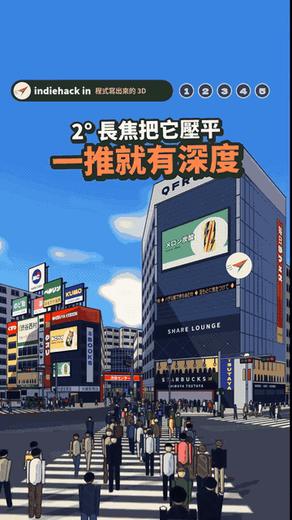

# 3D / animation and DCC

[中文](../../docs/dcc-animation.md) | English

[Home](../index.md)

Blender and other DCC add-ons, camera moves, procedural animation, game generation

### [blender-skills](https://github.com/EL4CTEO/blender-skills)

A skill that lets an agent run Blender workflows

| Credibility | Stars | Source |
| --- | --- | --- |
| — | 598 | [Video 1](https://www.facebook.com/reel/2050168028979180) |

A Blender workflow skill for agents

### [rossark-motion-skill](https://github.com/rossark0/rossark-motion-skill)

A skill that turns SVG into 60fps animation

| Credibility | Stars | Source |
| --- | --- | --- |
| — | 575 | [Video 1](https://www.facebook.com/reel/2050168028979180) |

Turns SVG into 60fps animation

### [Blender fish swimming along a curve](https://www.facebook.com/reel/1433262628273189)

A large school of fish swimming along a Bezier path

| Credibility | Stars | Source |
| --- | --- | --- |
| — | — | [Video 4](https://www.facebook.com/reel/1433262628273189) |

One BezierCurve is the path. Many glowing flat fish swim along it. It shows how a path plus instancing makes a complex crowd animation.

Many glowing flat fish swim a Bezier path, turn, and dive, with warm additive glow. Recreate it with Three.js InstancedMesh, samples along a CatmullRom curve, and additive blending.

### [Automated vertical port animation](https://www.facebook.com/reel/1665373244995510)

An isometric 3D port-logistics animation with a dashboard that stays in sync

| Credibility | Stars | Source |
| --- | --- | --- |
| — | — | [Video 5](https://www.facebook.com/reel/1665373244995510) |

Isometric 3D motion design: 15 containers move across three levels on conveyors, a counterweight lift, a rotating bridge, and a spider arm, while a live dashboard (shipped count, in transit, completion rate, lift height) ticks in sync. It looks like a Blender / C4D render plus post, not an AI generation. Author @marlenuii.

Isometric 3D multi-level port: containers move on conveyors and lifts while dashboard numbers (shipped, completion) increment in sync. Recreate it with a Three.js orthographic isometric camera and a GSAP timeline driving DOM numbers.

### [video-to-game](https://github.com/lovisdotio/video-to-game)

A skill that turns a video design board into a playable Three.js game

| Credibility | Stars | Source |
| --- | --- | --- |
| — | 278 | [Video 6](https://www.facebook.com/reel/1118797844231418) |

OdinLovis's agent skill. A video model first generates the game frames as a design board. The agent analyzes them frame by frame, then uses fal to generate images, 3D models, and sound, and writes a single-HTML Three.js game. It then plays the game and records highlight clips as the check. 31 games averaged about $6 each. MIT.

A generated Three.js game running (third-person flight / parkour) next to the code. Reference for a low-poly scene, a follow camera, and sky fog.

### [VirtuCamera: drive AI animation with a phone's handheld camera](https://virtucamera.com/)

Use a phone's handheld move to drive a 3D camera, then generate the AI video

| Credibility | Stars | Source |
| --- | --- | --- |
| — | — | [Video 10](https://www.facebook.com/reel/2599932377114150) |

A phone app connects over Wi-Fi to Blender (also Maya, Houdini, C4D, 3ds Max, and Nuke) and turns the phone's motion into a 3D camera move in real time. A slider pushes and pulls focal length live. Shoot the move first on a simple 3D character, then use that as the control layer for a photoreal AI video, instead of gambling on the camera in the generator. The app is a $19.99 one-time purchase. Pro is $9.99/month.

Three vertical panels in sync: a phone driving a Blender camera, a simple 3D character shot, and the generated photoreal AI video, all on the same move. A reference for a synchronized split-screen story.

### [Spider Walker: procedural walking for many-legged creatures](https://github.com/iltaen/spider_walker)

A Blender add-on that generates walking animation for many-legged creatures

| Credibility | Stars | Source |
| --- | --- | --- |
| — | 63 | [Video 11](https://www.facebook.com/reel/1442232340569116) |

A free Blender add-on (Blender 3.2). Set up the armature, the center bone, and each foot's IK controller. Move the body and the feet follow in gait order, predict the direction of travel, and ray-cast onto uneven ground. When it looks right, bake to keyframes in one click. The author notes that part of the code was written and refactored with AI. MIT. Music: instrumental synthwave / cyberpunk electronic music. The track name was not identified.

In Blender, a mechanical spider moves its body and each foot lifts and lands in gait order with IK, sticking to the terrain. Recreate it with Three.js CCDIKSolver, or 2D two-bone IK plus a gait phase.

### [Higgsfield + Fable 5.2: claimed 3.5-hour one-shot shooter model (Blender / UE5)](https://x.com/higgsfield_ai/status/2119890046748938248)

Claims Fable 5.2 + Higgsfield built a shooter-game model in Blender and UE5 in about 3.5 hours, almost in one shot; the video does not show that

| Credibility | Stars | Source |
| --- | --- | --- |
| claim unverified · post-produced · low credibility | — | [Video 57](https://www.facebook.com/reel/1610065000234607) |

25s Facebook Reel by 류내원 (2026-11-10), citing [X @higgsfield_ai](https://x.com/higgsfield_ai/status/2119890046748938248) (fetch returned 403; post text not verified). Top half: FPS footage with a HIGGSFIELD / FABLE 5.2 watermark. Bottom half is labeled “Blender”, but the UI is fully static while the model morphs — likely an AI morph over a Blender screenshot. No UE5, prompts, or 3.5-hour evidence. Fable 5.2 is Anthropic’s Claude model announced 2026-11-09 (see SEQ 0106 and the [official post](https://www.anthropic.com/claude-fable-and-mythos-5-2)), not a Higgsfield 3D generator. Higgsfield is an image/video/audio platform that can connect to Claude via MCP. The 3.5-hour one-shot and Blender/UE5 workflow are **unverified**.

### [text-to-cad: text-to-3D CAD for agents (earthtojake)](https://github.com/earthtojake/text-to-cad)

An open-source skill/plugin for AI agents to build 3D CAD from text, with drawings, DFM, slicing and printer hooks; the on-screen owner path and star count were wrong

| Credibility | Stars | Source |
| --- | --- | --- |
| claim unverified · medium credibility | 25.9k | [Video 58](https://www.facebook.com/reel/1051298501315719) |

~43s Facebook Reel by YuNo老師 (2026-11-08); no engagement bait. On-screen path github.com/earthtejake/text-to-cad and 22,499★, MIT. GitHub API 2026-11-10 (Asia/Taipei): earthtejake does not exist; real repo is [earthtojake/text-to-cad](https://github.com/earthtojake/text-to-cad), MIT, 25,948 stars / 2,467 forks, last push 2026-11-10 16:46 Asia/Taipei; site [texttocad.dev](https://www.texttocad.dev). README confirms engineering drawings, DFM, G-code (OrcaSlicer), Bambu, off-the-shelf screws/bearings/motors, URDF/SDF. The hinge demo and “~10 min printable stand” are **unverified** here. SkillSpector pending.

### [Ming Cheng Ho (indiehack in): a Shibuya 3D scene said to be coded with Fable 5.2 (process not public yet)](https://www.facebook.com/reel/2190397408553774)

The short shows a stylized 3D Shibuya crossing that behaves like a camera move through a solid scene, not like a typical video-model morph. The caption says it was made with Fable 5.2 plus an unnamed new process, and that a longer video will explain how; a public search has not found that longer video yet.

| Credibility | Stars | Source |
| --- | --- | --- |
| claims unverified · medium credibility | — | [Video 83](https://www.facebook.com/reel/2190397408553774) |

~40.5s vertical Facebook Reel by Ming Cheng Ho (2026-11-10; Brian sent [this reel](https://www.facebook.com/reel/2190397408553774) in chat on 2026-11-13). The caption is thin: the Short is about the process, the Shibuya scene was made with Fable 5.2 plus a new process, and anyone who wants the how-to should subscribe to the YouTube channel indiehack in for a later long video. The end card (indiehack.in, YouTube @indiehackin) is an ordinary subscribe CTA, not a comment-for-link gate, so this entry is not marked as engagement bait.

The picture is a stylized, cel-shaded / outlined 3D Shibuya crossing with the watermark “indiehack in 程式寫出來的 3D,” a compass, and pins 1–5. The camera pushes in from a flattened long-lens view; motion blur appears while buildings keep stable silhouettes, pedestrians are blocky simplified figures, and signage stays readable. It looks like a movable 3D scene, not like a video model whose shapes melt and signs break apart. No code editor, three.js, Blender, or other library / tool name appears on screen, and there is no process footage or prompt; besides indiehack.in and @indiehackin at the end, there is no other URL.

On-screen claims (unverified here): no 3D software and no hand drawing; 344 buildings at real scale, written line by line; buildings from government open data; music and sound also synthesized in code; modeling through audio all done by AI agents. Five shop cards appear (渋谷西村水果店, STARBUCKS 渋谷 TSUTAYA 2F, ロクシタンカフェ, USHIHACHI 極, MAG8 rooftop bar); the end list notes that shop info was checked from official sites in November 2026. This entry did not verify each contact line and does not copy phone numbers onto the public site.

Verification (2026-11-13, Asia/Taipei): Fable 5.2 is the official Anthropic Claude model announced on 2026-11-09 (see SEQ 0106, https://www.anthropic.com/claude-fable-and-mythos-5-2). The author’s site https://indiehack.in and its contact page name YouTube as @indiehackin. Searches of indiehack.in/videos and the public web found no process long video, no named write-up, and no repo; the process is not public yet. See also SEQ 0106 and 0104. No private IPs or local paths. Music: source not labeled (the video claims it is synthesized; unverified).

