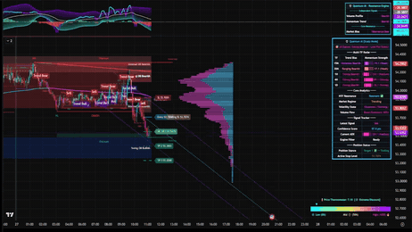

# Finance and trading

[中文](../../docs/finance-trading.md) | English

[Home](../index.md)

Trading charts, Claude techniques for finance, and trading-bot engagement bait

### [TradingView bar-replay chart animation](https://www.facebook.com/reel/1632204671708366)

Record a Bar Replay into an annotated candlestick replay

| Credibility | Stars | Source |
| --- | --- | --- |
| — | — | [Video 3](https://www.facebook.com/reel/1632204671708366) |

Use TradingView's Bar Replay to play the market back at high speed and screen-record it, with Premium / Discount zones, a volume profile, Buy/Sell and TP labels, and a status panel. You can rebuild it in HTML with canvas.

A canvas recreation in this repo: [Bar-replay chart demo](../../demos/chart-replay/index.html).

Candles replay one bar at a time, with translucent Premium/Discount bands, a volume-profile histogram on the right, and a status panel updating live. Recreate it by drawing candles frame by frame on Canvas 2D and overlaying rectangles.

### [25 Claude techniques for finance people](https://www.facebook.com/reel/1411775787706586)

25 ways finance people use Claude for Excel and reports

| Credibility | Stars | Source |
| --- | --- | --- |
| — | — | [Video 12](https://www.facebook.com/reel/1411775787706586) |

Compiled by Nicolas Boucher, in five groups. Claude in Excel (cell references, explain a formula, find #REF, budget variance, reconciliation, a three-statement model, extract a table from a PDF). Dashboard (Styles, one Project per client, an interactive Artifact dashboard, trace a KPI). Claude Cowork (least privilege by opening only a dedicated folder, list a plan and wait for approval before touching files, batch rename, screenshot to Excel). Best practices (split Opus / Sonnet / Haiku, XML tags, anti-hallucination checks, emit XLSX / PPT directly, automate reports with Claude Code). Music: female-vocal EDM / House. The track name was not identified.

### [⚠️ An AI trading-bot funnel video (a cautionary example)](https://www.facebook.com/reel/1893910828071251) ⚠️

An AI trading video that funnels viewers with fake profit. A cautionary example.

| Credibility | Stars | Source |
| --- | --- | --- |
| ⚠️ engagement bait | — | [Video 13](https://www.facebook.com/reel/1893910828071251) ⚠️ |

Tauhid 2.0 claims "give Grok Bot $53 and it adjusts leverage automatically". The screen goes from $54.76 to $3,874.56, with a 68% win rate and 67.5x average leverage. There is no real exchange or Grok interface. The equity curve never draws down. Closing a trade sprays confetti. It is almost certainly an After Effects animation. "DM GROK BOT" is a typical course or signal-group funnel. Music: hacker-style synthwave.

A dark-green glassmorphism trading dashboard: an equity curve draws, a trade log scrolls, character cards highlight in turn, then confetti and a profit popup. Recreate it with a Canvas line animation and canvas-confetti. The profit itself is fake; this is only a UI reference.

### [ALGORY: "day 289 of building an automated hedge fund"](https://algory.app/) ⚠️

Paid Windows software that uses a genetic algorithm to produce MT5 trading robots

| Credibility | Stars | Source |
| --- | --- | --- |
| ⚠️ engagement bait | — | Screenshot (Tommy Vaga) |

Windows software sold by Tommy Vaga (likely Tomas Edgar of VagaFX). A genetic algorithm breeds strategies in Consistency and Growth families for about 20 generations, tests them on an unseen 30% of history, then compares them tick by tick with MT5. Survivors export as MetaTrader 5 robots. Prototypes include Multi Signal, Breakout Hunter, and Reversion. The site itself says "Algory will not trade for you", and the author admits "hedge fund" is wordplay. The video is only a red HUD, with no real profit and loss. A backtest is not the future. Treat it with the same doubt as Tauhid 2.0. Music: original audio by ayaibrahimx.

### [Grok Desk: a BTC trading terminal with 6 AI agents](https://x.com/marlenuii/status/2115396645131022816)

A concept-animation interface of six AI agents trading BTC

| Credibility | Stars | Source |
| --- | --- | --- |
| Concept animation | — | Screenshot (DeepRepo.ai) |

A comment credits @Marlenuii (the author of this wiki's port animation and the Claude Code vs Blender pieces). TAKER, SPOTTER, EDGE, CLOSER, PRIOR, and KELLY sit around a central reactor, with 18 data signals and a live tape. This is a designed animation concept, not a usable product. The Grok Bot catalog does have a similarly divided Poly template (paper-first, a simulated Polymarket BTC 5-minute up/down market). It is a reference, not an implementation of this video.
