# Frontend and UI design

[中文](../../docs/frontend-ui.md) | English

[Home](../index.md)

Design systems, UI linters, design skills, interface templates, and concept interfaces

### [fx0](https://github.com/vercel-labs/fx0)

Describe a page and it writes a single HTML file

| Credibility | Stars | Source |
| --- | --- | --- |
| — | 418 | [Video 1](https://www.facebook.com/reel/2050168028979180) |

Describe a page and it writes one HTML file (Vercel)

### [Awesome DESIGN.md](https://github.com/VoltAgent/awesome-design-md)

Design systems from 73 real sites, so AI can follow them when it builds UI

| Credibility | Stars | Source |
| --- | --- | --- |
| — | 124.7k | [Video 9](https://www.facebook.com/reel/1780228483203385) |

VoltAgent collected DESIGN.md files from 73 real sites (Stripe, Linear, and others). Drop one into a project and Claude follows a real design system instead of an AI look.

### [Impeccable](https://github.com/pbakaus/impeccable)

Commands and rules that catch AI-flavored design problems

| Credibility | Stars | Source |
| --- | --- | --- |
| — | 97.2k | [Video 9](https://www.facebook.com/reel/1780228483203385) |

24 design commands (/impeccable audit, polish, bolder, quieter, and others) plus 59 rules. It specifically catches gradient headlines, emoji icons, and using Inter for everything. Apache-2.0.

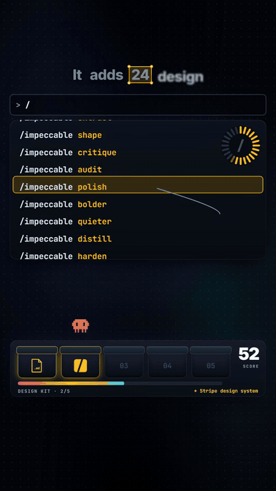

A UI exploded into stacked glass planes in 3D perspective, with red warning labels popping in one by one. Recreate it with CSS perspective, rotateX/rotateZ, and translateZ layers.

### [Taste Skill](https://github.com/Leonxlnx/taste-skill)

A Claude skill that sets design taste with three parameters

| Credibility | Stars | Source |
| --- | --- | --- |
| — | 106.4k | [Video 9](https://www.facebook.com/reel/1780228483203385) |

Set a design style with bold / motion / density so Claude produces work in your taste. MIT.

### [Web Design Guidelines (Vercel skill)](https://github.com/vercel-labs/agent-skills/tree/main/skills/web-design-guidelines)

A skill that checks web usability the way a UI linter would

| Credibility | Stars | Source |
| --- | --- | --- |
| — | 33.3k (agent-skills) | [Video 9](https://www.facebook.com/reel/1780228483203385) |

A skill inside vercel-labs/agent-skills. It works like a UI linter: it catches disabled zoom, hit targets under 24px, and submits with no loading state.

### [Apex: a JARVIS-style AI chief-of-staff interface](https://github.com/RubenM1990/APEX-UI)

Source for a JARVIS-style 3D interface of an AI chief of staff

| Credibility | Stars | Source |
| --- | --- | --- |
| Concept interface | 158 | Screenshot (Reznikov Engineering) |

Reznikov Engineering (Ruben Mouradian)'s AI chief of staff for an independent founder. The public APEX-UI is Next.js 15, React 19, and react-three-fiber: a gold halo sphere, a reasoning net of 18 agent nodes, and a STANDBY status column (the blue org-chart screenshot). The particle head "Apex Humanoid" is in a private repo. MIT. The brand is not in the license.

### [Vessa / Cadra admin dashboard templates](https://codeandchill.store/templates/vessa)

Paid admin dashboard templates, useful as a reference when AI builds UI

| Credibility | Stars | Source |
| --- | --- | --- |
| Paid template | — | Screenshot (Code and Chill) |

Paid templates sold by Code and Chill (not an AI-generated demo). Vessa is an inventory system for a skincare brand. Cadra is a 29-page factory management system. TypeScript and GSAP, no framework and no backend, $78 each. No public repo. They can be a design reference for AI-built admin UI.

### [Open Design Agent Kit (Feima Code)](https://marketplace.visualstudio.com/items?itemName=feima.open-design-agent-kit)

A VS Code extension that brings a large set of design skills into Copilot Chat

| Credibility | Stars | Source |
| --- | --- | --- |
| — | 581 | Screenshot (DeepRepo.ai) |

A VS Code extension that turns 270+ design skills, 150+ brand design systems, and 160+ examples into native tools and slash commands for GitHub Copilot Chat. It uses the model you picked in Copilot and writes HTML files into the repo. No daemon, MCP, or API key. The same repo also ships a Claude Code plugin, a Codex skill, and an MCP server. MIT. Ram Maheshwari (@rammcodes) on screen is the person who reposted it.

### [Websites in 2026: Aethelburg and Montfort](https://www.facebook.com/reel/1834273334429297) ⚠️

Two 2026-style sites whose scroll animation is very heavy on WebGL

| Credibility | Stars | Source |
| --- | --- | --- |
| ⚠️ engagement bait | — | [Video 29](https://www.facebook.com/reel/1834273334429297) ⚠️ |

wearebrand's "Websites in 2026 🤩". The copy "Comment “WEBSITE” and let’s make your brand stand out" is a keyword-comment funnel for client work. The sites in the clip are not necessarily theirs. It is a real recording of scrolling two WebGL-heavy sites on a Mac. (1) Aethelburg (⚠️ https://aethelburg.network ⚠️): particle swarms, distorted type, and 3D planes on scroll. In the clip it is a studio's jobs page. The domain exists, but the page title is "AETHELNET // Sovereign Mesh Observer & Neural Manifold". Whether that is the page in the clip is unconfirmed. (2) Montfort (⚠️ https://mont-fort.com ⚠️, not montfortgroup.com, which is a brick company): an energy and commodities trading company (offices in the UAE, Singapore, and Switzerland). Scroll parallax goes from a mountain in clouds to a cargo ship at sea to a rotating 3D earth. mesh3d.gallery says Immersive Garden built it with Three.js, custom shaders, and Lenis. The clip shows no AI tool. Music: it sounds like Tyla's "Water" (unconfirmed).

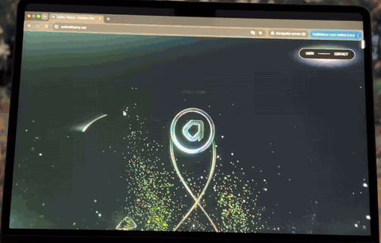

A WebGL portfolio: 3D cards and panels fly through space as you scroll, with colored particles and glitch RGB-split text "DISCOVER YOUR PATRONUS". Recreate it with a Three.js scroll-driven camera, particles, and an RGB-shift post pass.

A corporate WebGL site: scroll through snow mountains and volumetric clouds, a tanker sails in a sea of clouds, then the view pulls back to a 3D earth and a thin title fades in. Recreate it with a Three.js volumetric-cloud or fog shader and a scroll-driven camera path.

### [Kishan one-page graphic-design portfolio](https://www.facebook.com/reel/1670796030659910)

A layout example of a one-page graphic-design portfolio

| Credibility | Stars | Source |
| --- | --- | --- |
| Layout reference | — | [Video 35](https://www.facebook.com/reel/1670796030659910) |

An auto-scrolling one-page portfolio. A dark header reads "2026 PORTFOLIO / GRAPHIC DESIGN PORTFOLIO / CREATIVE - MODERN - IMPACTFUL", then white cards 01–08: About, Logo (AUREN / NEXORA / VELORA / BOLDPRO, black and gold), YouTube thumbnails, social posts, product mockups, a catalog, packaging (the frame spells "PAKAGING"), fences and billboards, and a contact footer with a QR code. The tools named are Illustrator and Photoshop. There is a #canva tag, but the clip shows neither Canva nor AI. Credibility: not applicable. It is only a layout reference. Music: lo-fi chillhop. GIF segment: 0:01–0:06. Note: the sections are clear and useful as a reference. The plan was to make an auto-scrolling HTML demo.

A long portfolio page auto-scrolls on a blurred dark background (PORTFOLIO cover, then About me, then Logo / Thumbnail / Social media), with heavy black-and-white type and thumbnail grids. Recreate it with a CSS @keyframes translateY on a long image and a backdrop-blur background.

▶ Interactive demo: [Open](../../demos/portfolio-scroll/) (https://wiki.singularityengine.dev/demos/portfolio-scroll/)

### [Six charts and when to use them](https://www.facebook.com/reel/1742098810210214)

One animation for when to use bar, pie, line, scatter, histogram, and box plot

| Credibility | Stars | Source |
| --- | --- | --- |
| High credibility · data visualization | — | [Video 36](https://www.facebook.com/reel/1742098810210214) |

Statsmaniaofficial's "Different visualizations — 6 charts · when to use them", a 10-second loop on synthetic data. A dark-blue dotted background and a 2×3 of cards: a bar chart (A18, B32, C24, D26, "height = value"); a pie of the same A–D shares and colors; a line chart (Jan–Dec, a yellow line with an area gradient); a scatter plot (green points, a positive trend, "Association ≠ causation"); a histogram (90 delivery times, equal bins from 10–70, right-skewed); a box plot of the same 90 points, marking the median, IQR = Q3−Q1, and outliers. A vertical scan line sweeps each chart and highlights the data under it. The guide: bars to compare categories, pie for part of a whole, line for change over time, scatter for two numeric variables, histogram for the shape of a distribution, box plot for a compact summary, and correlation is not causation. Credibility: high. Frame checks showed the statistics stay consistent. Music: unconfirmed. Note: the plan was a six-chart animated-SVG HTML demo.

Six chart cards on a dark background (bar, pie, line, scatter, histogram, box). A glowing scan line sweeps across and highlights points one by one. Recreate the charts in SVG or Canvas and move a gradient mask line (mix-blend-mode). The 10 seconds can loop seamlessly.

▶ Interactive demo: [Open](../../demos/charts/) (https://wiki.singularityengine.dev/demos/charts/)

### Kinlo back-office dashboard: a View Transitions circular wipe

When you switch page or theme, the View Transitions API expands a circular mask from the click and wipes to the next view.

| Credibility | Stars | Source |
| --- | --- | --- |
| High credibility | — | [Video 37](https://www.facebook.com/reel/1473800611304190) |

A Code & Chill reel of a cinema back-office dashboard (sidebar, Finance › Cards, Calendar). The technique calls `document.startViewTransition`, then animates `clipPath` on `::view-transition-new(root)` from `circle(0px at x y)` to `circle(d px at x y)`, where `d = Math.hypot(Math.max(x, innerWidth-x), Math.max(y, innerHeight-y))`, over about 400 ms. If the API is unsupported, or the user has `prefers-reduced-motion` set, it falls back to an instant change. Music: unconfirmed.

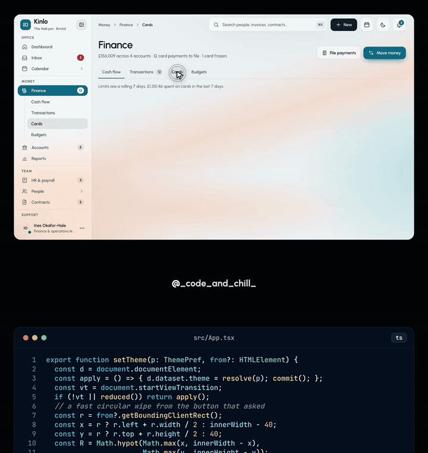

▶ Interactive demo: [Open](../../demos/view-transition-dashboard/) (https://wiki.singularityengine.dev/demos/view-transition-dashboard/)

### [Details.so: real-site design-detail library + MCP (Claude Code / Cursor)](https://www.details.so)

A hand-picked library of details from live production websites, searchable from Claude Code, Cursor, and similar tools via the official remote MCP

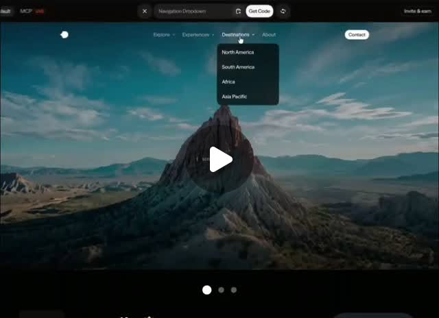

| Credibility | Stars | Source |
| --- | --- | --- |
| claim unverified · medium credibility | — | [Threads @ethansavemoneydairy](https://www.threads.com/@ethansavemoneydairy/post/DfgeXIwAIzH) |

Image/text Threads post (no video), 2026-11-10. Claim: 3,400+ real website design examples, usable via MCP from Claude Code / Cursor. Verified 2026-11-10 (Asia/Taipei) from [pricing](https://www.details.so/pricing) and [mcp.md](https://www.details.so/mcp.md): hosted MCP at https://api.details.so/mcp (browser OAuth). MCP is included on every paid plan — Pro $9/mo (full Inspo + 300 MCP credits/mo), Max $19/mo (adds Vault, 1,000 credits), Team $22/seat/mo (2,000 credits/seat), Lifetime one-time (price not shown on the page fetched; 2,000 credits/mo). Starter (free) can browse recent Inspo, category/Vault previews, and selected free resources. Official MCP docs also say free accounts get a one-time 20 credits while “free access” is enabled (may be turned off; no refill; does not unlock the paid site or Vault). The **3,400+** library-wide count was **not** found on the official pages opened this turn (**unverified**). No public MCP GitHub repo found, so no SkillSpector scan. Cross-links: SEQ 0028–0031. No engagement bait.

### ⚠️ [Hallmark: Together AI’s anti-AI-look design skill (Claude Code / Codex / Cursor / OpenCode)](https://github.com/Nutlope/hallmark) ⚠️

A design skill that avoids common AI-looking webpage patterns: 50 themes, reads the project then asks once for real photos and numbers, and can check the page in a real browser at 8 widths

| Credibility | Stars | Source |
| --- | --- | --- |
| ⚠️ engagement bait · concept animation · medium credibility | 52.0k | ⚠️ [Video 55](https://www.facebook.com/reel/1745279943247041) ⚠️ |

1:20 Facebook Reel by 小礦工挖挖礦 (2026-11-07): narration plus motion/slide graphics (no live demo, no real GitHub page). Ends with “comment 網頁質感 for the link” — engagement bait; the real repo is public. Claims: made by Together AI for Claude Code / Codex / Cursor / OpenCode; 48.2k stars / 2.6k forks, MIT; 50 themes each with a reference page; reads project fonts/colors/framework; asks once for real photos and numbers, no fabricated content; picks among 3 suitable themes, layout by page purpose; custom mode; 755 openly licensed photos with attribution; redesign (keep content, change style) and audit (report only); checks the page in a real browser at 8 widths (contrast, focus, mobile), with a fresh-eyes reviewer for the final verdict; browser check needs Chrome. Avoids AI-look patterns (eyebrow labels above headings, all-caps tags, newsletter footer). Verified GitHub API 2026-11-10 (Asia/Taipei): real repo is ⚠️ [Nutlope/hallmark](https://github.com/Nutlope/hallmark) ⚠️ (owner Nutlope / Hassan El Mghari, not the togethercomputer org; README says “Made by Together AI”), MIT, 52,023 stars / 2,771 forks (the video’s 48.2k is stale; forks are close to the claimed 2.6k), not archived, created 2026-04-27, last push 2026-11-05 21:16 Asia/Taipei; site ⚠️ [usehallmark.com](https://www.usehallmark.com/) ⚠️. README largely matches the feature list and notes static checks still run without Chrome / puppeteer-core. No live demo in this video, so effectiveness is unverified here. Cross-links: SEQ 0028, 0029, 0030, 0100. SkillSpector pending (no clone this batch).

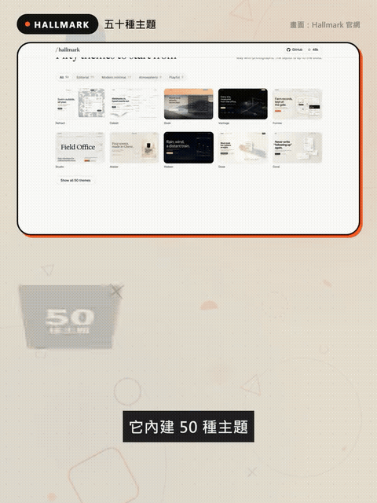

### ⚠️ [Claude + ChatGPT Astra 6: interactive architecture presentation (Verdant Residences)](https://www.facebook.com/reel/1485883914602760) ⚠️

Only the finished interactive 3D project site is shown (facade sliders, floor plans, an INR mortgage calculator), overlaid with “Client paid $2450”; no AI UI or workflow appears

| Credibility | Stars | Source |
| --- | --- | --- |
| ⚠️ engagement bait · claim unverified · low credibility | — | ⚠️ [Video 67](https://www.facebook.com/reel/1485883914602760) ⚠️ |

~24s Facebook Reel by Presentation Palette (2026-11-11). Caption: comment ASTRA for the full AI workflow and prompts — engagement bait. The video only shows a finished interactive site, “Verdant Residences”: facade-material sliders, floor plans, a mortgage calculator in Indian rupees, plus an overlay “Client paid $2450.” The fee and whether Claude + Astra actually made it are **unverified**; no AI UI appears. The caption’s “ChatGPT Astra 6” is informal / the wrong order: the official name is GPT-6 Astra (⚠️ [openai.com/index/gpt-6-astra](https://openai.com/index/gpt-6-astra/) ⚠️, API id gpt-6-astra), the model behind GPT-6 Pro in ChatGPT. SEQ 0039 already uses the GPT-6 Astra name in the OpenAI incident write-up. Cross-link SEQ 0045 (OPZEN AI architectural rendering). GIF: 0:09–0:19.

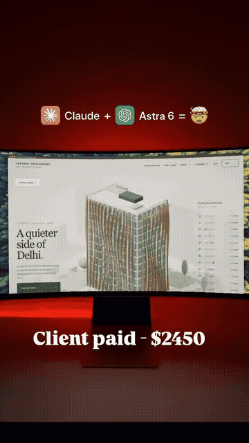

### ⚠️ [9 UI details that beat AI slop (David Mráz / Atheros Learning)](https://www.facebook.com/reel/1690133082855724) ⚠️

A ~9s before/after animation toggling AI Slop→Premium, with nine interface details and some CSS; comment Learn for paid course access

| Credibility | Stars | Source |
| --- | --- | --- |
| ⚠️ engagement bait · concept animation · medium credibility | — | ⚠️ [Video 69](https://www.facebook.com/reel/1690133082855724) ⚠️ |

~9s Facebook Reel by David Mráz (@davidm_ai) (2026-11-09). Caption: comment Learn to get these ideas on Atheros Learning (paid Pass members only, ⚠️ [learning.atheros.ai](https://learning.atheros.ai) ⚠️) — engagement bait. Animated checklist, not a real project recording. The nine details: (1) concentric radii (inner = outer minus padding: R32, p16, r16); (2) optical centre (nudge the play triangle slightly right); (3) tabular digits; (4) balanced text (no orphan word on the last line); (5) hairlines (5% border plus two soft shadows, not one harsh shadow); (6) icon strokes (1.75 outline, not a fill); (7) empty states need a title, subtitle, and CTA, not just “No data”; (8) one primary action (demote Cancel); (9) a visible 2px focus ring. CSS called out: `font-variant-numeric: tabular-nums`; `text-wrap: balance`; `:focus-visible` outline. Cross-links: SEQ 0029 (Impeccable), 0100 (Details.so), 0102 (Hallmark). GIF: 0:00–0:09.

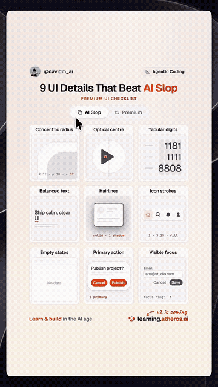

### [Light and Line: a visual-composition short (not an AI-tool demo)](https://www.facebook.com/reel/1782325196375171)

Minimal motion design: one line plus light becomes a story-cover poster; copy and offset grow a colonnade. No AI tool, prompt, or URL appears; filed as composition inspiration for posters / UI heroes

| Credibility | Stars | Source |
| --- | --- | --- |
| design inspiration · concept animation | — | [Video 70](https://www.facebook.com/reel/1782325196375171) |

~19s Facebook Reel by 家變美統包工程 (2026-11-08); no comment-for-link. 2D plus stylized-3D motion graphics, not a tool walkthrough, and no prompts or product URLs. Mandarin VO, in outline: a single line plus light becomes a story cover (typography poster); copy and offset turn it into six tapering lines, then a 3D colonnade with small figures that suggest a scene; a line-drawn profile gets a touch of red. Closing line: simple design, different combinations — that is visual composition. Takeaway: few elements, repetition and offset, light and contrast, one accent color — useful when writing prompts for posters or UI hero visuals. Light cross-link to SEQ 0114 (nine UI details): both are about composition, but this is not a component tutorial. GIF: 0:02–0:12.

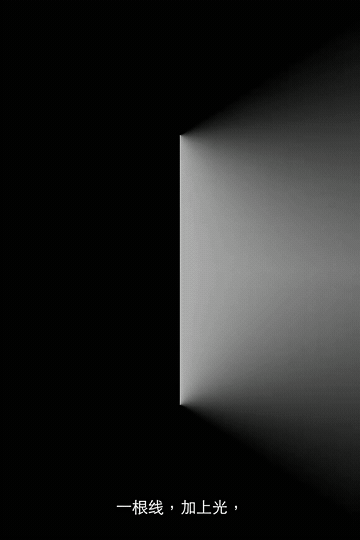

### ⚠️ [Gilt Foundry: interactive comic-book site (finished site only; comment HOW)](https://giltfoundry.com) ⚠️

Only the finished scrollytelling comic is shown (a person on a MacBook pressing the spacebar); no tools, prompts, or build process. Comment HOW for the workflow. The overlay “GPT-6.1 Terra can’t do this” uses a real model name; the capability claim is unverified

| Credibility | Stars | Source |
| --- | --- | --- |
| ⚠️ engagement bait · claim unverified · medium credibility | — | ⚠️ [Video 73](https://www.facebook.com/reel/1436171255368046) ⚠️ |

~13s Facebook Reel by Gilt Foundry (2026-11-06; Brian forwarded ⚠️ [this share link](https://www.facebook.com/share/r/19nawPHdLe/) ⚠️ via LINE at 23:54 Asia/Taipei on 2026-11-11). Caption: comment HOW for “the exact workflow behind sites like this” — engagement bait. The recording shows only the finished site in Safari on a MacBook, advanced with the spacebar: a black-and-white ink comic with spot color (a tan jacket, red); step- or scroll-triggered panels; parallax; a 3D wireframe sphere morphing into a red sun; a hand reaching across red; a jagged red curtain wipe revealing a gothic structure. Nav includes CERVANTES. Captions narrate a man being followed at night. No tools, prompts, or workflow appear, so how it was built is **unverified**.

The overlay “POV: GPT-6.1 Terra can’t do this”: GPT-6.1 Terra is a real OpenAI model announced 2026-10-26 (⚠️ [official post](https://openai.com/index/introducing-gpt-6-1-terra/) ⚠️, API id `gpt-6.1-terra`), distinct from GPT-6 Astra in SEQ 0039. The claim that it “can’t do this” is **unverified**. A studio site was found at ⚠️ [giltfoundry.com](https://giltfoundry.com) ⚠️ (“Premium digital craftsmanship”; the /work page features a scroll experience called The Temple). A public URL for this CERVANTES comic was not found in a quick search. Takeaway: scrollytelling / step-triggered narrative web techniques (GSAP ScrollTrigger-style steps, parallax layers, canvas/WebGL-style morphs) as ideas, not a how-to. Cross-links: SEQ 0074 (2026 scrollytelling sites), 0100 (Details.so), 0102 (Hallmark), 0114 (UI details). GIF: 0:00–0:10.

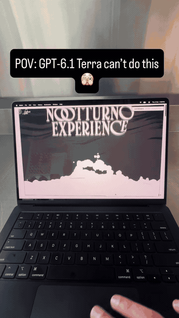

### [JEV Engineering: a stylized multi-agent pipeline FUI dashboard (motion graphic, not a product recording)](https://www.facebook.com/reel/1773060590589981)

A dark sci-fi monitoring dashboard that lays out planner, workers, quality / policy / release gates, and a cost ticker on one screen. This is stylized motion graphics / mock UI, not a real product recording; the tool used to make it is not stated, and the numbers are fake

| Credibility | Stars | Source |
| --- | --- | --- |
| design inspiration · concept animation | — | [Video 75](https://www.facebook.com/reel/1773060590589981) |

~20s vertical Facebook Reel by Moh Moh (2026-11-11; Brian forwarded [this bare share link](https://www.facebook.com/share/v/19SorEAJS6/) via LINE at 20:07 Asia/Taipei on 2026-11-12). The caption is only the line “学了别人看不懂的东西，比Ai还要强” — no tool, product, or URL, and no comment-for-link bait. The clip is a looping dark sci-fi FUI dashboard titled JEV ENGINEERING (subtitle BUILD FABRIC / ENGINEERING SYSTEM), not a recording of a real product. No authoring tool, prompt, or product URL appears. The top stage row is INGEST→PLAN→EXECUTE→VERIFY→GATE→COMMIT (ROUTE / BUILD / VERIFY / RELEASE). Visible panels include AGENT PLANNER, CODE/WORKER, SIMULATION/WORKER, SOURCE/WORKER, QUALITY/EVIDENCE, POLICY/APPROVAL, PACKET MATRIX, RELEASE/GATE, TEST/EXECUTOR, CACHE/MEMORY, BUILD TRACE, and RESOURCE/BUDGET, among others (also REQUEST/INTAKE, INTEGRITY SCAN, AGENT SWARM). Mechanical jellyfish move across the panels (labeled 5 MEDUSA AGENTS), with pixel-style handoff tags. BUILD TRACE scrolls quality/gate-style log lines; the RESOURCE/BUDGET cost figure keeps ticking (sampled frames show roughly $18–$22). The panel itself is labeled USD/DEMO and “simulation demo cost,” so the numbers are fake demo values. A watermark “Xi @Klonzu” appears at the top right; it was not verified as a public product and is not treated as a brand. Takeaway: a layout idea for a multi-agent pipeline monitoring dashboard — planner → workers → quality / policy / release gates, plus a cost tracker. Cross-link: SEQ 0115 (also design-inspiration concept animation, not a tool demo). GIF: 0:08–0:13.

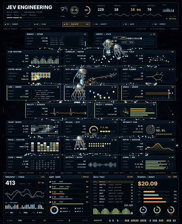

### [Code with Bhurtel: Space-Time Curve (JavaScript softened-gravity grid animation, not an AI tool)](https://www.facebook.com/reel/1140316585123225)

A 3D glowing wireframe grid warped by a star and an orbiting planet, later swallowed by a black hole; the bottom of the frame is a static Carbon-style gravityAt snippet for softened Newtonian acceleration. This is a motion graphic / creative-coding inspiration, not an AI tool, and it does not look like live output of that snippet

| Credibility | Stars | Source |
| --- | --- | --- |
| design inspiration · concept animation | — | [Video 79](https://www.facebook.com/reel/1140316585123225) |

~15s vertical Facebook Reel by Code with Bhurtel (2026-11-11; Brian sent the bare LINE link https://www.facebook.com/share/r/1MDedB26No/ at 08:06 Asia/Taipei on 2026-11-13, which resolves to [this reel](https://www.facebook.com/reel/1140316585123225)). The caption is only “Space Time Curve Using JavaScript!” plus hashtags: no library, tool, or product URL, and not comment-for-link bait. The on-screen title is Space-Time Curve. A glowing 3D wireframe grid is warped by a star and an orbiting planet; a black hole sweeps in at about 0:04 and swallows both by about 0:10. Below is a static Carbon-style JavaScript card (traffic-light window dots) showing gravityAt(bodies, x, z, skip), which computes a softened Newtonian planar acceleration: d2 = dx² + dz² + soften², f = G * mass / (d2 * sqrt(d2)). The snippet never changes, and the animation looks pre-rendered rather than live output of that function; no graphics library is named. This is not an AI-tool video; it is filed as visual / creative-coding inspiration (see also SEQ 0115 and 0120). The takeaway is the softened-gravity formula and the idea of displacing a grid by a gravity potential. three.js would be one way to build that idea, but the video does not show it. No private information is on screen. GIF: 0:08–0:13.

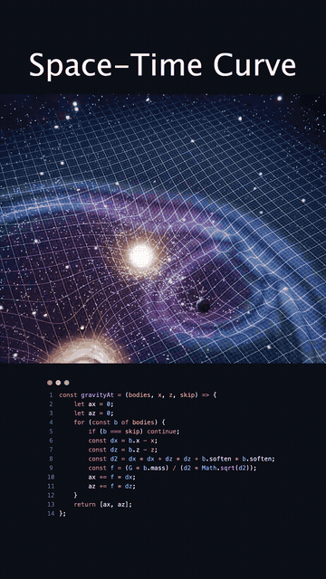

### [Philo: Pixel Plays (Amir Mushich’s five zero-image pixel web games)](https://github.com/amirmushichge/pixel-plays)

Open-source Pixel Plays: five isometric pixel browser games drawn entirely in code. The line count, zero-image and zero-dependency claims, and the MIT code license check out; the music is not under MIT. Claude Opus 5.5 is the author’s account plus unsigned co-author commit trailers

| Credibility | Stars | Source |
| --- | --- | --- |
| high credibility | 463 | [Video 82](https://www.facebook.com/reel/1927405395307821) |

~124s vertical Facebook Reel by 產品經理的背後靈 Philo (AI郵報) (2026-11-11; Brian sent [this reel](https://www.facebook.com/reel/1927405395307821) in chat on 2026-11-13). The clip is a fact-check explainer: public-game captures or excerpts from the author’s X video, with on-screen labels, not a developer walkthrough, and it shows no private IPs or local paths. The caption introduces Amir Mushich’s open-source project Pixel Plays, claims more than 180,000 views on X, and says Claude Opus 5.5 helped make it. It ends by asking people to comment 「遊戲」 so he knows, and to save the post; it does not promise a link or file in return, so no ⚠️.

Verification (2026-11-13, Asia/Taipei, GitHub API and raw files):

- Official repo: [amirmushichge/pixel-plays](https://github.com/amirmushichge/pixel-plays)
- Play: https://pixel-plays-ruby.vercel.app/
- Author’s X post: https://x.com/AmirMushich/status/2116509069477621819 (20:34 Asia/Taipei on 2026-10-31, titled “3D pixel games with Claude Opus 5.5 (OS)”)
- The five games: Balote, Stari Most, Rooftop Laundry, Tie-Break, Mini Ramp
- Line count: the caption says 3,557 lines. Counting newlines: 3,067 in the five game pages (524+655+674+635+579) plus engine.js 343 and shell.js 147 equals 3,557, which matches
- Zero images / zero dependencies: the repo tree has no image files and no package.json; serve.mjs uses only Node built-ins. There are five .mp3 files (generated with Suno); those are not images
- License: LICENSE is MIT, Copyright (c) 2026 Amir Mushich, matching the caption’s “code is MIT.” README and MUSIC.md state that the music is not under MIT and is not licensed for reuse outside this project — a point the caption omits and that should be noted
- Stars: GitHub API that day: 463 stars, 46 forks
- Visual rules match the caption: fixed 30° orthographic view, violet-leaning shadows, warm-yellow highlights, shadows to screen-right, only plants move, 360×280 canvas integer-upscaled. The README also lists further rules (Bayer dither, a depth buffer, and so on)
- Claude: both commits (770640d, 0c2a70f) end with Co-Authored-By: Claude Opus 5.5 and are unsigned; no prompts appear in the repo’s text files. The caption already says Claude’s role comes from the author’s statement and the commit record, with no full prompts to reproduce the work, which matches
- The “180,000+ views” figure is the caption’s claim about that X post; this entry did not re-count views on the X page
- README credits: “Concept by abhi. Game by AmirMushich. Visual reference: shawn.'s Small plays.” “No assets or subjects were copied” is the author’s statement; this entry did not compare the originals

SkillSpector static scan (2026-11-13, Asia/Taipei, skillspector 2.12.0, --no-llm, commit 0c2a70f): this repo is not a skill / MCP package; 0 issues, 0 findings; risk score 0, severity LOW, max_issue_severity NONE; coverage 85.7% (12 of 14 components, status partial). Cross-link SEQ 0106 (another AI-assisted page drawn live in the browser). The reel itself is labeled as having no music (explainer footage). GIF: 0:50–0:55.

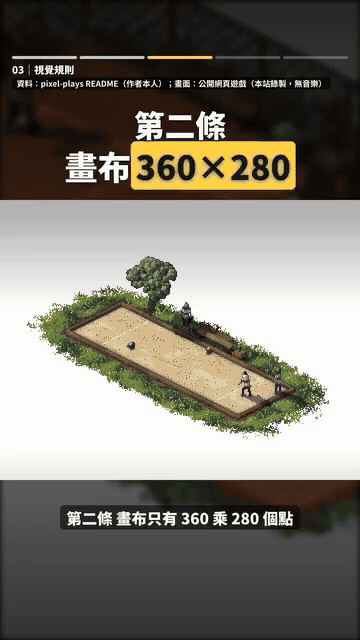

### [HA Bridge: visually design a 3D floor plan and bind Home Assistant entities (official paid dashboard)](https://habridge.cn/)

顏民凱 demonstrates the paid dashboard HA Bridge: drawing a 3D floor plan in the editor, using the official 「栖光」 UI kit, and binding Home Assistant entities onto the dashboard, without writing YAML.

| Credibility | Stars | Source |
| --- | --- | --- |
| high credibility | — | [Video 84](https://www.facebook.com/reel/1885203799120310) |

~104s landscape Facebook Reel by 顏民凱 (2026-09-04; 1624×720; Brian sent [this reel](https://www.facebook.com/reel/1885203799120310) in chat on 2026-11-13). The caption is only one line: 「輕鬆完成戶型圖設計，導入HA實體，終於不用再寫Yaml了」. There is no comment-for-link gate, so this entry is not marked as engagement bait.

The clip is a real product recording, not a motion graphic. It starts on a dashboard preview of an isometric 3D floor plan (tappable light and climate icons), then moves through a lighting overview, HVAC / curtain / washer panels and control popups, into the 「戶型圖繪製」 editor (plan view, furniture library, live 3D preview), and ends on the 「導出 3D 戶型圖」 export dialog. The top bar shows 編輯 / 儀表盤 / 打開 HA / 保存, matching the official “editor basics” toolbar. The left sidebar shows 「UI 方案 栖光」, with an on-screen label 「DWELL LIGHT · 1.0.0」 beside it. Official docs confirm 栖光 is the built-in complete UI kit (pages, widgets, popups, theme, and assets; you then replace entities). The official pages checked for this entry do not name DWELL LIGHT as the English title of 栖光, so that English label is recorded only as on-screen text.

Verification (2026-11-13, Asia/Taipei):

- Product: [HA Bridge](https://habridge.cn/), docs: https://wiki.habridge.cn/
- Official positioning: a self-hosted household dashboard. Home Assistant owns devices and entities; HA Bridge owns the control UI. You can DIY 2D panels in a visual editor, or draw a 3D floor plan and bind entities in a live 3D view
- Officially a paid product; features follow the license, and 3D interaction needs the matching entitlement
- Install as a Home Assistant add-on or standalone Docker; default port 18080 (changeable with APP_PORT)
- Official add-on repo is first on Gitee at https://gitee.com/weidaye1122/ha-bridge-addon, with GitHub backup https://github.com/weidaye1122/ha-bridge-addon; the standalone Docker image is weidaye1122/ha_bridge
- This is not the same project as the similarly named Philips Hue emulator [bwssytems/ha-bridge](https://github.com/bwssytems/ha-bridge)
- “No more YAML” is the uploader’s caption. Official docs describe searching and selecting an entity_id under 關聯實體 in the editor, and they do not require hand-written Lovelace YAML; this entry did not test whether every widget can be used with no YAML at all

The top bar shows a private LAN mid-control address, which this entry does not publish; local paths and a home address are also not copied here. The title on the floor-plan plaque is the uploader’s project, not the product name.

SkillSpector static scan (2026-11-13, Asia/Taipei, skillspector 2.12.0, --no-llm, commit 09b9be5): the scan covered the public add-on pack weidaye1122/ha-bridge-addon, not the closed product image. This repo is not a skill / MCP package; 27 issues (6 HIGH, 21 MEDIUM), all in release/ and tests/ (for example env passing, subprocess, and a directory-delete in candidate.py, verify_addon_upgrade.sh, and test_release_recovery.py); risk score 100, severity CRITICAL, recommendation DO_NOT_INSTALL, max_issue_severity HIGH; coverage 100% (22 / 22 components, status complete). The main application is not in this repo, and its Docker image was not scanned. GitHub API that day: 4 stars on the add-on repo; last push 10:01 Asia/Taipei on 2026-11-10, commit message Add-on 0.8.6-1. Music: not labeled.

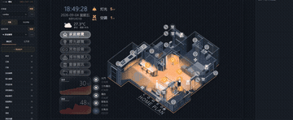
