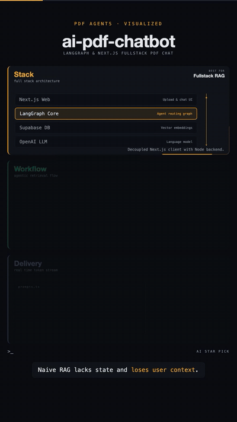
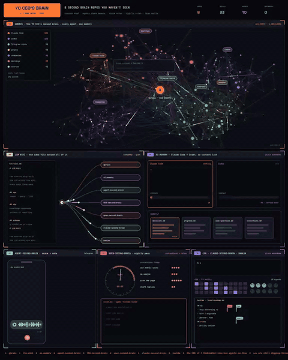
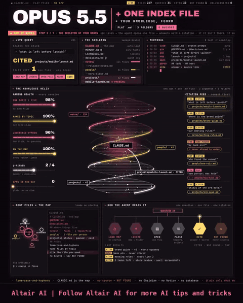
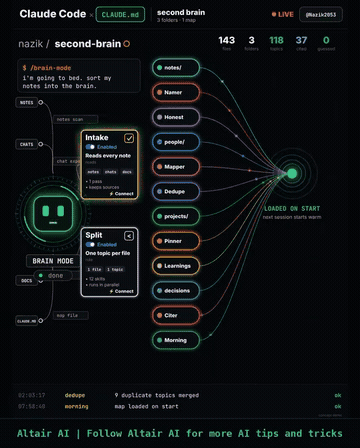
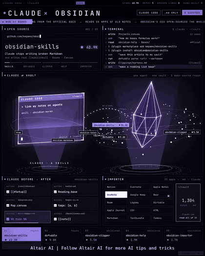

# Memory and context

[中文](../../docs/memory-context.md) | English

[Home](../index.md)

Knowledge graphs, code graphs, long-term memory, handoff across agents

### [Graphify](https://github.com/Graphify-Labs/graphify)

Turn code and documents into a knowledge graph you can query

| Credibility | Stars | Source |
| --- | --- | --- |
| — | 139,236 | [Video 1](https://www.facebook.com/reel/2050168028979180) |

Turns code, documents, and schemas into a knowledge graph you can query

### [ai-memory](https://github.com/akitaonrails/ai-memory)

Long-term memory for an agent CLI, so one agent can hand work to another

| Credibility | Stars | Source |
| --- | --- | --- |
| — | 14,563 | [Video 1](https://www.facebook.com/reel/2050168028979180) |

Long-term memory for an agent CLI, so work can be handed across agents

### [Graphicle](https://github.com/Graphicle-AI/graphicle)

One Rust program that provides both a code graph and memory

| Credibility | Stars | Source |
| --- | --- | --- |
| — | 477 | [Video 1](https://www.facebook.com/reel/2050168028979180) |

A single Rust program that provides both a code graph and memory

### [Hy-Memory](https://github.com/Tencent-Hunyuan/Hy-Memory)

Tencent Hunyuan's agent memory engine, shared across tools

| Credibility | Stars | Source |
| --- | --- | --- |
| — | 1,876 | [Video 1](https://www.facebook.com/reel/2050168028979180) |

Tencent Hunyuan's agent memory engine. Memory is shared across tools

### [CodeGraph](https://github.com/colbymchenry/codegraph)

Index the code into a knowledge graph ahead of time, and give the agent precise context through MCP

| Credibility | Stars | Source |
| --- | --- | --- |
| — | 76.1k | Brian's recommendation list 2026-10-31 |

colbymchenry's local code knowledge graph (Rust core). It indexes functions, classes, call chains, and cross-file relations in advance, and updates when the code changes. An MCP server lets Claude Code, Cursor, Codex, Gemini, Copilot, Grok Build, and others query it directly instead of grepping the whole repo each time. It stays 100% local. Install with `curl -fsSL https://raw.githubusercontent.com/colbymchenry/codegraph/main/install.sh | sh` (or `npm i -g @colbymchenry/codegraph`), then `codegraph install` to attach an agent, and `codegraph init` in each project. MIT. There are many projects with the same name (CodeGraphContext has 4.4k stars, among others). This one has the highest star count.

### [RAG Design Patterns: a chart of 7 RAG architectures](https://www.facebook.com/reel/4570321283241437)

One picture of seven RAG architectures, from basic retrieval to multi-agent collaboration

| Credibility | Stars | Source |
| --- | --- | --- |
| — | — | [Video 21](https://www.facebook.com/reel/4570321283241437) |

A static chart, "RAG Design patterns (You must know in 2026)", made by @MindBoost-Tutorix (YouTube) / @MindBoostTutorix (X) and reshared by Ankur Mishra. (1) Naive RAG (the chart misspells it Native RAG): chunk documents, embed them, store them in a vector database, embed the query, fetch context, send it to the LLM. Fine for a start and for simple Q&A. (2) Retrieve-and-Rerank: after retrieval, a reranker reorders the hits. Use it when recall is enough but the top hits are wrong. (3) Multimodal RAG: chunk and embed images and video too, and hand them to a multimodal LLM. Use it when the data is not only text. (4) Graph RAG: extract entities, have an LLM build a graph, store it, and retrieve over the graph. Use it when the question needs relations across documents. (5) Hybrid RAG: merge vector, keyword, and graph retrieval into one context. Use it when proper nouns, codes, and other exact matches matter. (6) Agentic RAG (Router): an agent decides whether to search and where, and can query the vector store again. Use it when question types vary. (7) Multi-Agent RAG: a lead agent assigns sub-agents (code tools, web search, vector engines A/B, Slack/Gmail). Use it when the task crosses several sources and tools. Small problems in the chart: "Native" is a typo, Hybrid's keyword search is not connected to any index, and the Router cell does not draw data ingest. Drawn by hand, not AI-generated. Music: no narration; generic royalty-free upbeat synth-pop.

### [ai-pdf-chatbot-langchain: a LangGraph PDF Q&A template](https://github.com/mayooear/ai-pdf-chatbot-langchain)

A full-stack PDF Q&A template with LangGraph and Next.js

| Credibility | Stars | Source |
| --- | --- | --- |
| — | 16.6k | [Video 27](https://www.facebook.com/reel/1687227069493469) |

mayooear's monorepo template, also the companion example for O'Reilly's Learning LangChain. A Next.js front end and a Node/TypeScript LangGraph agent. Graph nodes cover ingest, retrieval routing, and the reply. Supabase is the vector store, OpenAI is the LLM, tokens stream, each thread keeps its own history, and LangSmith traces the run. Compared with the RAG chart in Video 21, this is roughly Naive RAG plus a router that decides whether to retrieve. Maintenance: MIT. It is archived on GitHub. The last commit is 2026-03-28 (Taipei time). The README says it is no longer maintained and is only a reference. The video (AI Star Pick) is an architecture animation, not a screen recording. Music: no narration and no music, only UI sounds.

Stack, Workflow, and Delivery light up in order, borders draw on, a node diagram connects step by step, and the bottom caption changes. Recreate it with SVG stroke drawing and staged reveal.

### [gbrain: YC CEO Garry Tan's open-source agent second brain](https://github.com/garrytan/gbrain)

Garry Tan's opinionated OpenClaw/Hermes agent brain; every fact keeps its source

| Credibility | Stars | Source |
| --- | --- | --- |
| concept animation · high credibility | 31.9k | [Video 46](https://x.com/imryven/status/2119433356584604119) |

A 27s X video by Ryven (@imryven): motion graphics with GBRAIN / GARRY TAN and a glowing node network (not a screen recording); no full URL on screen. Caption names gbrain (by garrytan). Verified: https://github.com/garrytan/gbrain exists, MIT, "Garry's Opinionated OpenClaw/Hermes Agent Brain", GitHub API 2026-11-09: 31.9k stars / 4.7k forks, not archived, last push 2026-11-09 (Asia/Taipei). SkillSpector scan pending.

GIF: 0:00–0:02.5, gbrain network animation.

### ⚠️ [Altair AI: Claude Second Brain (Obsidian repo list + plain-Markdown variant)](https://github.com/kepano/obsidian-skills) ⚠️

Several Altair AI motion-graphics / concept-animation clips: an Obsidian repo list, a plain-.md + CLAUDE.md map, and a concept demo that sorts notes into a second brain with one overnight command (none of the clips show working software)

| Credibility | Stars | Source |
| --- | --- | --- |
| ⚠️ engagement bait · concept animation · medium credibility | — | ⚠️ [Video 48](https://www.facebook.com/reel/1666945238466731) ⚠️; [Video 51](https://www.facebook.com/reel/2062559707739569); [X @Flinzu](https://x.com/Flinzu/status/2119892851387769273); [Video 61](https://www.facebook.com/reel/3503498356478626); [Video 77](https://www.facebook.com/reel/1473932208004781) |

Motion graphics (not real recordings). **Video 48**: verified caption matches include kepano/obsidian-skills, AgriciDaniel/claude-obsidian, Astro-Han/karpathy-llm-wiki, undefined-ui/second-brain-os, vouchdev/vouch; other names unverified; comment-the-number CTA. **Video 51** variant: plain `.md` + root `CLAUDE.md` index; folders notes/ people/ projects/; cite source or NOT FOUND. Simulated dashboard only; "247 files / 0 hallucinations" unverified; "OPUS 5.5" unverified (same caution as SEQ 0096). No comment-for-link on Video 51. **X @Flinzu / Video 60**: 25s concept animation (no working software). Plain text files around a map: notes / people / projects, plus MEMORY / LEARNINGS / decisions; load the map first; answers should cite files; Claude will not invent reasons you did not write down. Caption points to @Bober_smart’s guide https://x.com/Bober_smart/status/2078784709253841039. On-screen “OPUS 5.5” unverified (same as SEQ 0096). No comment-for-link. **Video 61**: Facebook Reel by Lê Quốc Nghĩa; also concept animation (no working software): raw/→wiki/, root CLAUDE.md as the map; caption includes a setup prompt. Animation shows reading a people file, a weekly-review skill, remember, and a /doctor prompt audit. No comment-for-link.

**Video 77**: ~30s vertical Facebook Reel by Altair AI (2026-11-06; Brian sent [this share link](https://www.facebook.com/share/v/1A4xaosai3/) directly in chat at 21:28 Asia/Taipei on 2026-11-12). The caption calls it a concept demo, not working software. One command: “I'm going to bed. Sort my notes into the brain.” Pipeline roles: Intake / Split / Mapper / Dedupe / Learnings / Citer / Honest (the UI also shows cards for Namer, Pinner, and Morning). Folders: notes / people / projects / decisions (a dated decision log). Mapper writes a CLAUDE.md map that loads at the start of the next session. Five tips from the caption you can use today: one topic per file, named by content; a CLAUDE.md folder map; cite the source file; allow “not in the files”; pin only two files (for example a memory file and a decisions log). The caption also says /brain-mode, /map, and /pin are custom shortcuts in this concept, not built-in Claude Code commands; you can build your own with skills or custom commands (/brain-mode is visible on screen). End figures — 143 files, 37 cited answers, 0 guesses (the UI also says 3 folders · 1 CLAUDE.md, which does not exactly match the four folder names) — are concept-demo numbers, unverified. “Comment 1, 2 or 3” (which helps most: sorting, the map, or citations) is an interaction question with no link reward, so no new ⚠️; the existing ⚠️ stays because of Video 48’s comment-the-number CTA. The footer Follow Altair AI is an ordinary follow CTA. No private information. GIF (Video 51): 0:03–0:06. GIF (Video 77): 0:24–0:29.

Keep ⚠️ on the title and the Video 48 link only.

### [Lamis Mukta (Anthropic): agent memory from CLAUDE.md to Dreaming](https://x.com/David_eficaz/status/2118745007628726684)

An Anthropic engineer on agent memory: CLAUDE.md → tool memory → skills → a memory/ directory, then async Dreaming consolidation

| Credibility | Stars | Source |
| --- | --- | --- |
| high credibility · caption framing unverified | — | [Video 49](https://x.com/David_eficaz/status/2118745007628726684) |

~31-minute English conference talk by Lamis Mukta (Member of Technical Staff, Anthropic) at AI DevCon by Tessl, shared by David (@David_eficaz). Timecodes: memory evolution CLAUDE.md → tool memory → skills → agent-managed memory/ (03:16); progressive disclosure skills (05:30); concurrency via hashing the memory file before/after edits (10:05); memory permissioning — read-only org knowledge vs read/write scratchpad (11:45); limits of in-band memory updates (14:59); Dreaming — async out-of-band batch consolidation from transcripts (17:49); Dreaming architecture — orchestrator + subagents finding recurring errors (21:27). Quantitative claims (e.g. "97% fewer first pass errors") unverified. The X caption's "Opus 5.5" framing does not appear in the talk — mark caption framing unverified.

### [Altair AI: Obsidian CEO's open-source Claude + Obsidian tools](https://github.com/kepano/defuddle)

A motion-design board of kepano / official Obsidian open-source Claude + Obsidian tools: skills, Defuddle, Clipper, Help, Importer

| Credibility | Stars | Source |
| --- | --- | --- |
| concept animation · high credibility | — (per-repo in body) | [Video 50](https://www.facebook.com/reel/1895633831459873) |

A 25s Facebook Reel by Altair AI (uploaded 2026-11-08): motion graphics (not a real recording), banner "Follow Altair AI". Caption says Obsidian CEO (kepano) open-sourced Claude + Obsidian tools. OPEN SOURCE panel (on-screen / API 2026-11-09): ① [kepano/obsidian-skills](https://github.com/kepano/obsidian-skills) (58.0k / API 51.2k) → already in SEQ 0094/0095, cross-link only; ② [kepano/defuddle](https://github.com/kepano/defuddle) (9.0k / API 9.9k, MIT, page → Markdown); ③ [obsidianmd/obsidian-clipper](https://github.com/obsidianmd/obsidian-clipper) (5.5k / API 5.5k, MIT, official Web Clipper); ④ [obsidianmd/obsidian-help](https://github.com/obsidianmd/obsidian-help) (1.9k / API 2.0k, official help docs); ⑤ [obsidianmd/obsidian-importer](https://github.com/obsidianmd/obsidian-importer) (1.7k / API 1.7k, MIT, Apple Notes/OneNote → Markdown). SkillSpector scan pending.

GIF: 0:01–0:03.5 of the video, OPEN SOURCE tools board (motion graphics).
