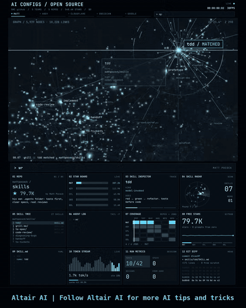
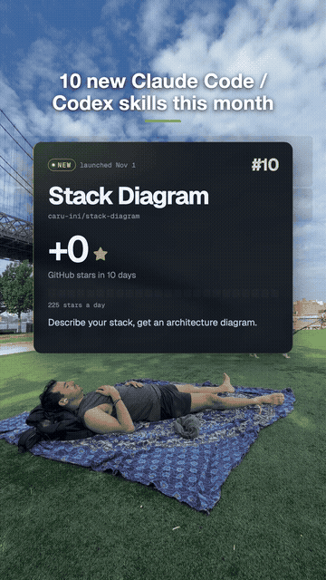
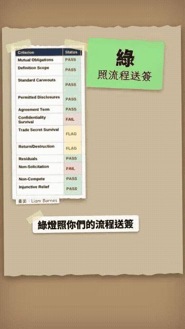

# Skills / MCP / tools

[中文](../../docs/skills-mcp-tools.md) | English

[Home](../index.md)

Shared agent building blocks: MCP, skills, methodology skills, speech, and extraction models

### [earshot](https://github.com/Leonxlnx/earshot)

A tool that lets an agent handle speech locally

| Credibility | Stars | Source |
| --- | --- | --- |
| — | 3,290 | [Video 1](https://www.facebook.com/reel/2050168028979180) |

Lets an agent process speech on the local machine

### [axuse](https://github.com/ctoldigital/axuse)

An MCP tool that drives the browser through the accessibility tree

| Credibility | Stars | Source |
| --- | --- | --- |
| — | 648 | [Video 1](https://www.facebook.com/reel/2050168028979180) |

Operates the browser through the accessibility tree, over MCP

### [imozuru](https://github.com/MaryCache/imozuru)

A Claude Code skill that follows citations back to the original paper

| Credibility | Stars | Source |
| --- | --- | --- |
| — | 1,385 | [Video 1](https://www.facebook.com/reel/2050168028979180) |

A Claude Code skill that traces citations back to the original literature

### [audio-studio-mcp](https://github.com/kanaworksai-hue/audio-studio-mcp)

An MCP tool that generates music and sound effects locally

| Credibility | Stars | Source |
| --- | --- | --- |
| — | 541 | [Video 1](https://www.facebook.com/reel/2050168028979180) |

Generates music and sound effects locally

### [Cloudflare Clairic extraction model](https://blog.cloudflare.com/clairic-extraction-model/)

A Cloudflare model that extracts typed fields in one forward pass

| Credibility | Stars | Source |
| --- | --- | --- |
| — | — | Screenshot (Marc.AI) |

Workers AI preview model @cf/cloudflare/clairic, 2026-10-19. Give it text (up to 4 images) and a field schema, and one forward pass returns typed values. It does not generate tokens. It also returns a confidence score, a null probability, and character positions. $0.10 per million input tokens. Output is not charged. Open weights were previewed. Multi-step math and prediction are still weak.

### [Superpowers](https://github.com/obra/superpowers)

A skill methodology that makes a coding agent clarify the need, write a plan, and use TDD before it edits

| Credibility | Stars | Source |
| --- | --- | --- |
| — | 309.7k | Brian's recommendation list 2026-10-31 |

Jesse Vincent's (obra) agentic skills framework. When an agent starts, it brainstorms and asks until the need is clear, confirms the design in pieces, then writes an implementation plan a newcomer could follow. It stresses red-green TDD, YAGNI, and DRY, and finishes with subagent-driven-development that assigns work item by item and reviews the result. Skills trigger on their own. It supports Claude Code, Codex, Cursor, Gemini CLI, Copilot CLI, Grok Build, and others. Install on Claude Code with `/plugin install superpowers@claude-plugins-official`, and on Cursor with `/add-plugin superpowers`. MIT. By default it loads the site logo to count versions. Turn that off with `SUPERPOWERS_DISABLE_TELEMETRY`.

### [Matt Pocock Skills (Skills For Real Engineers)](https://github.com/mattpocock/skills)

Small engineering skills Matt Pocock uses every day, built around aligning first then coding

| Credibility | Stars | Source |
| --- | --- | --- |
| — | 319.2k | Brian recommendation list 2026-10-31; [Video 47](https://www.facebook.com/reel/1815732602882824) |

TypeScript educator Matt Pocock published the skill set from his own `.agents` directory: small, composable, and not a full process takeover (unlike GSD, BMAD, Spec-Kit). Signature skills `/grill-me` and `/grill-with-docs` make the agent interrogate your requirements first, build a shared ubiquitous language, and write hard decisions as ADRs. Install: Claude Code `claude plugin install mattpocock-skills@claude-plugins-official`; other agents `npx skills@latest add mattpocock/skills`; MIT.

### [Ponytail](https://github.com/DietrichGebert/ponytail)

A skill that makes an agent write less code, like a senior engineer, and reuse what already exists

| Credibility | Stars | Source |
| --- | --- | --- |
| — | 181.2k | Brian's recommendation list 2026-10-31 |

DietrichGebert's "lazy senior engineer" skill. Write only the code the task needs. Prefer components that already exist in the repo. Do not cut validation, error handling, security, or accessibility. It includes /ponytail-review (it also reviews files affected outside the diff) and /ponytail-audit. The README's own test of Ponytail 5 on 39 Claude Code tasks: code −53%, time −41%, cost −26%, tokens −45%, and 98% of high-risk logic has tests (68% with no skill). Those numbers are the author's own test. Install on Claude Code with `/plugin marketplace add DietrichGebert/ponytail` and then `/plugin install ponytail@ponytail`. Other agents can drop it into AGENTS.md. MIT. The author says to install only from this repo or npm `@dietrichgebert/ponytail`. Builds that ship .exe or .dll files are fakes.

### [CLI-Anything: give every piece of software a command line](https://github.com/HKUDS/CLI-Anything)

Automatically generate a command line for professional software, so an AI agent can operate it without clicking the screen

| Credibility | Stars | Source |
| --- | --- | --- |
| — | 57.9k | [Video 26](https://www.facebook.com/reel/1857279712725267) |

An open-source project from HKUDS at the University of Hong Kong (repo blurb: Making ALL Software Agent-Native). It generates a CLI for professional software so an agent uses commands instead of screenshots and clicks. In Claude Code, `/cli-anything <software path or GitHub URL>` runs seven stages: analyze the code, design the CLI, implement it, plan tests, write tests, write test docs, and publish to PyPI. It calls the real software (LibreOffice to PDF, Blender to render) and emits structured JSON. The copy claims 2,000+ tests. CLI-Hub (https://clianything.cc/ ) lets an agent search and install community CLIs (SKILL.md). The video shows a FreeCAD Curiosity-style rover, a Blender orbital relay drone, and a Slay the Spire 2 CLI. The Slay the Spire on screen looks like the first game, not the second, and the demo frames are the polished shots from the README. It is the same direction as this wiki's blender-skills and Spider Walker: give the agent a testable interface to 3D software. Python, Apache-2.0, created 2026-03-08, 5.2k forks. The video is a Traditional Chinese AI voiceover by 小礦工挖挖礦. Music: none.

### [archify: turn an idea or code into an interactive architecture diagram](https://github.com/tt-a1i/archify)

Let an AI agent turn an idea, a plan, or code into an interactive diagram

| Credibility | Stars | Source |
| --- | --- | --- |
| — | 92.0k | Brian's recommendation list 2026-10-31 |

A skill for Claude Code, Codex, and similar agents. It turns an idea, a plan, or a whole codebase into an interactive diagram. Apache-2.0, created 2026-04-15. Site: https://archify.si . From a written recommendation by Brian. No video. Music: not applicable (no video).

### [diagram-design: an editorial-quality diagram skill](https://github.com/cathrynlavery/diagram-design)

Let an AI agent draw magazine-grade HTML and SVG diagrams

| Credibility | Stars | Source |
| --- | --- | --- |
| — | 63.4k | Brian's recommendation list 2026-10-31 |

A diagram skill for Claude Code, Codex, Copilot, Cursor, and similar agents. It produces a standalone HTML file with embedded SVG at editorial quality. MIT. Site: https://diagramdesign.dev . The Chinese fork patrick-xin/diagram-design-zh (https://github.com/patrick-xin/diagram-design-zh , 48 stars) includes CJK typesetting. From a written recommendation by Brian. No video. Music: not applicable (no video).

### [PPT Master: a document or a topic becomes an editable native PPTX (an AI skill pack)](https://github.com/hugohe3/ppt-master)

Give it a PDF, Word, text, or only a topic. The AI makes a real PowerPoint whose text boxes, shapes, and charts can still be edited. It is not a picture.

| Credibility | Stars | Source |
| --- | --- | --- |
| High credibility | 71.6k | [Video 39](https://www.facebook.com/reel/1051071164608370) |

A 1:28 video uploaded by 小礦工挖挖礦. The picture is a recording of the official example site, not a live generation. A skill pack for Claude Code, Cursor, and Codex CLI. Before it generates, it confirms template, aspect ratio, page count, and other specs (only a fast mode skips that). Charts are editable shapes by default. A parameter can switch them to native charts. It adds transitions and animation, and writes the speaker script into the notes. Images come from AI generation or open libraries, and the slide marks the source. It can also apply a company template and keep the original design. The official example site has 72 decks and 1,012 pages, in Chinese, Japanese, Korean, and German. Example repo: https://github.com/hugohe3/ppt-master-examples (22 stars). Requirements: Python 3.10–3.14 and one AI coding assistant. The author says not to expect the first pass to be perfect. You still edit it. Forks worth a look: academic-ppt-master (paper to PPTX) and ppt-master-plus. MIT, created 2025-12-10, last push 2026-10-30. Credibility: high. The star count matches the GitHub API. The end of the video only asks which deck you want to make first. That is a light prompt to comment, not engagement bait. Music: light, playful electronic music (casual-game style). No GIF clip.

### [VibeVoice: Microsoft's open-source speech AI (long-audio ASR, speaker diarization, and realtime TTS)](https://github.com/microsoft/VibeVoice)

Take a recording up to about an hour and emit a transcript of who spoke, at what time, and what they said. It also has realtime speech synthesis that can run in Colab.

| Credibility | Stars | Source |
| --- | --- | --- |
| High credibility | 55.1k | [Video 40](https://www.facebook.com/watch/?v=2181912112534967) |

A 59-second video uploaded by AI懶人報, with an AI Mandarin voiceover. VibeVoice-ASR does not need the long recording cut up first. One pass handles up to about an hour, and it does speaker diarization and timestamps together (who spoke, from which second to which second, and what they said). It supports 50+ languages and hotwords to improve proper nouns (the voiceover says WhyVoice; the correct name is VibeVoice). There is also realtime TTS, with a Colab T4 quickstart notebook. The demo clip is the official demo of Jimmy Fallon and Lady Gaga, with subtitles marking speaker 0 and speaker 1. What used to be ASR plus a separate diarization tool is now one model. MIT, created 2025-08-25, last push 2026-10-08. The video shows 54.9k stars. Credibility: high. It is Microsoft's official repo, and the video matches the README. The end only asks you to follow. There is no funnel. Music: ukulele plus light percussion.

GIF: 0:22.5–0:26 of the video, a speaker-diarization demo.

### ⚠️ [Android phone AI agent (wireless ADB debugging plus Claude Code MCP) | the preview is the alternative mobile-mcp, not the video's repo](https://www.facebook.com/reel/1628595922149351)

It claims "some GitHub repo plus Opus 5.5" can turn any Android phone into a hands-free agent, but the account in the video does not exist. Underneath it is only wireless ADB plus screenshot, tap, and type.

Alternative preview (not the repo in the video): ⚠️ [mobile-next/mobile-mcp](https://github.com/mobile-next/mobile-mcp)

| Credibility | Stars | Source |
| --- | --- | --- |
| ⚠️ engagement bait · claim unverified · low credibility | — (alternative mobile-mcp: 10.2k) | ⚠️ [Video 43](https://www.facebook.com/reel/1628595922149351) |

A 17-second video uploaded by Tauhid IQ, with no narration. The top half is a GitHub page titled "dkrv-dev / Reverse Engineer Phone" (the page shows 17k stars and 2.1k forks). About says "Turn any Android phone into an agent that uses its own apps over Wi-Fi. Say one sentence. Claude taps the rest." The README lists tools/phone.py --probe, tools/agent.sh, and claude mcp add phone tools/venv/bin/python tools/mcp.py. The bottom half is a Windows cmd.exe log, plus a real phone on a desk playing fast, opening Telegram and then the ChatGPT page on the Play Store. The English steps: phone and laptop on the same Wi-Fi, turn on wireless debugging in developer options, paste the repo and a screenshot of About phone plus a prompt into Claude Code, Opus "finds a vulnerability" (it is really ADB over the network), probe model, version, and installed apps and save a restore point, write an agent with only 3 tools (see the screen, tap, type), add it to Claude Code as MCP, press Allow once, and say "open Telegram and install ChatGPT". It also claims 40 brands, 300+ models, and no root. The ending says "Find GitHub repo + full prompt below" and does not give a repo. Check: ⚠️ https://github.com/dkrv-dev returns 404 (the account does not exist), and a GitHub API search does not find this repo. A GitHub repo name also cannot contain a space, so the page is likely a fake screen or has been deleted. Opus 5.5 is only the model named in the copy. This entry does not judge that. Credibility: low. The repo cannot be found, the numbers cannot be checked, and the "repo and full prompt below" line plus the exaggerated tone is engagement bait. The technique itself is real and ordinary: adb connect over Wi-Fi, then screenshot, tap, and type. That is the standard way to operate a phone. A usable alternative (not the repo in the video): mobile-next/mobile-mcp (⚠️ https://github.com/mobile-next/mobile-mcp), 10,198 stars, Apache-2.0, an MCP server for emulators and real devices, and it can attach to Claude Code, Codex, and Cursor. Music: phonk / electronic.

GIF: 0:02–0:06 of the video, the terminal log and the phone operating itself (sped up).

### ⚠️ [Scrapling: a Python web-scraping framework (stealth browser + MCP)](https://github.com/D4Vinci/Scrapling) ⚠️

A Python scraping framework with stealth browser, proxy rotation, CSS/XPath, Markdown output for AI agents, and MCP

| Credibility | Stars | Source |
| --- | --- | --- |
| ⚠️ engagement bait · medium credibility | 100.2k | ⚠️ [Video 45](https://www.facebook.com/reel/2088263658998884) ⚠️ |

A 1:26 Traditional Chinese Facebook Reel by 小礦工挖挖礦. Footage is slide/motion-design styled as a GitHub UI (not a real screen recording), showing about 97.1k stars and 10.2k forks. Introduces Scrapling: fast requests, stealth browser, CSS/XPath, whole-site crawls (throttling, pause/resume, proxy rotation), JSON/CSV export, one-line Markdown for AI, and an MCP server for Claude/Cursor-class agents. Cloudflare-bypass claim unverified. Verified repo: ⚠️ [https://github.com/D4Vinci/Scrapling](https://github.com/D4Vinci/Scrapling) ⚠️ , BSD-3-Clause, created 2024-10-13, GitHub API 2026-11-09: 100.2k stars / 10.5k forks, not archived, last push 2026-11-09 (Asia/Taipei). Docs: ⚠️ [https://scrapling.readthedocs.io/en/latest/](https://scrapling.readthedocs.io/en/latest/) ⚠️ . CTA asks viewers to comment 「爬蟲」 for a DM link (engagement bait); the repo itself is public. SkillSpector scan pending (no clone; URL mode blocked by SSRF).

### [Altair AI: five public agent skill / config repos](https://github.com/addyosmani/agent-skills)

Motion-design board of five public skill/config repos: Matt Pocock, Addy Osmani, Cloudflare, Obsidian CEO, Google

| Credibility | Stars | Source |
| --- | --- | --- |
| concept animation · high credibility | — | [Video 47](https://www.facebook.com/reel/1815732602882824) |

A 21s Facebook Reel by Altair AI: motion-design skill board (not a real recording), banner "Follow Altair AI". Five repos (on-screen / caption vs API 2026-11-09): ① [mattpocock/skills](https://github.com/mattpocock/skills) (295.8K / 318K / API 319.2k) → already SEQ 0058, source only; ② [addyosmani/agent-skills](https://github.com/addyosmani/agent-skills) (86.9K / 92K / API 114.3k, MIT); ③ [cloudflare/security-audit-skill](https://github.com/cloudflare/security-audit-skill) (63.9K / API 67.5k, MIT); ④ [kepano/obsidian-skills](https://github.com/kepano/obsidian-skills) (58.0K / 51K / API 51.2k, MIT; cross-ref Video 48); ⑤ [google/elephant-goldfish-model](https://github.com/google/elephant-goldfish-model) (13.4K / 14.8K / API 15.9k, Apache-2.0). SkillSpector scan pending.

GIF: 0:00–0:02 of the video, Altair AI skill board (motion graphics).

### [Cangjie Skill 2.0 (cangjie-skill): distill long videos/courses/podcasts into Agent Skills](https://github.com/kangarooking/cangjie-skill)

Distills text from long videos, courses, podcasts, and books into callable Agent Skills (steps, frameworks, safety boundaries); pair with the video-downloader skill for download + transcription first

| Credibility | Stars | Source |
| --- | --- | --- |
| claim unverified · medium credibility | 12.5k | [Video 53](https://www.facebook.com/reel/1308612614774010) |

3:15 Facebook Reel by 一人公司研究所 (source: Bilibili AI袋鼠帝 / kangarooking). Tool: kangarooking/cangjie-skill (on-screen “倉頡 SKILL 2.0”; README badge 2.5.0) plus companion [video-downloader](https://github.com/kangarooking/kangarooking-skills/tree/main/video-downloader). Pipeline: video link → download → extract audio → speech-to-text → cangjie-skill distills **text** into reusable Agent Skills. This is text distillation, **not** multimodal frame/visual analysis — the Facebook caption’s multimodal claim is wrong. Demo stack: Longcat-2.0 + Claude Code. Claims (stock footage only, **unverified**): Andrew Ng 2026 course 26 videos / 4h+ → ~25 skills in ~1h; 4 YouTube videos 80+ min → 8 skills. No engagement bait; no install commands shown. GitHub API 2026-11-10 (Asia/Taipei): MIT, 12,523 stars / 1,481 forks, created 2026-04-16, last push 2026-10-02 11:17 Asia/Taipei; parent kangarooking-skills 715 stars, no license field, last push 2026-11-04. Cross-links: SEQ 0095, 0057, 0058, 0094. SkillSpector pending (no clone this batch).

### ⚠️ [Broch Builds: 10 new Claude Code / Codex skills](https://github.com/heydamir/unslop) ⚠️

A short list of design/animation skill repos; the end asks you to comment SKILLS for a 320-item list

| Credibility | Stars | Source |
| --- | --- | --- |
| ⚠️ engagement bait · medium credibility | 14.2k | ⚠️ [Video 63](https://www.facebook.com/reel/1439815074924674) ⚠️ |

~12s Facebook Reel by Broch Builds (2026-11-11). Caption: comment SKILLS to receive a “320-item list ranked by GitHub stars, with install commands” — engagement bait. Repos named on screen, checked via GitHub API 2026-11-11 (Asia/Taipei): present — ⚠️ [caru-ini/stack-diagram](https://github.com/caru-ini/stack-diagram) ⚠️ (2,345★, MIT, last push 2026-11-09 14:00 Asia/Taipei); ⚠️ [elvarofficial/teardown](https://github.com/elvarofficial/teardown) ⚠️ (3,076, MIT, 2026-10-31 22:01); ⚠️ [t3dotgg/tstack](https://github.com/t3dotgg/tstack) ⚠️ (3,469, MIT, 2026-11-11 19:33); ⚠️ [heydamir/unslop](https://github.com/heydamir/unslop) ⚠️ (14,232, CC-BY-4.0, 2026-11-09 05:18; on-screen “#1, +13,630” delta **unverified**). On-screen path mromdev/claude-animated-shorts is 404; the one-letter typo that exists is ⚠️ [mromidev/claude-animated-shorts](https://github.com/mromidev/claude-animated-shorts) ⚠️ (2,867, MIT, 2026-11-01 13:57). benjitaylor/stageshow and haydenchetty/floorplan are 404; no substitutes guessed. #4 Earshot, #3 Rea-Video, #2 PixelFX had no repo path (Earshot is already SEQ 0011; owners not guessed). SkillSpector pending. GIF: 0:00–0:10.

### [AI懶人報: Anthropic official legal plugins (triage-nda / review-contract / legal-risk-assessment / claude-for-legal)](https://github.com/anthropics/knowledge-work-plugins)

A walkthrough of Anthropic’s official legal plugins: the legal folder in knowledge-work-plugins, and the practice-area plugins in claude-for-legal. The defaults follow US law and US practice; Taiwan matters should still be reviewed by a lawyer.

| Credibility | Stars | Source |
| --- | --- | --- |
| high credibility | 35,612 / 9,992 | [Video 89](https://www.facebook.com/reel/2280311616036852) |

~95s vertical Facebook Reel by AI懶人報 (2026-11-13; 360×640; Brian sent [this reel](https://www.facebook.com/reel/2280311616036852) in chat on 2026-11-13). The caption covers four pieces: triage-nda sorts an NDA into green / yellow / red; review-contract first asks which side you are on, then flags clauses and offers rewrite language for red and yellow items; legal-risk-assessment scores severity times likelihood; claude-for-legal has 12 practice-area plugins, and the commercial one can list contracts with cancellation notice due in 90 days. It also says you need a paid Claude plan (desktop Cowork or Claude Code). The caption notes that these plugins are written against US law and US practice by default, so Taiwan legal questions and documents to sign still need a lawyer. The risk memo and renewal-list segments are marked as illustrations. The closing “follow @ai.lanrenbao” is an ordinary follow CTA, not a comment-for-link gate, so this entry is not marked as engagement bait.

Verification (2026-11-13, Asia/Taipei):

- Both official repos exist, and both are licensed [Apache 2.0](https://github.com/anthropics/knowledge-work-plugins): [anthropics/knowledge-work-plugins](https://github.com/anthropics/knowledge-work-plugins) and [anthropics/claude-for-legal](https://github.com/anthropics/claude-for-legal)
- knowledge-work-plugins is officially a plugin set for knowledge workers, intended mainly for Claude Cowork and also compatible with Claude Code; the legal folder is present. GitHub API that day: 35,612 stars (the on-screen 34.6k is stale); last push 10:09 Asia/Taipei on 2026-11-13; scanned commit 02717ef
- The legal/skills directory contains folders named triage-nda, review-contract, and legal-risk-assessment, so those three names are real; it also has brief, compliance-check, legal-response, meeting-briefing, signature-request, and vendor-check. The skill table in legal/README still uses older names such as contract-review and nda-triage, which do not fully match the current folder names
- That README’s disclaimer says the plugin assists legal workflows but does not provide legal advice, and that AI analysis should be reviewed by a qualified lawyer before it is relied on for legal decisions. Default playbook examples reflect US legal positions and jurisdictions such as Delaware, New York, and California; if you operate under other legal systems (the README gives the EU and UK as examples), you must customize the playbook before relying on the analysis
- claude-for-legal is officially a suite of plugins for legal workflows. GitHub API that day: 9,992 stars (the on-screen “over 9,800” / 9.9k is close). The scanned commit is 4a6c651 (the tip of main in the shallow clone; the repo’s updated_at is newer and may reflect other activity)
- marketplace.json lists 13 plugins: 12 first-party practice-area plugins (commercial-legal, privacy-legal, product-legal, corporate-legal, employment-legal, regulatory-legal, ai-governance-legal, litigation-legal, law-student, legal-clinic, legal-builder-hub, ip-legal), plus the partner plugin cocounsel-legal maintained by Thomson Reuters. The caption’s “12 practice-area plugins” matches the first-party count
- The official README says they can be installed as Claude Cowork or Claude Code plugins, or deployed through the Claude Managed Agents API
- commercial-legal does include a renewal-tracker skill whose default window is cancel-by deadlines in the next 90 days (red 0–13 days, orange 14–44, yellow 45–89), matching the on-screen command text. That segment is marked as an illustration, so this entry treats the on-screen list as a demo and does not treat the dates in the clip as a real matter
- The official README also stresses that every output is a draft for attorney review — not legal advice, not a legal conclusion, and not a substitute for a lawyer
- On “you need a paid Claude plan”: the official Cowork product page says “Claude Cowork is now just Claude,” rolling out to Pro, Max, and Ultra, with more plans to follow. The plugin docs name Cowork or Claude Code as the intended surfaces (claude-for-legal also supports the Managed Agents API). This entry did not check every Claude plan tier for installability

SkillSpector static scan (2026-11-13, Asia/Taipei, skillspector 2.12.0, --no-llm):

- A scan of the entire knowledge-work-plugins repo (the marketplace contains many plugins) hit the 300-second timeout and produced no complete JSON. The legal plugin pack alone was scanned instead: 1 issue (1 HIGH, in README.md, rule Anti-Refusal Statement); risk score 20, severity LOW, recommendation SAFE, max_issue_severity HIGH; coverage 100% (14 / 14 components, status complete)
- The whole claude-for-legal repo: 233 issues (22 HIGH, 207 MEDIUM, 4 LOW); risk score 100, severity CRITICAL, recommendation DO_NOT_INSTALL, max_issue_severity HIGH; coverage 98.7% (311 / 315 components, status partial)
- This is a rule- and pattern-based scan, not a confirmed product compromise; many hits are in skill-instruction wording and MCP config files

Music: not labeled.

