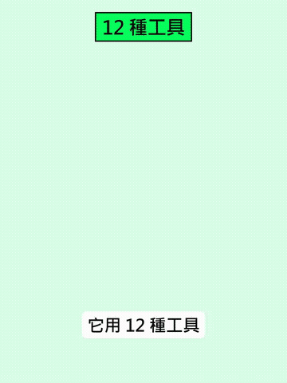

# Talks

[中文](../../docs/talks.md) | English

[Home](../index.md)

Talks and podcast clips: first-hand comments from AI leaders and practitioners

### [Sam Altman: the letdown after a new model solves research problems in a row (Cheeky Pint)](https://www.facebook.com/reel/1167964102224005)

Sam Altman on a new model solving hard research problems one after another, and feeling a loss along with the excitement

| Credibility | Stars | Source |
| --- | --- | --- |
| — | — | [Video 17](https://www.facebook.com/reel/1167964102224005) |

A clip from the podcast Cheeky Pint, edited by Uncle Investment Note (watermark Source: Cheeky Pint; a bar, two people talking over beer). Altman says that one weekend he got a new model, the internal channel was named "model name - hold my beer", and people threw it the hardest research problems of their academic careers. In many fields it solved them one after another. He was so excited he barely slept for two nights, but he also felt more loss than he expected, as if something were ending. He thinks this is right for the world, a direction nobody can or should stop. The host calls it wistfulness. Altman answers that it is more than nostalgia. The clip never names the model. The first half of the subtitles is translated correctly. It is a real edited recording, not AI-generated. Music: none, only conversation.

### [Claude Science: scorpion-toxin protein binders (318,484 designs, 211 lab-tested)](https://www.anthropic.com/research/claude-scorpion-toxin-binder-design)

Anthropic published a Claude experiment designing scorpion-toxin binders: 211 tested, 17 passed (~8%); the official write-up says neutralization has not been shown

| Credibility | Stars | Source |
| --- | --- | --- |
| high credibility | — | [Video 62](https://www.facebook.com/reel/1119597340441398) |

~1:22 Facebook Reel by 小礦工挖挖礦 (2026-10-23). Checked against the [official post](https://www.anthropic.com/research/claude-scorpion-toxin-binder-design) and [technical report PDF](https://www-cdn.anthropic.com/31ac578806cffd8b3d92d8affe6edc4c04d502e1.pdf) (2026-10-20): from an initial prompt plus four follow-ups, Claude produced 318,484 designs against five sodium-channel toxins; it chose 180 and the team added 31, so 211 were tested at Adaptyv Bio and Twist Bioscience; 17 met the binding bar (~8%); 7 for Cn2, 0 for Ts1. The report says the tightest, Cn2-B1, is single-digit nM or better; the narration also mentions B2, whose affinity was not independently confirmed here (**unverified**). About the first 24 hours ran autonomously; 64 hours to the final list. Prompt co-developed with Citrini Research. Official text is clear that neutralization has not been tested in functional or in-vivo assays — binding only, on recombinant toxins, not an antidote claim. Data: [Hugging Face](https://huggingface.co/datasets/Anthropic/scorpion-toxin-binder-design). Narration mentions only SPR; the report says SPR was the main screen at both labs, some Adaptyv replicates used biolayer interferometry (BLI), and both labs ran reverse BLI (Twist: Cn2, Ts1, AaH II, AaH I). Closing question only (“is the harder part design or the lab?”); no comment-for-link.

