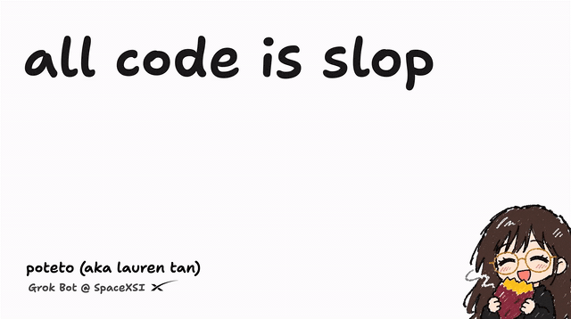

# Talks

[中文](../../docs/talks.md) | English

[Home](../index.md)

Talks and podcast clips: first-hand comments from AI leaders and practitioners

### [Sam Altman: the letdown after a new model solves research problems in a row (Cheeky Pint)](https://www.facebook.com/reel/1167964102224005)

Sam Altman on a new model solving hard research problems one after another, and feeling a loss along with the excitement

| Credibility | Stars | Source |
| --- | --- | --- |
| — | — | [Video 17](https://www.facebook.com/reel/1167964102224005) |

A clip from the podcast Cheeky Pint, edited by Uncle Investment Note (watermark Source: Cheeky Pint; a bar, two people talking over beer). Altman says that one weekend he got a new model, the internal channel was named "model name - hold my beer", and people threw it the hardest research problems of their academic careers. In many fields it solved them one after another. He was so excited he barely slept for two nights, but he also felt more loss than he expected, as if something were ending. He thinks this is right for the world, a direction nobody can or should stop. The host calls it wistfulness. Altman answers that it is more than nostalgia. The clip never names the model. The first half of the subtitles is translated correctly. It is a real edited recording, not AI-generated. Music: none, only conversation.

#### Chapter key points and timeline

This entry is a short Facebook clip, not the full episode. The official show is Cheeky Pint episode 39, “Why Sam Altman is against a single superintelligence” (2026-10-29, host John Collison): [episode page](https://cheekypint.transistor.fm/39). The official transcript is on [the episode transcript page](https://cheekypint.transistor.fm/39/transcript). The full verbatim text is kept only in the private vault and is not copied here.

- The clip is Altman’s account of a weekend with a new model (in the official chapter list, the Math section starts at **15:47**, and this passage comes after that). An internal channel was named “Model Name-Hold My Beer.” People threw their hardest research problems at it, and it knocked them down one after another across many fields.
- He says he was up most of two nights from excitement, but also felt more sadness and a sense of something ending than he expected. The host calls it wistfulness or nostalgia; he says it is more than nostalgia.
- The clip does not name the model. The official episode also covers PHP week, sandboxing, agent swarms, and other topics that are outside this clip; see the official episode page rather than expanding them here.

### [Claude Science: scorpion-toxin protein binders (318,484 designs, 211 lab-tested)](https://www.anthropic.com/research/claude-scorpion-toxin-binder-design)

Anthropic published a Claude experiment designing scorpion-toxin binders: 211 tested, 17 passed (~8%); the official write-up says neutralization has not been shown

| Credibility | Stars | Source |
| --- | --- | --- |
| high credibility | — | [Video 62](https://www.facebook.com/reel/1119597340441398) |

~1:22 Facebook Reel by 小礦工挖挖礦 (2026-10-23). Checked against the [official post](https://www.anthropic.com/research/claude-scorpion-toxin-binder-design) and [technical report PDF](https://www-cdn.anthropic.com/31ac578806cffd8b3d92d8affe6edc4c04d502e1.pdf) (2026-10-20): from an initial prompt plus four follow-ups, Claude produced 318,484 designs against five sodium-channel toxins; it chose 180 and the team added 31, so 211 were tested at Adaptyv Bio and Twist Bioscience; 17 met the binding bar (~8%); 7 for Cn2, 0 for Ts1. The report says the tightest, Cn2-B1, is single-digit nM or better; the narration also mentions B2, whose affinity was not independently confirmed here (**unverified**). About the first 24 hours ran autonomously; 64 hours to the final list. Prompt co-developed with Citrini Research. Official text is clear that neutralization has not been tested in functional or in-vivo assays — binding only, on recombinant toxins, not an antidote claim. Data: [Hugging Face](https://huggingface.co/datasets/Anthropic/scorpion-toxin-binder-design). Narration mentions only SPR; the report says SPR was the main screen at both labs, some Adaptyv replicates used biolayer interferometry (BLI), and both labs ran reverse BLI (Twist: Cn2, Ts1, AaH II, AaH I). Closing question only (“is the harder part design or the lab?”); no comment-for-link.

### 0144　Lauren Tan (poteto): All Code Is Slop (Except Mine) (AI Engineer CODE 2026)

When an agent repeats a mistake, put the fix in the codebase, the API, and executable checks, not in more AGENTS.md. The inverted pyramid, top to bottom, is codebase, static analysis, verification, prose, and human review. Figures are speaker- or team-reported and unaudited. Source: Video 100.

An approximately 17-minute 31-second talk by Lauren Tan (poteto) at AI Engineer CODE 2026 (1920×1080; the timestamp in info.json is 1794681009, which is 2026-11-14 18:30:09 UTC / 2026-11-15 02:30:09 Asia/Taipei; the upload_date field is 20261114, the UTC date). It was uploaded on the AI Engineer YouTube channel under the title All Code Is Slop (Except Mine) — Lauren Tan, SpaceXSI. Brian forwarded https://youtu.be/O_zcc6Xl12g?si=8TX1iOUw2cJrOI51 via LINE at 07:49 Asia/Taipei on 2026-11-16 (canonical URL https://www.youtube.com/watch?v=O_zcc6Xl12g). Official page: https://ai.engineer/code/2026/talks/lauren-tan . The post does not ask anyone to comment a keyword to get something, so this entry is not marked as gated bait. The speaker is an engineer at SpaceXSI, on the Grok Bot team, and a core contributor to the React compiler (public handle @poteto). She introduces herself as poteto, working on Grok Bot at SpaceXSI. The thesis is that you can raise output a lot while holding or even improving quality, and that trust comes from investing in the agent’s environment, not from blind trust. When an agent repeats the same mistake, put the fix in the codebase, the API design, or an executable check (lints, tests, verification), not in another paragraph of AGENTS.md or a comment. She uses an inverted pyramid (the poteto pyramid) to show where to spend time, with a downward cost arrow. From top (wide, cheaper) to bottom (narrow, more expensive) the layers are: codebase (good API design, architecture, refactoring); static analysis (lints, types, compilers, tests, CI); verification (formal and runtime); prose (rules, skills, AGENTS.md); and human review. Examples include the internal Dune framework (not public; she describes it as something like Next.js for Electron apps, packed with enforceable constraints); turning comments into lint rules that point at the root cause, and restricting the large majority of comments because they go stale and cannot be enforced; runtime feature maps plus reusable CLIs; formal methods with TLA+ for major flows such as notifications across devices, and Lean for some algorithms (she calls this experimental, not a silver bullet); and property-based UI testing with the open-source library Bombadil (https://github.com/antithesishq/bombadil ; prep notes on 2026-11-16: 1,970 stars, MIT). She quotes Cindy Sridharan (as shown in the talk; this entry does not independently re-verify the posts): about six months earlier Cindy wrote that subtle bugs being merged made agents hard to trust, and that verification was what was missing; six months later Cindy said about 70% of her daily tokens go to verification. The speaker says that tracks with what she sees, and that agents have lowered the cost of testing and verification. That is her retelling of the quotation, not an independent check by this entry. All of the figures are speaker- or team-reported, unaudited here, and should not be mixed across different definitions: she says she personally shipped 3,000 PRs last month; the team slide says the Grok Bot team merged 10,926 PRs in October (she says about 11,000 out loud), with a June–October total of 23,370; she also mentions about 227 people who contributed at least one PR in October, and a new stable desktop build about once a day. The revert-rate slide is labeled as the percentage of commits reverted (0.47% in October; June–October: 0.98%, 0.61%, 0.47%, 0.48%, 0.47%). Spoken, she says about 0.5% of PRs. She also says Grok Bot, still an Electron app, is faster than at launch on startup, typing, opening new chats, and switching chats; that too is a speaker claim. Near the end she pitches Grok Bot as an outer loop: connectors and routines can start Cursor, cloud agents, and projects, to orchestrate hundreds or even thousands of agents; and she says each release automatically starts a Cursor project that exercises the app, then opens fix PRs and auto-merges them. That is the speaker’s account of their own process. This entry is not a how-to, and the GIF omits the related thread screens. pstack is her plugin under cursor/plugins (https://github.com/cursor/plugins/tree/main/pstack ), MIT, Copyright (c) 2026 Lauren Tan, version v0.15.42. The parent repo cursor/plugins had 16,437 stars in the prep snapshot; that figure belongs to the whole plugins repo and should not be counted as pstack’s own star count. SkillSpector static scan (07:55 Taipei time on 2026-11-16; report timestamp 2026-11-15 23:55:20 UTC; skillspector 2.12.0, --no-llm; scanned path pstack, commit bf0c7cd): score 100, severity CRITICAL, recommendation DO_NOT_INSTALL; 198 issues (20 HIGH: 5 TM1, 4 MP3, 4 P6, 3 RA1, 2 TM2, 1 SC2, 1 YR4; 176 MEDIUM, including 169 AS3 skill-enumeration hits; 2 LOW). Most of those are pattern noise. This is a rules-and-pattern scan, not confirmed proof of a vulnerability or an exploit. Review it before installing. Interactive recreation: https://wiki.singularityengine.dev/demos/poteto-trust-pyramid/ (a five-layer clickable inverted pyramid with a downward cost arrow, using examples from the talk; this is not a product and it does not go online). Music: live talk and applause; no title given. GIF: 0:28–0:32 title slide, 0:02:06–0:02:11 the pyramid, 0:13:34–0:13:39 the team PR chart (cropped to the slide area, omitting the speaker name bar; https://wiki.singularityengine.dev/assets/gifs/v94-poteto-trust-pyramid.gif).

Interactive demo: [poteto-trust-pyramid](https://wiki.singularityengine.dev/demos/poteto-trust-pyramid/)

#### Chapter key points and timeline

Watch the original: [YouTube](https://www.youtube.com/watch?v=O_zcc6Xl12g). Timecodes follow that upload. These are key points, not a transcript; the full verbatim transcript is kept only in the private vault. Figures are speaker- or team-reported and unaudited.

- **00:14** She introduces herself as poteto, working on Grok Bot at SpaceXSI, and says you can turn work that looks like slop into something you can trust.
- **00:42** She says she shipped 3,000 PRs to production last month (unaudited). The thesis is that you can raise output a lot while holding or even improving quality. Trust comes from investing in the agent’s environment, not from blind trust.
- **02:03** The inverted pyramid (the poteto pyramid): start with the codebase and static analysis (cheaper, deterministic), then verification, and only then prose (rules, skills, AGENTS.md).
- **02:55** When you correct an agent, put the check in code rather than adding another line to AGENTS.md. She likens the codebase to a garden: a messy environment gets copied as if it were the established pattern.
- **05:00** Example: the internal Dune framework (she describes it as something like Next.js for Electron apps, packed with constraints). One lesson is to restrict APIs that are easy to misuse in product code, and to split Electron’s main and renderer with directory conventions and forbidden cross-layer imports.
- **08:12** They restrict the large majority of comments because they go stale and cannot be enforced, and replace them with lint rules that point at the root cause.
- **09:40** Verification: runtime checks (including a feature map and reusable CLIs), TLA+ for major flows, Lean for some algorithms (she calls this experimental), and property-based UI testing with Bombadil.
- **11:52** She retells Cindy Sridharan: about six months earlier, subtle bugs being merged made agents hard to trust, and verification was missing; later Cindy said about 70% of her daily tokens go to verification. That is the speaker’s retelling, not an independent check.
- **13:05** The StateChart skill in pstack (PotatoStack) is used to visualize state machines from the user’s point of view. For the license and the SkillSpector scan, see the rest of this entry.
- **13:36** Team figures (speaker- or slide-reported, unaudited): she says about 11,000 PRs out loud (the slide says 10,926); a new stable client about once a day; about 227 people contributed at least one PR in October; revert rate spoken as about 0.5%. She also says Grok Bot is faster than at launch on startup, typing, opening new chats, and switching chats.
- **15:56** Outer-loop example: Grok Bot connectors and routines can start Cursor, cloud agents, and projects; she says a release automatically starts a project that exercises the app, then opens fix PRs and auto-merges them. That is her account of their own process, not a how-to.

### 0149　Matt Pocock live with Lauren Tan (poteto): the trust ladder, the Michelin kitchen, and inner/outer agent loops (a Facebook repost)

An approximately 65-minute live conversation between Matt Pocock and Lauren Tan: the trust ladder, the Michelin-kitchen metaphor, and connecting an outer loop of routines to inner-loop coordinator agents. Figures are speaker- or host-reported and unaudited. See also SEQ 0144. Source: Video 105.

| Confidence | Stars | Source |
| --- | --- | --- |
| Speaker-reported figures, unaudited | — | [Video 105](https://www.facebook.com/reel/4411053492371686) |

A live conversation on Matt Pocock’s own YouTube channel (official title LIVE: Poteto (creator of pstack) on shipping 1,000's of PR's a month at SpaceX; canonical [https://www.youtube.com/watch?v=MN9dGgmLyso](https://www.youtube.com/watch?v=MN9dGgmLyso); channel [Matt Pocock](https://www.youtube.com/@mattpocockuk)). The timestamp in the official info.json is 1791004092, which is 2026-10-03 05:08:12 UTC / 2026-10-03 13:08:12 Asia/Taipei. Official runtime is about 1 hour 5 minutes 36 seconds (3,936 seconds) at 1920×1080. What Brian sent in chat on 2026-11-16 is a Facebook repost, [https://www.facebook.com/reel/4411053492371686](https://www.facebook.com/reel/4411053492371686), uploaded by Việt Nguyễn AI (2026-11-12 16:00:01 Asia/Taipei; about 1 hour 5 minutes 01 second, 1920×1080). The repost is about 35 seconds shorter than the official video: it starts at the speaker’s “Thanks for having me,” which lines up with about 0:36 on the official upload, and it still reaches “Let's do it. Part two.” at the end. The post does not ask anyone to comment a keyword to get something, so this entry is not marked as gated bait. This is a 2026-10-03 live Q&A, not the later AI Engineer CODE 2026 talk filed as SEQ 0144. The themes overlap (trust, environment, pstack, Grok Bot, the outer loop), but the host, the length, the event, and the figures are different, so this is a new entry, with a cross-reference to SEQ 0144. The Facebook caption talks about 30-plus agents at once, 1,000 PRs a month, and 20 PRs already waiting on waking; that does not match this conversation, and this entry does not treat the caption as a source. The on-screen logo and SEQ 0144 both use SpaceXSI. The speaker says “Cursor which is now SpaceX AI” out loud; this entry does not treat that wording as the official name. She says she had previously been on the React team at Meta and joined Cursor in March, and she draws on time leading a team at Netflix for the phrase “context not control” (give context, instead of driving the outcome by micromanagement). The host opens by saying she had given a talk about ten days earlier and had posted on X about “2,500 PRs last month to production,” which he says got about 3 million views. That is the host’s retelling, unaudited here, and this entry does not automatically identify that post with some other appearance. In this conversation she refers to 2,000 or 2,500 PRs, and later clarifies that they are clearly not 2,500 features: much of the work is gardening (tending the environment so both the team and the agents can work well). Those figures are speaker- or host-reported on the day, unaudited, and should not be mixed with the later SEQ 0144 talk’s figures (3,000 personal PRs, 10,926 at the team, and so on). The through-line is a trust ladder: she says the climb started even before she joined Cursor, when (around January or February) she was spending a lot of time micromanaging a single agent; the kitchen and the tools have to be in place before you add more agents. She does not much like the phrase “software factory,” because it can sound as if quality and craft do not matter, and prefers a Michelin-kitchen metaphor: from a home cook who does every bit of prep, to splitting work among a few helpers, to a chef who organizes the kitchen and is still responsible for the plate. On scaling output she distinguishes an inner loop from an outer loop. The inner loop is agents coding toward a snapshot of intent (she points to Cursor’s then-new projects: a coordinator or chief-of-staff agent in the cloud that does little of the work itself and instead delegates and supervises). The outer loop is connectors and routines that pull context back in from outside systems such as Slack, X, email, and Linear. Matching SEQ 0144 and the product name, this entry writes that outer-loop tool as Grok Bot (third-party captions transcribe it as Graphbot, Grabbot, and similar). The point is to connect the two loops so agents can fetch real data themselves, instead of a human acting as the proxy or the model guessing. The host uses a burst of about 30 issues at once as an example of how a coordinator might delegate; she says the coordinator can grow different topologies for the work. Do not write that example up as the speaker claiming she runs 30-plus agents at once. She also says a key to reaching that kind of PR volume is to work backwards from the question of how an agent can merge its own code; the host then parks “how did you review that many PRs” for a later beat. Other practices include not immediately spawning a crowd of fix-it agents for every issue: a routine can first append patterns (she uses common React pitfalls as an example) to a document, and you look at them every few days, so pure execution mode does not hide the wider picture. Near the end they talk about pstack and the host’s own skills: a skill is essentially process written in language or Markdown, and the libraries can be woven together, but everyone still has to sharpen their own “knives.” She suggests mining your own prior transcripts for the places you keep stepping in to correct an agent, and turning those into reusable skills. For pstack’s license and the SkillSpector scan, see SEQ 0144. In the prep snapshot, the official YouTube upload showed about 363,312 views and the Facebook repost about 52,200; both are same-day snapshots. This is a conversation recording: almost the whole runtime is the speaker in a home workspace, with the host in a small window at the lower right and burned-in English captions. There is no clear slide deck that would make a useful GIF, so this entry has none (the pyramid GIF is with SEQ 0144). Music: the live conversation; no title given.

Interactive demo: [trust-ladder-loops](https://wiki.singularityengine.dev/demos/trust-ladder-loops/)

#### Chapter key points and timeline

Watch the official upload: [YouTube](https://www.youtube.com/watch?v=MN9dGgmLyso). Timecodes follow that video (about 1:05:36). The Facebook repost trims about 35 seconds of intro and starts at the speaker’s “Thanks for having me.” These are key points, not a transcript; the full verbatim transcript is kept only in the private vault. Figures are speaker- or host-reported and unaudited.

- **00:00** Host Matt Pocock introduces the guest; she says “Thanks for having me” at about **00:36**.
- **01:08** The host refers to a talk she gave about ten days earlier and an X post about “2,500 PRs last month to production,” which he says got about 3 million views (unaudited). This live Q&A is not the later SEQ 0144 talk.
- **01:36** The trust ladder: earn trust first, then scale how many agents you run in parallel.
- **01:58** She says the climb started even before she joined Cursor. She says “Cursor which is now SpaceX AI” out loud; this entry treats SpaceXSI (the on-screen logo and SEQ 0144) as the official name. Around January or February she was spending a lot of time micromanaging a single agent.
- **11:10** The Michelin-kitchen metaphor: she does not much like “software factory,” because it can sound as if quality and craft do not matter. The path is from a home cook who does every bit of prep, to splitting work among helpers, to a chef who organizes the kitchen and still owns the plate.
- **33:01** On where 2,000 or 2,500 PRs come from: the environment has to be in place first. The inner loop is agents coding toward a snapshot of intent; the outer loop pulls context back in from Slack, X, email, and Linear. This entry writes the outer-loop tool as Grok Bot.
- **39:10** Cursor projects as cloud coordinator or chief-of-staff agents that do little of the work themselves and delegate to sub-agents.
- **41:38** She draws on time leading a team at Netflix for the phrase “context not control”: give context, instead of driving the outcome by micromanagement.
- **43:28** The host uses a burst of about 30 issues as an example. Do not write that up as the speaker claiming she runs 30-plus agents at once. The Facebook caption’s 1,000 PRs a month and 20 PRs waiting on waking do not match this conversation.
- **46:01** She clarifies that 2,500 PRs are clearly not 2,500 features; much of the work is gardening. Do not mix these figures with the later SEQ 0144 talk.
- **47:24** A routine can first append recurring patterns (she uses common React pitfalls) to a buffer document and look at them every few days, so pure execution mode does not hide the wider picture.
- **59:49** pstack and the host’s skills can be woven together; a skill is process written in language. Everyone still has to sharpen their own “knives,” and can mine prior chats for the corrections they keep repeating. For the pstack scan, see SEQ 0144.

### 0096　[Lamis Mukta (Anthropic): agent memory from CLAUDE.md to Dreaming](https://www.youtube.com/watch?v=tTcxVv8HHNw)
{: #seq-0096}

An Anthropic engineer on agent memory: CLAUDE.md → tool memory → skills → a memory/ directory, then async Dreaming consolidation

| Credibility | Stars | Source |
| --- | --- | --- |
| high credibility · caption framing unverified | — | [Video 49](https://x.com/David_eficaz/status/2118745007628726684) |

~31-minute English conference talk by Lamis Mukta (Member of Technical Staff, Anthropic) at AI DevCon by Tessl, shared by David (@David_eficaz). The full timeline is in the chapter key points below (rechecked against the approximately 31-minute talk recording; the official event name is AI Native DevCon). Quantitative claims (e.g. "97% fewer first pass errors") unverified. The X caption's "Opus 5.5" framing does not appear in the talk — mark caption framing unverified.

Official video (title Learning while you sleep: Beyond memory to dreaming, AI Native DevCon, June 2026): https://www.youtube.com/watch?v=tTcxVv8HHNw . The X repost is the same talk recording. The subject still relates to memory and context; the original category page keeps a short note.

#### Chapter key points and timeline

Official video: [YouTube](https://www.youtube.com/watch?v=tTcxVv8HHNw), titled Learning while you sleep: Beyond memory to dreaming (AI Native DevCon, June 2026, Tessl). Timecodes follow the approximately 31-minute talk recording (the same recording as the [X repost](https://x.com/David_eficaz/status/2118745007628726684); the official YouTube upload may have a short host intro first). These are key points, not a transcript; the full verbatim transcript is kept only in the private vault. Quantitative claims in the talk stay unverified. Framing in the X caption, including “Opus 5.5,” does not appear in the talk.

- **00:00** She introduces herself on Anthropic’s applied AI team. The talk is about context engineering: raw model intelligence does not compound on its own; agents need context that fits your environment, on the path to continual learning.
- **01:50** Roadmap: a recap of the past year, the state of memory management, what it takes to run this in production, and finally dreaming.
- **03:27** The evolution starts with Claude Code’s CLAUDE.md (simple and effective, but it can bloat), then memory tools that let an agent read and write in-band during a session.
- **05:29** Skills and progressive disclosure: the agent first sees a short preamble, and loads the detailed procedure only when needed, so context is not filled all at once.
- **10:20** Production principles: versioning (rollback, and record which session justified an update); **11:06** concurrency (hash the memory before and after a write, and reread if it changed); **11:32** permissioning (organization-wide knowledge is closer to read-only; an agent’s own scratch pad can be writable); **12:48** portability (a clean API so curated memory can be reused across surfaces).
- **13:45** She describes production results (better on a second attempt, fewer tokens; speaker-reported and unaudited). Earlier notes mentioned a “97% fewer first pass errors” claim; that stays unverified, and this transcript pass did not clearly catch that figure.
- **15:05** Limits of in-band memory: the same session is asked both to finish the task and to curate memory, and it is harder to see patterns across a whole fleet.
- **17:51** Dreaming: an asynchronous, batch, separately resourced second-order process that reviews a set of transcripts and updates memory.
- **21:25** Production architecture: an orchestrator sends sub-agents to analyze transcripts and tool-call metadata, then proposes memory edits.
- **29:00** Q&A, including how a dreaming job is scoped, and which parts belong in the harness versus leaving the agent to act on its own.
